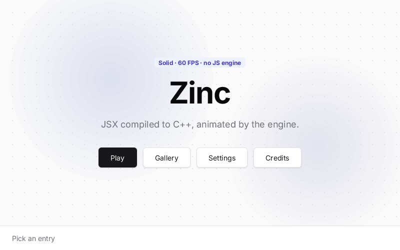
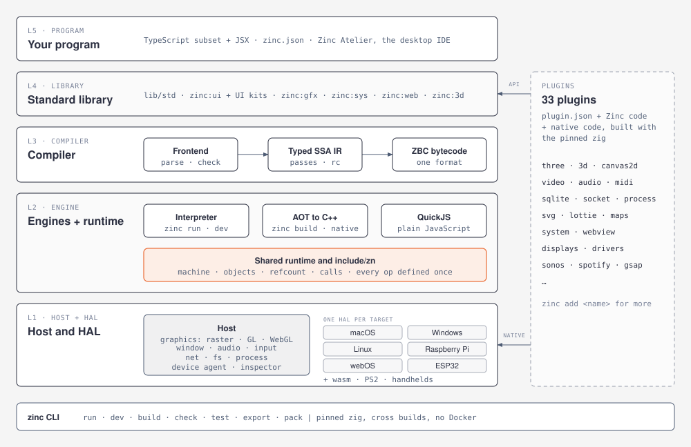
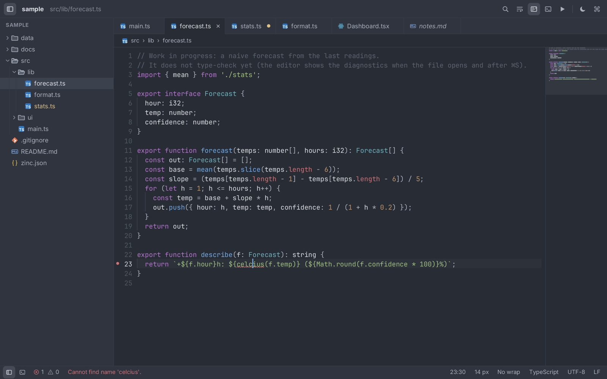
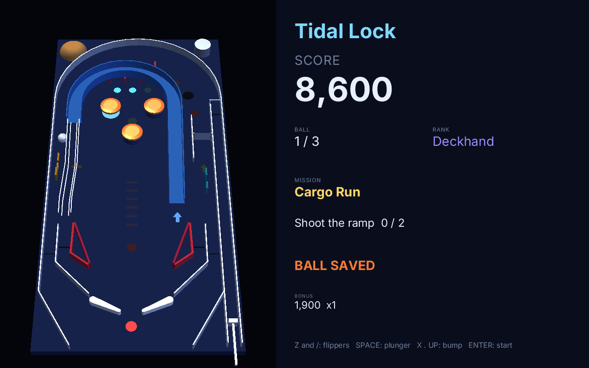
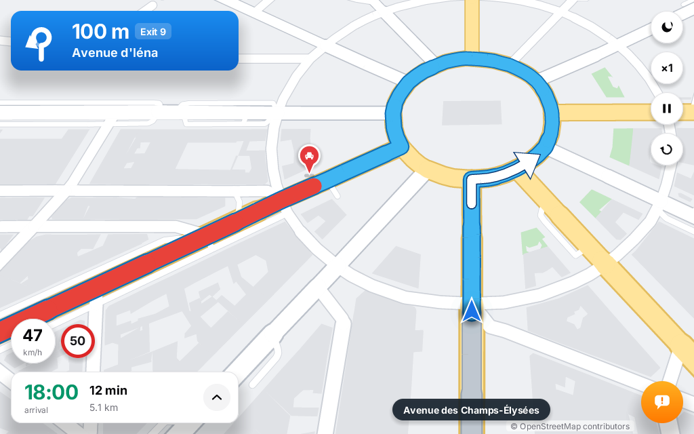
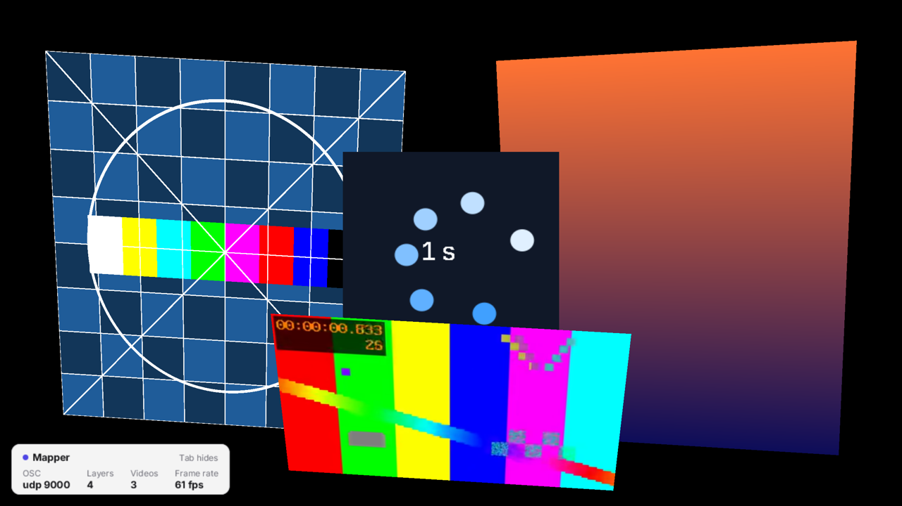
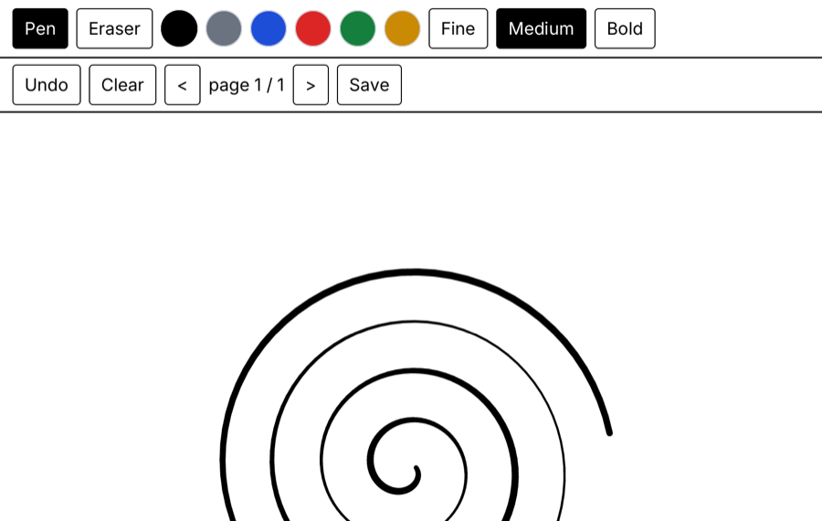
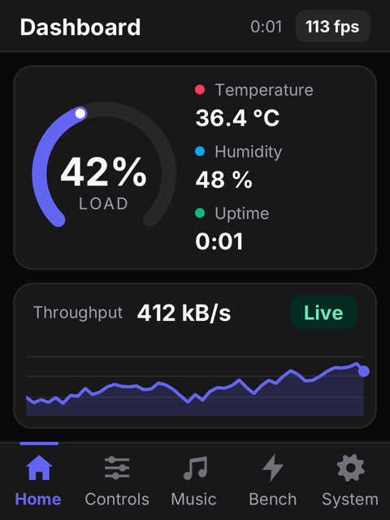
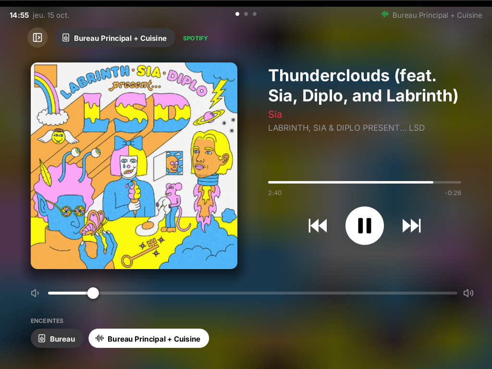

<div align="center">

# ⚡ Zinc

**Write it once in TypeScript. Run it natively everywhere, from a Mac to an ESP32.**

Desktop and mobile apps the way Electron makes them, without shipping a browser.<br>
UI, games, 3D, video and hardware, from one strict, typed subset of TypeScript and JSX.

[Architecture](#️-architecture) · [Quick start](#-quick-start) · [The CLI](#-the-cli) · [Demos](#-demos) · [Plugins](#-plugins) · [AI](#-a-note-on-ai) · [Guide](docs/guide/README.md)



</div>

> [!WARNING]
> **Zinc is under active construction. Nothing here is stable or final.**
> The language subset, the `zinc` CLI, the plugin ABI, the file formats, the APIs and the release packages change without notice and
> without a deprecation period, and a version may break what the previous one ran. Releases are early previews (`0.x`), not signed or
> notarized yet, and only macOS is built and tested today; other platforms are goals, not promises.
> Expect rough edges, missing documentation and failing tests. Do not build anything you cannot afford to rewrite on it yet.
> Feedback and bug reports are welcome in the [issues](../../issues).

## ✨ Why Zinc

- 🚀 **Native, not embedded.** Your program is interpreted while you work and compiled to C++ when you ship: one executable, no
  JavaScript engine or browser inside, a fast start on modest hardware.
- 🌍 **One program, every screen.** A Mac, Windows, Linux, every Raspberry Pi, a reMarkable, an HP TouchPad from 2011, an ESP32, a PS2.
- ⚡ **Fast Refresh.** `zinc dev` swaps each save into the running program: the window stays and so does the state (the page you were on,
  what you typed, the game round in progress). A save shows up in a fraction of a second, and nothing of it ends up in what you ship.
- 🧰 **Batteries included.** One `zinc` command builds, runs, debugs, tests, packages and flashes; cross builds need no Docker and no SDK.
- 🎨 **UI people already know.** Solid or React models, Tailwind-like classes, a shadcn-style kit, Nuxt UI 4 and React Native components,
  drawn by a GPU renderer that also runs on a Pi's VideoCore IV.
- 🔌 **Web APIs on real devices.** `fetch`, WebSocket, `crypto.subtle`, `localStorage`, and the battery, sensors, vibration, orientation and
  notifications of the device the program runs on.
- 📦 **50 plugins.** three.js, video, webcams, sound, MIDI, maps, physics, SQLite, Sonos, Spotify, AsyncStorage, and drivers for LED matrices,
  e-ink and OLED screens.

## 🏗️ Architecture

<p align="center"></p>

One program goes down the stack, and each layer only knows the one below it:

- **Core** (L3 and L2): the compiler turns your TypeScript into a typed IR and one bytecode (ZBC); the shared runtime and `include/zn` define every value and operation once, so every engine behaves the same, byte for byte.
- **Engines** (L2): the interpreter runs while you work (`zinc run`, `zinc dev`), the AOT compiler writes C++ for a native executable (`zinc build`), QuickJS runs plain JavaScript. Pick one, the program does not change.
- **Host and HAL** (L1): the host gives programs a screen, sound, network, files and an inspector; a thin HAL per target (macOS, Windows, Linux, Raspberry Pi, webOS, ESP32, the web...) is all that changes from one machine to the next.
- **Plugins** (side): a plugin is a `plugin.json`, some Zinc code and optional native code. Its Zinc side extends the standard library, its native side loads into the host; the engine itself stays small and agnostic.
- **Toolchain** (under everything): the `zinc` CLI and a pinned `zig` build, cross-compile and package, with no Docker and no SDK to install.

## 🚀 Quick start

From the sources (CMake 3.20+ and a C++20 compiler; every library is vendored, Node.js is not needed):

```sh
git clone https://github.com/Frulko/zinc && cd zinc/next
cmake -S . -B build -DCMAKE_BUILD_TYPE=Release && tools/build zinc
build/zinc doctor                             # what this machine can do
build/zinc new desktop-app ../my-app && cd ../my-app
../next/build/zinc dev                        # a window opens; edit, save: it updates and keeps its state
```

Or, from a release, nothing to compile: the `zinc` CLI on your `PATH` with one command (`-s -- --atelier` adds the Zinc Atelier app on a Mac):

```sh
curl -fsSL https://github.com/zinc-engine/zinc/releases/latest/download/install.sh | sh
```

Then `zinc update` installs each new release (`--check`, `--rollback`, `--channel beta`: [Updating](docs/guide/01-getting-started.md#updating)).

Each release has two downloads per Mac (arm64, Intel): `zinc-<version>-macos-<arch>.tar.gz`, the CLI, and
`Zinc-Atelier-<version>-macos-<arch>.zip`, the app ([docs/guide/07-distribution.md](docs/guide/07-distribution.md#the-two-downloads-of-a-release)).

A first app, step by step: [docs/guide/01-getting-started.md](docs/guide/01-getting-started.md).

## 🧑‍💻 The CLI

Everything goes through one command.

| I want to… | Command |
|---|---|
| start a project from one of 13 templates (game, 3D, dashboard, IoT, e-ink, service…) | `zinc new game my-game` |
| run it, with Fast Refresh and a DevTools inspector | `zinc run` · `zinc dev` |
| run plain JavaScript (three.js, PixiJS, Phaser) as it is | `zinc run app.js --engine quickjs` |
| set breakpoints in VS Code or Chrome | `zinc debug --dap` · `zinc debug --cdp` |
| understand an error | `zinc explain Z0104` |
| test on the interpreter, in native code, on QuickJS or a simulated device | `zinc test --runner aot` |
| try it on a device I do not have | `zinc run --simulate hp-touchpad` |
| build a native executable, for this machine or another | `zinc build` · `zinc build --target aarch64-linux` |
| flash a board | `zinc flash --target esp32` |
| drive a Pi or a Mac from my desk (shell, files, apps, logs) | `zinc agent` on it, `zinc device` here |
| ship a .app, a single executable or a `.zapp` | `zinc export` · `zinc pack` |
| publish a version and signed updates | `zinc publish` |
| add a plugin from the signed index | `zinc add <plugin>` |
| capture frames, measure speed | `zinc capture` · `zinc bench` |

<details>
<summary>🎯 Cross-build targets</summary>

`zinc build --target <target>` uses a pinned zig toolchain that `zinc toolchain` downloads:

| Target | Machines |
|---|---|
| `aarch64-macos` · `x86_64-macos` | Mac, Apple silicon and Intel |
| `x86_64-windows` | Windows 10 and 11 (console programs for now) |
| `x86_64-linux` | PCs and servers |
| `aarch64-linux` | Raspberry Pi 3, 4 and 5 (64-bit), reMarkable Paper Pro |
| `armhf-linux` | every 32-bit Raspberry Pi OS, Pi 1 and Zero included |
| `armv7-linux` | NTC CHIP and PocketCHIP |
| `armv7-webos` | HP TouchPad on webOS 3 |
| `esp32` | flashes the board, or runs it in Espressif's QEMU |

</details>

## 🎮 Demos

From a desktop app to a microcontroller, the same engine and the same language:

<table>
<tr>
<td width="33%"><br><b>A code editor, Zed style</b><br><code>zinc run examples/zed-editor</code></td>
<td width="33%"><br><b>A museum touch table</b><br><code>zinc run examples/museum-table</code></td>
<td width="33%"><br><b>3D pinball</b><br><code>zinc run examples/pinball3d</code></td>
</tr>
<tr>
<td><br><b>Offline GPS navigation</b><br><code>zinc run examples/maps/navigation</code></td>
<td><br><b>three.js, unmodified</b><br><code>zinc run examples/js-three</code></td>
<td><br><b>GPU video mapping</b><br><code>zinc run examples/video/mapper</code></td>
</tr>
<tr>
<td><br><b>e-ink notebook (reMarkable)</b><br><code>zinc run examples/remarkable/notes</code></td>
<td><br><b>A 2.2" ESP32 touch screen</b><br><code>zinc run examples/boards/esp32-2432s022</code></td>
<td><br><b>A Sonos remote on a 2011 tablet</b><br><code>examples/music/install.sh</code></td>
</tr>
</table>

More: `examples/hero` (a complete app), `examples/nuxt-ui`, `examples/rn-showcase`, `examples/js-phaser` (Phaser, unmodified),
`examples/leapmotion` (hand tracking games), `examples/hardware` (the device web APIs; try `--simulate hp-touchpad`).

## 🔌 Plugins

Plugins live in `plugins/`, one directory each, and are compiled into a program only when it imports them. **Native** ones hold C/C++
code or a library; **Zinc** ones are written in Zinc and run wherever the modules they use do. `zinc plugins` lists them for your project;
the guides are in [docs/plugins/](docs/plugins/). Abbreviations: Pi = Raspberry Pi, rM = reMarkable Paper Pro, Web = WebAssembly.

<details>
<summary><b>36 modules</b>: 3D, video, sound, maps, physics, storage, network, desktop, hardware</summary>

| Plugin | What it does | Code | Platforms |
|---|---|---|---|
| `zinc:3d` | 3D: meshes, materials, lights, camera, scene graph; software or GPU | Native | macOS, Linux, Pi, ESP32, Web |
| `three` | three.js API subset on `zinc:3d` (GLTFLoader, OrbitControls) | Native | macOS, Linux, Pi, Web |
| `zinc:canvas` | HTML Canvas 2D-style context | Native | macOS, Linux, Pi, rM, Web, ESP32 |
| `zinc:svg` | SVG rendered at run time | Native | macOS, Linux, Pi, Web |
| `zinc:lottie` | Lottie animations, `<Lottie/>` | Native | macOS, Linux, Pi, rM, Web, PS2, ESP32 |
| `zinc:map` | Vector maps (Mapbox tiles, MapLibre styles) | Native | macOS, Linux, Pi |
| `zinc:mapping` | GPU video mapping (warp, masks, blends) driven by OSC | Native | macOS, Pi |
| `zinc:video` | Video: FFmpeg (VideoToolbox, V4L2), GStreamer and the hardware decoder on webOS | Native | macOS, Linux, Pi, webOS |
| `zinc:audio` | Sounds and music (WAV, FLAC, MP3, Ogg) on miniaudio | Native | macOS, Linux |
| `zinc:midi` | MIDI in and out (RtMidi) | Native | macOS, Linux |
| `zinc:osc/full` | Open Sound Control over UDP | Zinc | macOS, Linux, Pi, rM |
| `zinc:physics2d` | 2D physics (Box2D 3.1) | Native | macOS, Linux |
| `zinc:physics3d` | 3D physics (Jolt 5.6) | Native | macOS, Linux |
| `zinc:gestures` | Pan, pinch, rotate, tap | Zinc | macOS, Linux, Pi, Web, ESP32, PS2 |
| `zinc:ink` | Handwriting: pressure, eraser, SVG/JSON export | Zinc | macOS, Linux, Pi, Web, rM |
| `zinc:sprite` | Sprite animations from packed atlases | Zinc | macOS, Linux, Pi, Web, ESP32, PS2 |
| `zinc:tilemap` | Tiled and LDtk levels | Zinc | macOS, Linux, Pi, Web, ESP32, PS2 |
| `zinc:pixelfont` | 5x7 and 3x5 bitmap fonts for LED matrices | Zinc | macOS, Linux, Pi, ESP32, Web, PS2 |
| `zinc:loader` | Loading screens (bar, splash, `<Loader>`) | Zinc | macOS, Linux, Pi, Web, ESP32, PS2 |
| `zinc:sqlite` | SQLite 3.53 databases | Native | macOS, Linux, Pi, rM |
| `gsap` | GSAP's core API in typed Zinc (tweens, timelines, eases, staggers), compiled by `zinc build`; the whole library runs on the QuickJS engine | Zinc | macOS, Linux, Windows, Pi, rM, webOS, Web, ESP32 |
| `zinc:async-storage` | React Native's AsyncStorage on `zinc:storage` | Zinc | macOS, Linux, Windows, Pi, rM, webOS, ESP32 |
| `zinc:socket` | TCP, UDP and Unix sockets, DNS, WebSocket client and server | Native | macOS, Linux, Pi, rM |
| `zinc:process` | Child processes (args, streams, kill) | Native | macOS, Linux, Pi |
| `zinc:ffi` | C functions of shared libraries (libffi) | Native | macOS, Linux |
| `zinc:script` | Sandboxed JavaScript at run time (QuickJS-ng) | Native | macOS, Linux, Pi, rM |
| `zinc:wasm` | WebAssembly on wasm3 | Native | macOS, Linux, Pi, rM |
| `zinc:system` | Desktop integration: notifications, menus, tray, dialogs, shortcuts, clipboard | Native | macOS, Linux |
| `zinc:webview` | Embedded web views (WKWebView), Tauri-like messages | Native | macOS |
| `zinc:devtools` | UI inspector for Chrome DevTools | Native | macOS, Linux, Pi |
| `zinc:serial` | Serial ports (Arduino and other boards) | Native | macOS, Linux |
| `zinc:camera` | Webcams and built-in cameras: frames as an image, snapshots, a fake camera (AVFoundation, V4L2) | Native | macOS, Linux, Pi |
| `zinc:gphoto2` | Camera remote control over USB (libgphoto2) | Native | macOS, Linux, Pi |
| `zinc:leapmotion` | Ultraleap hand tracking (LeapC) | Native | macOS |
| `zinc:imu` | QMI8658 motion sensor | Native | ESP32, macOS, Linux |
| `zinc:device` | Board services: backlight, chip, heap | Native | ESP32, macOS, Linux |
| `zinc:remarkable` | reMarkable status bar (clock, battery, exit) | Native | rM, macOS, Linux |
| `zinc:remote` | View and drive a `display-remote` app | Native | macOS, Linux, Pi |
| `zinc:webos` | webOS services (Luna bus through PDL), root helper, notifications | Native | macOS, Linux |
| `zinc:sonos` | Sonos speakers (UPnP): rooms, groups, playback, volume, radios | Zinc | macOS, Linux, Pi, rM |
| `zinc:spotify` | Spotify Web API: paged lists, search, playback | Zinc | macOS, Linux, Pi, rM |

</details>

<details>
<summary><b>9 display drivers</b>: GPU, framebuffer, e-ink, LCD, OLED, LED matrices</summary>

| Plugin | What it does | Platforms |
|---|---|---|
| display-gl | GPU screen: OpenGL (SDL3) on macOS, KMS/EGL/GLES 2 on Pi and Linux, GLES 2 through Palm's SDL on webOS | macOS, Pi, Linux, webOS |
| display-webos | First TouchPad driver: SDL 1.2, software frames, multitouch | Linux |
| display-fbdev | Linux framebuffer (`/dev/fb0`) with keyboard, mouse and touch | Linux, Pi |
| display-remote | Headless: streams frames over TCP to `zinc:remote` viewers | macOS, Linux, Pi |
| display-rmpp | reMarkable Paper Pro e-ink, pen and touch | rM (emulated on macOS, Linux) |
| display-st7789 | ST7789 and ILI9341 LCDs over SPI, CST820 touch | ESP32, macOS |
| display-ssd1306 | SSD1306 OLEDs over I2C | ESP32, Pi, Linux, macOS |
| display-ws2812 | WS2812 (NeoPixel) LED matrices | ESP32, Pi, Linux, macOS |
| display-scrollphat | Pimoroni Scroll pHAT (11x5 LEDs) over I2C | Pi, Linux, macOS |

</details>

Sonos, Spotify and `zinc:webos` also run on the TouchPad (`examples/music`), though their manifests do not list `webos` yet; Windows is
declared by `async-storage` only and not yet proven anywhere.

## 🤖 A note on AI

Zinc has been a project of several years, and of many failures: attempts that went nowhere, designs that had to be thrown away. It
exists today thanks to intensive help from AI. A large part of the code, tests and documentation of Zinc Next was written with AI
coding agents, working through a backlog of precise tasks under rules a person sets and checks: [AGENTS.md](AGENTS.md) and
[next/RULES.md](next/RULES.md) are the instructions they follow. The direction, the design choices and the tests on real hardware stay
human. Mistakes remain possible; every behaviour is meant to be proven by a test, and reports of what is wrong are welcome.

## 📚 Documentation

- 📖 [Developer guide](docs/guide/README.md): getting started, language, UI apps, services, plugins, testing, distribution, security, web APIs
- 🎨 UI: [ui](docs/ui.md), [kit](docs/ui-kit.md), [Nuxt UI](docs/nuxt-ui.md), [React Native](docs/react-native.md) · 🎯 [targets](docs/targets/) · 🔧 [boards](docs/boards.md)
- 🛠 Working on Zinc: [AGENTS.md](AGENTS.md), [architecture](next/ARCHITECTURE.md), [rules](next/RULES.md), [testing](next/TESTING.md),
  [decisions](docs/reports/zinc-next-decisions.md), [performance log](docs/reports/zinc-next-perf.md), [hardware notes](docs/reports/hardware/)
- 🧪 [The prototype](docs/prototype.md): the first generation (TypeScript to C++17 on Node), kept as the specification

<details>
<summary>🗂 Repository layout</summary>

```
next/        Zinc Next: src/ (frontend, ir, zbc, vm, aot, rt, host, qjs, gl, text, tc, dev, lsp), include/zn, tests/, tools/, backlog/, app/
lib/         the standard library in Zinc (std/, the UI kits), shared by both generations; zinc.d.ts
plugins/     optional modules and display drivers, one directory each (plugin.json)
examples/    the demos every engine must run unchanged
templates/   the projects of `zinc new`
targets/, boards/, devices/   target capabilities, board presets, simulated devices
docs/        guides, plugin and target docs, reports, decisions
compiler/, runtime/, sim/, docker/   the prototype
apps/studio, integrations/, site/    ZincStudio, Figma and reMarkable integrations, the web site
```

</details>
