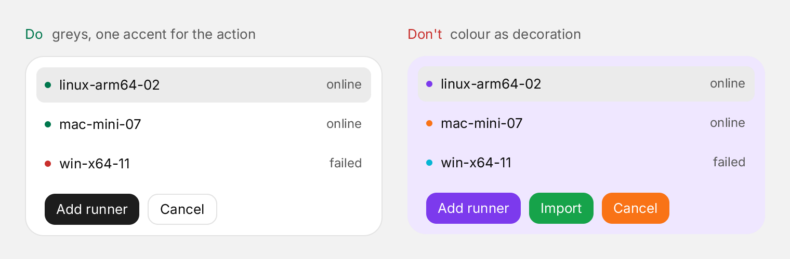
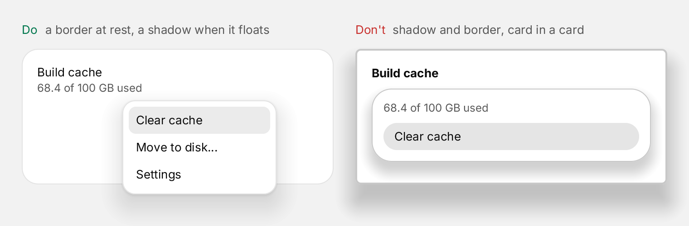
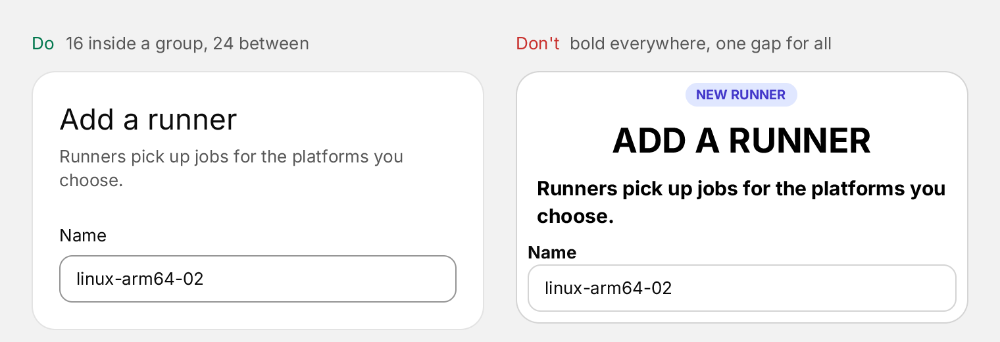
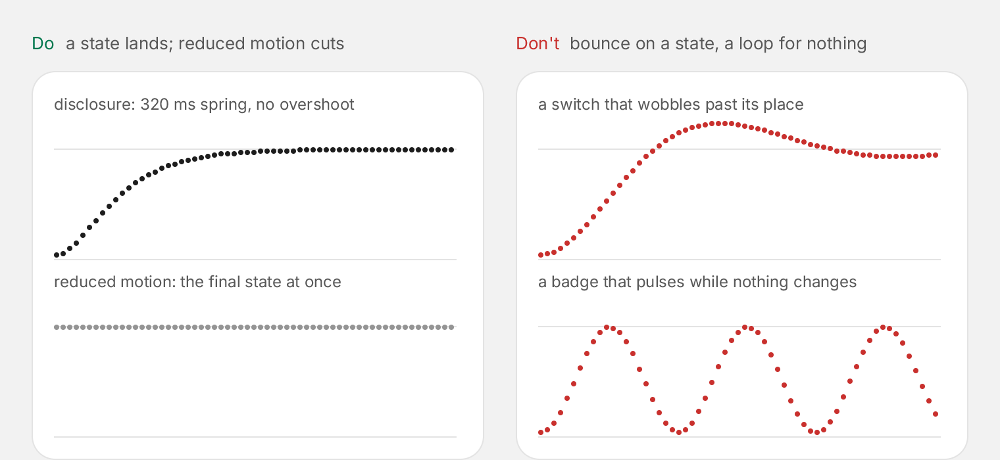
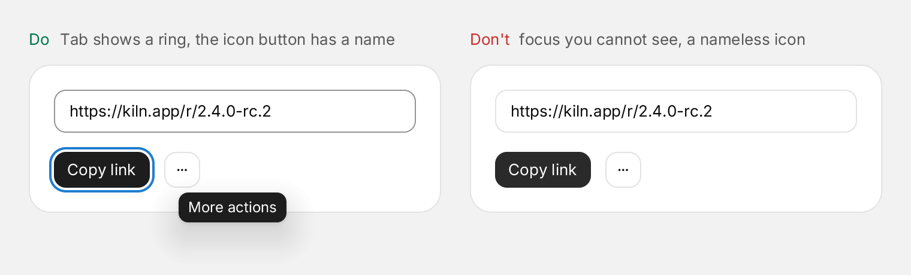

# Design principles

The rules every new demo, app and template of Zinc follows (owner, 2026-11-09; "Design" in `AGENTS.md`). They are
taken from [CUI](https://github.com/yappologistic/CUI)'s `docs/design.md` (MIT, © its authors): its rules and its token
values, mapped onto `zinc:ui` classes and the kit's theme roles. The kit's Quiet theme carries them, so a screen built
from kit components and theme roles follows them without hand-picked values.

The pictures below are drawn by Zinc: `docs/img/design/src` is the program, one picture per run
(`PICTURE=accent ZINC_HEADLESS=1 ZINC_SCALE=2 ZINC_SIZE=760x250 ZINC_FRAMES=2 ZINC_SHOT=docs/img/design/accent.png zinc run docs/img/design/src`).

## 1. Neutral surfaces, one accent

- Most of the screen is grey. The accent is spent with intent: the primary action, the selected item, the one series
  that matters, progress, focus.
- Status colours mean status: green for success, amber for attention, red for failure, always with a label or an icon,
  never as decoration. A dot means a state (online, unread, failed), not a decoration on a tag.
- Use the theme's roles, never raw colours, so the screen works in light and dark and with any accent.

| Role (kit `theme()`) | Used for | Quiet light / dark |
|---|---|---|
| `background` | the page | `#f2f2f2` / `#121212` |
| `card` | cards, panels, menus | `#ffffff` / `#181818` |
| `foreground`, `mutedForeground` | text, secondary text | `#0b0b0b`, `#585858` / `#f2f2f2`, `#b4b4b4` |
| `primary`, `primaryForeground` | the solid button, a switch that is on | `#1d1d1d` on white / `#e8e8e8` on `#141414` |
| `accent`, `accentSoft` | the accent and its tint (selection) | follows the accent (neutral, violet, blue, green, amber, orange, coral, rose) |
| `success`, `destructive`, `warningSoftForeground` | status only | `#00774d`, `#c9302d`, `#9f6202` / `#55d69f`, `#f2716c`, `#f2bd68` |

In classes: `bg-${theme().card}`, `text-${theme().mutedForeground}`, `border-${theme().border}`.

## 2. Hairline borders, shadows only on what floats

- Group by proximity first, a hairline second, a card only for a real boundary. No card inside a card.
- Cards rest on a 1 px border and cast no shadow. Only floating layers cast one: menus, popovers, dialogs, toasts,
  tooltips. An edge or a shadow for what rests on the page, never both.
- A field, a checkbox or a radio is marked only by its edge, so that edge is 3:1 against the surface (`input` role);
  a button or a chip is marked by its label, so its edge is a quiet hairline (`border` role).
- In dark mode depth comes from lightness: the page is the darkest level, each layer above it a step lighter
  (`#121212`, `#181818`, `#1f1f1f`).
- Corners are concentric: an inner radius is the outer radius minus the padding between them. Controls 10 px, panels
  (menus, popovers) 14 px with items of 8 px inside a 6 px padding, surfaces (cards, dialogs) 18 px. Fully round only
  for what is round by nature: switches, slider thumbs, avatars, chips, progress bars.

| Token | Value | Classes |
|---|---|---|
| hairline | 1 px, `#e3e3e3` / `#2b2b2b` | `border border-${theme().border}` |
| control edge (3:1) | `#949494` / `#676767` | `border border-${theme().input}` |
| radius control / panel / surface | 10 / 14 / 18 px | `rounded-[10px]`, `rounded-[14px]`, `rounded-[18px]` |
| floating shadow, light | 0 12 32 -4 at 12 %, 0 1 3 at 6 % | `shadow-[0_12px_32px_-4px_rgba(0,0,0,0.12),0_1px_3px_rgba(0,0,0,0.06)]` |
| floating shadow, dark | 0 14 36 -4 at 40 %, 0 1 3 at 24 % | the same with `dark:` |

## 3. Type and spacing

- Inter for the interface. Two weights: regular and medium; hierarchy comes from size, colour and spacing, not bold.
- Sizes: 11, 12, 13 (body), 15; headings 36, 28, 22, 17. Sentence case for every label; no upper-case eyebrow or pill
  above a heading to restate it.
- Numbers that change or align use tabular figures (`tabular-nums`); loading states keep their size.
- A 4 px grid: 16 inside a group, 24 between regions, 32 to 48 between sections. Controls are 30, 36 or 44 px tall;
  button padding 11 / 14 / 18 px by size, field padding 12 px. Left aligned by default; centre only what is alone.
- Margins tighten on small screens (16 px instead of 24 to 40); type and control sizes do not.

| Token | Value | Classes |
|---|---|---|
| body, small, caption | 13, 12, 11 px | `text-[13px]`, `text-[12px]`, `text-[11px]` |
| headings | 36, 28, 22, 17 px, medium | `heading(1..4)` of the kit under the Quiet theme |
| control heights | 30 / 36 / 44 px | the kit's `Button size="sm" / default / "lg"` |
| spacing | 4 px grid | `gap-4` inside, `gap-6` between, `gap-8` to `gap-12` between sections |

## 4. Motion explains what changed

- Motion shows cause and effect: what opened, what changed, where it came from. No decoration loops, no pulse on
  what is not changing, no bounce on routine dialogs.
- Everything is a spring, so everything is interruptible. A spring is a period and a bounce (the damping ratio is
  1 − bounce), as SwiftUI's and CUI's: smooth (400 ms, 0), snappy (260 ms, 0.12), morph (420 ms, 0.16).
- What reports a state lands without overshoot (switch thumbs, progress, panel heights); small feedback has a little
  life (presses scale to 0.97, 0.98 for wide rows and cards). Nothing grows on hover.
- One duration per job: a row following the pointer 100 ms; hover colour 140 ms; focus ring 140 ms; a check or
  switch 180 ms; a disclosure 320 ms; a popover or menu 280 ms from 96 % rising 6 px; a dialog 340 ms; any layer
  leaving 160 ms (exits are faster than entrances). Disabled is one opacity everywhere: 45 %.
- Every animation has a reduced-motion path that keeps the final state and the feedback:
  `ui.prefersReducedMotion()` (the OS's setting, `reducemotion 1` as a system signal) turns a move into a cut or a
  short fade.

## 5. Every control from the keyboard

- Every action works with the keyboard: Tab and Shift-Tab move, Enter and Space act, arrows move inside a group,
  Escape closes the latest layer.
- Focus rings appear for keyboard focus, never for clicks (`focus-visible:`); a clicked control keeps the focus, so
  the next key shows the ring and acts. The ring is 2 px, 2 px outside the control, in the accent's focus colour
  (`ring-2 ring-offset-2`); never remove it (`outline-none`) without drawing another.
- An icon-only button has a tooltip: it is its name (`Tooltip label=...` of the kit).
- Prefer changing a control in place ("Saved") to a toast for the result of a press; toasts are for background events.

## What generic looks like

Defaults nobody chose read as generic. Screens built with Zinc stay clear of them:

- No purple-to-blue gradients, neon, glow halos or coloured blur behind content; depth comes from surface levels.
- Headings and numbers are one solid colour; text on a coloured surface is tinted toward it, never grey on colour.
- No decorative grid or dot backgrounds, no rows of identical icon-tile cards: a list looks like a list.
- No sparkles as a default icon, no emoji in place of icons; monospace only for code and aligned technical data.
  Icons come in even sizes matching the text: 12, 14, 16, 18.
- Charts: no gradient under a line; a change names its baseline ("+2 this week"); its colour says good or bad, not up
  or down.
- Words: a button is a verb and an object ("Create project", not "Submit"); example content is specific and plausible.
- One value per axis on a screen: one radius scale, one accent, one icon set, one spacing scale, one set of springs.
