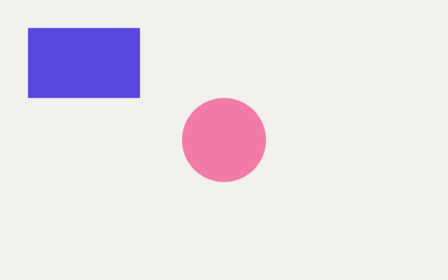

# 1. A window and a shape

**What you will see:** a window with a light background, a purple rectangle in the top left corner and a pink circle in
the middle.



## The code

A Zinc program is a folder with two files. The project is in
[`samples/01-window-and-shape`](samples/01-window-and-shape/).

`zinc.json` describes the project:

```json
{
  "name": "window-and-shape",
  "entry": "src/main.ts",
  "app": { "id": "com.example.learn.shape", "window": { "width": 640, "height": 400 } }
}
```

`src/main.ts` is the program:

```ts
import { onFrame, clear, rect, rrect, width, height } from 'zinc:gfx';

console.log(`The window is ${width()} by ${height()} pixels.`);

onFrame((dt: number) => {
  clear(0xf3f1ec);
  rect(40, 40, 160, 100, 0x5746e0);
  rrect(width() / 2 - 60, height() / 2 - 60, 120, 120, 60, 0xf27aa6, 255);
});
```

Run it:

```sh
zinc run docs/learn/samples/01-window-and-shape
```

The window opens and the terminal shows `The window is 640 by 400 pixels.`

## Line by line

**`zinc.json`**

- `"name"`: the name of the program. The window's title uses it.
- `"entry"`: the file where the program starts.
- `"app"`: about the app. `"id"` is a name no other app uses, written backwards like a web address (`com.example...`).
  `"window"` gives the size of the window in pixels: 640 wide, 400 tall.

**`src/main.ts`**

- `import { onFrame, clear, rect, rrect, width, height } from 'zinc:gfx';`
  Zinc comes with modules: sets of ready-made functions. `zinc:gfx` is the one that draws. This line takes six of its
  functions so the program can use them. You only import what you use.
- `console.log(...)` prints a line in the terminal. Between the backquotes, `${width()}` is replaced by the value of
  `width()`: the width of the window, 640. Printing is the easiest way to see what your program is doing.
- `onFrame((dt: number) => { ... });`
  This is the heart of the program. You give `onFrame` a function (the part from `(dt: number) =>` to the closing `}`).
  Zinc calls it for every frame, about 60 times a second, as often as the screen refreshes. Each call draws the whole
  picture again. Here the picture never changes, so you see a still image; the next lesson makes it move.
  `dt` is the time since the last frame. `: number` says that `dt` is a number: Zinc checks the types of your values
  before the program runs.
- `clear(0xf3f1ec);` paints the whole window with one colour. Colours are numbers written `0xRRGGBB`: two digits for red,
  two for green, two for blue, from `00` (none) to `ff` (full). `0xf3f1ec` is a warm light grey. It is the same code as
  `#f3f1ec` on the web, with `0x` in front instead of `#`.
- `rect(40, 40, 160, 100, 0x5746e0);` draws a filled rectangle. The numbers are, in order: x, y, width, height, colour.
  x counts pixels from the left edge of the window, y counts pixels down from the top edge. So the top left corner of
  this rectangle is 40 pixels from the left and 40 from the top, and it is 160 wide and 100 tall.
- `rrect(width() / 2 - 60, height() / 2 - 60, 120, 120, 60, 0xf27aa6, 255);` draws a rectangle with rounded corners.
  After x, y, width and height come the radius of the corners (60) and the colour, then the opacity: 255 is solid,
  0 is invisible, 128 is half see-through. A square of 120 with corners of 60 (half its size) is a circle.
  `width() / 2` is the middle of the window; minus 60 (half the circle) puts the circle's centre exactly there.

The order of the drawing calls matters: what is drawn later covers what was drawn before. That is why `clear` comes first.

## Try this

- Change the colour of the background to `0x1c1b20` (almost black).
- Move the rectangle to the bottom right corner. Hint: `width() - 200` is 200 pixels from the right edge.
- Make the circle bigger (remember: the radius is half the size). Then give it a width of 200 and keep the rest: it
  becomes a pill.
- Give the circle an opacity of 128 and move it over the rectangle to see through it.
- Add `line(0, 0, width(), height(), 0x1d1b18);` (add `line` to the import line): a thin line across the window.
- Change the window size in `zinc.json`. The circle stays in the middle because the code uses `width()` and `height()`.

## Next

[2. Colours and movement](02-colours-and-movement.md): make things move, smoothly, at the same speed on every machine.
