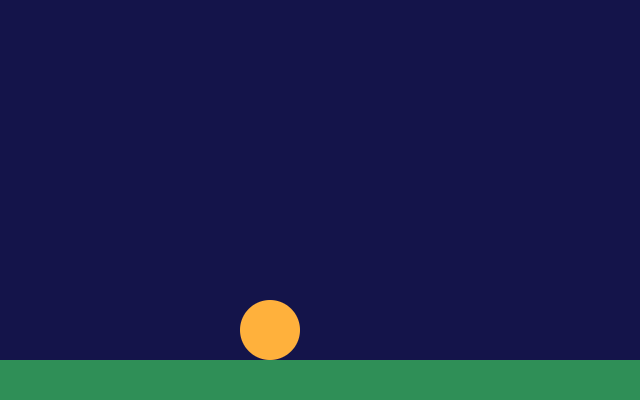

# 2. Colours and movement

**What you will see:** an orange ball rolls along green grass from left to right, comes back on the left when it leaves
the window, and the sky slowly turns from dark blue to violet and back.



## The code

The project is in [`samples/02-colours-and-movement`](samples/02-colours-and-movement/); its `zinc.json` is the one of
lesson 1 with another name. `src/main.ts`:

```ts
import { onFrame, clear, rrect, rect, width, height } from 'zinc:gfx';

function rgb(red: number, green: number, blue: number): u32 {
  return Math.round(red) * 65536 + Math.round(green) * 256 + Math.round(blue);
}

const SPEED = 160;   // pixels per second
const SIZE = 60;
let x = 0;           // the left edge of the ball
let time = 0;        // seconds since the start
let told = false;

onFrame((dt: number) => {
  time += dt;
  x += SPEED * dt;
  if (x > width()) x = -SIZE;

  if (!told && time >= 1) {
    console.log(`After ${time.toFixed(2)} seconds the ball is at x = ${Math.round(x)}.`);
    told = true;
  }

  const glow = (Math.sin(time * 2) + 1) / 2;   // goes from 0 to 1 and back, again and again
  clear(rgb(20, 20, 40 + 60 * glow));
  rect(0, height() - 40, width(), 40, 0x2f8f57);
  rrect(x, height() - 40 - SIZE, SIZE, SIZE, SIZE / 2, rgb(255, 120 + 100 * glow, 60), 255);
});
```

After one second the terminal shows `After 1.00 seconds the ball is at x = 160.` (on your machine the numbers can be a
little different, as the next part explains).

## How movement works

A film is a series of still pictures shown quickly. A program does the same: on each frame it draws a picture where the
ball is a little further. To move the ball you change a number (`x`) and draw the ball at `x`.

How far should the ball go on each frame? Not a fixed number of pixels: a fast screen shows 120 frames a second, a slow
machine 30, and the ball would roll four times faster on one than on the other. Instead you give a speed in pixels per
**second** and multiply it by `dt`, the time since the last frame, in seconds. At 60 frames a second `dt` is about
0.0167, so the ball moves 160 × 0.0167 ≈ 2.7 pixels per frame; at 30 frames a second it moves twice as far each frame, but
twice as rarely. Either way it covers 160 pixels in one second.

## Line by line

- `function rgb(red: number, green: number, blue: number): u32 { ... }` makes a function of your own. It takes three
  numbers from 0 to 255 and returns the colour they make. `: u32` says it returns a whole number that cannot be
  negative: the type of colours in `zinc:gfx`.
- `Math.round(red) * 65536 + Math.round(green) * 256 + Math.round(blue)` builds the colour number. `0xRRGGBB` is red
  times 65536, plus green times 256, plus blue: `rgb(255, 0, 0)` is `0xff0000`, pure red. `Math.round` turns
  `127.6` into `128`, because each part must be a whole number.
- `const SPEED = 160;` a value that never changes is a `const`. Writing it in capitals is a habit that says "a setting".
  The comment after `//` is for people; Zinc ignores it.
- `let x = 0;` a value that changes is a `let`. `x` is where the ball is; `time` counts the seconds since the start;
  `told` remembers whether the program already printed its line.
- `time += dt;` adds the time of this frame to `time`. `x += SPEED * dt;` moves the ball by its speed times the time.
- `if (x > width()) x = -SIZE;` when the ball has left the window on the right, put it back just outside on the left.
- `if (!told && time >= 1) { ... }` runs once: when one second has passed and nothing was printed yet (`!told` means
  "told is false"). `time.toFixed(2)` writes the number with two digits after the point.
- `const glow = (Math.sin(time * 2) + 1) / 2;` `Math.sin` goes smoothly from -1 to 1 and back, forever. Adding 1 and
  dividing by 2 makes it go from 0 to 1 instead. `time * 2` makes it go twice as fast. This is the easiest way to make
  something pulse, sway or breathe.
- `clear(rgb(20, 20, 40 + 60 * glow));` the sky: its blue goes from 40 to 100 as `glow` goes from 0 to 1.
- `rect(0, height() - 40, width(), 40, 0x2f8f57);` the grass: a green band 40 pixels tall at the bottom.
- `rrect(x, height() - 40 - SIZE, SIZE, SIZE, SIZE / 2, rgb(255, 120 + 100 * glow, 60), 255);` the ball, sitting on the
  grass. Its colour goes from orange to yellow with `glow`.

## Try this

- Make the ball go twice as fast. Then make it go backwards: a negative speed (and change the `if` so it comes back on
  the right).
- Make it bounce: keep a speed `vy` for up and down, add `vy += 900 * dt` each frame (gravity), `y += vy * dt`, and when
  the ball touches the grass, `vy = -vy * 0.8`.
- Make the ball spin around the middle of the window: `const bx = width() / 2 + Math.cos(time) * 100` and
  `const by = height() / 2 + Math.sin(time) * 100`.
- Use `rgb` for the grass too, and make it change colour with the time of day: a full day in 20 seconds.
- Draw ten balls in a loop: `for (let i = 0; i < 10; i++) { ... }`, each one a little later than the one before.

## Next

[3. The keyboard](03-keyboard.md): move a square with the arrow keys.
