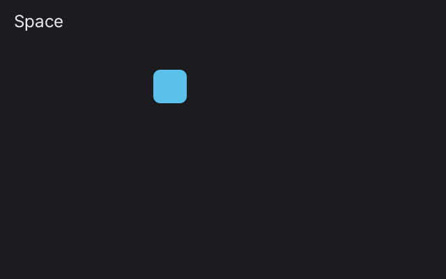

# 3. The keyboard

**What you will see:** a square you move with the arrow keys. Space changes its colour. The name of the last key you
pressed shows in the top left corner.



## The code

The project is in [`samples/03-keyboard`](samples/03-keyboard/). `src/main.ts`:

```ts
import { onFrame, clear, rrect, font, drawText, width, height, isDown, wasPressed, Btn, keyCount, keyKind, keyName, KeyKind } from 'zinc:gfx';

const SPEED = 240;   // pixels per second
const SIZE = 48;
let x = 100, y = 100;
let color: u32 = 0xe8b06a;
let lastKey = 'Press a key';
const label = font('sans', 24);

onFrame((dt: number) => {
  // 1. Keys held down: ask every frame.
  if (isDown(Btn.Left)) x -= SPEED * dt;
  if (isDown(Btn.Right)) x += SPEED * dt;
  if (isDown(Btn.Up)) y -= SPEED * dt;
  if (isDown(Btn.Down)) y += SPEED * dt;
  x = Math.max(0, Math.min(width() - SIZE, x));
  y = Math.max(0, Math.min(height() - SIZE, y));

  // 2. A key pressed this frame (not held since before).
  if (wasPressed(Btn.A)) color = color === 0xe8b06a ? 0x5bc0eb : 0xe8b06a;

  // 3. Every key that went down since the last frame, by name.
  for (let i = 0; i < keyCount(); i++) {
    if (keyKind(i) === KeyKind.Down) {
      lastKey = keyName(i) === ' ' ? 'Space' : keyName(i);
      console.log(`key "${lastKey}", the square is at x = ${Math.round(x)}`);
    }
  }

  clear(0x1c1b20);
  rrect(x, y, SIZE, SIZE, 10, color, 255);
  drawText(label, 20, 16, lastKey, 0xeceaf0, 255, 0);
});
```

Press keys: the terminal shows each one, for example `key "a", the square is at x = 220`.

## Two ways to read the keyboard

**Ask, every frame: is this key held down?** `isDown(Btn.Left)` is `true` while the key is held. This is what games use
to move things: as long as you hold the arrow, the square moves a little on every frame. `zinc:gfx` names a small set of
buttons, the ones of a game controller, so the same code works with a keyboard, a gamepad or the buttons of a handheld:

| Button | Keys on a keyboard |
|---|---|
| `Btn.Up`, `Btn.Down`, `Btn.Left`, `Btn.Right` | the arrows, or W, S, A, D |
| `Btn.A` | Space or Z |
| `Btn.B`, `Btn.X`, `Btn.Y` | X, C, V |
| `Btn.L`, `Btn.R` | Q, E |
| `Btn.Start`, `Btn.Select` | Enter, Tab |

**Read the list of keys pressed since the last frame.** Each key that goes down, comes up or repeats (held long enough
to type again) is an event with a name: `'a'`, `'1'`, `' '` (Space), `'Enter'`, `'Escape'`, `'ArrowLeft'`, `'F5'`...
This is the way to read any key, letters included, and nothing is missed even when two keys come in the same frame.

## Line by line

- `import { ... } from 'zinc:gfx';` new this time: `font` and `drawText` (lesson 5 explains them), `isDown`,
  `wasPressed` and `Btn` for the game buttons, `keyCount`, `keyKind`, `keyName` and `KeyKind` for the key events.
- `let x = 100, y = 100;` where the square is. `let color: u32 = 0xe8b06a;` its colour, a `u32` like every colour.
- `let lastKey = 'Press a key';` the text shown in the corner. Words between quotes are a `string`.
- `const label = font('sans', 24);` a font, asked once at the start: the family `'sans'` at 24 pixels.
- `if (isDown(Btn.Left)) x -= SPEED * dt;` while Left is held, move left. Up is `y -= ...` because y grows downwards.
- `x = Math.max(0, Math.min(width() - SIZE, x));` keeps the square inside the window. `Math.min(a, b)` is the smaller
  of the two, `Math.max(a, b)` the larger: together they keep `x` between 0 and `width() - SIZE`.
- `if (wasPressed(Btn.A)) color = ...;` `wasPressed` is `true` only on the frame where the button goes down, not while
  it stays down. Holding Space changes the colour once, not 60 times a second.
- `color === 0xe8b06a ? 0x5bc0eb : 0xe8b06a` reads "if the colour is orange, then blue, else orange". `===` compares,
  `? :` picks one of two values.
- `for (let i = 0; i < keyCount(); i++) { ... }` goes through the key events of this frame, from the first (number 0)
  to the last.
- `if (keyKind(i) === KeyKind.Down)` keeps only the keys going down. The others are `KeyKind.Up` (released),
  `KeyKind.Repeat` (held, typing again) and `KeyKind.Text` (typed text, when a text field asked for it).
- `lastKey = keyName(i) === ' ' ? 'Space' : keyName(i);` the key's name. The name of Space is a space, which you
  would not see on screen, so the program writes `Space` instead. Names do not change with Shift: Shift+A is still `'a'`.
- `drawText(label, 20, 16, lastKey, 0xeceaf0, 255, 0);` writes `lastKey` at (20, 16) in light grey.

## Try this

- Make Shift go faster: `import { modifiers, Mod }` and `const fast = (modifiers() & Mod.Shift) !== 0;`.
- Make Enter (`Btn.Start`) put the square back in the middle.
- Count the keys pressed and show the count under the name.
- Draw the square bigger while Space is held (`isDown(Btn.A)`), and smaller when it is released.
- Make the square wrap around: when it leaves on the right, it comes back on the left, as in lesson 2.
- Escape closes a `zinc:gfx` program (or leaves full screen). To use Escape yourself, call `escapeByApp(true)` once.

## Next

[4. The mouse and touch](04-mouse-and-touch.md): draw with the mouse or a finger.
