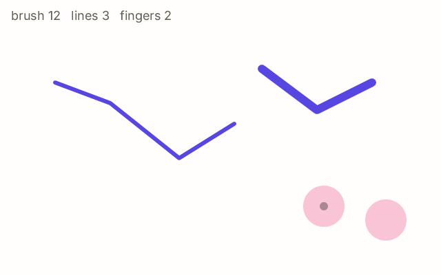

# 4. The mouse and touch

**What you will see:** a page you draw on. Press and move the mouse (or a finger on a touch screen) to draw a line. The
wheel makes the brush thicker or thinner, the right button wipes the page, and each finger on a touch screen shows a
pink ring.



## The code

The project is in [`samples/04-mouse-and-touch`](samples/04-mouse-and-touch/). `src/main.ts`:

```ts
import { onFrame, clear, stroke, rrect, font, drawText, pointerX, pointerY, pointerDown, pointerButtons, wheel, touchCount, touchX, touchY } from 'zinc:gfx';

const lines: number[][] = [];   // every line drawn so far, as points: [x0, y0, x1, y1, ...]
const sizes: number[] = [];     // the brush size of each line
let brush = 6;
let wasDown = false;
const label = font('sans', 18);

onFrame((dt: number) => {
  const x = pointerX(), y = pointerY(), down = pointerDown();

  if (down && !wasDown) {                       // just pressed: start a new line
    lines.push([x, y]);
    sizes.push(brush);
    console.log(`pressed at ${Math.round(x)}, ${Math.round(y)}`);
  } else if (down) {                            // still pressed: add a point, if the pointer moved
    const line = lines[lines.length - 1];
    if (x !== line[line.length - 2] || y !== line[line.length - 1]) {
      line.push(x);
      line.push(y);
    }
  } else if (wasDown) {                         // just released
    console.log(`released at ${Math.round(x)}, ${Math.round(y)}: ${lines.length} line(s)`);
  }
  wasDown = down;

  if ((pointerButtons() & 2) !== 0) {           // the right button wipes the page
    lines.splice(0, lines.length);
    sizes.splice(0, sizes.length);
  }
  if (wheel() !== 0) {                          // the wheel changes the brush
    brush = Math.max(2, Math.min(40, brush + wheel() * 2));
    console.log(`brush ${brush}`);
  }

  clear(0xfffefc);
  for (let i = 0; i < lines.length; i++) stroke(lines[i], sizes[i], 0x5746e0, 255, false);
  for (let i = 0; i < touchCount(); i++) {      // one ring under each finger on a touch screen
    rrect(touchX(i) - 30, touchY(i) - 30, 60, 60, 30, 0xf27aa6, 110);
  }
  rrect(x - brush / 2, y - brush / 2, brush, brush, brush / 2, 0x1d1b18, 90);
  drawText(label, 16, 12, `brush ${brush}   lines ${lines.length}   fingers ${touchCount()}`, 0x625d55, 255, 0);
});
```

Draw: the terminal shows where you pressed and released, for example `pressed at 80, 120`, then
`released at 340, 180: 1 line(s)`.

## The pointer

`zinc:gfx` calls the mouse the **pointer**. On a touch screen the first finger is the pointer too, so the same code works
with a mouse, a trackpad, a stylus or a finger:

| Function | Gives |
|---|---|
| `pointerX()`, `pointerY()` | where the pointer is, in pixels from the top left corner of the window |
| `pointerDown()` | `true` while the main button (or a finger) is down |
| `pointerButtons()` | every button held: 1 left, 2 right, 4 middle, added together |
| `wheel()` | how many steps the wheel turned in this frame: more than 0 up, less than 0 down |
| `touchCount()` | how many fingers touch the screen; `touchX(i)`, `touchY(i)` where finger `i` is |

There is no "click" function: a click is the moment `pointerDown()` becomes `true`. The program finds it by remembering
the value of the frame before, in `wasDown`.

## Line by line

- `const lines: number[][] = [];` every line drawn so far. One line is a list of numbers, `[x0, y0, x1, y1, ...]`
  (`number[]`), so all the lines are a list of lists (`number[][]`). It starts empty: `[]`.
- `const sizes: number[] = [];` the brush size of each line, in the same order.
- `const x = pointerX(), y = pointerY(), down = pointerDown();` reads the pointer once at the top of the frame.
- `if (down && !wasDown)` down now and not before: the button was just pressed. `lines.push([x, y])` adds a new line
  that starts here; `push` adds at the end of a list.
- `else if (down)` still down: the pointer is dragging. `lines[lines.length - 1]` is the last line, the one being drawn.
  Its last point is `line[line.length - 2]`, `line[line.length - 1]`; the new point is added only if the pointer moved.
- `else if (wasDown)` up now, down before: the button was just released.
- `wasDown = down;` remembers this frame's value for the next frame.
- `if ((pointerButtons() & 2) !== 0)` is the right button held? `&` keeps the part of the number that is 2: it is not
  0 when the right button is among the buttons held. `splice(0, lines.length)` empties a list.
- `brush + wheel() * 2` each step of the wheel changes the brush by 2 pixels, kept between 2 and 40.
- `stroke(lines[i], sizes[i], 0x5746e0, 255, false);` draws a line through all the points of a list, with round ends.
  The arguments: the points, the thickness, the colour, the opacity, and `false` for an open line (`true` would join the
  last point back to the first).
- `for (let i = 0; i < touchCount(); i++)` one ring per finger, see-through (opacity 110 of 255).
- The last `rrect` is a small dark dot that follows the pointer, as big as the brush.
- `drawText(...)` shows the brush size, the number of lines and the number of fingers.

## Try this

- Give each line its own colour: keep a list of colours like `sizes`, and pick a new colour at each press.
- Make the middle button (4) undo the last line: `lines.pop()` and `sizes.pop()`.
- Draw with all fingers at once: one line per finger, using `touchId(i)` to know which finger is which from one frame to
  the next.
- Add `closed` shapes: draw the line with `true` as the last argument and see it close.
- Draw a soft dot at every point instead of a line: `rrect` with a low opacity, for a spray paint.
- Fast strokes with a stylus: `penCount()`, `penX(i)`, `penY(i)` and `penPressure(i)` give every sample of the pen since
  the last frame, with its pressure from 0 to 1 (the [reference](../reference/gfx.md#input) lists them).

## Next

[5. Text and images](05-text-and-images.md): write words and show pictures.
