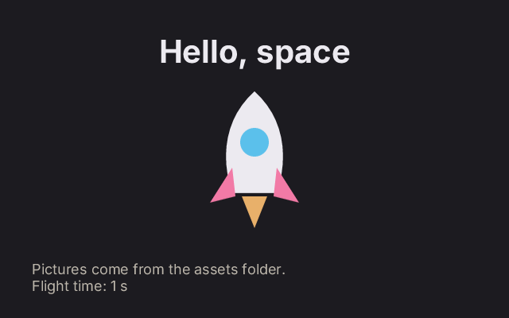

# 5. Text and images

**What you will see:** a title in the middle at the top, a rocket that bobs up and down, and two lines of smaller text
at the bottom, one of them counting the seconds.



## The code

The project is in [`samples/05-text-and-images`](samples/05-text-and-images/). It has a third part: an `assets` folder
with the picture, `rocket.svg`. `zinc.json` names that folder:

```json
{
  "name": "text-and-images",
  "entry": "src/main.ts",
  "assets": "assets",
  "app": { "id": "com.example.learn.text", "window": { "width": 640, "height": 400 } }
}
```

`src/main.ts`:

```ts
import { onFrame, clear, font, drawText, textWidth, lineHeight, image, imageWidth, imageHeight, drawImage, width, height } from 'zinc:gfx';

const title = font('sans-bold', 40);
const body = font('sans', 18);
const rocket = image('rocket.svg');   // the file assets/rocket.svg

console.log(`The rocket picture is ${imageWidth(rocket)} by ${imageHeight(rocket)} pixels.`);

let time = 0;

onFrame((dt: number) => {
  time += dt;
  clear(0x1c1b20);

  // A title in the middle: measure it, then start half of what is left from the left edge.
  const words = 'Hello, space';
  const w = textWidth(title, words, 0);
  drawText(title, (width() - w) / 2, 40, words, 0xeceaf0, 255, 0);

  // Two lines of smaller text, one under the other.
  const left = 40;
  let y = height() - 2 * lineHeight(body) - 30;
  drawText(body, left, y, 'Pictures come from the assets folder.', 0xbcb6ab, 255, 0);
  y += lineHeight(body);
  drawText(body, left, y, `Flight time: ${Math.floor(time)} s`, 0xbcb6ab, 255, 0);

  // The picture, bobbing up and down, drawn at twice its size.
  const size = imageWidth(rocket) * 2;
  const bob = Math.sin(time * 3) * 10;
  drawImage(rocket, (width() - size) / 2, height() / 2 - size / 2 + bob, size, size, 255, 0);
});
```

The terminal shows `The rocket picture is 96 by 96 pixels.`

## Fonts

Before writing, you ask for a font: a family and a size in pixels, once, at the start. Zinc gives back a number that
stands for that font, and every text call uses that number. The families that come with Zinc:

| Family | Looks like |
|---|---|
| `'sans'` | plain letters (Inter) |
| `'sans-bold'` | the same, bold |
| `'mono'` | every letter as wide as the others, for code (JetBrains Mono) |

A font of your own: put a `.ttf` file in `assets` and ask `loadFont('MyFont.ttf', 32)`.

## Line by line

- `const title = font('sans-bold', 40);` a bold font, 40 pixels tall. `body` is a plain one at 18.
- `const rocket = image('rocket.svg');` a picture from the `assets` folder, by its file name. PNG and SVG work. Like a
  font, you get a number that stands for the picture. If the file is missing, the number is `-1` and nothing is drawn.
- `imageWidth(rocket)`, `imageHeight(rocket)`: the size of the picture, in pixels.
- `const w = textWidth(title, words, 0);` how wide the words will be in that font, before drawing them. The last
  argument is extra space between letters, 0 for none.
- `drawText(title, (width() - w) / 2, 40, words, 0xeceaf0, 255, 0);` writes the words. The arguments: the font, x and
  y of the top left corner of the text, the words, the colour, the opacity, the extra space between letters.
  `(width() - w) / 2` centres the text: what is left of the width, split in two, on each side.
- `lineHeight(body)` is the height of one line in that font, with the space between lines. The program starts two lines
  and a margin above the bottom, then goes down one line height for the second line.
- `` `Flight time: ${Math.floor(time)} s` `` builds the text on each frame. `Math.floor` drops what is after the point,
  so the number changes once a second.
- `drawImage(rocket, x, y, size, size, 255, 0);` draws the picture into a box: x, y, width, height, opacity, and the
  radius of rounded corners (0: square corners). The box is twice the picture's size, so it is drawn twice as big. An SVG
  picture is a drawing, not dots, so it stays sharp.
- `Math.sin(time * 3) * 10` makes the rocket go 10 pixels up and down, three times faster than a second.

## Try this

- Write your name under the title, centred too.
- Make the title fade in: an opacity of `Math.min(255, time * 100)`.
- Write a long sentence and wrap it yourself: split it into words, measure each with `textWidth`, and start a new line
  when the next word does not fit (Atelier's *Text* example does this).
- Draw the rocket smaller, many times, at random places: `Math.random() * width()`. Pick the places once, before
  `onFrame`, or they jump on every frame.
- Draw your own picture in any vector editor (Inkscape, Figma), export it as SVG into `assets`, and show it.
- Turn the rocket with the arrow keys: `drawImageRect` takes a rotation (the [reference](../reference/gfx.md#images)
  shows how).

## Next

[6. Sound](06-sound.md): play notes.
