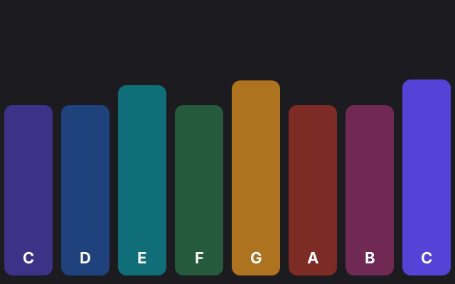

# 6. Sound

**What you will see (and hear):** eight coloured bars, one per note of a scale. Click a bar, or press a key from 1 to 8,
and its note plays while the bar lights up and grows.



## The code

The project is in [`samples/06-sound`](samples/06-sound/). `src/main.ts`:

```ts
import { tone } from 'zinc:audio';
import { onFrame, clear, rrect, font, drawText, textWidth, width, height, pointerX, pointerDown, keyCount, keyKind, keyName, KeyKind } from 'zinc:gfx';

const NAMES = ['C', 'D', 'E', 'F', 'G', 'A', 'B', 'C'];
const HERTZ = [261.6, 293.7, 329.6, 349.2, 392.0, 440.0, 493.9, 523.3];   // how fast the air shakes, per second
const COLORS: u32[] = [0x5746e0, 0x2563c9, 0x0e7c86, 0x2f8f57, 0xb7791f, 0xcf3a2b, 0xb5357d, 0x5746e0];

const notes = HERTZ.map((hz: number) => tone(hz, 0.5, 'triangle'));   // made once, played many times
const glow: number[] = HERTZ.map((hz: number) => 0);                   // 1 just after a note, then fades to 0
const label = font('sans-bold', 22);
let wasDown = false;

function play(i: number): void {
  notes[i].play();
  glow[i] = 1;
  console.log(`play ${NAMES[i]} (${HERTZ[i]} Hz)`);
}

onFrame((dt: number) => {
  const bar = width() / NAMES.length;

  if (pointerDown() && !wasDown) play(Math.min(NAMES.length - 1, Math.floor(pointerX() / bar)));
  wasDown = pointerDown();

  for (let k = 0; k < keyCount(); k++) {   // the keys 1 to 8 play too
    const n = parseInt(keyName(k));
    if (keyKind(k) === KeyKind.Down && n >= 1 && n <= 8) play(n - 1);
  }

  clear(0x1c1b20);
  for (let i = 0; i < NAMES.length; i++) {
    glow[i] = Math.max(0, glow[i] - dt * 2);
    const tall = height() * 0.6 + glow[i] * 40;
    rrect(i * bar + 6, height() - tall - 12, bar - 12, tall, 12, COLORS[i], Math.round(140 + 115 * glow[i]));
    drawText(label, i * bar + (bar - textWidth(label, NAMES[i], 0)) / 2, height() - 50, NAMES[i], 0xffffff, 255, 0);
  }
});
```

Click the third bar: you hear an E and the terminal shows `play E (329.6 Hz)`.

## Making a sound

The module `zinc:audio` plays sound. `tone(hz, seconds, wave)` makes a sound from nothing:

- `hz` is the pitch: how many times per second the air shakes. 440 is the A that orchestras tune to; twice as many (880)
  is the same note one octave higher.
- `seconds` is how long it lasts.
- `wave` is the shape of the sound: `'sine'` (soft, a flute), `'triangle'` (a little brighter), `'square'` (an old video
  game), `'sawtooth'` (buzzing), `'noise'` (a hiss, for drums and wind).

`tone` gives back a sound you can play as often as you like with `play()`. Each `play()` starts a new copy, so a note
pressed twice quickly plays twice, overlapping. To play a recording instead, put a WAV, MP3, OGG or FLAC file in the
`assets` folder and use `load('coin.wav')` in place of `tone`.

A program run without a window, as the tests run it, is silent: every call works and nothing is heard.

## Line by line

- `import { tone } from 'zinc:audio';` one function of the sound module. The two `import` lines can come in any order.
- `const NAMES = [...]`, `HERTZ`, `COLORS`: three lists of the same length, one entry per bar. The notes C, D, E, F, G,
  A, B, C are a major scale; the last C is one octave above the first (523.3 is about twice 261.6).
- `const COLORS: u32[] = [...]` a list of colours: `u32[]` is "a list of u32".
- `const notes = HERTZ.map((hz: number) => tone(hz, 0.5, 'triangle'));` `map` makes a new list by calling a function on
  each entry: here, one sound of half a second per pitch. The sounds are made once, at the start, not on every click.
- `const glow: number[] = HERTZ.map((hz: number) => 0);` a list of eight zeros: how lit each bar is.
- `function play(i: number): void { ... }` plays note number `i`, lights its bar and prints it. `: void` means it gives
  nothing back. Both the click and the keys call it, so the code is written once.
- `const bar = width() / NAMES.length;` the width of one bar: the window split in eight.
- `if (pointerDown() && !wasDown) play(...)` a new press, as in lesson 4. `Math.floor(pointerX() / bar)` turns the
  pointer's x into a bar number: 0 for the first bar, 7 for the last. `Math.min(NAMES.length - 1, ...)` makes sure it is
  never 8, even at the very right edge.
- `const n = parseInt(keyName(k));` turns the key's name into a number: `'5'` becomes `5`. A key that is not a digit
  (`'a'`) gives `NaN` ("not a number"), which is neither `>= 1` nor `<= 8`, so it plays nothing.
- `play(n - 1)` key 1 plays bar 0: lists count from 0.
- `glow[i] = Math.max(0, glow[i] - dt * 2);` each bar's light fades by 2 per second: from 1 to 0 in half a second.
- `const tall = height() * 0.6 + glow[i] * 40;` a lit bar is up to 40 pixels taller.
- `Math.round(140 + 115 * glow[i])` the opacity: 140 at rest, 255 when just played.
- The last `drawText` writes the note's name, centred in its bar as in lesson 5.

## Try this

- Change the wave to `'square'`, then `'sine'`. Which one do you like?
- Play a chord: a press plays three notes at once (bars `i`, `i + 2` and `i + 4`).
- Make a sound louder or softer: `notes[i].volume = 0.3;` before `play()`. `pan` moves it left (-1) or right (1).
- Record a sound with your phone, save it as `assets/clap.wav`, and play it with `load('clap.wav').play()` when Space is
  pressed.
- Play a melody: a list of bar numbers, and a timer in `onFrame` that plays the next one every half second.
- Every function of `zinc:audio` (loops, volume, files, sounds computed sample by sample) is in [the audio
  plugin's page](../plugins/audio.md).

## Next

Part 2 starts: [7. Components](07-components.md), an interface made of boxes, text, a picture and a button.
