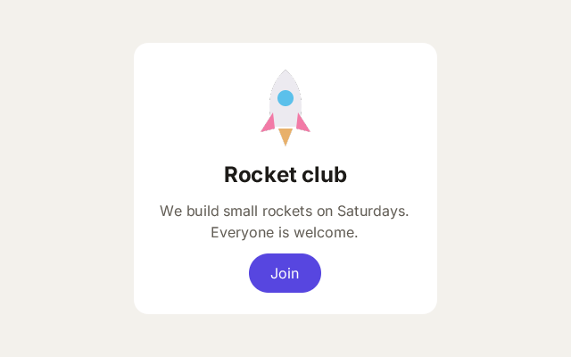

# 7. Components

**What you will see:** a white card in the middle of the window, with a rocket, a title, a sentence and a purple *Join*
button. Clicking the button prints a line.



## A new way to put things on screen

In part 1 your program drew every frame itself: it had to say where each thing goes, in pixels. For an app (a form, a
list, settings) that is a lot of work: text must wrap, things must line up, the window can change size.

`zinc:ui` does that work. You describe what the screen holds, once, as **elements** inside other elements, the way a web
page is written. Zinc lays them out, draws them, and draws them again when something changes. The description uses
**JSX**: tags like HTML, inside the code.

## The code

The project is in [`samples/07-components`](samples/07-components/). The code is in `src/main.tsx`: the `x` of `.tsx`
says the file holds JSX. `zinc.json` names it as the entry and has an `assets` folder for the picture:

```json
{
  "name": "components",
  "entry": "src/main.tsx",
  "assets": "assets",
  "app": { "id": "com.example.learn.components", "window": { "width": 640, "height": 400 } }
}
```

`src/main.tsx`:

```tsx
import { render } from 'zinc:ui/solid';

function App(): i32 {
  return <View className="w-full h-full items-center justify-center">
    <View className="w-[340px] p-6 gap-3 items-center rounded-2xl bg-white">
      <Image src="rocket.svg" className="w-24 h-24" />
      <Text className="text-2xl font-bold text-[#1d1b18]">Rocket club</Text>
      <Text className="text-base text-center text-[#625d55]">We build small rockets on Saturdays. Everyone is welcome.</Text>
      <Button className="h-11 px-6 rounded-full bg-[#5746e0]" onClick={() => console.log('Welcome aboard!')}>
        <Text className="text-base font-medium text-white">Join</Text>
      </Button>
    </View>
  </View>;
}

render(App, 0xf3f1ec, null);
```

Click *Join*: the terminal shows `Welcome aboard!`

## The elements

Zinc's elements start with a capital letter, as in React Native:

| Element | What it is |
|---|---|
| `View` | a box. It holds other elements and places them; it can have a background, a border, rounded corners. |
| `Text` | words. Text always goes inside a `Text`. |
| `Image` | a picture from the `assets` folder: `src="rocket.svg"`. |
| `Button` | something to press: it holds a `Text` (or an icon) and runs `onClick` when pressed. |
| `ScrollView` | a box whose content scrolls when it is too long. |
| `Input`, `TextArea` | a field to type one line, or several (lesson 12 uses `Input`). |
| `Canvas` | a box you draw in with `zinc:gfx` (lesson 11). |

Two rules of spelling, checked by Zinc: elements start with a capital letter (`<View>`), and the look of an element
goes in `className` (the shorter word is a keyword of JavaScript, so Zinc refuses it).

## How they are laid out

A `View` places its children one under the other, from the top. `className` says how:

- `w-full h-full`: as wide and as tall as its parent (here the whole window).
- `items-center`: the children are centred across (left to right, in a column).
- `justify-center`: the children are centred along (top to bottom, in a column).
- `w-[340px]`: exactly 340 pixels wide. Square brackets hold an exact value.
- `p-6`: space inside the box, on all sides. The numbers of `p-`, `gap-`, `w-`, `h-` count steps of 4 pixels: `p-6` is
  24 pixels, `gap-3` is 12.
- `gap-3`: 12 pixels between the children.

There is more on styles in lesson 10.

## Line by line

- `import { render } from 'zinc:ui/solid';` `render` puts an interface on the screen. The elements themselves
  (`View`, `Text`...) need no import.
- `function App(): i32 { return <View ...>...</View>; }` a **component**: a function that returns elements. `App` is
  the whole interface. Its type is `i32` (a whole number) because Zinc names each element it creates with a number; you
  never need to look at that number.
- `<View className="w-full h-full items-center justify-center">` the outer box fills the window and centres what it
  holds: the card.
- `<View className="w-[340px] p-6 gap-3 items-center rounded-2xl bg-white">` the card: 340 pixels wide, 24 pixels of
  padding, 12 pixels between its children, centred children, very rounded corners (`rounded-2xl`), a white background.
  Its height is not given: it is as tall as its content.
- `<Image src="rocket.svg" className="w-24 h-24" />` the picture, 96 by 96 pixels. `/>` closes an element that holds
  nothing.
- `<Text className="text-2xl font-bold text-[#1d1b18]">Rocket club</Text>` a title: large (`text-2xl`), bold, almost
  black. `text-[#1d1b18]` is an exact colour, written as on the web.
- `<Text className="text-base text-center text-[#625d55]">...` a sentence in the normal size, centred, grey. It is longer
  than the card is wide, so it wraps onto two lines by itself.
- `<Button className="h-11 px-6 rounded-full bg-[#5746e0]" onClick={() => console.log('Welcome aboard!')}>` a button 44
  pixels tall, with 24 pixels of padding on the left and right (`px-6`), round ends, purple. `onClick={...}` gives it a
  function to run when it is pressed: the braces `{ }` put code inside JSX. Lesson 9 is about events.
- `render(App, 0xf3f1ec, null);` shows `App` in the window. The second argument is the window's background colour (a
  number, as in part 1). The third is a function to run on every frame; `null` means none.

## Try this

- Change the title and the sentence. Make the sentence longer and watch it wrap.
- Put the picture after the button. The order of the elements is the order on screen.
- Add `flex-row` to the card's `className`: the children go side by side instead.
- Make the card wider (`w-[480px]`), or remove `w-[340px]` to see what the card does without a width.
- Add a second button next to the first: wrap the two in `<View className="flex-row gap-3">...</View>`.
- Make your own component: `function Title(): i32 { return <Text className="text-3xl">Hi</Text>; }`, then write
  `<Title />` inside `App`.

## Next

[8. State](08-state.md): an interface that changes when a value changes.
