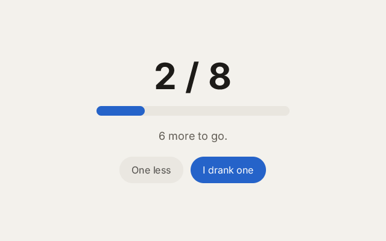

# 8. State

**What you will see:** a counter of glasses of water, a blue bar that grows with it, a sentence that changes, and two
buttons, *One less* and *I drank one*.



## The code

The project is in [`samples/08-state`](samples/08-state/). `src/main.tsx`:

```tsx
import { createSignal, render } from 'zinc:ui/solid';

const GOAL = 8;
const [glasses, setGlasses] = createSignal<i32>(0);

function drink(by: i32): void {
  const next = glasses() + by;
  if (next < 0 || next > GOAL) return;
  setGlasses(next);
  console.log(`glasses: ${glasses()}`);
}

function message(): string {
  if (glasses() === 0) return 'Time for a glass of water.';
  if (glasses() < GOAL) return `${GOAL - glasses()} more to go.`;
  return 'Goal reached. Well done!';
}

function App(): i32 {
  return <View className="w-full h-full items-center justify-center gap-5">
    <Text className="text-6xl font-bold text-[#1d1b18]">{`${glasses()} / ${GOAL}`}</Text>
    <View className="w-[320px] h-4 rounded-full bg-[#e9e6df]">
      <View className="h-4 rounded-full bg-[#2563c9]" style={{ width: glasses() * 40 }} />
    </View>
    <Text className="text-lg text-[#625d55]">{message()}</Text>
    <View className="flex-row gap-3">
      <Button className="h-11 px-5 rounded-full bg-[#e9e6df]" onClick={() => drink(-1)}>
        <Text className="text-base text-[#1d1b18]">One less</Text>
      </Button>
      <Button className="h-11 px-5 rounded-full bg-[#2563c9]" onClick={() => drink(1)}>
        <Text className="text-base text-white">I drank one</Text>
      </Button>
    </View>
  </View>;
}

render(App, 0xf3f1ec, null);
```

Click *I drank one* three times, then *One less*: the terminal shows `glasses: 1`, `glasses: 2`, `glasses: 3`,
`glasses: 2`, and the screen follows each click.

## Signals: values the screen follows

The `App` function runs **once**, when the interface is built. If `glasses` were a plain variable (`let glasses = 0`),
changing it later would change nothing on screen: the text was already made.

A **signal** is a value that the interface follows. `createSignal` gives you two functions:

- `glasses()` reads the value. Any part of the interface that reads it (a text, a style, a class) remembers that it did.
- `setGlasses(3)` changes the value. Every part that read it is updated, and only those parts.

This is the whole idea of state in `zinc:ui`: keep what can change in signals, read them where they are shown, and
change them in your event handlers. The screen follows by itself.

## Line by line

- `import { createSignal, render } from 'zinc:ui/solid';` `zinc:ui/solid` works like [Solid](https://www.solidjs.com),
  a web library: signals and components that run once. (`zinc:ui/react` works like React instead; these lessons use
  Solid.)
- `const GOAL = 8;` the number of glasses to drink, a plain constant: it never changes.
- `const [glasses, setGlasses] = createSignal<i32>(0);` a signal that holds a whole number (`<i32>`), starting at 0.
  `createSignal` returns two things; the square brackets name them, in order: the reader and the writer.
- `function drink(by: i32): void { ... }` adds `by` (1 or -1) to the count. `if (next < 0 || next > GOAL) return;`
  stops there when the count would go below 0 or above 8 (`||` means "or"). Then `setGlasses(next)` changes the value
  and the screen follows.
- `function message(): string { ... }` picks a sentence from the count. It is a plain function, but it reads
  `glasses()`, so a text that shows `message()` follows the signal too.
- `<Text ...>{`${glasses()} / ${GOAL}`}</Text>` the big number. Code inside a text goes between `{ }`; here a template
  string with the count and the goal.
- `<View className="w-[320px] h-4 rounded-full bg-[#e9e6df]">` the empty bar: 320 pixels wide, a light grey.
- `<View className="h-4 rounded-full bg-[#2563c9]" style={{ width: glasses() * 40 }} />` the blue part inside it.
  `style={{ ... }}` sets a style from a value: its width is 40 pixels per glass, so 8 glasses fill the 320. It reads
  `glasses()`, so it grows when the signal changes. (The double braces are a JavaScript object `{ width: ... }` inside
  the `{ }` of JSX.)
- `<Text ...>{message()}</Text>` the sentence, updated with the count.
- `onClick={() => drink(-1)}` and `onClick={() => drink(1)}`: each button calls `drink` with its own step.

## Try this

- Change the goal to 6. The bar is now too short when full: make its width `glasses() * (320 / GOAL)`.
- Add a *Reset* button that calls `setGlasses(0)`.
- Make the number turn green when the goal is reached: `className={...}` can read signals too, as lesson 10 shows. Try
  `className={glasses() === GOAL ? 'text-6xl font-bold text-emerald-600' : 'text-6xl font-bold text-[#1d1b18]'}`.
- Add a second signal, `cups` of tea, with its own buttons and its own line.
- Print the count with `console.log` inside `message()`, and watch when it runs: once at the start, then only when the
  count changes, never on the frames in between.

## Next

[9. Events](09-events.md): clicks are one kind of event; there are presses, moves, hovers and keys too.
