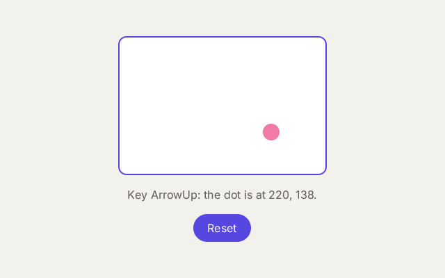

# 9. Events

**What you will see:** a white box with a pink dot. Press in the box and the dot jumps there; drag and it follows; the
arrow keys move it; the box's border turns purple while the pointer is over it. A sentence says what happened, and a
*Reset* button puts the dot back in the middle.



## The code

The project is in [`samples/09-events`](samples/09-events/). `src/main.tsx`:

```tsx
import { createSignal, render } from 'zinc:ui/solid';
import * as ui from 'zinc:ui';

const [dotX, setDotX] = createSignal<number>(150);
const [dotY, setDotY] = createSignal<number>(100);
const [pressed, setPressed] = createSignal<boolean>(false);
const [over, setOver] = createSignal<boolean>(false);
const [news, setNews] = createSignal<string>('Press in the box, drag, or use the arrow keys.');

function moveTo(x: number, y: number): void {
  setDotX(Math.max(0, Math.min(300, x)));
  setDotY(Math.max(0, Math.min(200, y)));
}

function down(e: ui.PointerEvent): void {
  setPressed(true);
  moveTo(e.x, e.y);
  setNews(`Pressed at ${Math.round(e.x)}, ${Math.round(e.y)} inside the box.`);
  console.log(news());
}

function drag(e: ui.PointerEvent): void {
  if (pressed()) moveTo(e.x, e.y);
}

function up(e: ui.PointerEvent): void {
  setPressed(false);
  setNews(`Let go at ${Math.round(e.x)}, ${Math.round(e.y)}.`);
  console.log(news());
}

ui.onKey((e: ui.KeyEvent) => {
  if (e.key === 'ArrowLeft') moveTo(dotX() - 10, dotY());
  else if (e.key === 'ArrowRight') moveTo(dotX() + 10, dotY());
  else if (e.key === 'ArrowUp') moveTo(dotX(), dotY() - 10);
  else if (e.key === 'ArrowDown') moveTo(dotX(), dotY() + 10);
  else return;
  e.preventDefault();   // this key is used: it does not also move the keyboard focus
  setNews(`Key ${e.key}: the dot is at ${dotX()}, ${dotY()}.`);
  console.log(news());
});

function reset(): void {
  moveTo(150, 100);
  setNews('Back to the middle.');
  console.log(news());
}

function App(): i32 {
  return <View className="w-full h-full items-center justify-center gap-4">
    <View className={`w-[300px] h-[200px] rounded-xl bg-white border-2 ${over() ? 'border-[#5746e0]' : 'border-[#e9e6df]'}`}
      onPointerDown={down} onPointerMove={drag} onPointerUp={up}
      onPointerEnter={(e: ui.PointerEvent) => setOver(true)} onPointerLeave={(e: ui.PointerEvent) => setOver(false)}>
      <View className="absolute w-6 h-6 rounded-full bg-[#f27aa6]" style={{ left: dotX() - 12, top: dotY() - 12 }} />
    </View>
    <Text className="text-base text-[#625d55]">{news()}</Text>
    <Button className="h-10 px-5 rounded-full bg-[#5746e0]" onClick={reset}>
      <Text className="text-base text-white">Reset</Text>
    </Button>
  </View>;
}

render(App, 0xf3f1ec, null);
```

Press in the box near its top left corner, drag, let go, press the left arrow: the terminal shows
`Pressed at 30, 28 inside the box.`, `Let go at 230, 148.`, `Key ArrowLeft: the dot is at 220, 148.`

## What an event is

An **event** is something that happens: a press, a move, a key. You give an element a function for an event, in an
attribute whose name starts with `on`; Zinc calls the function when the event happens on that element.

| Attribute | When it runs | The function gets |
|---|---|---|
| `onClick` | the element was pressed and released (mouse, finger, or Enter and Space when it has the keyboard focus) | nothing |
| `onPointerDown` | a button or a finger goes down on the element | a `PointerEvent` |
| `onPointerMove` | the pointer moves over it; after a press on it, everywhere until the release | a `PointerEvent` |
| `onPointerUp` | the button or the finger comes up, after a press on the element | a `PointerEvent` |
| `onPointerEnter`, `onPointerLeave` | the pointer comes over the element, or leaves it | a `PointerEvent` |
| `onKeyDown` | a key goes down while the element (or one inside it) has the keyboard focus | a `KeyEvent` |

A `PointerEvent` says where: `e.x` and `e.y` are measured **from the top left corner of the element**, not of the window
(`e.gx`, `e.gy` are from the window's corner). It also says which button (`e.button`: 0 left, 1 middle, 2 right) and
which keys were held (`e.shift`, `e.ctrl`, `e.alt`, `e.meta`). Every event and what it gives is listed in
[the zinc:ui events reference](../reference/ui-events.md); there are also taps, long presses, drags and pinches.

## Line by line

- `import * as ui from 'zinc:ui';` takes the whole `zinc:ui` module under the name `ui`: the types `ui.PointerEvent` and
  `ui.KeyEvent` and the function `ui.onKey` come from it.
- Five signals: `dotX` and `dotY` (where the dot is, inside the box), `pressed` (is a button down?), `over` (is the
  pointer over the box?), and `news`, the sentence under the box. `createSignal<number>(150)` holds any number,
  `<boolean>` true or false, `<string>` text.
- `function moveTo(x: number, y: number): void` puts the dot at (x, y), kept inside the 300 by 200 box.
- `function down(e: ui.PointerEvent): void` runs on a press: remembers that a button is down, moves the dot where the
  pointer is (`e.x`, `e.y`, inside the box), writes the sentence and prints it.
- `function drag(e: ui.PointerEvent): void` runs on every move over the box, and after a press on the box on every move
  anywhere: the box **captures** the pointer until the release, so a drag that leaves the box is not lost. It moves the
  dot only while `pressed()` is true.
- `function up(e: ui.PointerEvent): void` runs on the release.
- `ui.onKey((e: ui.KeyEvent) => { ... });` a key handler for the whole window: it gets the keys that nothing else used.
  `e.key` is the key's name, as in lesson 3 (`'ArrowLeft'`, `'a'`, `'Enter'`).
- `else return;` any other key: do nothing, and leave the key to Zinc.
- `e.preventDefault();` says "this key is used". Without it, the arrow keys would also move the keyboard focus from
  button to button, as they do in every app.
- `function reset(): void` puts the dot back and says so.
- `className={`... ${over() ? 'border-[#5746e0]' : 'border-[#e9e6df]'}`}` the box's border: purple while `over()` is
  true, light grey otherwise. The class reads a signal, so it changes with it.
- `onPointerDown={down} onPointerMove={drag} onPointerUp={up}` gives the box its three functions. A function can be
  given by its name (`down`) or written on the spot (`(e: ui.PointerEvent) => setOver(true)`).
- `<View className="absolute w-6 h-6 rounded-full bg-[#f27aa6]" style={{ left: dotX() - 12, top: dotY() - 12 }} />` the
  dot. `absolute` takes it out of the layout: `left` and `top` place it from the top left corner of its parent, the box.
  Minus 12 (half its size) centres it on the point.
- `<Button ... onClick={reset}>` the button runs `reset` when clicked.

## Try this

- Make a double click put the dot back in the middle: `onDoubleClick={(e: ui.PointerEvent) => reset()}` on the box.
- Make a right click change the dot's colour: in `down`, check `e.button === 2`.
- Hold Shift to move by 50 with the arrow keys: `const step = e.shift ? 50 : 10;`.
- Draw a trail: keep the last positions in a signal holding a list, and show one small `View` per position.
- Use `onKeyDown` instead of `ui.onKey`: put `focusable onKeyDown={...}` on the box. Now the keys work only after you
  clicked the box (it has the focus), which is what you want when a window has several such boxes.
- Replace the three pointer handlers by one `onDrag={(e: ui.PointerEvent) => moveTo(e.x, e.y)}`: a drag starts after the
  pointer moved 8 pixels, and `e.phase` says if it starts (0), moves (1) or ends (2).

## Next

[10. Styles](10-styles.md): colours, sizes, borders and shadows with `className`.
