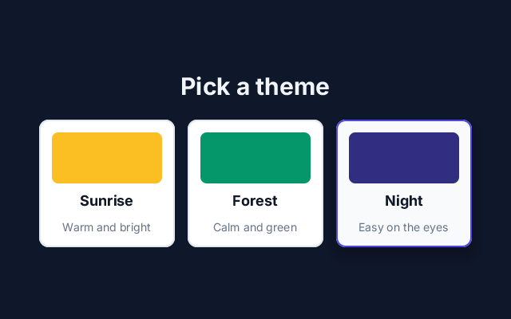

# 10. Styles

**What you will see:** three cards, *Sunrise*, *Forest* and *Night*, each with a colour swatch. Click one: it gets a
purple border and a shadow, and the whole page takes its colours (Night makes it dark).



## The code

The project is in [`samples/10-styles`](samples/10-styles/). `src/main.tsx`:

```tsx
import { createSignal, render } from 'zinc:ui/solid';

const [theme, setTheme] = createSignal<string>('Sunrise');

function pick(name: string): void {
  setTheme(name);
  console.log(`theme: ${name}`);
}

function page(): string {
  if (theme() === 'Night') return 'bg-slate-900';
  if (theme() === 'Forest') return 'bg-emerald-50';
  return 'bg-amber-50';
}

function title(): string {
  return theme() === 'Night' ? 'text-slate-100' : 'text-slate-900';
}

interface CardProps { name: string; swatch: string; words: string }

function Card(props: CardProps): i32 {
  const chosen = (): boolean => theme() === props.name;
  return <Button
    className={`w-[170px] p-4 gap-2 rounded-xl bg-white border-2 hover:bg-slate-50 ${chosen() ? 'border-indigo-600 shadow-lg' : 'border-slate-200 shadow-sm'}`}
    onClick={() => pick(props.name)}>
    <View className={`w-full h-16 rounded-lg ${props.swatch}`} />
    <Text className="text-lg font-bold text-slate-900">{props.name}</Text>
    <Text className="text-sm text-slate-500">{props.words}</Text>
  </Button>;
}

function App(): i32 {
  return <View className={`w-full h-full p-8 gap-6 items-center justify-center ${page()}`}>
    <Text className={`text-3xl font-bold ${title()}`}>Pick a theme</Text>
    <View className="flex-row gap-4">
      <Card name="Sunrise" swatch="bg-amber-400" words="Warm and bright" />
      <Card name="Forest" swatch="bg-emerald-600" words="Calm and green" />
      <Card name="Night" swatch="bg-indigo-900" words="Easy on the eyes" />
    </View>
  </View>;
}

render(App, 0xffffff, null);
```

Click *Night*: the page turns dark and the terminal shows `theme: Night`.

## How `className` works

`className` holds a list of short words, separated by spaces, each one setting one thing. They are the words of
[Tailwind CSS](https://tailwindcss.com), a style system for the web: if you know it, you know these. When `className` is
plain text between quotes, Zinc reads it before the program runs and tells you if a word does not exist.

| To set | Write | Examples |
|---|---|---|
| width, height | `w-*`, `h-*` | `w-24` (96 px), `w-full` (the whole parent), `h-[200px]` (exactly 200) |
| space inside | `p-*`, `px-*`, `py-*`, `pt-*`... | `p-4` (16 px on every side), `px-6` (24 px left and right) |
| space between children | `gap-*` | `gap-4` |
| direction | `flex-row`, `flex-col` | side by side, or one under the other (the default) |
| alignment | `items-*`, `justify-*` | `items-center`, `justify-between` (first at the start, last at the end) |
| growing | `grow` | takes the space left in its parent |
| background | `bg-*` | `bg-white`, `bg-amber-400`, `bg-[#5746e0]` |
| text | `text-*`, `font-*` | `text-sm`, `text-2xl`, `text-slate-500`, `font-bold`, `text-center` |
| corners | `rounded-*` | `rounded-lg`, `rounded-xl`, `rounded-full` |
| border | `border`, `border-2`, `border-*` | `border-2 border-indigo-600` (2 px, purple) |
| shadow | `shadow-*` | `shadow-sm`, `shadow-lg` |
| see-through | `opacity-*` | `opacity-50` |

Numbers count steps of 4 pixels (`p-4` is 16 px). Colours have a name and a shade from 50 (very light) to 950 (very
dark): `slate`, `gray`, `red`, `orange`, `amber`, `yellow`, `green`, `emerald`, `teal`, `sky`, `blue`, `indigo`,
`violet`, `purple`, `pink`, `rose` and more. Any exact value goes in square brackets: `w-[170px]`, `bg-[#f3f1ec]`.

A word with a prefix applies only in a state: `hover:bg-slate-50` while the pointer is over the element,
`active:bg-slate-100` while it is pressed, `focus:border-blue-500` while it has the keyboard focus.

## Line by line

- `const [theme, setTheme] = createSignal<string>('Sunrise');` the chosen theme, a signal holding its name.
- `function page(): string` gives the classes of the page for the chosen theme: a light amber, a light green, or a dark
  slate. `title()` does the same for the title's colour: light text on the dark page.
- `interface CardProps { name: string; swatch: string; words: string }` describes what a card needs: an **interface**
  lists the names and types of the values an object holds.
- `function Card(props: CardProps): i32` a component of your own. It receives its values in one object, `props` (short
  for properties): `props.name`, `props.swatch`, `props.words`.
- `const chosen = (): boolean => theme() === props.name;` a small function: is this card the chosen one?
- `className={`w-[170px] p-4 gap-2 ... ${chosen() ? 'border-indigo-600 shadow-lg' : 'border-slate-200 shadow-sm'}`}`
  the card's classes. The first part never changes: 170 pixels wide, padding, rounded corners, a white background, a
  2-pixel border, a lighter background on hover. The part in `${ }` changes with the signal: the chosen card gets a
  purple border and a big shadow, the others a light border and a small shadow. Because the text reads `theme()`, the
  classes are worked out again each time the theme changes.
- `<View className={`w-full h-16 rounded-lg ${props.swatch}`} />` the swatch: full width, 64 pixels tall, with the
  colour class the card was given.
- `<Card name="Sunrise" swatch="bg-amber-400" words="Warm and bright" />` uses the component. Each attribute becomes a
  field of `props`. Components you write start with a capital, like Zinc's own.
- `<View className={`w-full h-full p-8 gap-6 items-center justify-center ${page()}`}>` the page: its background follows
  the theme.

## Try this

- Add a fourth theme, *Ocean*, with `bg-sky-500` as its swatch and `bg-sky-50` as its page.
- Make the selected card stand out more: `bg-indigo-50` when chosen.
- Change `hover:bg-slate-50` to `hover:bg-amber-100` and move the pointer over the cards.
- Put the cards one under the other: change `flex-row` to `flex-col`.
- Round the cards completely with `rounded-3xl`, or square them with `rounded-none`.
- Write a style that `className` cannot say, as an object: `style={{ opacity: 0.8 }}` (lesson 8 used
  `style={{ width: ... }}`). [zinc:ui in depth](../ui.md#object-styles-and-stylesheet) lists the style keys.

## Next

[11. A drawing inside an interface](11-drawing-in-an-interface.md): mix part 1 and part 2.
