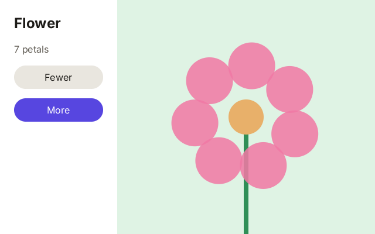

# 11. A drawing inside an interface

**What you will see:** a white panel on the left with a title, the number of petals and two buttons; on the right, a
flower that turns slowly. *More* and *Fewer* add and remove petals.



## The code

The project is in [`samples/11-drawing-in-an-interface`](samples/11-drawing-in-an-interface/). `src/main.tsx`:

```tsx
import { createSignal, render } from 'zinc:ui/solid';
import { rrect, stroke } from 'zinc:gfx';

const [petals, setPetals] = createSignal<i32>(6);
let time = 0;   // seconds since the start, moved forward every frame

function change(by: i32): void {
  const next = petals() + by;
  if (next < 3 || next > 12) return;
  setPetals(next);
  console.log(`petals: ${petals()}`);
}

function flower(x: i32, y: i32, w: i32, h: i32): void {
  const cx = x + w / 2, cy = y + h / 2;          // the middle of the canvas
  const reach = Math.min(w, h) * 0.22;           // how far the petals are from the middle
  stroke([cx, cy, cx, y + h], 8, 0x2f8f57, 255, false);
  for (let i = 0; i < petals(); i++) {
    const angle = time * 0.5 + (i * 2 * Math.PI) / petals();
    const px = cx + Math.cos(angle) * reach, py = cy + Math.sin(angle) * reach;
    rrect(px - 40, py - 40, 80, 80, 40, 0xf27aa6, 220);
  }
  rrect(cx - 30, cy - 30, 60, 60, 30, 0xe8b06a, 255);
}

function App(): i32 {
  return <View className="w-full h-full flex-row">
    <View className="w-[200px] p-6 gap-4 bg-white">
      <Text className="text-2xl font-bold text-[#1d1b18]">Flower</Text>
      <Text className="text-base text-[#625d55]">{`${petals()} petals`}</Text>
      <Button className="h-10 rounded-full bg-[#e9e6df]" onClick={() => change(-1)}>
        <Text className="text-base text-[#1d1b18]">Fewer</Text>
      </Button>
      <Button className="h-10 rounded-full bg-[#5746e0]" onClick={() => change(1)}>
        <Text className="text-base text-white">More</Text>
      </Button>
    </View>
    <Canvas className="grow" onDraw={flower} />
  </View>;
}

render(App, 0xdff3e4, (dt: number) => { time += dt; });
```

Click *More* twice and *Fewer* once: the terminal shows `petals: 7`, `petals: 8`, `petals: 7`.

## A Canvas: part 1 inside part 2

Some things are easier to draw than to build from boxes: a chart, a game board, a drawing, a waveform. A `Canvas` is an
element of the interface that you draw yourself, with the `zinc:gfx` functions of part 1. The layout gives it its place
and size like any element (`grow` here: all the width the panel leaves). Zinc then calls its `onDraw` function with that
place: `x`, `y` (its top left corner, in the window) and `w`, `h` (its width and height). You draw inside that box.

A Canvas is drawn again on every frame, so a drawing that moves just reads the time. (An interface without a Canvas is
drawn only when something in it changes, which saves battery; `style={{ lazy: 1 }}` makes a Canvas wait for a change
too.)

## Line by line

- `import { rrect, stroke } from 'zinc:gfx';` the drawing functions this program uses, as in part 1. You do not call
  `onFrame` or `clear`: `zinc:ui` runs the frames and paints the background.
- `const [petals, setPetals] = createSignal<i32>(6);` the number of petals, a signal: the text `6 petals` follows it.
- `let time = 0;` the seconds since the start, a plain variable: only the drawing reads it, and the Canvas is drawn on
  every frame anyway.
- `function change(by: i32): void` adds or removes a petal, between 3 and 12.
- `function flower(x: i32, y: i32, w: i32, h: i32): void` the Canvas's drawing function. Zinc gives it the box.
- `const cx = x + w / 2, cy = y + h / 2;` the centre of the box. Always draw from `x` and `y`: the Canvas is not at the
  top left of the window, it starts 200 pixels from the left edge, after the panel.
- `const reach = Math.min(w, h) * 0.22;` how far the petals are from the centre: a share of the box's smaller side, so
  the flower fits when the window changes size.
- `stroke([cx, cy, cx, y + h], 8, 0x2f8f57, 255, false);` the stem: a thick green line from the centre down to the
  bottom of the box.
- `for (let i = 0; i < petals(); i++)` one petal per turn of the loop. `petals()` reads the signal: the drawing uses the
  new number on the next frame.
- `const angle = time * 0.5 + (i * 2 * Math.PI) / petals();` where the petal is on the circle. A full turn is
  `2 * Math.PI` (about 6.28); the petals share it equally, and `time * 0.5` turns them all slowly.
- `const px = cx + Math.cos(angle) * reach, py = cy + Math.sin(angle) * reach;` the point at that angle on a circle of
  radius `reach` around the centre. `cos` gives the part across, `sin` the part down.
- `rrect(px - 40, py - 40, 80, 80, 40, 0xf27aa6, 220);` a round petal of 80 pixels around that point, a little
  see-through, so overlapping petals show.
- `rrect(cx - 30, cy - 30, 60, 60, 30, 0xe8b06a, 255);` the yellow heart, drawn last so it is on top.
- `<View className="w-full h-full flex-row">` the window is a row: the panel, then the Canvas.
- `<View className="w-[200px] p-6 gap-4 bg-white">` the panel: 200 pixels wide, white, its children in a column.
- `<Canvas className="grow" onDraw={flower} />` the Canvas takes the rest of the row and draws with `flower`.
- `render(App, 0xdff3e4, (dt: number) => { time += dt; });` the third argument of `render`, which was `null` before, is a
  function Zinc calls on every frame with `dt`, the time since the last frame, as `onFrame` does in part 1. It moves the
  clock of the drawing.

## Try this

- Make the flower turn faster, or the other way (a negative speed).
- Give each petal its own colour, from a list as in lesson 6.
- Add a signal for the size of the petals, with two more buttons.
- Make the petals breathe: their size times `1 + 0.1 * Math.sin(time * 3)`.
- Click on the Canvas to move the flower: give it `onPointerDown={(e: ui.PointerEvent) => ...}` (lesson 9) and keep the
  centre in two variables. `e.x`, `e.y` are inside the Canvas, so add `x`, `y` when you draw.
- Draw a bar chart instead: one `rect` per value of a list, as tall as the value.

## Next

[12. A small complete app](12-a-small-app.md): everything together.
