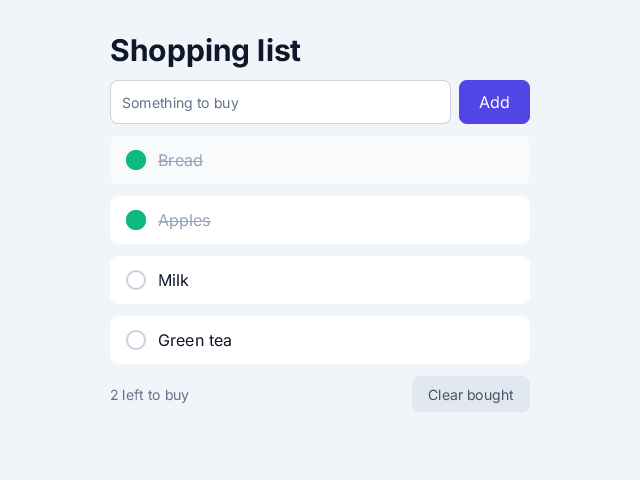

# 12. A small complete app

**What you will see:** a shopping list. Type something in the field and press Enter (or click *Add*): it joins the
list. Click an item to tick it as bought; click again to put it back. *Clear bought* removes the ticked items. The line
at the bottom counts what is left to buy.



## The code

The project is in [`samples/12-a-small-app`](samples/12-a-small-app/). `src/main.tsx`:

```tsx
import { createSignal, render, For } from 'zinc:ui/solid';

class Item {
  text: string;
  done: boolean;
  constructor(text: string, done: boolean) { this.text = text; this.done = done; }
}

const [items, setItems] = createSignal<Item[]>([new Item('Bread', false), new Item('Apples', true)]);
const [draft, setDraft] = createSignal<string>('');

function add(): void {
  const text = draft().trim();
  if (text === '') return;
  setItems([...items(), new Item(text, false)]);
  setDraft('');
  console.log(`added "${text}", ${left()} left to buy`);
}

function toggle(item: Item): void {
  setItems(items().map((it: Item) => it === item ? new Item(it.text, !it.done) : it));
  console.log(`${item.text} ${item.done ? 'back on the list' : 'bought'}, ${left()} left to buy`);
}

function clearDone(): void {
  setItems(items().filter((it: Item) => !it.done));
  console.log(`cleared, ${items().length} on the list`);
}

function left(): i32 {
  return items().filter((it: Item) => !it.done).length;
}

interface RowProps { item: Item }

function Row(props: RowProps): i32 {
  const item = props.item;
  return <Button className="py-1 flex-row items-center justify-start gap-3 px-4 h-12 rounded-lg bg-white hover:bg-slate-50" onClick={() => toggle(item)}>
    <View className={`w-5 h-5 rounded-full border-2 ${item.done ? 'bg-emerald-500 border-emerald-500' : 'border-slate-300'}`} />
    <Text className={`text-base ${item.done ? 'text-slate-400 line-through' : 'text-slate-900'}`}>{item.text}</Text>
  </Button>;
}

function App(): i32 {
  return <View className="w-full h-full items-center p-8 bg-slate-100">
    <View className="w-[420px] gap-3">
      <Text className="text-3xl font-bold text-slate-900">Shopping list</Text>
      <View className="flex-row gap-2" onSubmit={add}>
        <Input className="text-[14px] py-1.5 grow h-11 px-3 rounded-lg bg-white border border-slate-300" placeholder="Something to buy"
          value={draft()} onInput={(v: string) => setDraft(v)} />
        <Button className="py-1 h-11 px-5 rounded-lg bg-indigo-600" onClick={add}>
          <Text className="text-base text-white">Add</Text>
        </Button>
      </View>
      <For each={items()}>{(item: Item) => <Row item={item} />}</For>
      <View className="flex-row items-center justify-between">
        <Text className="text-sm text-slate-500">{`${left()} left to buy`}</Text>
        <Button className="py-1 h-9 px-4 rounded-lg bg-slate-200 hover:bg-slate-300" onClick={clearDone}>
          <Text className="text-sm text-slate-600">Clear bought</Text>
        </Button>
      </View>
    </View>
  </View>;
}

render(App, 0xf1f5f9, null);
```

Type `Milk`, press Enter, add `Green tea` with the button, tick *Bread*, then *Clear bought*: the terminal shows

```text
added "Milk", 2 left to buy
added "Green tea", 3 left to buy
Bread bought, 2 left to buy
cleared, 2 on the list
```

## How the app is built

Everything the app knows is in two signals: `items`, the list, and `draft`, the text being typed. The functions `add`,
`toggle` and `clearDone` are the only places that change them. The interface reads them and follows. When you write an
app, start the same way: what does it need to remember (the signals), what can the user do (the functions), and what
does the screen show (the components).

The list is never changed in place. To add an item, `add` makes a **new** list with the old items and the new one, and
gives it to `setItems`. To tick an item, `toggle` makes a new list where that item is replaced by a new one. A signal
notices a change when it is given a different value; a list changed in place would still be the same list, and nothing
would update.

## Line by line

- `import { createSignal, render, For } from 'zinc:ui/solid';` `For` shows one element per item of a list.
- `class Item { ... }` describes one thing to buy: its `text` and whether it is `done`. The `constructor` is the
  function that `new Item('Bread', false)` calls to fill a new one.
- `createSignal<Item[]>([new Item('Bread', false), new Item('Apples', true)])` the list, which starts with two items,
  the apples already bought.
- `createSignal<string>('')` the text of the field, empty at the start.
- `function add(): void` reads the draft, `trim()` removes the spaces at both ends, and an empty text adds nothing.
  `[...items(), new Item(text, false)]` is a new list: `...` spreads the old items into it, the new one comes last. Then
  `setDraft('')` empties the field.
- `function toggle(item: Item): void` `items().map(...)` makes a new list of the same length: the clicked item is
  replaced by a copy with `done` reversed (`!it.done`), the others are kept as they are.
- `function clearDone(): void` `filter` keeps the items for which the function says `true`: the ones not done.
- `function left(): i32` counts the items not done. The text at the bottom reads it, so it follows the list.
- `interface RowProps { item: Item }` and `function Row(props: RowProps): i32` a component for one row, as in lesson 10.
  The row is a `Button` (so the whole row can be clicked) laid out as a row: a circle, then the text.
- `${item.done ? 'bg-emerald-500 border-emerald-500' : 'border-slate-300'}` the circle is green when done, an empty
  ring otherwise. The text is grey and struck through (`line-through`) when done.
- `<View className="flex-row gap-2" onSubmit={add}>` the field and the *Add* button side by side. `onSubmit` runs when
  Enter is pressed in a one-line field inside this element: Enter adds, like the button.
- `<Input ... value={draft()} onInput={(v: string) => setDraft(v)} />` the text field. `value` is what it shows: the
  draft. `onInput` runs after each key typed, with the new text, which goes into the signal. So the field and the signal
  always agree, and `setDraft('')` in `add` empties the field. `placeholder` is the grey hint shown while it is empty.
- `<For each={items()}>{(item: Item) => <Row item={item} />}</For>` one `Row` per item. When the list changes, `For`
  keeps the rows of the items still there, adds rows for new items and removes the others.
- `<View className="flex-row items-center justify-between">` the bottom line: the count on the left, *Clear bought* on
  the right (`justify-between` pushes them to the two ends).

## Try this

- Show a message when the list is empty: `<Show when={items().length === 0}><Text>Nothing to buy.</Text></Show>` (import
  `Show` too).
- Add a quantity to each item: a number in `Item`, shown after the text, and a *+* button in each row.
- Put the items not bought first: sort the list in `add` and `toggle`.
- Keep the list when the app closes: `zinc:storage` saves text on the device. Save `JSON.stringify` of the texts after
  each change, and read them back at the start.
- Make the list scroll when it is long: put the `For` inside a `<ScrollView className="grow">`.
- Use the ready-made components of [the UI kit](../ui-kit.md) (`Button`, `Card`, `List`, `Switch`...) for a finished
  look.

## Where to go next

You know the two ways to put things on screen, how to answer the keyboard, the mouse and touch, how to draw and play
sound, and how to build an interface that follows its state. From here:

- [zinc:gfx reference](../reference/gfx.md) and [zinc:ui events reference](../reference/ui-events.md): everything these
  lessons used, and the rest.
- [UI apps](../guide/03-ui-apps.md) and [zinc:ui in depth](../ui.md): scrolling, text fields, animations, layers,
  windows.
- `zinc new desktop-app` makes a bigger app with pages, a menu and settings; `zinc new game-2d` a small complete game.
  Read their code: you now know every part of it.
- [Back to the start of the track](README.md).
