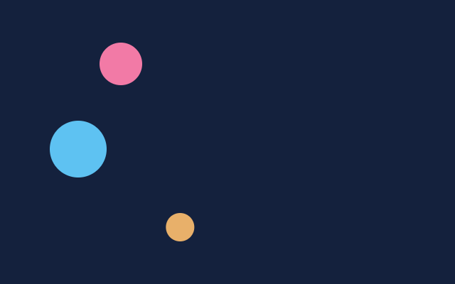

# 13. A stage and a sprite

**What you will see:** three balls of different sizes roll from left to right on a dark blue stage, each at its own speed, and
come back on the left when they leave the window.



Part 3 writes programs as a **scene**: a stage that holds objects, each object a little program of its own that knows where it
is and how to draw itself. If you have made Flash games with ActionScript 3, or used Haxe and OpenFL, this is the same idea, with
the same names. It uses the module `zinc:stage`, and draws with the `zinc:gfx` functions of part 1.

## The code

The project is in [`samples/13-a-stage-and-a-sprite`](samples/13-a-stage-and-a-sprite/). `src/main.ts`:

```ts
import { onFrame, rrect, width } from 'zinc:gfx';
import { Stage, Sprite, uiState } from 'zinc:stage';

class Ball extends Sprite {
  color: u32 = 0xffffff;
  speed: number = 100;   // pixels per second, to the right

  override onAddedToStage(): void {
    console.log(`The ${this.name} joined the stage.`);
  }

  override onUpdate(dt: number): void {
    this.x += this.speed * dt;
    if (this.x > width()) this.x = -this.width;   // gone on the right: back on the left
    uiState.dirty = true;                         // it moved: the stage must be drawn again
  }

  override onDraw(w: number, h: number): void {
    rrect(0, 0, w, h, w / 2, this.color, 255);    // (0, 0) is the ball's own top left corner
  }
}

function makeBall(name: string, color: u32, y: number, size: number, speed: number): Ball {
  const ball = new Ball(name);
  ball.color = color;
  ball.y = y;
  ball.width = size;
  ball.height = size;
  ball.speed = speed;
  return ball;
}

const stage = new Stage();
stage.color = 0x14213d;
stage.addChild(makeBall('pink ball', 0xf27aa6, 60, 60, 120));
stage.addChild(makeBall('blue ball', 0x5ec2f2, 170, 80, 60));
stage.addChild(makeBall('gold ball', 0xe8b06a, 300, 40, 200));
console.log(`The stage holds ${stage.numChildren} balls.`);

let time = 0;
let told = false;
onFrame((dt: number) => {
  stage.frame(dt);
  time += dt;
  if (!told && time >= 1) {
    console.log(`After ${time.toFixed(2)} seconds the pink ball is at x = ${Math.round(stage.getChildAt(0).x)}.`);
    told = true;
  }
});
```

The terminal shows:

```text
The pink ball joined the stage.
The blue ball joined the stage.
The gold ball joined the stage.
The stage holds 3 balls.
After 1.00 seconds the pink ball is at x = 120.
```

## Objects, classes and sprites

In part 1 a ball was two variables, `x` and `y`, and the frame function drew it. With three balls you would need six variables,
three speeds, three colours, and a frame function that grows with each new ball. A scene puts each ball's numbers **inside the
ball**: an object.

A **class** is the plan of an object: what it holds and what it can do. `class Ball extends Sprite` says "a Ball is a Sprite, with a
colour and a speed added". `Sprite` comes from `zinc:stage` and already has what every object of a scene needs: a position `x`, `y`
(from the top left corner of its parent), a size `width`, `height`, a `name`, and children. `new Ball('pink ball')` makes one object
from the plan; you can make as many as you like, each with its own numbers.

A sprite does not draw itself when you want: Zinc calls its methods at the right moment. You write the ones you need, with the
word `override` (you replace what `Sprite` does, which is nothing):

| Method | When Zinc calls it |
|---|---|
| `onAddedToStage()` | once, when the object joins the stage |
| `onUpdate(dt)` | on every frame: move it on by `dt` seconds |
| `onDraw(w, h)` | when the stage is drawn: draw it, with `(0, 0)` at its own top left corner and `w`, `h` its size |

The **stage** is the root of the scene. `stage.frame(dt)`, called from `onFrame`, does a whole frame: it calls `onUpdate` on every
object, then, if something changed, clears the window to `stage.color` and calls every `onDraw`, in the order the objects were added
(the last one is on top).

## Line by line

- `import { Stage, Sprite, uiState } from 'zinc:stage';` the stage, the base class of objects, and the frame's state.
- `class Ball extends Sprite { ... }` the plan of a ball. Inside the braces: its fields and its methods.
- `color: u32 = 0xffffff;` a field: every ball has a colour, white until someone changes it. `speed: number = 100;` same for
  the speed.
- `override onAddedToStage(): void` runs when `addChild` puts the ball on the stage. `this` is the ball itself:
  `this.name` is the name it was given.
- `override onUpdate(dt: number): void` runs on every frame. `this.x += this.speed * dt;` moves this ball by its own speed, as
  in lesson 2.
- `if (this.x > width()) this.x = -this.width;` when it has left on the right, put it just outside on the left.
- `uiState.dirty = true;` tells the stage that the picture changed. A stage where nothing sets it draws nothing: the last picture
  stays on screen, and the computer rests. Here the balls always move, so they always set it.
- `override onDraw(w: number, h: number): void` draws the ball. `rrect(0, 0, w, h, w / 2, ...)` is a circle filling the
  ball's box. `(0, 0)` is not the corner of the window: it is the ball's own corner, wherever the ball is. Zinc moves the drawing
  there for you.
- `function makeBall(...)` makes a ball and sets its fields, so three balls take three lines below. `new Ball(name)` makes the
  object; `return ball;` gives it back.
- `const stage = new Stage();` the stage. `stage.color = 0x14213d;` its background, dark blue.
- `stage.addChild(makeBall('pink ball', 0xf27aa6, 60, 60, 120));` puts a pink ball 60 pixels from the top, 60 pixels wide,
  rolling at 120 pixels a second. Adding it calls its `onAddedToStage`.
- `stage.numChildren` how many objects the stage holds. `stage.getChildAt(0)` the first one, the pink ball.
- `onFrame((dt: number) => { stage.frame(dt); ... });` the frame loop of part 1 hands each frame to the stage. The rest counts
  one second and prints where the pink ball is: 120 pixels a second for one second, 120 pixels from where it started.

## Try this

- Add a fourth ball: one more `stage.addChild(makeBall(...))` line. Nothing else changes.
- Give `Ball` a vertical speed too, and make the balls bounce on the edges, as in lesson 2's *Try this*.
- Remove `uiState.dirty = true;` and run: the balls move (their `x` changes) but the picture stays still, because nobody asks
  the stage to draw.
- Make a second class, `Square extends Sprite`, that draws a square and falls down instead of rolling. Put balls and squares on
  the same stage.
- In `onDraw`, write the ball's name under it with `drawText` (lesson 5): `drawText(f, 0, h + 4, this.name, 0xffffff, 255, 0)`.

## Next

[14. Children and local coordinates](14-children-and-local-coordinates.md): objects inside objects, and a moon that turns around a
planet that turns around the sun.
