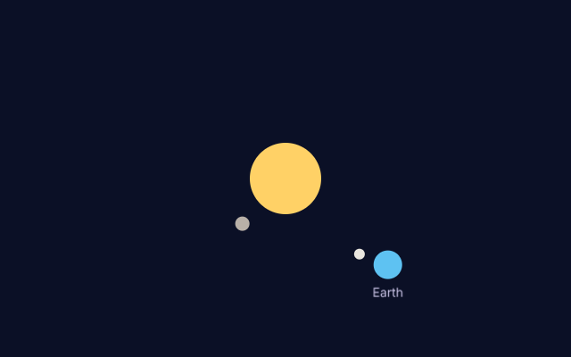

# 14. Children and local coordinates

**What you will see:** a yellow sun in the middle of the window. A small grey planet turns quickly around it; a blue planet,
the Earth, turns slowly further out, with its name under it and a small moon turning around it.



## The code

The project is in [`samples/14-children-and-local-coordinates`](samples/14-children-and-local-coordinates/). `src/main.ts`:

```ts
import { onFrame, rrect, font, drawText, textWidth } from 'zinc:gfx';
import { Stage, Sprite, DisplayObject, uiState } from 'zinc:stage';

// A sun, a planet or a moon: a disc centred on its own (0, 0), turning around its parent's (0, 0).
class Body extends Sprite {
  color: u32 = 0xffffff;
  radius: number = 10;
  orbit: number = 0;    // how far from the parent's centre, in pixels (0: it does not turn)
  speed: number = 0;    // how fast it turns, in radians per second
  angle: number = 0;

  override onUpdate(dt: number): void {
    if (this.orbit === 0) return;
    this.angle += this.speed * dt;
    this.x = Math.cos(this.angle) * this.orbit;
    this.y = Math.sin(this.angle) * this.orbit;
    uiState.dirty = true;
  }

  override onDraw(w: number, h: number): void {
    rrect(-this.radius, -this.radius, this.radius * 2, this.radius * 2, this.radius, this.color, 255);
  }
}

// A name written under its parent, centred on the parent's (0, 0).
const small = font('sans', 14);
class Name extends Sprite {
  text: string = '';
  override onDraw(w: number, h: number): void {
    drawText(small, -textWidth(small, this.text, 0) / 2, 0, this.text, 0xc9c3e6, 255, 0);
  }
}

function body(name: string, color: u32, radius: number, orbit: number, speed: number): Body {
  const b = new Body(name);
  b.color = color;
  b.radius = radius;
  b.orbit = orbit;
  b.speed = speed;
  b.x = orbit;          // its place before it starts turning
  return b;
}

// Where a node is in the window: its x and y, plus its parent's, plus the parent's parent's...
function windowX(node: DisplayObject): number {
  let x = 0;
  let n: DisplayObject | null = node;
  while (n !== null) {
    x += (n as DisplayObject).x;
    n = (n as DisplayObject).parent;
  }
  return x;
}
function windowY(node: DisplayObject): number {
  let y = 0;
  let n: DisplayObject | null = node;
  while (n !== null) {
    y += (n as DisplayObject).y;
    n = (n as DisplayObject).parent;
  }
  return y;
}

const stage = new Stage();
stage.color = 0x0b1026;

const sun = body('sun', 0xffd166, 40, 0, 0);
sun.x = 320;
sun.y = 200;
const mercury = body('mercury', 0xb8b0a8, 8, 70, 2);
const earth = body('earth', 0x5ec2f2, 16, 150, 0.6);
const moon = body('moon', 0xe9e6df, 6, 34, 3);
const label = new Name('label');
label.text = 'Earth';
label.y = 22;

stage.addChild(sun);
sun.addChild(mercury);
sun.addChild(earth);
earth.addChild(moon);
earth.addChild(label);

function tell(): void {
  console.log(`The moon is at ${Math.round(moon.x)}, ${Math.round(moon.y)} in the earth, ` +
    `at ${Math.round(windowX(moon))}, ${Math.round(windowY(moon))} in the window.`);
}

tell();
let time = 0;
let told = false;
onFrame((dt: number) => {
  stage.frame(dt);
  time += dt;
  if (!told && time >= 1) {
    tell();
    told = true;
  }
});
```

The terminal shows where the moon is at the start, then one second later:

```text
The moon is at 34, 0 in the earth, at 504, 200 in the window.
The moon is at -34, 5 in the earth, at 410, 289 in the window.
```

## A tree of objects

An object of a scene can hold other objects: its **children**. `sun.addChild(earth)` puts the Earth inside the sun, and
`earth.addChild(moon)` the moon inside the Earth. The objects make a tree, like folders inside folders:

```text
stage
└── sun
    ├── mercury
    └── earth
        ├── moon
        └── label ("Earth")
```

A child's `x` and `y` are counted **from its parent**, not from the window: these are its local coordinates. The moon only knows
"I am 34 pixels to the right of the Earth's centre". It does not know where the Earth is, and does not need to: when the Earth
moves, everything inside it moves too. That is how the moon follows the Earth around the sun without a line of code for it, and
how the name stays under the Earth.

To know where something is in the window, add up the positions down the tree. At the start the sun is at 320, 200 in the window,
the Earth 150, 0 from the sun, the moon 34, 0 from the Earth: 320 + 150 + 34 = 504 and 200 + 0 + 0 = 200. That is what `windowX` and
`windowY` compute, walking from the moon up to the stage with `parent`.

A parent is drawn before its children, so the children are on top, and the children in the order they were added.

## Line by line

- `class Body extends Sprite` one class for the sun, the planets and the moon: they only differ by their numbers.
- `orbit`, `speed`, `angle` how far from its parent the body turns, how fast, and how far it has turned. An angle is in radians: a
  full turn is `2 * Math.PI`, about 6.28.
- `if (this.orbit === 0) return;` the sun does not turn: `return` leaves `onUpdate` at once.
- `this.x = Math.cos(this.angle) * this.orbit;` and `this.y = Math.sin(this.angle) * this.orbit;` the point at that angle on a
  circle of radius `orbit` around the parent's `(0, 0)` (lesson 11 used the same two lines for the petals).
- `rrect(-this.radius, -this.radius, this.radius * 2, ...)` the disc is drawn around `(0, 0)`, not from it: so the body's `x`, `y` is
  its centre, and a child turning around `(0, 0)` turns around the centre.
- `class Name extends Sprite` a sprite that only writes text. `-textWidth(small, this.text, 0) / 2` starts the text half its width
  to the left, so it is centred under the parent's centre.
- `b.x = orbit;` each body starts on the right of its parent, before it turns.
- `function windowX(node: DisplayObject): number` adds `x` from the node up to the stage. `DisplayObject` is the type of every
  object of a scene (`Sprite` is another name for it). `n` is the node we are at; `n = (n as DisplayObject).parent` climbs one level.
  `parent` is `null` above the stage: the loop stops there.
- `sun.x = 320; sun.y = 200;` the sun's centre, in the window: the sun is a child of the stage, which starts at the top left corner.
- `label.y = 22;` the name, 22 pixels under the Earth's centre. It is a child of the Earth: it turns with it.
- `stage.addChild(sun); sun.addChild(mercury); ...` builds the tree drawn above.

## Try this

- Add Mars: `body('mars', 0xe76f51, 12, 110, 1)`, a child of the sun.
- Give Mars two small moons, children of Mars, at different distances and speeds.
- Move the whole system: change `sun.x` in an `onUpdate` of the sun (or in `onFrame`) and watch everything follow.
- Make the moon a child of the sun instead of the Earth (`sun.addChild(moon)`): it now turns around the sun, 34 pixels from it.
- Every object has `mouseX` and `mouseY`: the pointer in its own coordinates. Print `earth.mouseX` in `onFrame` and move the mouse
  over the Earth: it is near 0 when the pointer is on its centre, wherever the Earth is.

## Next

[15. Taps and drags](15-taps-and-drags.md): a button you tap and cards you pick up and move.
