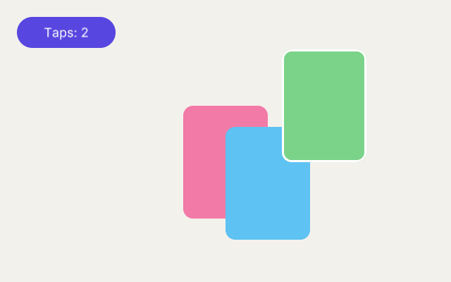

# 15. Taps and drags

**What you will see:** a violet button *Taps: 0* at the top left, and three cards, green, pink and blue, lying on top of each other.
Tap the button and its number goes up; it darkens while your finger is on it. Pick up a card and move it: it comes on top of the
others and gets a white border while you hold it.



## The code

The project is in [`samples/15-taps-and-drags`](samples/15-taps-and-drags/). `src/main.ts`:

```ts
import { onFrame, rrect, border, font, drawText, textWidth, lineHeight } from 'zinc:gfx';
import { Stage, Sprite, DisplayObject, registerTapZone, registerDragZone, isZonePressed } from 'zinc:stage';

const label = font('sans', 18);

// A button that counts its taps.
class Counter extends Sprite {
  taps: i32 = 0;
  override onDraw(w: number, h: number): void {
    const held = isZonePressed(this.name);                 // a finger is on it right now
    rrect(0, 0, w, h, h / 2, held ? 0x3f33b0 : 0x5746e0, 255);
    const words = `Taps: ${this.taps}`;
    drawText(label, (w - textWidth(label, words, 0)) / 2, (h - lineHeight(label)) / 2, words, 0xffffff, 255, 0);
    registerTapZone(this.name, 0, 0, w, h, () => {
      this.taps++;
      console.log(`tap ${this.taps}`);
    });
  }
}

// A card you pick up and move.
class Card extends Sprite {
  color: u32 = 0;
  startX: number = 0;   // where the card was when it was picked up
  startY: number = 0;
  grabX: number = 0;    // where the finger took it, in the card
  grabY: number = 0;

  override onDraw(w: number, h: number): void {
    rrect(0, 0, w, h, 14, this.color, 255);
    if (isZonePressed(this.name)) border(0, 0, w, h, 14, 3, 0xffffff, 255);
    registerDragZone(this.name, 0, 0, w, h, (x: number, y: number, phase: i32) => this.drag(x, y, phase));
  }

  drag(x: number, y: number, phase: i32): void {
    if (phase === 0) {                                     // pressed
      this.startX = this.x;
      this.startY = this.y;
      this.grabX = x;
      this.grabY = y;
      (this.parent as DisplayObject).addChild(this);       // added again: now on top of the other cards
      console.log(`picked up the ${this.name} at ${Math.round(x)}, ${Math.round(y)} in the card`);
    } else if (phase === 1) {                              // moved
      this.x = this.startX + x - this.grabX;
      this.y = this.startY + y - this.grabY;
    } else if (phase === 2) {                              // let go
      console.log(`dropped the ${this.name} at ${Math.round(this.x)}, ${Math.round(this.y)}`);
    }
  }
}

function card(name: string, color: u32, x: number, y: number): Card {
  const c = new Card(name);
  c.color = color;
  c.x = x;
  c.y = y;
  c.width = 120;
  c.height = 160;
  return c;
}

const stage = new Stage();
stage.color = 0xf3f1ec;
const counter = new Counter('counter');
counter.x = 24;
counter.y = 24;
counter.width = 140;
counter.height = 44;
stage.addChild(counter);
stage.addChild(card('green card', 0x7bd389, 200, 120));
stage.addChild(card('pink card', 0xf27aa6, 260, 150));
stage.addChild(card('blue card', 0x5ec2f2, 320, 180));
onFrame((dt: number) => stage.frame(dt));
```

Tap the button twice, then take the green card by its top left corner and move it up and to the right:

```text
tap 1
tap 2
picked up the green card at 30, 30 in the card
dropped the green card at 400, 70
```

## Zones: where an object takes the finger

An object of a scene says, while it draws, which part of it answers the pointer: a **zone**, a rectangle in its own coordinates,
with a name and the function to call. There are two kinds:

- `registerTapZone(name, x, y, w, h, onTap)`: a press and a release in the zone, without moving more than 12 pixels, call
  `onTap()`. That is a click with the mouse, a tap with a finger.
- `registerDragZone(name, x, y, w, h, onDrag)`: a press in the zone calls `onDrag(x, y, phase)` with `phase` 0, each move with
  `phase` 1 (on every frame while the pointer is held), the release with `phase` 2. `x` and `y` are the pointer **in the object's
  coordinates**, measured from where the object was when the press began: (30, 30) is 30 pixels right of and below the card's corner.

`stage.frame` keeps the zones of the last picture. When the pointer goes down, it looks for the topmost zone under it, the one
drawn last, so a card on top of another takes the finger first. `isZonePressed(name)` says whether the finger is on that zone right
now, to draw it pressed. A tap, a drag and the press itself set `uiState.dirty`: the scene is drawn again without you asking.

The keyboard is read as in part 1, with `zinc:gfx` (`keyCount`, `keyName`, `isDown`), in an `onUpdate` or in `onFrame`.

## Line by line

- `class Counter extends Sprite` the button: a sprite with a number of taps.
- `const held = isZonePressed(this.name);` true while a finger is on this button. The zone's name is the sprite's name,
  `'counter'`, so two buttons never share one.
- `rrect(0, 0, w, h, h / 2, held ? 0x3f33b0 : 0x5746e0, 255);` a pill as big as the button, darker while held.
  `held ? a : b` is `a` when `held` is true, else `b`.
- `drawText(label, (w - textWidth(label, words, 0)) / 2, (h - lineHeight(label)) / 2, ...)` the words centred in the button:
  half of what is left on each side, across and down.
- `registerTapZone(this.name, 0, 0, w, h, () => { ... });` the whole button takes taps. `() => { ... }` is the function to call: it
  adds one to `taps` and prints it. The next picture shows the new number.
- `class Card extends Sprite` a card remembers where it was and where it was taken: `startX`, `startY`, `grabX`, `grabY`.
- `registerDragZone(this.name, 0, 0, w, h, (x, y, phase) => this.drag(x, y, phase));` the whole card can be dragged; each step
  goes to the card's `drag` method.
- `if (phase === 0)` the press: keep where the card is and where the finger is in it.
- `(this.parent as DisplayObject).addChild(this);` adding a child that is already there moves it to the end of the list: it is now
  drawn last, on top. `parent` may be `null` in general; `as DisplayObject` says "here it is not".
- `else if (phase === 1)` a move: the card goes where it was, plus how far the finger went (`x - this.grabX`). The finger stays on
  the same spot of the card.
- `else if (phase === 2)` the release: say where the card was dropped.
- `function card(...)` makes a card of 120 by 160 pixels.
- `stage.addChild(card('green card', 0x7bd389, 200, 120));` the three cards, each a little lower and to the right of the one before.

## Try this

- Add a second button that counts down, or that resets the first one to 0.
- Keep the cards inside the window: in `drag`, limit `this.x` between `0` and `640 - this.width` with `Math.max` and `Math.min`.
- Make a card snap to a grid of 20 pixels when it is dropped: in phase 2, `this.x = Math.round(this.x / 20) * 20`.
- Make the tap zone of the button smaller than its picture (`registerTapZone(this.name, 10, 10, w - 20, h - 20, ...)`) and see
  where it stops answering.
- Tell a tap from a drag: in phase 2, when the card is less than 5 pixels from `startX`, `startY`, it was only tapped: change its
  colour.

## Next

[16. The layout and a scroll box](16-layout-and-scrolling.md): a title bar and a list of twenty fruits that scrolls.
