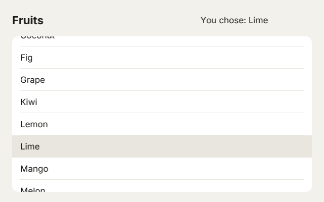

# 16. The layout and a scroll box

**What you will see:** a page with a title bar, *Fruits* on the left and *Tap a fruit* on the right, and under it a white list of
twenty fruits that does not fit in the window. Scroll it with the mouse wheel, two fingers on a trackpad, or by dragging it with a
finger; it keeps going a little when you let go. Tap a fruit: its row turns grey and the title bar says *You chose: Lime*.



## The code

The project is in [`samples/16-layout-and-scrolling`](samples/16-layout-and-scrolling/). `src/main.ts`:

```ts
import { onFrame, rrect, rect, font, drawText, lineHeight } from 'zinc:gfx';
import {
  Stage, Sprite, ScrollBox, registerTapZone, beginScrollBox, endScrollBox, isLocalRectVisible, isZonePressed,
} from 'zinc:stage';

const FRUITS = ['Apple', 'Apricot', 'Banana', 'Blackberry', 'Cherry', 'Coconut', 'Fig', 'Grape', 'Kiwi', 'Lemon',
  'Lime', 'Mango', 'Melon', 'Orange', 'Peach', 'Pear', 'Pineapple', 'Plum', 'Raspberry', 'Strawberry'];
const ROW = 44;                                   // the height of one row, in pixels
const bold = font('sans-bold', 22);
const plain = font('sans', 17);
let chosen = '';

// A line of text, centred in its height.
class Label extends Sprite {
  text: string = '';
  fontId: i32 = 0;
  override onDraw(w: number, h: number): void {
    drawText(this.fontId, 0, (h - lineHeight(this.fontId)) / 2, this.text, 0x1d1b18, 255, 0);
  }
}

// The list of fruits: it draws only the rows you can see, and scrolls with a finger or the wheel.
class FruitList extends Sprite {
  box: ScrollBox = new ScrollBox();

  override onMeasure(): void {
    this.box.contentHeight = FRUITS.length * ROW;
  }

  override onDraw(w: number, h: number): void {
    rrect(0, 0, w, h, 12, 0xffffff, 255);
    beginScrollBox(this.box, 0, 0, w, h);         // what is drawn until endScrollBox stays inside the box
    for (let i = 0; i < FRUITS.length; i++) {
      const y = i * ROW - this.box.scrollY;       // scrolled: the rows move up
      if (!isLocalRectVisible(0, y, w, ROW)) continue;
      const id = `row ${i}`;
      if (isZonePressed(id) || FRUITS[i] === chosen) rect(0, y, w, ROW, 0xe9e6df);
      drawText(plain, 16, y + (ROW - lineHeight(plain)) / 2, FRUITS[i], 0x1d1b18, 255, 0);
      rect(16, y + ROW - 1, w - 32, 1, 0xe9e6df);
      registerTapZone(id, 0, y, w, ROW, () => {
        chosen = FRUITS[i];
        status.text = `You chose: ${chosen}`;
        console.log(`tapped ${chosen}, the list is scrolled by ${Math.round(this.box.scrollY)}`);
      });
    }
    endScrollBox();
  }
}

const stage = new Stage();
stage.color = 0xf3f1ec;
stage.direction = 'column';                       // children from top to bottom
stage.alignItems = 'stretch';                     // each one as wide as the stage
stage.setPaddingSymmetric(24, 20);
stage.gap = 12;

const header = new Sprite('header');
header.direction = 'row';                         // children from left to right
header.height = 40;
const title = new Label('title');
title.text = 'Fruits';
title.fontId = bold;
title.flex = 1;                                   // takes the room the status leaves
title.height = 40;
const status = new Label('status');
status.text = 'Tap a fruit';
status.fontId = plain;
status.width = 220;
status.height = 40;
header.addChild(title);
header.addChild(status);

const list = new FruitList('list');
list.flex = 1;                                    // the rest of the height

stage.addChild(header);
stage.addChild(list);
console.log(`${FRUITS.length} fruits, ${FRUITS.length * ROW} pixels of list`);
onFrame((dt: number) => stage.frame(dt));
```

Tap *Cherry*, scroll down three steps of the wheel, drag the list up by 100 pixels, then tap the row under the pointer:

```text
20 fruits, 880 pixels of list
tapped Cherry, the list is scrolled by 0
tapped Lime, the list is scrolled by 244
```

## Rows and columns

Until now every object had an `x` and a `y` that you set. A page with a title bar and a list would need many numbers, all to be
changed when the window changes size. Instead, a parent can **place its children**:

| Field | What it does |
|---|---|
| `direction = 'column'` | the children one under the other, from the top |
| `direction = 'row'` | the children side by side, from the left |
| `gap` | pixels between two children |
| `setPaddingSymmetric(across, down)` | an empty margin inside the parent: `across` on the left and the right, `down` at the top and the bottom |
| `alignItems = 'stretch'` | each child takes the whole width of a column (or the whole height of a row) |
| `flex = 1` | on a child: it takes the room the others leave |

Here the stage is a column: the title bar (40 pixels high), then the list, which takes the rest (`flex = 1`). The title bar is a row:
the title takes what the status (220 pixels wide) leaves. Change the window's size in `zinc.json` and everything still fits, with no
number to change. Before drawing, the stage calls each object's `onMeasure()`: the moment to set a size or a value that the layout
needs.

## A scroll box

The list is 880 pixels high (20 rows of 44) and the window 400. A **scroll box** shows a part of it, and moves when you scroll:

- `box: ScrollBox = new ScrollBox();` holds the state: `scrollY`, how far the list is scrolled, and `contentHeight`, how high the
  whole list is.
- `beginScrollBox(this.box, 0, 0, w, h)` ... `endScrollBox()`: what is drawn between the two is cut to the box, and so are the
  zones. A row half hidden under the title takes no tap on its hidden half.
- You draw each row at `i * ROW - this.box.scrollY`: when the list is scrolled by 100, every row is 100 pixels higher.
- `stage.frame` does the rest: the wheel and the trackpad scroll the box under the pointer; a finger that moves more than 12 pixels
  on it scrolls it (and taps nothing), and a quick move flings it.

`isLocalRectVisible` says whether a row is inside the box at all: the rows you cannot see are not drawn, so a list of a thousand
rows draws no more than twenty.

## Line by line

- `const FRUITS = [...]` the twenty fruits, in a list. `const ROW = 44;` the height of a row.
- `let chosen = '';` the fruit tapped last, `''` (empty) at the start.
- `class Label extends Sprite` a text centred in its height: `(h - lineHeight(this.fontId)) / 2` from the top. `fontId` says which
  font, so the title and the status share the class.
- `override onMeasure(): void` sets the height of the content before the layout and the drawing.
- `rrect(0, 0, w, h, 12, 0xffffff, 255);` the white card of the list, before the box opens.
- `for (let i = 0; i < FRUITS.length; i++)` one row per fruit. `continue` skips to the next fruit when this row is out of sight.
- ``const id = `row ${i}`;`` the name of the row's zone: `row 0`, `row 1`... `isZonePressed(id)` is true while the finger is on it.
- `if (isZonePressed(id) || FRUITS[i] === chosen) rect(0, y, w, ROW, 0xe9e6df);` a grey background for the row held or chosen.
  `||` means "or".
- `drawText(plain, 16, y + (ROW - lineHeight(plain)) / 2, FRUITS[i], ...)` the fruit's name, centred in its row.
- `rect(16, y + ROW - 1, w - 32, 1, 0xe9e6df);` a thin line under each row.
- `registerTapZone(id, 0, y, w, ROW, () => { ... });` the row takes taps. The function remembers `i`: each row has its own.
- `status.text = ...` changes the text of the status label. `status` is made further down the file; the function runs later, on a
  tap, when it exists. A tap already asks for a new picture: the new text shows at once.
- `stage.direction = 'column'; stage.alignItems = 'stretch';` the page is a column, its children as wide as the window minus the
  padding.
- `header.direction = 'row';` the title bar is a row of two labels.
- `title.flex = 1;` the title takes the width the status leaves; `status.width = 220;` the status has a fixed width.
- `list.flex = 1;` the list takes the height the title bar leaves.

## Try this

- Make the rows taller or shorter: change `ROW`. Everything follows.
- Add a third label to the title bar, *20 fruits*, between the title and the status.
- Put the status at the bottom of the page instead: add it to the stage after the list, not to the header.
- Make the list as wide as half the window: `stage.direction = 'row'`, and a second list beside it.
- Scroll back to the top when the title is tapped: in `Label`'s `onDraw`, a tap zone that sets `list.box.scrollY = 0`.

## Where to go next

You can build a scene: objects that move and draw themselves, a tree of children, taps, drags, a layout and a list that scrolls.
That is enough for most apps on an old tablet.

- The [zinc:stage reference](../reference/stage.md): every field, method and function, and what ActionScript 3 has that `zinc:stage`
  has not.
- `zinc new stage` makes a small app to grow from: a title, colour buttons and a sticker you drag.
- [`examples/music-tree`](../../examples/music-tree/src/main.ts) in the repository: a whole music player written this way, fast on
  a 2011 tablet.
- [Four ways to write a program](../start/styles.md), or part 4: [17. Paths and fills](17-paths-and-fills.md), the canvas of the web.
