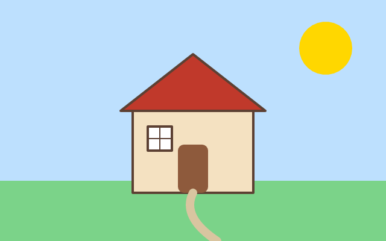

# 17. Paths and fills

**What you will see:** a house on green grass under a blue sky: cream walls with a brown outline, a red roof, a door with
round corners, a window with a cross, a path that curves through the grass, and a yellow sun.



Part 4 draws with the **canvas of the web**: the `CanvasRenderingContext2D` that web pages use to draw in a `<canvas>`. If you have
followed a canvas tutorial on MDN or drawn charts in JavaScript, you know these calls already. In Zinc there is no page and no
`<canvas>` element: the window is the canvas, and the frame loop of part 1 calls your drawing. It uses the module `zinc:canvas`.

## The code

The project is in [`samples/17-paths-and-fills`](samples/17-paths-and-fills/). `src/main.ts`:

```ts
import { onFrame, width, height } from 'zinc:gfx';
import { CanvasRenderingContext2D } from 'zinc:canvas';

const ctx = new CanvasRenderingContext2D();
let told = false;

onFrame((dt: number) => {
  ctx.begin(0, 0, width(), height());   // the canvas is the whole window

  // the sky and the grass: rectangles
  ctx.fillStyle = '#bde0fe';
  ctx.fillRect(0, 0, 640, 400);
  ctx.fillStyle = '#7bd389';
  ctx.fillRect(0, 300, 640, 100);

  // the sun: a full circle
  ctx.beginPath();
  ctx.arc(540, 80, 44, 0, 2 * Math.PI);
  ctx.fillStyle = 'gold';
  ctx.fill();

  // the walls of the house, filled then outlined
  ctx.fillStyle = '#f4e1c1';
  ctx.fillRect(220, 180, 200, 140);
  ctx.lineWidth = 4;
  ctx.strokeStyle = '#5c4033';
  ctx.strokeRect(220, 180, 200, 140);

  // the roof: a path of three points, closed
  ctx.beginPath();
  ctx.moveTo(200, 184);
  ctx.lineTo(320, 90);
  ctx.lineTo(440, 184);
  ctx.closePath();
  ctx.fillStyle = '#c0392b';
  ctx.fill();
  ctx.lineJoin = 'round';
  ctx.stroke();
  if (!told) {
    console.log(`Is 320, 140 in the roof? ${ctx.isPointInPath(320, 140)}. And 120, 140? ${ctx.isPointInPath(120, 140)}.`);
  }

  // the door: a rectangle with round corners
  ctx.beginPath();
  ctx.roundRect(295, 240, 50, 80, 10);
  ctx.fillStyle = '#8e5a3c';
  ctx.fill();

  // a window: two lines make the cross
  ctx.fillStyle = '#ffffff';
  ctx.fillRect(245, 210, 40, 40);
  ctx.strokeRect(245, 210, 40, 40);
  ctx.beginPath();
  ctx.moveTo(265, 210);
  ctx.lineTo(265, 250);
  ctx.moveTo(245, 230);
  ctx.lineTo(285, 230);
  ctx.lineWidth = 2;
  ctx.stroke();

  // a path in the grass: a curve
  ctx.beginPath();
  ctx.moveTo(320, 320);
  ctx.quadraticCurveTo(300, 360, 360, 400);
  ctx.lineWidth = 14;
  ctx.lineCap = 'round';
  ctx.strokeStyle = '#d9c5a0';
  ctx.stroke();

  ctx.end();
  told = true;
});
```

The terminal shows:

```text
Is 320, 140 in the roof? true. And 120, 140? false.
```

## A pen with settings

The canvas draws like a pen that you set up before each line:

1. **Choose the paint.** `ctx.fillStyle` is the colour that fills shapes, `ctx.strokeStyle` the colour of outlines,
   `ctx.lineWidth` how thick outlines are. Colours are written as on the web: `'#c0392b'`, `'gold'`, `'rgb(255, 120, 60)'`,
   `'rgba(0, 0, 0, 0.5)'` (half see-through).
2. **Build a path.** `ctx.beginPath()` starts a new one. `moveTo(x, y)` lifts the pen and puts it down at a point; `lineTo(x, y)`
   draws a straight line to another; `arc(x, y, radius, start, end)` a piece of circle; `quadraticCurveTo` and `bezierCurveTo`
   curves; `rect` and `roundRect` whole rectangles; `closePath()` goes back to the first point. Nothing shows yet: a path is only a
   plan.
3. **Paint it.** `ctx.fill()` fills the inside of the path with `fillStyle`; `ctx.stroke()` draws its outline with `strokeStyle`
   and `lineWidth`. You can do both, on the same path.

Rectangles are so common that they have short forms that need no path: `fillRect(x, y, w, h)` and `strokeRect(x, y, w, h)`.

The settings stay until you change them: after `ctx.lineWidth = 4`, every outline is 4 pixels thick, in this frame and in the next
ones (on the web too). That is why this program sets the line width before each outline that needs another one.

`ctx.begin(0, 0, width(), height())` and `ctx.end()` are Zinc's own: they say "the canvas is the whole window, for this frame".
Everything you draw goes between the two.

## Line by line

- `import { onFrame, width, height } from 'zinc:gfx';` the frame loop and the size of the window, from part 1. `zinc:canvas` only
  draws.
- `const ctx = new CanvasRenderingContext2D();` the context: the pen and its settings. On the web you would write
  `canvas.getContext('2d')`; here you make it yourself, once.
- `ctx.fillStyle = '#bde0fe'; ctx.fillRect(0, 0, 640, 400);` paints the whole window light blue: each frame starts from the
  sky, as `clear` did in part 1.
- `ctx.arc(540, 80, 44, 0, 2 * Math.PI);` a circle around (540, 80) with a radius of 44: an arc from angle 0 to a full turn,
  `2 * Math.PI`. `fill()` makes it a disc.
- `ctx.strokeRect(220, 180, 200, 140);` the outline of the walls, drawn over the filled rectangle. An outline is centred on the
  edge: half of its 4 pixels fall inside, half outside.
- `ctx.moveTo(200, 184); ctx.lineTo(320, 90); ctx.lineTo(440, 184); ctx.closePath();` the roof: a triangle, from the left
  corner up to the top, down to the right corner, and back.
- `ctx.lineJoin = 'round';` the corners of an outline: `'miter'` (sharp, the default), `'round'` or `'bevel'` (cut).
- `ctx.isPointInPath(320, 140)` asks whether a point is inside the current path, the roof here. It is how a canvas program knows
  that a click landed on a shape (the [styles page](../start/styles.md#canvas-zinccanvas) uses it on a ball).
- `ctx.roundRect(295, 240, 50, 80, 10);` a rectangle with corners of radius 10, added to a new path.
- `ctx.moveTo(265, 210); ctx.lineTo(265, 250); ctx.moveTo(245, 230); ctx.lineTo(285, 230);` one path with two separate lines:
  `moveTo` lifts the pen between them. One `stroke()` draws both.
- `ctx.quadraticCurveTo(300, 360, 360, 400);` a curve from the current point (320, 320) to (360, 400), pulled towards
  (300, 360) on the way, as a magnet would pull it.
- `ctx.lineCap = 'round';` the ends of an open line: `'butt'` (cut flat at the end, the default), `'round'` or `'square'`.
- `told = true;` the line is printed on the first frame only.

## Try this

- Paint the sun with a thick orange outline: `ctx.lineWidth = 6; ctx.strokeStyle = 'orange'; ctx.stroke();` after its `fill()`.
- Draw a second window on the right of the door.
- Add a chimney on the roof: a `fillRect` drawn before the roof, so the roof covers its bottom.
- Draw a fence along the grass with a loop: `for (let x = 10; x < 640; x += 30) ctx.fillRect(x, 280, 8, 40);`.
- Replace the quadratic curve with `ctx.bezierCurveTo(260, 350, 420, 370, 360, 400)`: two magnets, an S-shaped path.
- Every function of the context, and the few differences from the web, are in [the zinc:canvas page](../plugins/canvas2d.md).

## Next

[18. Transforms](18-transforms.md): move, turn and shrink the paper under the pen, and draw a clock.
