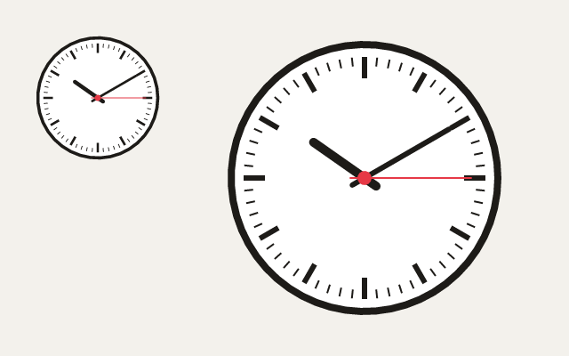

# 18. Transforms

**What you will see:** two station clocks showing ten past ten, a big one on the right and a small copy at the top left, each with
sixty ticks, an hour hand, a minute hand and a red second hand.



## The code

The project is in [`samples/18-transforms`](samples/18-transforms/). `src/main.ts`:

```ts
import { onFrame, width, height } from 'zinc:gfx';
import { CanvasRenderingContext2D } from 'zinc:canvas';

const ctx = new CanvasRenderingContext2D();
const HOURS = 10, MINUTES = 10;
let told = false;

// One hand, drawn straight up from the centre, after turning by `turn` (0 to 1: a whole turn).
function hand(turn: number, length: number, thickness: number, color: string): void {
  ctx.save();                                   // remember the transform...
  ctx.rotate(turn * 2 * Math.PI);
  ctx.beginPath();
  ctx.moveTo(0, 16);
  ctx.lineTo(0, -length);
  ctx.lineWidth = thickness;
  ctx.lineCap = 'round';
  ctx.strokeStyle = color;
  ctx.stroke();
  ctx.restore();                                // ...and go back to it
}

// A clock of radius 150 around (0, 0): wherever the transform puts (0, 0).
function clock(): void {
  ctx.beginPath();
  ctx.arc(0, 0, 150, 0, 2 * Math.PI);
  ctx.fillStyle = 'white';
  ctx.fill();
  ctx.lineWidth = 8;
  ctx.strokeStyle = '#1d1b18';
  ctx.stroke();

  for (let i = 0; i < 60; i++) {                // 60 ticks: draw one at the top, turn by a sixtieth, again
    ctx.beginPath();
    ctx.moveTo(0, -136);
    ctx.lineTo(0, i % 5 === 0 ? -112 : -126);
    ctx.lineWidth = i % 5 === 0 ? 6 : 2;
    ctx.stroke();
    ctx.rotate((2 * Math.PI) / 60);
  }                                             // 60 sixtieths: a whole turn, back where it started

  hand((HOURS + MINUTES / 60) / 12, 70, 10, '#1d1b18');
  hand(MINUTES / 60, 110, 6, '#1d1b18');
  hand(0.25, 120, 2, '#e63946');
  ctx.beginPath();
  ctx.arc(0, 0, 8, 0, 2 * Math.PI);
  ctx.fillStyle = '#e63946';
  ctx.fill();
}

// Where the transform puts (0, 0), and how much it scales: e and f, and a (a is the scale when nothing is turned).
function tell(where: string): void {
  const m = ctx.getTransform();
  console.log(`${where}, (0, 0) is at ${m.e}, ${m.f} and the scale is ${m.a.toFixed(2)}.`);
}

onFrame((dt: number) => {
  ctx.begin(0, 0, width(), height());
  ctx.fillStyle = '#f3f1ec';
  ctx.fillRect(0, 0, 640, 400);

  ctx.save();
  ctx.translate(410, 200);                      // (0, 0) is now the middle of the big clock
  clock();
  if (!told) tell('In the big clock');
  ctx.restore();

  ctx.save();
  ctx.translate(110, 110);                      // the small clock: move, then make everything smaller
  ctx.scale(0.45, 0.45);
  clock();
  if (!told) tell('In the small clock');
  ctx.restore();

  if (!told) tell('After restore');
  ctx.end();
  told = true;
});
```

The terminal shows:

```text
In the big clock, (0, 0) is at 410, 200 and the scale is 1.00.
In the small clock, (0, 0) is at 110, 110 and the scale is 0.45.
After restore, (0, 0) is at 0, 0 and the scale is 1.00.
```

## Moving the paper

Drawing sixty ticks around a circle with `Math.cos` and `Math.sin` works, but it is a lot of arithmetic. A canvas has a simpler way:
instead of moving the pen, **move the paper**. A transform changes where everything drawn after it lands:

- `ctx.translate(x, y)` moves the paper: `(0, 0)` is now at what was `(x, y)`.
- `ctx.rotate(angle)` turns the paper around `(0, 0)`, by an angle in radians (a full turn is `2 * Math.PI`), clockwise.
- `ctx.scale(sx, sy)` makes everything bigger or smaller: `0.45` is a little less than half. Line widths shrink too.

They add up: `translate(110, 110)` then `scale(0.45, 0.45)` puts `(0, 0)` at (110, 110) and draws at 45%. So the clock is written once,
around `(0, 0)`, as if it were alone on the page; where and how big it lands is decided before calling it.

The ticks use this: draw one tick straight up, turn the paper by a sixtieth of a turn, draw the same tick again, sixty times. After
sixty turns of a sixtieth, the paper is back where it started.

`ctx.save()` remembers the transform (and the colours and line settings); `ctx.restore()` goes back to what was saved. Each hand
turns the paper by its own angle, between a `save` and a `restore`, so the next hand starts from the upright paper. Saves can be
inside saves, like the hand inside the clock: each `restore` undoes the last `save`.

`ctx.getTransform()` gives the transform as six numbers, `a` to `f`: `e` and `f` are where `(0, 0)` lands, `a` and `d` the scale when
nothing is turned. The program prints them to show the three states.

## Line by line

- `const HOURS = 10, MINUTES = 10;` the time the clocks show.
- `function hand(turn, length, thickness, color)` draws one hand. `turn` goes from 0 (straight up, twelve o'clock) to 1 (a whole
  turn).
- `ctx.rotate(turn * 2 * Math.PI);` turns the paper by that much of a full turn.
- `ctx.moveTo(0, 16); ctx.lineTo(0, -length);` a line from a little below the centre to `length` pixels above it. On the paper
  it is always straight up; the rotation makes it point to the hour.
- `function clock()` draws a whole clock around `(0, 0)`: the face, the ticks, the hands and the red centre.
- `ctx.lineTo(0, i % 5 === 0 ? -112 : -126);` every fifth tick (`i % 5 === 0`: `i` divided by 5 leaves nothing) is longer and
  thicker: the hours.
- `hand((HOURS + MINUTES / 60) / 12, ...)` the hour hand: 10 hours and 10 minutes is 10.17 hours, out of 12 for a turn.
- `hand(MINUTES / 60, ...)` the minute hand: 10 minutes out of 60. `hand(0.25, ...)` the second hand at a quarter: 15 seconds.
- `ctx.save(); ctx.translate(410, 200); clock(); ... ctx.restore();` the big clock, with its middle at (410, 200).
- `ctx.translate(110, 110); ctx.scale(0.45, 0.45);` the small clock: the same `clock()`, moved and shrunk. Order matters: the
  translate is in window pixels; the scale then shrinks what comes after it.
- `if (!told) tell('After restore');` after the last `restore` the paper is back to normal: `(0, 0)` is the window's corner.

## Try this

- Add a third clock, upside down: `ctx.rotate(Math.PI)` after its `translate`.
- Show the real time: `const now = new Date();` then `now.getHours()`, `now.getMinutes()`, `now.getSeconds()`, and move the
  second hand with `now.getSeconds() / 60`.
- Make the big clock wider than high: `ctx.scale(1.3, 1)` after its `translate`. See what happens to the ticks.
- Forget a `ctx.restore()` in `hand` and look: every hand turns from where the one before ended.
- Write numbers on the face: in the loop, every fifth tick, `ctx.fillText(...)` (lesson 20 shows how to set the font and centre
  text).

## Next

[19. An animation](19-animation.md): a windmill whose blades turn and clouds that drift, frame after frame.
