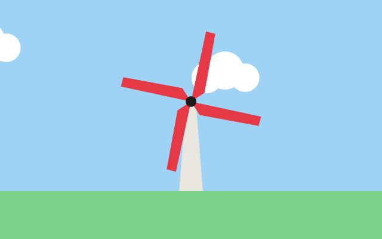

# 19. An animation

**What you will see:** a windmill on green grass. Its four red blades turn steadily, a quarter of a turn every second, and white
clouds drift across the blue sky, coming back on the left when they leave on the right.



## The code

The project is in [`samples/19-animation`](samples/19-animation/). `src/main.ts`:

```ts
import { onFrame, width, height } from 'zinc:gfx';
import { CanvasRenderingContext2D } from 'zinc:canvas';

const ctx = new CanvasRenderingContext2D();
const TURN_SPEED = Math.PI / 2;   // the blades turn a quarter of a turn per second
let angle = 0;                    // how far the blades have turned, in radians
let cloudX = 0;                   // how far the clouds have moved
let time = 0;
let told = false;

function cloud(x: number, y: number): void {
  ctx.beginPath();
  ctx.arc(x, y, 26, 0, 2 * Math.PI);
  ctx.arc(x + 30, y - 12, 32, 0, 2 * Math.PI);
  ctx.arc(x + 64, y, 24, 0, 2 * Math.PI);
  ctx.fill();
}

onFrame((dt: number) => {
  time += dt;
  angle += TURN_SPEED * dt;
  cloudX = (cloudX + 40 * dt) % 800;
  if (!told && time >= 1) {
    console.log(`After ${time.toFixed(2)} seconds the blades turned ${Math.round((angle * 180) / Math.PI)} degrees.`);
    told = true;
  }

  ctx.begin(0, 0, width(), height());
  ctx.fillStyle = '#9fd3f5';                    // every frame starts from an empty sky
  ctx.fillRect(0, 0, 640, 400);
  ctx.fillStyle = '#7bd389';
  ctx.fillRect(0, 320, 640, 80);

  ctx.fillStyle = 'white';                      // two clouds drift to the right and come back on the left
  cloud(cloudX - 100, 80);
  cloud(((cloudX + 400) % 800) - 100, 130);

  ctx.beginPath();                              // the tower
  ctx.moveTo(300, 320);
  ctx.lineTo(312, 170);
  ctx.lineTo(328, 170);
  ctx.lineTo(340, 320);
  ctx.closePath();
  ctx.fillStyle = '#e9e6df';
  ctx.fill();

  ctx.save();                                   // the blades: move to the hub, turn by the angle, draw four blades
  ctx.translate(320, 170);
  ctx.rotate(angle);
  ctx.fillStyle = '#e63946';
  for (let i = 0; i < 4; i++) {
    ctx.beginPath();
    ctx.moveTo(0, 0);
    ctx.lineTo(18, -20);
    ctx.lineTo(10, -120);
    ctx.lineTo(-6, -120);
    ctx.closePath();
    ctx.fill();
    ctx.rotate(Math.PI / 2);
  }
  ctx.restore();

  ctx.beginPath();
  ctx.arc(320, 170, 9, 0, 2 * Math.PI);
  ctx.fillStyle = '#1d1b18';
  ctx.fill();
  ctx.end();
});
```

After one second the terminal shows:

```text
After 1.00 seconds the blades turned 90 degrees.
```

## An animation is a picture, again and again

There is nothing new to learn to make a canvas move: it is the flip book of lesson 2. On every frame, `onFrame` gives you `dt`,
the time since the last frame; you move your numbers on by a speed times `dt`, then draw the whole picture again from the sky up.
The canvas does not remember what it drew on the frame before (on the web you would call `clearRect` first; here the sky's
`fillRect` covers everything).

Two things the canvas **does** remember from one frame to the next: its settings and its transform. A `translate` or a `rotate` that
is not undone is still there on the next frame, and the next, and adds up: the windmill would fly away. That is why the blades are
drawn between `save()` and `restore()`. The same goes for `fillStyle` or `lineWidth`: set what you need before you draw.

The angle grows forever (90 degrees after one second, 900 after ten); a rotation of 900 degrees looks the same as one of 180, so
nothing needs to bring it back. The clouds do need it: `%` (the remainder of a division) brings `cloudX` back to 0 when it reaches
800.

## Line by line

- `const TURN_SPEED = Math.PI / 2;` a quarter of a turn (half of `Math.PI`, which is half a turn) per second.
- `angle += TURN_SPEED * dt;` the blades turn by the speed times the time of the frame, so they turn as fast on a slow machine as
  on a fast one.
- `cloudX = (cloudX + 40 * dt) % 800;` the clouds move 40 pixels a second; past 800 they start again from 0.
- `Math.round((angle * 180) / Math.PI)` turns radians into degrees for the message: a half turn is `Math.PI` radians, 180 degrees.
- `function cloud(x, y)` three circles in one path, filled at once: a cloud. `arc` adds a circle to the path without lifting the
  pen, and the fill covers all three.
- `cloud(cloudX - 100, 80);` the first cloud starts 100 pixels left of the window, so it slides in instead of popping up.
- `cloud(((cloudX + 400) % 800) - 100, 130);` the second cloud is 400 pixels behind the first, on the same loop.
- `ctx.moveTo(300, 320); ... ctx.closePath();` the tower: narrower at the top than at the bottom.
- `ctx.translate(320, 170); ctx.rotate(angle);` the hub of the windmill becomes `(0, 0)`, turned by the angle.
- `ctx.moveTo(0, 0); ctx.lineTo(18, -20); ctx.lineTo(10, -120); ctx.lineTo(-6, -120);` one blade, pointing up from the hub.
  `ctx.rotate(Math.PI / 2)` turns a quarter: the loop draws the four blades with the same lines.
- `ctx.restore();` undoes the translate and the four rotations at once, back to the window's corner.
- `ctx.arc(320, 170, 9, ...)` the black hub, drawn last, on top of the blades.

## Try this

- Make the wind blow harder: double `TURN_SPEED` and the speed of the clouds.
- Make the blades turn the other way: subtract instead of adding.
- Remove `ctx.save()` and `ctx.restore()` and run: the moves and the turns add up frame after frame, and the blades fly off the
  window.
- Let a click speed the blades up: read `pointerDown()` from `zinc:gfx`, as in the [styles page](../start/styles.md), and add to
  the speed on each press. Then slow it down a little on every frame: `speed *= 0.99`.
- Make it night: a dark sky, a moon (a circle), and a few stars (small `fillRect`s at fixed places).

## Next

[20. Text and gradients](20-text-and-gradients.md): a poster with a sky that fades from one colour to another, a glowing sun and
centred text.
