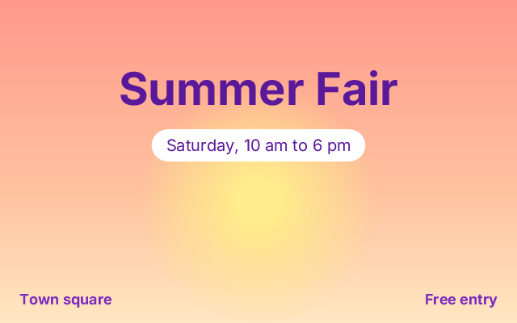

# 20. Text and gradients

**What you will see:** a poster for a summer fair. The sky fades from pink at the top to pale yellow at the bottom, a soft yellow
sun glows in the middle, *Summer Fair* is written large and centred, the date sits in a white pill just under it, and two small
lines take the bottom corners.



## The code

The project is in [`samples/20-text-and-gradients`](samples/20-text-and-gradients/). `src/main.ts`:

```ts
import { onFrame, width, height } from 'zinc:gfx';
import { CanvasRenderingContext2D } from 'zinc:canvas';

const ctx = new CanvasRenderingContext2D();
const TITLE = 'Summer Fair';
let told = false;

onFrame((dt: number) => {
  ctx.begin(0, 0, width(), height());

  // the sky: a linear gradient from the top of the window to the bottom
  const sky = ctx.createLinearGradient(0, 0, 0, 400);
  sky.addColorStop(0, '#ff9a8b');
  sky.addColorStop(0.6, '#ffc3a0');
  sky.addColorStop(1, '#ffe8c2');
  ctx.fillGradient = sky;                    // on the web: ctx.fillStyle = sky
  ctx.fillRect(0, 0, 640, 400);

  // the sun: a radial gradient, yellow in the middle, fading out at the edge
  const glow = ctx.createRadialGradient(320, 250, 30, 320, 250, 150);
  glow.addColorStop(0, 'rgba(255, 236, 140, 1)');
  glow.addColorStop(1, 'rgba(255, 236, 140, 0)');
  ctx.fillGradient = glow;
  ctx.beginPath();
  ctx.arc(320, 250, 150, 0, 2 * Math.PI);
  ctx.fill();

  // the title, centred: textAlign says which point of the text x is
  ctx.textAlign = 'center';
  ctx.textBaseline = 'alphabetic';
  ctx.font = 'bold 56px sans-serif';
  ctx.fillStyle = '#5a189a';
  ctx.fillText(TITLE, 320, 130);

  // a label in a pill: measureText says how wide the text is, the pill is drawn around it
  ctx.font = '20px sans-serif';
  const words = 'Saturday, 10 am to 6 pm';
  const w = ctx.measureText(words).width;
  ctx.beginPath();
  ctx.roundRect(320 - w / 2 - 18, 160, w + 36, 40, 20);
  ctx.fillStyle = 'white';
  ctx.fill();
  ctx.textBaseline = 'middle';
  ctx.fillStyle = '#5a189a';
  ctx.fillText(words, 320, 180);

  // two corners: x is where the text starts (left) or where it ends (right)
  ctx.font = 'bold 18px sans-serif';
  ctx.fillStyle = '#7b2cbf';
  ctx.textAlign = 'left';
  ctx.fillText('Town square', 24, 370);
  ctx.textAlign = 'right';
  ctx.fillText('Free entry', 616, 370);

  if (!told) {
    ctx.font = 'bold 56px sans-serif';
    console.log(`The title is ${Math.round(ctx.measureText(TITLE).width)} pixels wide, the label ${Math.round(w)}.`);
    told = true;
  }
  ctx.end();
});
```

The terminal shows (the numbers depend a little on the font):

```text
The title is 347 pixels wide, the label 229.
```

## Gradients

A **gradient** is a paint that changes colour along the way. You make one, give it colours at points along its length, then paint
with it:

- `ctx.createLinearGradient(x0, y0, x1, y1)` changes along a line, from (x0, y0) to (x1, y1). From (0, 0) to (0, 400) is top to
  bottom.
- `ctx.createRadialGradient(x0, y0, r0, x1, y1, r1)` changes from one circle to another: from the small circle of radius 30 to the
  big one of radius 150 here, both around the sun's centre.
- `addColorStop(offset, colour)` puts a colour at a place along the gradient: `0` is the start, `1` the end, `0.6` a little past
  the middle. Between two stops the colours blend. A colour can be see-through: `rgba(255, 236, 140, 0)` is the same yellow with an
  opacity of 0, so the sun fades into the sky.

On the web you would write `ctx.fillStyle = sky`. Zinc writes `ctx.fillGradient = sky`, because in Zinc a field has one type and
`fillStyle` is a text. Setting `fillStyle` to a colour again (`ctx.fillStyle = 'white'`) stops the gradient, as on the web.

## Text

`ctx.fillText(text, x, y)` writes text with the `fillStyle` colour. Three settings say how:

- `ctx.font` is written like CSS: `'bold 56px sans-serif'` (bold, 56 pixels high, the sans-serif font that comes with Zinc), or
  `'20px monospace'`.
- `ctx.textAlign` says which point of the text `x` is: `'left'` (or `'start'`, the default) its start, `'center'` its middle,
  `'right'` its end. So `textAlign = 'center'` and `x = 320` centres a text in a 640 pixel window, whatever its length.
- `ctx.textBaseline` says which line of the text `y` is: `'alphabetic'` (the default) the line the letters sit on, `'top'` the top,
  `'middle'` the middle. `'middle'` is the easy way to centre text in a box: `y` is the box's middle.

`ctx.measureText(text).width` says how wide a text will be with the current font, before you draw it: here, to size the white pill
so the date fits with 18 pixels on each side.

## Line by line

- `const sky = ctx.createLinearGradient(0, 0, 0, 400);` a gradient from the top of the window to the bottom.
- `sky.addColorStop(0, '#ff9a8b'); sky.addColorStop(0.6, '#ffc3a0'); sky.addColorStop(1, '#ffe8c2');` pink at the top, peach a
  little below the middle, pale yellow at the bottom.
- `ctx.fillGradient = sky; ctx.fillRect(0, 0, 640, 400);` the whole window, painted with the gradient.
- `ctx.createRadialGradient(320, 250, 30, 320, 250, 150);` inside the radius 30 the first colour, beyond 150 the last, a blend between.
- `ctx.arc(320, 250, 150, 0, 2 * Math.PI); ctx.fill();` the disc the glow is painted on: as big as the gradient's outer circle, so
  its edge is fully see-through and does not show.
- `ctx.font = 'bold 56px sans-serif'; ctx.fillText(TITLE, 320, 130);` the title, its middle at x = 320, sitting on the line
  y = 130.
- `const w = ctx.measureText(words).width;` the width of the date in the 20 pixel font.
- `ctx.roundRect(320 - w / 2 - 18, 160, w + 36, 40, 20);` the pill: as wide as the text plus 18 pixels on each side, 40 high, round
  ends (a radius of half its height).
- `ctx.textBaseline = 'middle'; ctx.fillText(words, 320, 180);` the date, centred in the pill both ways: 180 is the pill's middle
  (160 + 40 / 2).
- `ctx.textAlign = 'left'; ctx.fillText('Town square', 24, 370);` starts 24 pixels from the left edge.
  `ctx.textAlign = 'right'; ctx.fillText('Free entry', 616, 370);` ends 24 pixels from the right edge.

## Try this

- Make the sky a sunset: a linear gradient from left to right, `createLinearGradient(0, 0, 640, 0)`, orange to violet.
- Paint the title with a gradient: `ctx.fillGradient = ...` before its `fillText`. Zinc draws text in the gradient's first colour
  (a difference from the web, listed on [the zinc:canvas page](../plugins/canvas2d.md#deviations-from-the-web)).
- Add a second pill under the first, *Free entry*, sized with `measureText` too.
- Write your name in the bottom middle, with `textAlign = 'center'`.
- Make the sun pulse: give the radial gradient an outer radius of `150 + 20 * Math.sin(time)`, with a `time` that grows by `dt`.

## Where to go next

You can draw with the canvas of the web: paths, fills and outlines, transforms, animations, text and gradients.

- [The zinc:canvas page](../plugins/canvas2d.md): every function, an offscreen `Canvas` whose pixels stay between frames, images, and
  the differences from the web.
- `zinc new canvas` makes a sketch to grow from: a gradient sky, a turning star, bubbles where you click.
- [`examples/canvas/sketch`](../../examples/canvas/sketch/main.tsx) in the repository: a clock, fireworks and shapes drawn in
  canvases inside an interface.
- [Draw it with the web's canvas](../start/beyond.md#draw-it-with-the-webs-canvas): a chart drawn with these calls in a box of an
  interface, beside its buttons.
- [Four ways to write a program](../start/styles.md): how the canvas mixes with the other styles. [Back to the start of the
  track](README.md).
