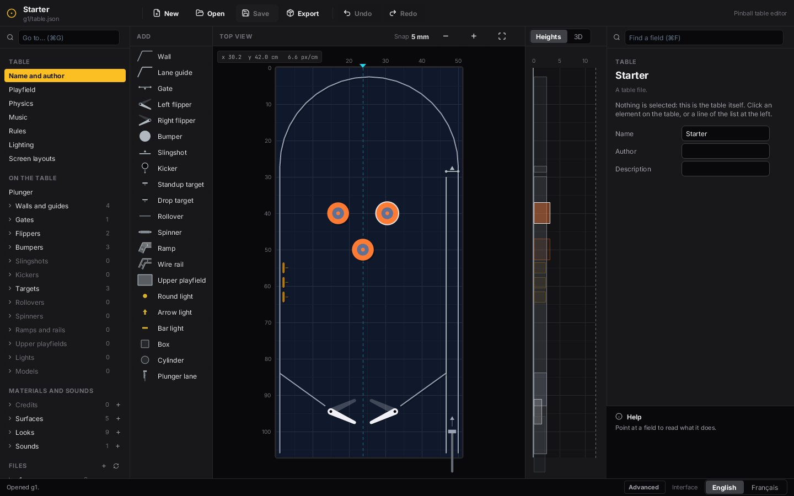
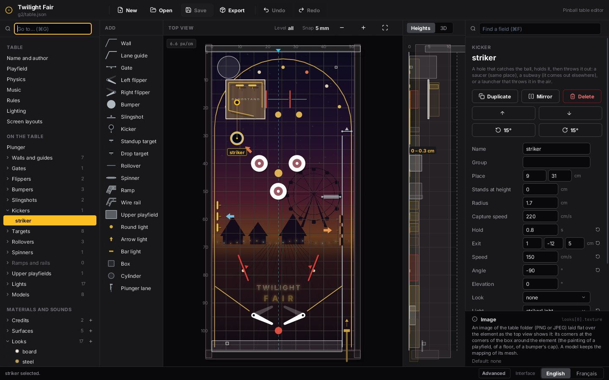
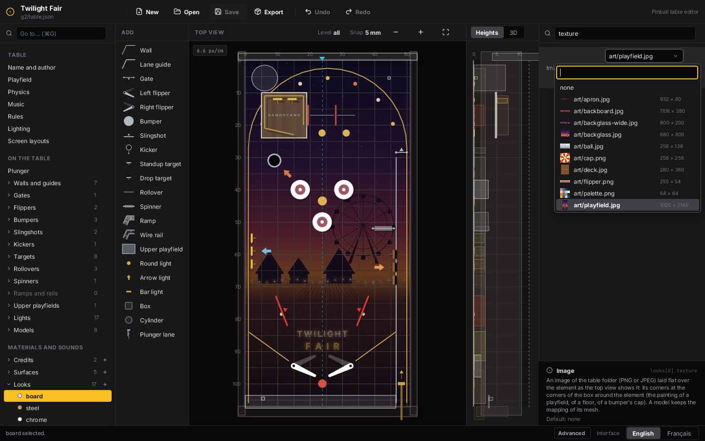
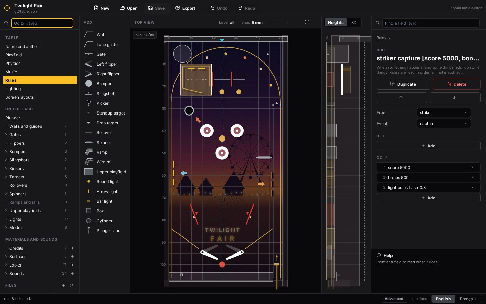
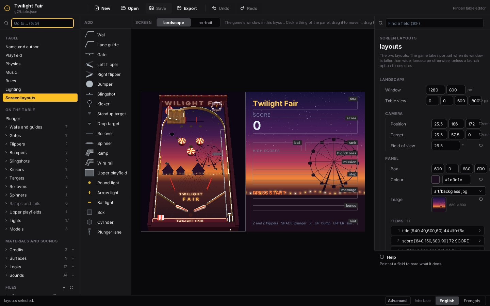

# Make a pinball table

A table of [`examples/pinball3d`](../examples/pinball3d/README.md) is a folder: `table.json` and the images, sounds and
models it names. The game has no table in its code, so a new table needs no code: it is made in the table editor,
[`examples/pinball3d-editor`](../examples/pinball3d-editor). This page follows the making of the game's second table,
**Twilight Fair**, a funfair at dusk, from an empty board to a table the game plays. Every step below is one of the five
editor sessions kept in [`examples/pinball3d/tools/twilight_fair/sessions`](../examples/pinball3d/tools/twilight_fair/sessions):
what was clicked and typed, in order. A test replays them and gets the shipped `table.json` byte for byte.


```sh
zinc run examples/pinball3d-editor -- my-table                                    # the editor, on a folder (a new table when it is empty)
zinc run examples/pinball3d -- --table=assets/tables/twilight-fair                # the game, on a table
```

## 0. What the editor cannot make: the pictures and the sounds

The editor places, shapes, names and tunes; it does not paint or record. The files of a table come from elsewhere: a
drawing program, a recorder, or, for the two tables of the game, a script kept in the example
([`tools/twilight_fair_art.py`](../examples/pinball3d/tools/twilight_fair_art.py) draws 11 images and builds 2 models,
[`tools/twilight_fair_sounds.py`](../examples/pinball3d/tools/twilight_fair_sounds.py) synthesises 34 sounds). Put them in
the table's folder (`art/`, `sounds/`), or bring them in one by one with **Import…** in any file list, or by dropping a
file on the window. The painting of the playfield is the one file that depends on the layout (the canopy around the
bumpers, the pad under each light): draw it last, or draw it again when the layout has settled.

## 1. Start: a board, an arch, a lane, two flippers

The editor opens on a new table: a board, a ball and a plunger. The list at the left is everything a table file holds,
the palette beside it everything that can be put on the board, the form at the right the properties of what is selected,
each with its help. Twilight Fair starts from the table the editor's own test makes in two minutes: the outer wall with
its arch (four clicks, then the round dot of the top stretch pulled up into a half circle), **Plunger lane** (one
click: its wall, its gate and the plunger), a guide and a flipper on the left, and **Mirror** for the right ones.



## 2. What the ball meets (session 1)

Things are added from the palette: choose one, click where it goes (two clicks for a thing with two ends, a click per
point and Enter for a path). Points snap to the grid, to the table's axis and to the points of other things.

- **Slingshots**: the left one from its upper end to its lower one (a slingshot kicks to the left of that way), then
  Mirror.
- **Top lanes**: two lane guides, and a rollover across each lane.
- **Coconut shy**: three drop targets along the plunger lane, turned to face the table (their angle typed: 180).
- **Spinner**, and a kicker, the **high striker**: it holds the ball, then throws it up. Its exit is typed as three
  numbers: 1 cm to the right, 12 cm up the table, 5 cm higher.
- **The bandstand**, an upper playfield: its outline, four clicks. The button **Level** (or L) then goes to its level:
  what is placed now stands on it. Its rail is one wall that leaves a gap at the lower right corner, and two targets,
  the bells, stand against it.

Names are typed in the form (a thing renamed is renamed wherever a rule names it; a thing deleted that rules or
missions cannot do without lists them, each as its sentence, and asks before they go with it). **Drop a ball** (B, then a click on
the top view) plays the real game from that spot: dropped above the striker, the ball is caught, thrown onto the
bandstand, rings a bell, rolls to the gap and falls among the bumpers.



## 3. What it looks like and what is heard (session 2)

A **look** is a colour (click its swatch: a square of shades, a strip of hues, and the colours the table already
uses), highlights, a glow for when the thing is lit, and an image of the folder laid flat over the thing. The image is
chosen in a list that shows each file with its picture and its size; type a part of its name to find it.



A **sound** is a file of the folder with its volume, and how much volume and pitch vary from one play to the next; the
button beside the file plays it. Then each thing names the sound of each of its events (a bumper's hit, a flipper's
up and down, the striker's capture and eject), the ball its own, and the music a piece per state of the game. Twilight
Fair has 34 sounds; this is the longest session, and the least inventive: thirty times the same four gestures.

## 4. Lights and scenery (session 3)

A light is an insert the rules turn on. Its **glow** is the circle around it on the top view, pulled with the round
handle: how far its light falls on the board. Twilight Fair has a string of seven bulbs under the arch (their places
typed, on an arc), a light per lane, an arrow at each shot, and two lamps under the slingshots that are the general
illumination (**Lighting**, *General lighting*: they go out on a tilt). A rollover, a kicker or a target names the light
that goes with it.

Scenery is a **model**: a box, a cylinder, a cone, or a mesh file of the folder. The cabinet is five boxes with their
place and their size typed; the big wheel and the ticket booth are OBJ files; the big top is a cone with a striped image.

## 5. Rules, missions, ranks (session 4)

A rule says: when this happens there, and these things hold, do that. **+rule** adds one; its form has where the event
comes from (a thing, or a group of things such as `bumpers`, or the game itself), the event, then two lists of
sentences: what must hold, and what it does. **Add** opens the list of kinds ("Lights on or off", "Targets down or
up", "Add points", "Change lights", "Show a text", "Play a sound"...); the kind chosen is added whole, with what the
table has: "the lights of `bulbs` are all on" names the table's first group of lights, "the targets of `coconuts` are
all down" its bank of drop targets. Each word that can change is then a choice (a name among the lights, a way among
on, off, blink...), or a number or a text to type. The twenty-two rules of Twilight Fair were made that way, from "the
slingshots score 110" to "when the ball rolls over `lanes`, if the lights of `lanes` are all on: raise the bonus
multiplier by 1; add 1,000 to the bonus; turn off the lights of `lanes`; show LANES LIT: BONUS X on the panel".

Plain scores need no rule made by hand. Selecting **Rules** replaces the top view by the **scores grid**: a row per
group and per element that sends events, a column per event (hit, down, roll, spin...), and in a cell the points the
thing always gives there. A number typed in a cell is the points of the rule that scores there without a condition
(the rule is made when there was none, and goes when the cell is emptied and it did nothing else); the box above the
names finds a row (Cmd+K). What depends on a condition stays a rule, in the form at the right.

A mission is a name, an award and steps, each a sentence: "Hit `bumpers` 10 times", "Shoot into `striker` 2 times",
"Knock down `coconuts` 3 times". **Add** opens the list of events ("Hit …", "Roll over …", "Lose a ball"); the step is
added whole, waiting for the first thing that sends that event (a group before a single thing, the bank of drop
targets for targets knocked down), and the thing is then a choice among those that send it, not among everything on
the table. Under the sentence are what the panel asks the player for and the light that blinks meanwhile: the text is
the sentence itself, and follows the step, until another is typed ("Hook the ducks"). Finishing a mission promotes the
player to the next of the ranks, typed one per line.



## 6. The screen (session 5)

Selecting **Screen layouts** replaces the top view by the game's own window, in the landscape layout or the portrait
one: the things of the score panel are dragged and sized there, and the picture behind them is chosen like any image.
In the 3D pane (V), a drag turns the view, and **Use this view** makes it the layout's.



Last, the **credits**: who made which files, under what licence. They travel with the table. **Export** then writes
the table and its files as one `.zpinball` file to share.

## What had to be typed as the file has it

The measure of the editor is what it could not do by its forms, lists and pointer. For Twilight Fair:

- **Nothing was written as the file has it.** The first version of the table needed it for two rules with a condition
  ("when all the lane lights are on", "when all the coconuts are down"): a form of plain fields cannot build such a
  condition one field at a time, because a test of lights needs a light and the word "on" together and every state on
  the way is refused by the format's own check. Conditions and actions are now added by their kind, whole (ZN-649.14),
  and the session that makes the rules has no line of file text any more.
- **Nothing was typed in `table.json` itself**, and no line of the game changed.
- Typed in forms rather than pointed at: the places of the bulbs and of the scenery, the angle of the drop targets and
  the exit of the kicker (the pointer snaps to half centimetres), and the colours, as hex in the box beside the swatch
  (the sessions were typed by a script, which types more surely than it picks a shade; a person uses the picker).
- Made outside the editor, as said above: every image, model and sound.

The sessions were typed by a script, not by a person ([`sessions.py`](../examples/pinball3d/tools/twilight_fair/sessions.py):
no person was at the keyboard); nobody has yet played Twilight Fair or judged its sounds by ear.
