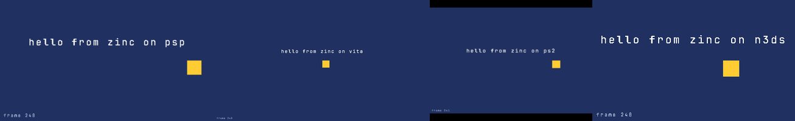
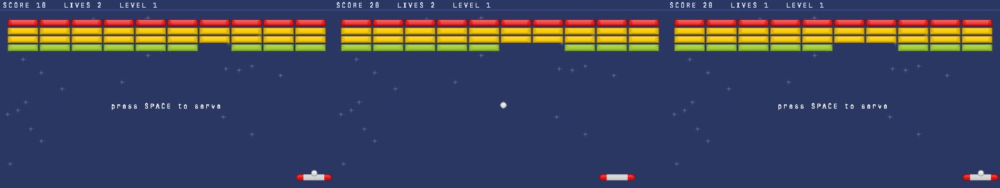
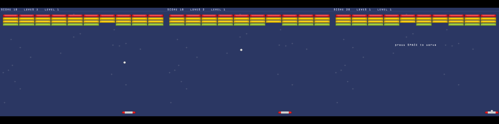
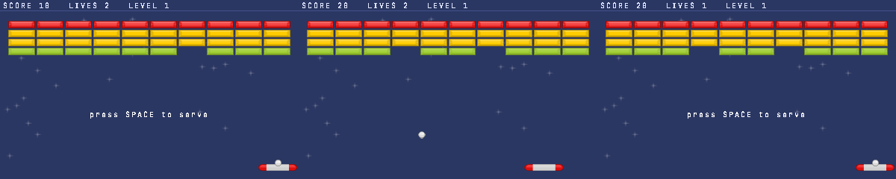
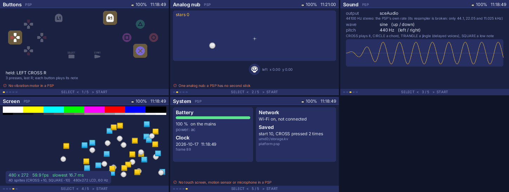
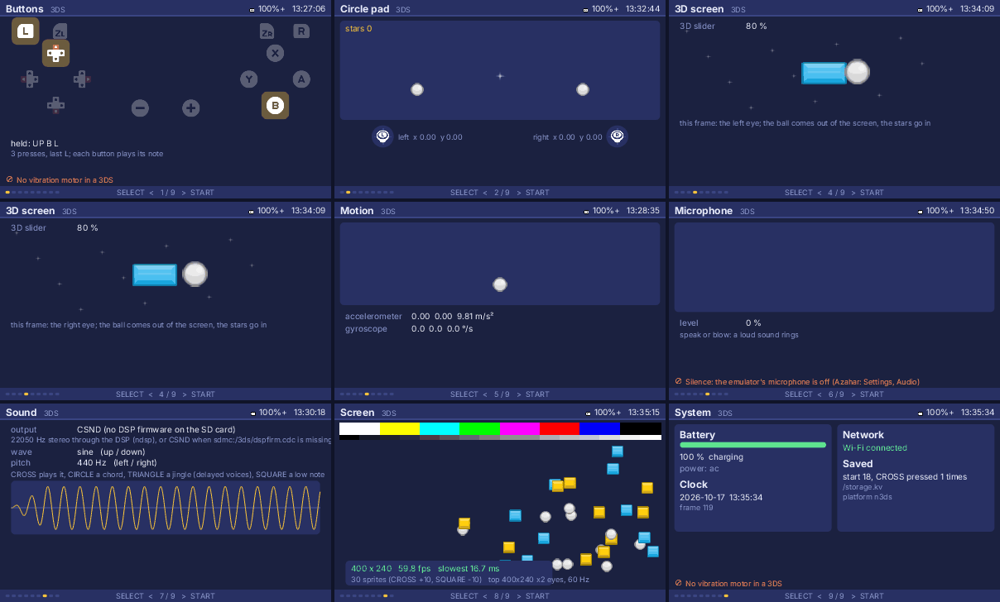
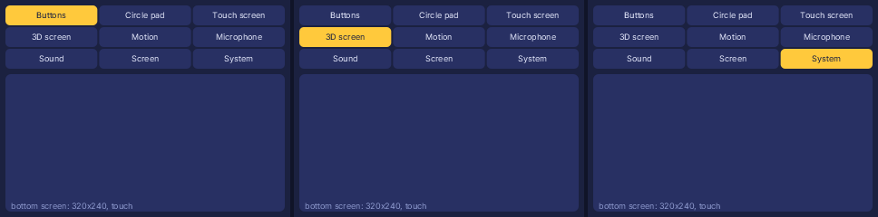
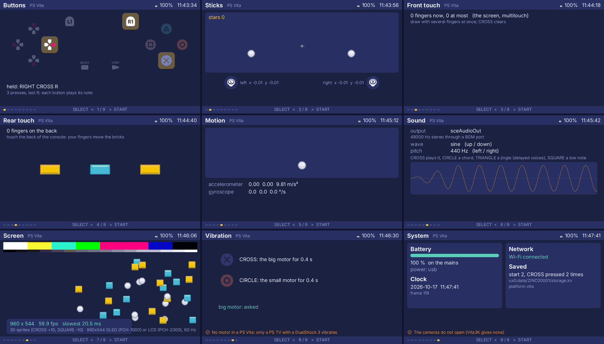
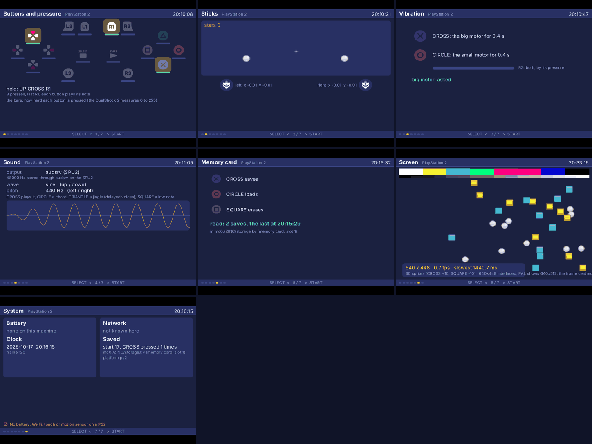

# Zinc Next on the consoles: breakout on PSP, PS Vita, PS2 and 3DS (ZN-753)

`examples/breakout` runs unchanged on the four console cores (`docs/targets/handhelds.md`), in their emulators, driven by each console's pad.
Since 2026-10-17 it wears Kenney's Puzzle Pack (CC0, `examples/breakout/assets/kenney`): bricks, paddle, ball and a starry background drawn as
sprites by `src/skin.ts`; the rules are untouched, and `src/render.ts` keeps the original look (the prototype's frames, `breakout-mods`).

## What each console shows

Every picture below is the emulator's own output, not the HAL's frame: PPSSPP's screenshot (PSP), PCSX2's save-state screenshot of the GS
output (PS2), and the framebuffer the display scans out, read back through the console's own call (`sceDisplayGetFrameBuf` on the Vita, the
3DS buffer shown since the last swap). Vita3K and Azahar have no screenshot a script can ask for (a key in their window), and window captures
need the Screen Recording permission.

The console hello (`next/targets/console/hello`), PSP, Vita, PS2 (PAL BIOS: 640x512, the 448-row frame centred) and 3DS:

breakout's pad session (`next/tests/golden/breakout/pad.input`: start, serve, move left and right, break bricks, lose a life, serve again), at
frames 300, 600 and 900:

PSP, 480x272 (PPSSPPHeadless 1.20.4, software renderer):

PS Vita, the program at 480x272 shown doubled on the 960x544 screen (`zinc.json` `targets.vita`; Vita3K):

PS2, 640x448 in a PAL 640x512 picture (PCSX2 2.8.2, the owner's BIOS):

Nintendo 3DS top screen, 400x240 (Azahar 2126.2):

The last frame of the session has the same hash on the console as `zinc run --interp` with the console's profile, size and script
(`tests/golden/breakout/pad.hashes`): PSP, Vita and 3DS byte for byte; the PS2 ends on the same game (score, lives, bricks, paddle), its pixels
within one or two colour steps (no pixel differs by more than 3%): the EE's FPU is not IEEE (it rounds toward zero, has no denormals), which the
raster's blends feel. Its own hash is the golden's fourth column.

## Frame times

`ZINC_PROFILE=1` built into the core, 900 frames of the session, in milliseconds. *work* is the program and the draw list (input, game, paint,
diff); *present* is the software raster of the damaged rows and the copy to the console's framebuffer. Clocks: the emulated clock on PPSSPP
(333 MHz), PCSX2 and Azahar, so these are console times as far as the emulator models the CPU's speed (PPSSPP and Azahar estimate cycles, they
are not cycle-exact); Vita3K runs the ARM code on the host and its clock is the host's, so its numbers are the Mac's, not a Vita's.

| Console | Screen | work p50 / p99 / max | present p50 / p99 / max | 60 fps? |
|---|---|---|---|---|
| PSP (PPSSPP, 333 MHz) | 480x272 | 1.16 / 1.22 / 1.90 | 0.00 / 6.42 / 19.67 | yes; a full redraw (a new wall, the title) takes one frame over |
| PS2 (PCSX2, EE 294 MHz) | 640x448 | 1.75 / 1.81 / 3.07 | 0.79 / 17.64 / 44.02 | no at a full redraw (one to three frames), yes in play; PAL is 50 Hz |
| 3DS (Azahar, old 3DS 268 MHz) | 400x240 | 0.53 / 0.60 / 1.01 | 0.00 / 3.27 / 16.15 | yes |
| Vita (Vita3K, host clock) | 480x272 x2 | 0.13 / 0.62 / 11.90 | not printed (Vita3K drops lines) | yes on the Mac; unmeasured on a Vita |
| Vita (Vita3K, host clock) | 960x544 | 0.36 / 4.83 / 9.56 | | |
| Vita (the owner's PS Vita, ARM 444 MHz), Meadow Run on GXM | 960x544 | 3.2-3.7 / 3.9 / 8.8 | replay 0.3-0.44 / 0.5 / 2.3, then the vblank wait | yes: 4,200 frames, none missed a vblank (frame max 17.9 ms) |

In play only the rows that change are rastered (the ball, the paddle, a brick): the p50 of *present* is under a millisecond everywhere. The
p99 is the frames that redraw everything (the title, the wall of a new level): 320,000 pixels on the PS2 through one EE core and a texture
upload. The GE, GXM and PICA replays (later tasks) take that off the CPU.

PPSSPP's GPU backend does not change these numbers: the core writes its pixels to VRAM itself and the backend only shows them, so the
"software and GPU modes" of PPSSPP give the same frame and the same times; the run above uses `--graphics=software`.

## What each port needed

- **All**: a built-in pad session (`tools/build-console-core --input`, the `pad`/`padup` lines of a `ZINC_INPUT` script, held on top of the
  real pad) and environment (`--env ZINC_PROFILE=1 ZINC_FRAMEHASH=last ZINC_DETERMINISTIC=1`); the analog stick (circle pad) as the d-pad; the
  text screen for a program that ends with nothing drawn; `tools/console-demos` for the copies a person plays (no frame budget, a Vita title id
  per demo).
- **PSP**: nothing beyond the above; the screenshot is cropped to 480 columns (the VRAM stride is 512).
- **Vita**: a surface smaller than the screen is shown scaled by a whole factor and centred (breakout at 480x272 doubled: its 8x8 text is
  readable); the ARM clock raised to 444 MHz; the shot read back from `sceDisplayGetFrameBuf`. Vita3K does not show newlib's stdout and drops
  repeated lines.
- **PS2**: the frame centred and the screen cleared around it (a PAL BIOS gives 640x512: the 64 rows under a 448-row frame showed old video
  memory); `hal_env` reads the environment; a test build keeps its last frame on the screen after `zinc:exit` so PCSX2's save state holds it;
  the DualShock 2 set to analog mode for its stick. The owner's black screen was the one-line text program: it drew nothing.
- **3DS**: the top screen is double-buffered and the HAL wrote only the damaged rows into the buffer being drawn, so each buffer missed the
  other frame's changes (a moving object left a ghost every other frame); each buffer now takes every row changed since it was last shown.

## Kenney skin

`examples/breakout/assets/kenney`: eleven PNGs of the Puzzle Pack 1.1 (<https://kenney.nl/assets/puzzle-pack-1>) and its `License.txt` (CC0).
The bricks keep their size (64x32 sprites drawn at the rules' 44x10 on the PSP), the ball sprite is drawn 2 px larger than its 5 px hitbox, the
paddle 2 px taller. No sound: the console cores have no audio yet, and `zinc:audio` is a plugin the console cores do not load (Kenney's
"Interface Sounds" go in when they do). The prototype's frozen breakout frame is no longer compared (`manifest.json` skip row, the owner's
choice); `breakout-mods` still draws `render.ts` and is compared.

## Files for the owner

`~/Documents/psp/breakout/EBOOT.PBP`, `~/Documents/vita/breakout.vpk` (title "Breakout", ZINC00002), `~/Documents/ps2/breakout.elf`,
`~/Documents/3ds/breakout.3dsx`, and the hello beside them (`zinc-hello`, ZINC00001). Controls: the d-pad or the left stick (circle pad) move
the paddle, Cross (A on the 3DS) or START starts and serves. Rebuild them with `tools/console-demos ../examples/breakout breakout --title
Breakout --id ZINC00002`.

## Hardware demos: every part of each console (ZN-759)

`examples/hardware-psp`, `hardware-vita`, `hardware-ps2` and `hardware-n3ds` show each part of the console live, one screen each, with Kenney's
Input Prompts and Puzzle Pack (CC0, each project's `assets/kenney`); START and SELECT move between the screens, and a line in orange says what
the console (or its emulator) does not give. The parts are zinc APIs every target has (`docs/targets/handhelds.md`, "Hardware"): zinc:gfx's
gamepad 0, touch points and windows, zinc:audio, zinc:storage and zinc:hardware, so the same screens run on a desktop
(`zinc run --simulate psp examples/hardware-psp`). The pictures below are the emulators' own (as for breakout), from a pad session built into
the core (`tools/build-console-core --input`): each shot is the last frame of a session that goes to that screen and presses its buttons.

### PSP (PPSSPPHeadless 1.20.4)

Buttons (LEFT, CROSS and R held), the analog nub, the sound (sceAudio at 44.1 kHz, the samples of the last tone), the screen (40 sprites at
59.9 fps), the system (battery and mains from PPSSPP, the Wi-Fi switch, the clock, a counter saved with zinc:storage):

| Part | Live | Note |
|---|---|---|
| D-pad, CROSS CIRCLE SQUARE TRIANGLE, L, R, START, SELECT | yes, each with its note | gamepad 0 in W3C order |
| Analog nub | yes (left stick axes; it also drives the d-pad buttons) | no second stick on a PSP: said on screen |
| Sound | yes: zinc:audio's mixer at 44100 Hz on a 1024-frame channel | PPSSPPHeadless plays no sound; PPSSPPSDL does |
| Screen | 480x272 at 60 fps with 40 sprites: work 2.8 ms, present 11.2 ms (p50, emulated 333 MHz) | |
| Battery, clock | `scePowerGetBatteryLifePercent`, mains, charging; `gettimeofday` (UTC) | PPSSPP reports 100 %, on the mains |
| Wi-Fi | the WLAN switch (`sceWlanGetSwitchState`): on or off | a PSP joins no network here |
| Saving | zinc:storage in the game's folder | PPSSPPHeadless runs from `umd0:` |
| Vibration, touch, motion, microphone | none on a PSP: said on screen | |

Controls in PPSSPP: its own keyboard or gamepad mapping (Settings, Controls); the nub is a gamepad's left stick there.

### Nintendo 3DS (Azahar 2126.2, New 3DS)

Top screen: buttons (B, UP and L held), the circle pad and the C-stick, the 3D screen's left and right eyes (the 3D slider at 80 %: the ball
comes out of the screen, the stars go in), motion, the microphone, the sound (CSND), the screen (30 sprites at 59.8 fps), the system:

The bottom screen is the program's zinc:gfx window: the screens' names to tap and a pad to draw on with the stylus:

| Part | Live | Note |
|---|---|---|
| A B X Y, d-pad, L R, START SELECT; ZL ZR | yes; ZL and ZR as the triggers (New 3DS) | an Old 3DS says it has none |
| Circle pad, C-stick | the left and right sticks; the C-stick through ir:rst on a New 3DS | |
| Bottom screen, touch | the first `openWindow` (320x240) is the bottom screen; the stylus is its pointer and touch point | |
| Stereoscopic 3D | `setStereo(true)`: with the slider up the frames alternate, the left eye to GFX_LEFT with no swap, the right to GFX_RIGHT, both shown at the vblank (gfxSet3D) | Azahar's slider is its own setting (left at 0 here); the shots force it with `--env ZINC_3D_SLIDER=0.8` and the HAL's right-eye shot |
| Accelerometer, gyroscope | HID's sensors, about 512 a g, the gyro through its raw-to-°/s coefficient | Azahar: gravity on z at rest; its motion comes from a right-mouse drag or a gamepad |
| Microphone | MIC service, 16 kHz PCM, the RMS of the last 1/30 s | Azahar's input was off (exact silence): said on screen |
| Sound | zinc:audio at 22050 Hz: ndsp with the DSP firmware (`sdmc:/3ds/dspfirm.cdc`), else one looping CSND buffer written ahead by the clock | Azahar's SD card has no firmware: CSND, shown as the output's name |
| Screen | 400x240 at 59.8 fps with 30 sprites: work 2.4 ms, present 5.9 ms (p50, Azahar's estimate of an Old 3DS's 268 MHz) | |
| Battery, Wi-Fi, clock | ptm (five steps; mcu::HWC's percentage when it agrees), the adapter; ac:u's Wi-Fi status and SSID | Azahar: 100 %, charging, connected |
| Saving | zinc:storage in the working directory (`sdmc:/`) | |
| Vibration | none in a 3DS: said on screen | |

### PS Vita (Vita3K, the owner's firmware and settings by copy)

Buttons (RIGHT, CROSS and R held), both sticks, front touch, rear touch, motion, the sound (sceAudioOut at 48 kHz), the screen (30 sprites at
59.9 fps on the Mac's clock), vibration, the system (battery, Wi-Fi, clock, a counter saved in `ux0:data/<title id>/`):

| Part | Live | Note |
|---|---|---|
| Buttons, both sticks | gamepad 0, W3C order, the two sticks as axes 0 to 3 | |
| Front touch | sceTouch's front port mapped from its active area onto the screen: zinc:gfx touch points, the first one the pointer | the session above has no touch (a script drives the pad only); Vita3K: the mouse |
| Rear touch | sceTouch's back port: zinc:hardware `rearTouches()` | Vita3K gives the rear pad through its touch toggle |
| Motion | sceMotion: the accelerometer (g, turned to the web's m/s² and sign) and the gyro (rad/s to °/s) | Vita3K: gravity on z at rest, its motion from a gamepad's sensors |
| Sound | zinc:audio at 48 kHz on a BGM port, its own thread | |
| Screen | 960x544 at 59.9 fps | Vita3K runs on the Mac's clock: not a Vita's time |
| Vibration | gamepadRumble asks `sceCtrlSetActuator(1, ...)`: a PS TV's DualShock 3 | a Vita has no motor: said on screen |
| Cameras | `device('cameras')` opens each one | Vita3K opens none: said on screen; the picture is not shown (a later step) |
| Battery, Wi-Fi, clock | scePower (percent, charging, the cable); SceNetCtl's state and SSID | Vita3K: 100 %, connected |
| Saving | zinc:storage in `ux0:data/<title id>/` (app0: is read-only) | |

### PlayStation 2 (PCSX2 2.8.2, the owner's BIOS, the runner's own data folder)

Buttons with their pressure bars (UP, CROSS and R1 held), both sticks, the motors, the sound (audsrv on the SPU2), the memory card (saved,
then read back from `mc0:/ZINC/storage.kv`), the screen, the system:

| Part | Live | Note |
|---|---|---|
| Buttons, both sticks, L3 R3, L2 R2 | gamepad 0 in W3C order (L2 R2 the triggers), the sticks once the pad is in analog mode | PCSX2's runner folder has no pad bindings: the session is scripted |
| Pressure | libpad's pressure mode (padEnterPressMode): every button's 0 to 255 in `gamepadButtonValue` | a scripted press reads 1; PCSX2 gives pressure from an analog binding |
| Vibration | gamepadRumble: the big motor's strength (low) and the small one (high), padSetActAlign then padSetActDirect; stopped after the asked time | PCSX2 forwards it to a host gamepad's motors |
| Sound | zinc:audio at 48 kHz through audsrv (FREESD and audsrv linked in as IOP modules, loaded from EE memory after sbv_patch_enable_lmb) | |
| Memory card | zinc:storage in `mc0:/ZINC/` (rom0:MCMAN and MCSERV, libmc to see the card): save, load, erase; kept across runs | the runner's fresh card was unformatted: the test build formats it (`--env ZINC_FORMAT_CARD=1`); a person's card is formatted in the PS2's browser and the demo never formats one |
| Screen | 640x448 in a PAL 640x512 picture: 48 fps with 10 sprites, 25 fps with 30 (a full redraw each frame: work 3.6 ms, present 22.5 ms, p50; PAL is 50 Hz) | the shot's last frame shows the 1.4 s the test spends writing its picture through `host:` |
| Clock | the console's clock (`Date`): PCSX2's reads 8 hours ahead of UTC | |
| Battery, Wi-Fi, touch, motion | none on a PS2: said on screen | |
