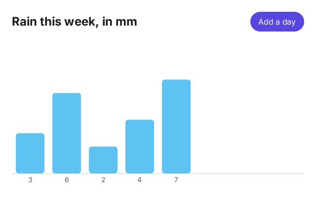
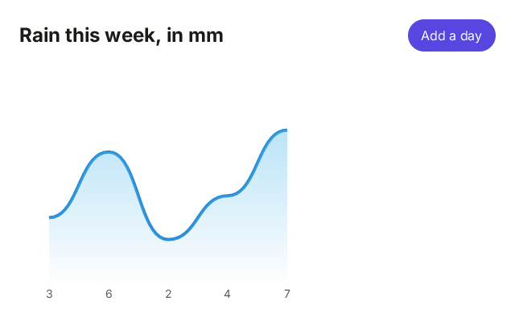
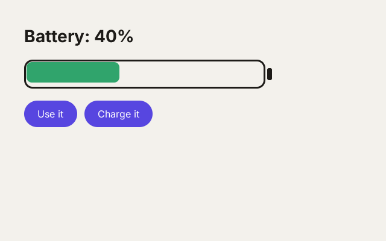
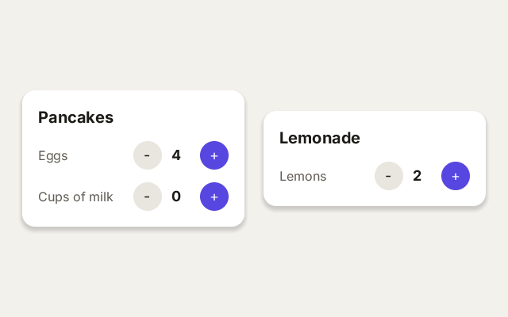
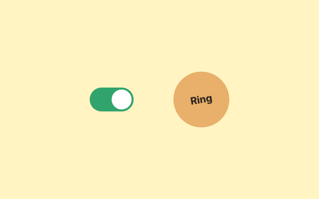
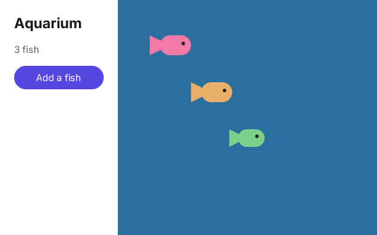
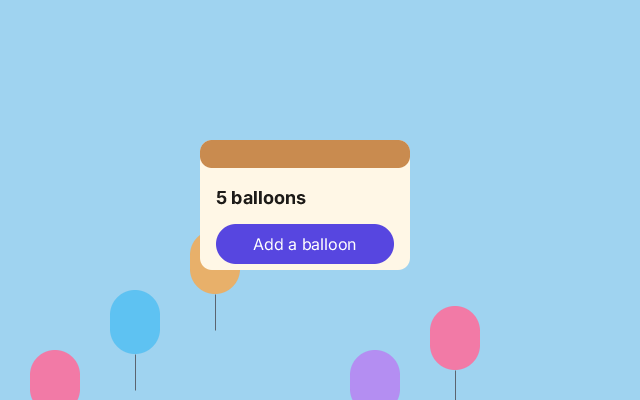

# Beyond the components

`View`, `Text`, `Button` and the other elements build most screens: forms, lists, settings. Sooner or later you want something they
do not have: a chart, a switch that slides, a card of your own, a game board beside the buttons. This page shows seven ways to go
further. Each one is a small program you can run and change.

Each program is a project in [`docs/start/samples/`](samples/), run like a lesson: `zinc run docs/start/samples/chart-gfx`. The page
expects you to know the interface lessons ([7 to 11](../learn/07-components.md)); the last two parts also use a scene
([lessons 13 to 15](../learn/13-a-stage-and-a-sprite.md)).

1. [Draw it yourself](#draw-it-yourself): a `Canvas` and `zinc:gfx`.
2. [Draw it with the web's canvas](#draw-it-with-the-webs-canvas): a `Canvas` and `zinc:canvas`.
3. [Styles as objects](#styles-as-objects): `style` instead of `className`.
4. [Components of your own](#components-of-your-own): props, children and a state of their own.
5. [Animations and transitions](#animations-and-transitions): things that move by themselves.
6. [A scene inside an interface](#a-scene-inside-an-interface): sprites in a box of the interface.
7. [An interface inside a scene](#an-interface-inside-a-scene): buttons on an object of the scene.

## Draw it yourself

**What you will see:** the rain of the week as bars, and a button that adds a day.



[`samples/chart-gfx/src/main.tsx`](samples/chart-gfx/src/main.tsx):

```tsx
import { createSignal, render } from 'zinc:ui/solid';
import { rrect, rect, font, drawText, textWidth } from 'zinc:gfx';

const MORE = [4, 7, 1, 8, 5];                       // the days still to come
const [rain, setRain] = createSignal<number[]>([3, 6, 2]);
const label = font('sans', 14);

function addDay(): void {
  if (rain().length - 3 >= MORE.length) return;
  setRain([...rain(), MORE[rain().length - 3]]);
  console.log(`${rain().length} days, ${rain()[rain().length - 1]} mm today`);
}

function chart(x: i32, y: i32, w: i32, h: i32): void {
  const days = rain();
  const step = w / 8;                               // room for 8 days
  const tall = (h - 24) / 10;                       // pixels for 1 mm
  rect(x, y + h - 24, w, 1, 0xd6d1c7);              // the ground line
  for (let i = 0; i < days.length; i++) {
    const barH = days[i] * tall;
    const left = x + i * step + 8;
    rrect(left, y + h - 24 - barH, step - 16, barH, 6, 0x5ec2f2, 255);
    const text = `${days[i]}`;
    drawText(label, left + (step - 16 - textWidth(label, text, 0)) / 2, y + h - 20, text, 0x625d55, 255, 0);
  }
}

function App(): i32 {
  return <View className="w-full h-full p-6 gap-4 bg-white">
    <View className="flex-row items-center gap-4">
      <Text className="grow text-2xl font-bold text-[#1d1b18]">Rain this week, in mm</Text>
      <Button className="px-4 h-10 rounded-full bg-[#5746e0]" onClick={addDay}>
        <Text className="text-base text-white">Add a day</Text>
      </Button>
    </View>
    <Canvas className="grow" onDraw={chart} />
  </View>;
}

render(App, 0xffffff, null);
```

Click *Add a day* twice. The terminal shows:

```text
4 days, 4 mm today
5 days, 7 mm today
```

- There is no chart element. A `<Canvas>` is a box of the interface that you paint yourself. The layout gives it its place, like any
  element (`grow`: the room the title leaves). Then Zinc calls its `onDraw` function with that box: `x`, `y`, `w`, `h`.
- `chart` draws with the functions of [part 1 of the lessons](../learn/README.md#the-lessons): `rect`, `rrect`, `drawText`.
- Measure everything from `x` and `y`, the corner of the box, never from the corner of the window.
- The bars come from a signal, `rain()`. A Canvas is painted again on every frame, so a new day shows as soon as the signal changes.
- The sizes are shares of the box (`w / 8`, `(h - 24) / 10`): make the window bigger and the chart grows with it.

**Try:** draw the rainy days (more than 5 mm) in a darker blue. Draw a line at the height of the week's average.

## Draw it with the web's canvas

**What you will see:** the same week, as a smooth line over a blue that fades into the ground.



[`samples/chart-canvas/src/main.tsx`](samples/chart-canvas/src/main.tsx):

```tsx
import { createSignal, render } from 'zinc:ui/solid';
import { CanvasRenderingContext2D } from 'zinc:canvas';

const MORE = [4, 7, 1, 8, 5];                       // the days still to come
const [rain, setRain] = createSignal<number[]>([3, 6, 2]);
const ctx = new CanvasRenderingContext2D();

function addDay(): void {
  if (rain().length - 3 >= MORE.length) return;
  setRain([...rain(), MORE[rain().length - 3]]);
  console.log(`${rain().length} days, ${rain()[rain().length - 1]} mm today`);
}

function chart(x: i32, y: i32, w: i32, h: i32): void {
  const days = rain();
  const step = w / 8;                               // room for 8 days
  const ground = h - 24;
  const at = (i: i32): number => step * i + step / 2;           // the middle of day i
  const top = (i: i32): number => ground - days[i] * ground / 10;
  ctx.begin(x, y, w, h);                            // from here, (0, 0) is the Canvas's corner

  // a smooth line from day to day: each piece is a curve that leaves and arrives flat
  ctx.beginPath();
  ctx.moveTo(at(0), top(0));
  for (let i = 1; i < days.length; i++) ctx.bezierCurveTo(at(i) - step / 2, top(i - 1), at(i) - step / 2, top(i), at(i), top(i));
  ctx.lineWidth = 4;
  ctx.strokeStyle = '#2b8fd6';
  ctx.stroke();

  // the same line, closed along the ground, filled with a fading blue
  ctx.lineTo(at(days.length - 1), ground);
  ctx.lineTo(at(0), ground);
  const fade = ctx.createLinearGradient(0, 0, 0, ground);
  fade.addColorStop(0, 'rgba(94, 194, 242, 0.6)');
  fade.addColorStop(1, 'rgba(94, 194, 242, 0)');
  ctx.fillGradient = fade;                          // on the web: ctx.fillStyle = fade
  ctx.fill();

  ctx.font = '14px sans-serif';
  ctx.textAlign = 'center';
  ctx.fillStyle = '#625d55';
  for (let i = 0; i < days.length; i++) ctx.fillText(`${days[i]}`, at(i), h - 6);
  ctx.end();
}

function App(): i32 {
  return <View className="w-full h-full p-6 gap-4 bg-white">
    <View className="flex-row items-center gap-4">
      <Text className="grow text-2xl font-bold text-[#1d1b18]">Rain this week, in mm</Text>
      <Button className="px-4 h-10 rounded-full bg-[#5746e0]" onClick={addDay}>
        <Text className="text-base text-white">Add a day</Text>
      </Button>
    </View>
    <Canvas className="grow" onDraw={chart} />
  </View>;
}

render(App, 0xffffff, null);
```

Click *Add a day* twice: the same two lines as above.

- The same `<Canvas onDraw>`, drawn with the calls of the web's `<canvas>` ([`zinc:canvas`](../plugins/canvas2d.md), part 4 of
  the lessons). Code from a web tutorial about charts reads the same way.
- `ctx.begin(x, y, w, h)` gives the context the box of the Canvas. From there, `(0, 0)` is the corner of the box, and nothing is
  drawn outside it. `ctx.end()` closes it.
- A path is built point by point, then `stroke` draws its outline and `fill` paints its inside. Here the line is stroked first,
  then closed along the ground and filled.
- `bezierCurveTo` makes each piece of the line a curve. Its first two points pull the curve flat at both ends, so the pieces join
  smoothly.
- A gradient is a paint that changes along a line. `createLinearGradient(0, 0, 0, ground)` goes from the top down: a see-through
  blue that fades to nothing.
- Which one? `zinc:gfx` for boxes, circles, text and pictures; `zinc:canvas` for curves, outlines, dashes and gradients.

**Try:** draw a white dot with a blue outline on each day (`arc`, `fill`, then `stroke`).

## Styles as objects

**What you will see:** a battery that empties and fills, and turns red when it is low.



[`samples/style-objects/src/main.tsx`](samples/style-objects/src/main.tsx):

```tsx
import { createSignal, render } from 'zinc:ui/solid';
import { StyleSheet } from 'zinc:ui';

const [level, setLevel] = createSignal<number>(60);   // the battery, in percent

const styles = StyleSheet.create({
  page: { width: '100%', height: '100%', padding: 40, gap: 20, backgroundColor: '#f3f1ec' },
  title: { fontSize: 28, fontWeight: 'bold', color: '#1d1b18' },
  battery: { flexDirection: 'row', alignItems: 'center', gap: 3 },
  track: { width: 400, height: 48, padding: 4, borderRadius: 14, borderWidth: 3, borderColor: '#1d1b18' },
  fill: { height: 34, borderRadius: 9 },
  tip: { width: 8, height: 20, borderRadius: 3, backgroundColor: '#1d1b18' },
  row: { flexDirection: 'row', gap: 12 },
  button: { height: 44, paddingHorizontal: 22, borderRadius: 22, backgroundColor: '#5746e0' },
  label: { fontSize: 16, color: 'white' },
});

function change(by: number): void {
  setLevel(Math.max(0, Math.min(100, level() + by)));
  console.log(`battery ${level()}%`);
}

function App(): i32 {
  return <View style={styles.page}>
    <Text style={styles.title}>{`Battery: ${level()}%`}</Text>
    <View style={styles.battery}>
      <View style={styles.track}>
        <View style={[styles.fill, { width: level() * 3.86, backgroundColor: level() <= 20 ? '#e5484d' : '#30a46c' }]} />
      </View>
      <View style={styles.tip} />
    </View>
    <View style={styles.row}>
      <Button style={styles.button} onClick={() => change(-20)}><Text style={styles.label}>Use it</Text></Button>
      <Button style={styles.button} onClick={() => change(20)}><Text style={styles.label}>Charge it</Text></Button>
    </View>
  </View>;
}

render(App, 0xf3f1ec, null);
```

Click *Use it* twice, then *Charge it*. The terminal shows:

```text
battery 40%
battery 20%
battery 40%
```

- `className` is not the only way to give a look. `style` takes an object of named values, as in React Native:
  `{ fontSize: 28, color: '#1d1b18' }`. The names are the properties of CSS written in one word (`backgroundColor` for
  `background-color`); numbers are pixels.
- `StyleSheet.create` names a group of styles once, at the top of the file: `styles.title`, `styles.button`. Use it for the styles
  that never change.
- A list, `style={[a, b]}`, puts styles on top of each other; the last one wins. Here `styles.fill`, then an object of values that
  change.
- That object reads the signal: `width: level() * 3.86` (3.86 pixels for each percent), and a colour chosen with `? :`. Change the
  signal and the bar follows.
- Which one? Classes are short to write and to read. Objects suit values you compute, and they are what React Native code uses. You
  can give both to one element. A program with no `className` at all is lighter: Zinc leaves out the code that reads classes.
- Every property: [Object styles and StyleSheet](../ui.md#object-styles-and-stylesheet).

**Try:** add a third button that empties the battery at once. Make the bar orange between 20% and 50%.

## Components of your own

**What you will see:** two recipe cards. Each ingredient has a number, a minus and a plus.



[`samples/own-components/src/main.tsx`](samples/own-components/src/main.tsx):

```tsx
import { createSignal, render } from 'zinc:ui/solid';

// A card: a title, and whatever you put between <Card> and </Card>.
interface CardProps { title: string; children: () => i32 }

function Card(props: CardProps): i32 {
  return <View className="w-[280px] p-5 gap-4 rounded-2xl bg-white shadow-md">
    <Text className="text-xl font-bold text-[#1d1b18]">{props.title}</Text>
    {props.children()}
  </View>;
}

// A number with a minus and a plus. Each Stepper keeps its own number, and tells its owner when it changes.
interface StepperProps { label: string; start: i32; onChange: (value: i32) => void }

function Stepper(props: StepperProps): i32 {
  const [value, setValue] = createSignal<i32>(props.start);
  const change = (by: i32): void => {
    if (value() + by < 0) return;
    setValue(value() + by);
    props.onChange(value());
  };
  return <View className="flex-row items-center gap-3">
    <Text className="grow text-base text-[#625d55]">{props.label}</Text>
    <Button className="w-9 h-9 rounded-full bg-[#e9e6df]" onClick={() => change(-1)}>
      <Text className="text-lg text-[#1d1b18]">-</Text>
    </Button>
    <Text className="w-6 text-lg font-bold text-[#1d1b18]">{`${value()}`}</Text>
    <Button className="w-9 h-9 rounded-full bg-[#5746e0]" onClick={() => change(1)}>
      <Text className="text-lg text-white">+</Text>
    </Button>
  </View>;
}

function App(): i32 {
  return <View className="w-full h-full flex-row items-center justify-center gap-6 bg-[#f3f1ec]">
    <Card title="Pancakes">
      <Stepper label="Eggs" start={2} onChange={(n: i32) => console.log(`pancakes: ${n} eggs`)} />
      <Stepper label="Cups of milk" start={1} onChange={(n: i32) => console.log(`pancakes: ${n} cups of milk`)} />
    </Card>
    <Card title="Lemonade">
      <Stepper label="Lemons" start={3} onChange={(n: i32) => console.log(`lemonade: ${n} lemons`)} />
    </Card>
  </View>;
}

render(App, 0xf3f1ec, null);
```

Click the eggs' plus twice, the milk's minus, then the lemons' minus. The terminal shows:

```text
pancakes: 3 eggs
pancakes: 4 eggs
pancakes: 0 cups of milk
lemonade: 2 lemons
```

- A component is a function that returns elements. Its name starts with a capital letter, and you use it like any element:
  `<Card title="Pancakes">`.
- What you write on it (`title="Pancakes"`, `start={2}`) arrives in `props`, an object whose fields an `interface` lists:
  `props.title`, `props.start`.
- What you put between `<Card>` and `</Card>` arrives as `props.children`, a function. `{props.children()}` puts it where you want
  it in the card.
- `Stepper` keeps its number in a signal made inside it. Each `<Stepper>` gets its own, so the eggs and the lemons do not share.
- A component tells its owner what happened through a function it was given, `onChange`. The owner decides what to do; here it
  prints a line.
- A component can hold a drawing too: a `<Canvas>` inside it makes a gauge, a dial or a meter that you use like a `<Button>`.

**Try:** give `Stepper` a `max` prop and stop at it. Add a third card.

## Animations and transitions

**What you will see:** a switch that turns the light on, and the page fades to a warm yellow. A bell swings when you ring it.



[`samples/animation/src/main.tsx`](samples/animation/src/main.tsx):

```tsx
import { createSignal, render } from 'zinc:ui/solid';
import * as Animated from 'zinc:ui/animated';

const [on, setOn] = createSignal<boolean>(false);
const swing = new Animated.Value(0);                 // the bell's angle, in degrees

function flip(): void {
  setOn(!on());
  console.log(on() ? 'the light is on' : 'the light is off');
}

function ring(): void {
  console.log('ring!');
  Animated.sequence([
    Animated.timing(swing, { toValue: 25, duration: 120 }),
    Animated.timing(swing, { toValue: -25, duration: 240 }),
    Animated.spring(swing, { toValue: 0, bounciness: 14 }),
  ]).start((finished: boolean) => console.log('the bell is still again'));
}

function App(): i32 {
  return <View className={`w-full h-full flex-row items-center justify-center gap-20 transition-colors duration-500 ${on() ? 'bg-[#fff4c2]' : 'bg-[#2a2833]'}`}>
    <View className={`w-[88px] h-12 p-1 rounded-full transition-colors duration-300 ${on() ? 'bg-[#30a46c]' : 'bg-[#8e8c99]'}`} onClick={flip}>
      <View className="w-10 h-10 rounded-full bg-white transition-transform duration-300 ease-out" style={{ translateX: on() ? 40 : 0 }} />
    </View>
    <Button className="w-28 h-28 rounded-full bg-[#e8b06a]" style={{ rotate: swing.get() }} onClick={ring}>
      <Text className="text-xl font-bold text-[#1d1b18]">Ring</Text>
    </Button>
  </View>;
}

render(App, 0x2a2833, null);
```

Click the switch, then the bell. The terminal shows:

```text
the light is on
ring!
the bell is still again
```

- A **transition** eases a change. The page has `transition-colors duration-500`: when its colour changes, Zinc moves from the old
  colour to the new one in 500 milliseconds. Your code changes the value once; it runs nothing on each frame.
- The knob slides the same way: `transition-transform` eases its `translateX` from 0 to 40 pixels, and `ease-out` starts fast and
  slows down at the end.
- An **animation** is started by your code. `Animated` is React Native's. `swing` is an `Animated.Value`, a number that moves, and
  `style={{ rotate: swing.get() }}` turns the bell by it, in degrees.
- `Animated.timing` moves the value to `toValue` in `duration` milliseconds. `Animated.spring` lets it bounce there like a spring.
  `Animated.sequence` plays them one after the other, and `start` takes a function to call at the end.
- Which one? A transition for a state that changes: on, off, chosen, open. An animation for a movement with a story of its own: a
  shake, a bounce, a loop.
- A style object says the same as the classes with `transitionProperty` and `transitionDuration`. More in
  [Transitions](../ui.md#transitions) and [Animated](../ui.md#animated-react-natives-api).

**Try:** make the bell grow while it rings (`scale`). Make the switch slower, then faster.

## A scene inside an interface

**What you will see:** a panel with a button, beside an aquarium where fish swim. Click a fish to feed it: it grows.



[`samples/scene-in-interface/src/main.tsx`](samples/scene-in-interface/src/main.tsx):

```tsx
import { createSignal, render } from 'zinc:ui/solid';
import { rrect, polygon } from 'zinc:gfx';
import { Stage, Sprite, registerTapZone } from 'zinc:stage';

const COLORS: u32[] = [0xf27aa6, 0xe8b06a, 0x7bd389, 0xffffff];
const NAMES = ['pink', 'gold', 'green', 'white'];
const [count, setCount] = createSignal<i32>(0);

class Fish extends Sprite {
  speed: number = 50;         // pixels per second, + to the right
  color: u32 = 0;
  override onUpdate(dt: number): void {
    if (stage.width === 0) return;                           // not drawn yet: the tank has no size
    this.x += this.speed * dt;
    if (this.x < 0) this.speed = Math.abs(this.speed);       // turn back at the glass
    if (this.x > stage.width - this.width) this.speed = -Math.abs(this.speed);
  }
  override onDraw(w: number, h: number): void {
    const right = this.speed > 0;                            // which way it swims
    const tail = right ? 0 : w;
    polygon([tail, 0, tail, h, w / 2, h / 2], this.color, 255);
    rrect(right ? w * 0.25 : 0, 0, w * 0.75, h, h / 2, this.color, 255);
    rrect(right ? w - 16 : 10, h / 2 - 6, 6, 6, 3, 0x1c1b20, 255);   // the eye
    registerTapZone(this.name, 0, 0, w, h, () => this.feed());
  }
  feed(): void {
    this.width += 10;
    this.height += 4;
    console.log(`fed the ${this.name} fish, it is ${this.width} pixels long`);
  }
}

const stage = new Stage();

function addFish(): void {
  const n = stage.numChildren;
  const fish = new Fish(NAMES[n % 4]);
  fish.color = COLORS[n % 4];
  fish.x = 30 + 70 * n;
  fish.y = 60 + 80 * n;
  fish.width = 60;
  fish.height = 30;
  stage.addChild(fish);
  setCount(stage.numChildren);
  console.log(`${count()} fish in the tank`);
}

addFish();
addFish();

function App(): i32 {
  return <View className="w-full h-full flex-row">
    <View className="w-[200px] p-6 gap-4 bg-white">
      <Text className="text-2xl font-bold text-[#1d1b18]">Aquarium</Text>
      <Text className="text-base text-[#625d55]">{`${count()} fish`}</Text>
      <Button className="px-2 h-10 rounded-full bg-[#5746e0]" onClick={addFish}>
        <Text className="text-base text-white">Add a fish</Text>
      </Button>
    </View>
    <Canvas className="grow bg-[#2b6f9e]" onDraw={(x: i32, y: i32, w: i32, h: i32) => stage.drawIn(x, y, w, h)} />
  </View>;
}

render(App, 0xffffff, (dt: number) => stage.update(dt));
```

Click *Add a fish*, then the pink fish and the gold fish. The terminal shows:

```text
1 fish in the tank
2 fish in the tank
3 fish in the tank
fed the pink fish, it is 70 pixels long
fed the gold fish, it is 70 pixels long
```

- The fish are sprites of a scene ([`zinc:stage`](../reference/stage.md)), as in lessons 13 to 15. Each one moves in `onUpdate`,
  draws itself in `onDraw` and registers a tap zone.
- The scene lives in a `<Canvas>`. Its `onDraw` calls `stage.drawIn(x, y, w, h)`, which lays out and draws the stage in the box of
  the Canvas. The stage's `(0, 0)` is the corner of the box, and `stage.width`, `stage.height` its size.
- `render`'s third argument calls `stage.update(dt)` on every frame: it gives the pointer to the tap zones and calls `onUpdate`. (A
  program that is only a scene calls `stage.frame(dt)`, which does both halves.)
- Each side gets its own clicks. *Add a fish* is a button of the interface: its `onClick` calls `addFish`. A click on a fish goes to
  the fish's tap zone. Nothing of the scene reaches outside its box, its zones neither: a fish half out of the tank never takes a
  click meant for the panel.
- The stage has no size before it is first drawn, which is why `onUpdate` waits for `stage.width`.
- The water is the Canvas's own background (`bg-[#2b6f9e]`).

**Try:** make the fish turn back when they are fed. Add a button that empties the tank (`stage.removeChildren()`).

## An interface inside a scene

**What you will see:** balloons rise through the sky. A wooden sign holds a title and a button that adds a balloon. Click a balloon
to pop it. Drag the sign by its brown bar.



[`samples/interface-in-scene/src/main.tsx`](samples/interface-in-scene/src/main.tsx):

```tsx
import { createSignal, render } from 'zinc:ui/solid';
import { rrect, line } from 'zinc:gfx';
import { Stage, Sprite, registerTapZone, registerDragZone } from 'zinc:stage';

const COLORS: u32[] = [0xf27aa6, 0x5ec2f2, 0xe8b06a, 0x7bd389, 0xb48ef2];
const [signX, setSignX] = createSignal<number>(0);   // where the sign is: the interface follows it
const [signY, setSignY] = createSignal<number>(0);
const [count, setCount] = createSignal<i32>(0);
let made = 0;                                            // balloons made since the start

class Balloon extends Sprite {
  color: u32 = 0;
  override onUpdate(dt: number): void {
    this.y -= 30 * dt;                                   // it rises,
    if (this.y < -100) this.y = 400;                     // and comes back from below
  }
  override onDraw(w: number, h: number): void {
    line(w / 2, h, w / 2, h + 36, 0x5b6470);            // the string
    rrect(0, 0, w, h, w / 2, this.color, 255);
    registerTapZone('balloon', 0, 0, w, h, () => this.pop());
  }
  pop(): void {
    sky.removeChild(this);
    setCount(sky.numChildren);
    console.log(`pop! ${count()} balloons left`);
  }
}

class Sign extends Sprite {
  startX: number = 0;
  startY: number = 0;
  grabX: number = 0;
  grabY: number = 0;
  override onDraw(w: number, h: number): void {
    rrect(0, 0, w, h, 12, 0xfff7e6, 255);
    rrect(0, 0, w, 28, 12, 0xc98b4f, 255);              // the bar you drag it by
    registerTapZone('sign', 0, 28, w, h - 28, () => {}); // the interface takes these clicks, not the balloons behind
    registerDragZone('bar', 0, 0, w, 28, (x: number, y: number, phase: i32) => this.drag(x, y, phase));
  }
  drag(x: number, y: number, phase: i32): void {
    if (phase === 0) {
      this.startX = this.x;
      this.startY = this.y;
      this.grabX = x;
      this.grabY = y;
    } else {
      this.x = this.startX + x - this.grabX;
      this.y = this.startY + y - this.grabY;
    }
  }
}

function addBalloon(): void {
  const balloon = new Balloon('balloon');
  balloon.color = COLORS[made % COLORS.length];
  balloon.x = 30 + 80 * (made % 7);
  balloon.y = 380 - 60 * (made % 4);
  made++;
  balloon.width = 50;
  balloon.height = 64;
  sky.addChild(balloon);
  setCount(sky.numChildren);
  console.log(`a new balloon, ${count()} in the sky`);
}

const stage = new Stage();
const sky = new Sprite('sky');                           // the balloons, under the sign
stage.addChild(sky);
const sign = new Sign('sign');
sign.x = 400;
sign.y = 40;
sign.width = 210;
sign.height = 130;
stage.addChild(sign);
for (let i = 0; i < 5; i++) addBalloon();

function App(): i32 {
  return <View className="w-full h-full">
    <Canvas className="w-full h-full bg-[#9fd3f0]" onDraw={(x: i32, y: i32, w: i32, h: i32) => stage.drawIn(x, y, w, h)} />
    <View className="absolute w-[210px] h-[102px] p-4 gap-3" style={{ left: signX(), top: signY() + 28 }}>
      <Text className="text-lg font-bold text-[#1d1b18]">{`${count()} balloons`}</Text>
      <Button className="h-10 rounded-full bg-[#5746e0]" onClick={addBalloon}>
        <Text className="text-base text-white">Add a balloon</Text>
      </Button>
    </View>
  </View>;
}

render(App, 0x9fd3f0, (dt: number) => {
  stage.update(dt);
  setSignX(sign.x);                                      // the scene fills the window: its x and y are the window's
  setSignY(sign.y);
});
```

Pop the green balloon, drag the sign down and to the left, then click *Add a balloon* over the gold balloon behind the sign. The
terminal shows (after the five balloons of the start):

```text
pop! 4 balloons left
a new balloon, 5 in the sky
```

- The scene fills the window: one `<Canvas className="w-full h-full">` draws it with `drawIn`.
- The sign is a sprite: it draws the board and its bar. The interface on the sign is a `<View className="absolute">` placed over it
  with `style={{ left: signX(), top: signY() + 28 }}`. Zinc draws the elements that come after a Canvas over it, so the panel shows
  on the board.
- On every frame, after `stage.update(dt)`, the program copies where the sign is into two signals, `signX` and `signY`. Drag the
  sign and the panel follows it. (The scene starts at the corner of the window, so the sign's `x` and `y` are window positions.)
- The button belongs to the interface: its `onClick` adds a balloon. Under the panel, the sign registers a tap zone that does
  nothing. It covers the balloons behind, so a click on the button never pops a balloon too.
- The balloons are the children of a sprite of their own, `sky`, added before the sign: they rise behind it.

**Try:** put a second button on the sign that pops every balloon. Let the sign hang from a balloon and rise with it.

## Where to go next

- [Four ways to write a program](styles.md): the drawing, scene, Canvas and interface styles side by side, and how they mix.
- [zinc:ui in depth](../ui.md): every style key, the events, scrolling, layers, transitions.
- [zinc:stage reference](../reference/stage.md), [zinc:canvas](../plugins/canvas2d.md), [zinc:gfx reference](../reference/gfx.md).
- [The UI kit](../ui-kit.md): ready-made buttons, dialogs, menus and tabs, for when you would rather not make them.
