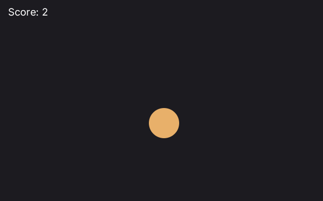

# Four ways to write a program

Zinc lets you put things on the screen in four ways. They run on the same engine, in the same window, with the same commands
(`zinc new`, `zinc run`, `zinc dev`); they differ in how you think about the screen. Pick the one that feels natural to you, or the one
that fits what you make. You can mix them, and you can change later: the language, the sound, the files and the network are the same in
all four.

| | Drawing | Scene | Canvas | Interface |
| --- | --- | --- | --- | --- |
| Module | `zinc:gfx` | `zinc:stage` | `zinc:canvas` | `zinc:ui` |
| Like | Processing, p5.js, LÖVE | ActionScript 3 (Flash), Haxe and OpenFL | the web's `<canvas>` | React, Solid, React Native |
| You write | a function that draws the whole picture, every frame | objects that each draw themselves, in a tree | the same frame function, with the web's canvas calls | the elements of the screen, once, in JSX |
| Good for | games, animations, art, a first program | apps and games on old tablets, objects you tap and drag | web canvas code, vector drawings, charts | apps, forms, lists, settings, tools |
| Start with | `zinc new game` | `zinc new stage` | `zinc new canvas` | `zinc new desktop-app` |
| Lessons | [1 to 6](../learn/README.md#the-lessons) | [13 to 16](../learn/13-a-stage-and-a-sprite.md) | [17 to 20](../learn/17-paths-and-fills.md) | [7 to 12](../learn/07-components.md) |

Where to choose: `zinc new` alone asks what you want to make, then, for a game or a drawing (Drawing, Scene, Canvas) and for an
app with windows (Interface, Scene), how you want to write it. In Zinc Atelier, **New sketch** at the top of the start view offers
the four styles, each a small program to begin from, and the examples below are grouped by style.

## The same program, four times

A ball bounces around the window. A click (or a tap) on the ball changes its colour and adds a point to the score at the top left.
Here it is in each style. The four programs look the same:



Each version is a small project in [`docs/start/samples/`](samples/), run like a lesson: `zinc run docs/start/samples/drawing`
(or `scene`, `canvas`, `interface`). Each one prints a line when you hit the ball:

```text
hit: score 1, the ball is blue
hit: score 2, the ball is gold
```

### Drawing (`zinc:gfx`)

[`samples/drawing/src/main.ts`](samples/drawing/src/main.ts):

```ts
import { onFrame, clear, rrect, font, drawText, width, height, pointerX, pointerY, pointerDown } from 'zinc:gfx';

const COLORS: u32[] = [0xf27aa6, 0x5ec2f2, 0xe8b06a, 0x7bd389];
const NAMES = ['pink', 'blue', 'gold', 'green'];
const R = 30;                 // the radius of the ball
let x = 100, y = 80;          // the centre of the ball
let vx = 150, vy = 110;       // its speed, in pixels per second
let color = 0;                // which colour of COLORS it has
let score = 0;
let wasDown = false;
const label = font('sans', 20);

onFrame((dt: number) => {
  // move, and bounce on the edges of the window
  x += vx * dt;
  y += vy * dt;
  if (x < R || x > width() - R) vx = -vx;
  if (y < R || y > height() - R) vy = -vy;

  // a press on the ball: the next colour and one more point
  const down = pointerDown();
  if (down && !wasDown) {
    const dx = pointerX() - x, dy = pointerY() - y;
    if (dx * dx + dy * dy <= R * R) {
      color = (color + 1) % COLORS.length;
      score++;
      console.log(`hit: score ${score}, the ball is ${NAMES[color]}`);
    }
  }
  wasDown = down;

  // draw the whole picture again
  clear(0x1c1b20);
  rrect(x - R, y - R, 2 * R, 2 * R, R, COLORS[color], 255);
  drawText(label, 16, 12, `Score: ${score}`, 0xffffff, 255, 0);
});
```

- Everything lives in variables: where the ball is, its speed, its colour, the score.
- One function runs about 60 times a second. It moves the ball, looks at the mouse, then paints the whole window again, from the
  background up.
- Nobody tells the program about a click: it asks `pointerDown()` on every frame and compares with the frame before
  (`wasDown`) to see the moment the button went down. Then it measures the distance to the centre of the ball.

### Scene (`zinc:stage`)

[`samples/scene/src/main.ts`](samples/scene/src/main.ts):

```ts
import { onFrame, rrect, font, drawText, width, height } from 'zinc:gfx';
import { Stage, Sprite, registerTapZone, uiState } from 'zinc:stage';

const COLORS: u32[] = [0xf27aa6, 0x5ec2f2, 0xe8b06a, 0x7bd389];
const NAMES = ['pink', 'blue', 'gold', 'green'];
const label = font('sans', 20);

class Score extends Sprite {
  points: i32 = 0;
  override onDraw(w: number, h: number): void {
    drawText(label, 0, 0, `Score: ${this.points}`, 0xffffff, 255, 0);
  }
}

class Ball extends Sprite {
  vx: number = 150;           // its speed, in pixels per second
  vy: number = 110;
  color: i32 = 0;             // which colour of COLORS it has
  override onUpdate(dt: number): void {
    this.x += this.vx * dt;
    this.y += this.vy * dt;
    if (this.x < 0 || this.x > width() - this.width) this.vx = -this.vx;
    if (this.y < 0 || this.y > height() - this.height) this.vy = -this.vy;
    uiState.dirty = true;     // it moved: draw the next frame
  }
  override onDraw(w: number, h: number): void {
    rrect(0, 0, w, h, w / 2, COLORS[this.color], 255);           // (0, 0) is the ball's own corner
    registerTapZone('ball', 0, 0, w, h, () => this.hit());
  }
  hit(): void {
    this.color = (this.color + 1) % COLORS.length;
    score.points++;
    console.log(`hit: score ${score.points}, the ball is ${NAMES[this.color]}`);
  }
}

const stage = new Stage();
stage.color = 0x1c1b20;
const score = new Score('score');
score.x = 16;
score.y = 12;
const ball = new Ball('ball');
ball.x = 70;                  // the corner: the centre is at 100, 80
ball.y = 50;
ball.width = 60;
ball.height = 60;
stage.addChild(ball);
stage.addChild(score);
onFrame((dt: number) => stage.frame(dt));
```

- The ball and the score are objects, each a class with its own fields. The stage holds them, as a stage holds actors.
- Each object draws itself in its own coordinates: `(0, 0)` is the ball's top left corner, wherever the ball is. Zinc moves the
  drawing to the right place.
- The ball says where it can be tapped (`registerTapZone`) while it draws, and gives the function to call. The stage finds the zone
  under the finger and calls `hit()`.
- `uiState.dirty = true` asks for a new picture. A scene where nothing moves draws nothing at all, which is why old tablets like it.

### Canvas (`zinc:canvas`)

[`samples/canvas/src/main.ts`](samples/canvas/src/main.ts):

```ts
import { onFrame, width, height, pointerX, pointerY, pointerDown } from 'zinc:gfx';
import { CanvasRenderingContext2D } from 'zinc:canvas';

const COLORS = ['#f27aa6', '#5ec2f2', '#e8b06a', '#7bd389'];
const NAMES = ['pink', 'blue', 'gold', 'green'];
const R = 30;                 // the radius of the ball
let x = 100, y = 80;          // the centre of the ball
let vx = 150, vy = 110;       // its speed, in pixels per second
let color = 0;                // which colour of COLORS it has
let score = 0;
let wasDown = false;
const ctx = new CanvasRenderingContext2D();

onFrame((dt: number) => {
  // move, and bounce on the edges of the window
  x += vx * dt;
  y += vy * dt;
  if (x < R || x > width() - R) vx = -vx;
  if (y < R || y > height() - R) vy = -vy;

  ctx.begin(0, 0, width(), height());          // the canvas is the whole window
  ctx.fillStyle = '#1c1b20';
  ctx.fillRect(0, 0, width(), height());

  ctx.beginPath();
  ctx.arc(x, y, R, 0, 2 * Math.PI);
  // a press inside the ball's path: the next colour and one more point
  const down = pointerDown();
  if (down && !wasDown && ctx.isPointInPath(pointerX(), pointerY())) {
    color = (color + 1) % COLORS.length;
    score++;
    console.log(`hit: score ${score}, the ball is ${NAMES[color]}`);
  }
  wasDown = down;
  ctx.fillStyle = COLORS[color];
  ctx.fill();

  ctx.font = '20px sans-serif';
  ctx.textBaseline = 'top';
  ctx.fillStyle = 'white';
  ctx.fillText(`Score: ${score}`, 16, 12);
  ctx.end();
});
```

- The same frame function as the drawing style; the drawing calls are the web's: `fillStyle`, `beginPath`, `arc`, `fill`, `fillText`.
  Code from a web page or an MDN tutorial reads the same way.
- `ctx.begin(0, 0, width(), height())` makes the whole window the canvas; there is no page, no `<canvas>` element and no JSX.
- Colours are CSS strings (`'#f27aa6'`, `'white'`, `'rgba(0, 0, 0, 0.5)'`).
- The click is read from `zinc:gfx`, as in the drawing style. The canvas answers the question "is this point inside the shape I just
  built?" with `isPointInPath`.

### Interface (`zinc:ui`)

[`samples/interface/src/main.tsx`](samples/interface/src/main.tsx):

```tsx
import { createSignal, render } from 'zinc:ui/solid';
import { width, height } from 'zinc:gfx';

const COLORS = ['bg-[#f27aa6]', 'bg-[#5ec2f2]', 'bg-[#e8b06a]', 'bg-[#7bd389]'];
const NAMES = ['pink', 'blue', 'gold', 'green'];
const R = 30;                 // the radius of the ball
const [x, setX] = createSignal<number>(100);   // the centre of the ball
const [y, setY] = createSignal<number>(80);
const [color, setColor] = createSignal<i32>(0);
const [score, setScore] = createSignal<i32>(0);
let vx = 150, vy = 110;       // its speed, in pixels per second

function move(dt: number): void {
  setX(x() + vx * dt);
  setY(y() + vy * dt);
  if (x() < R || x() > width() - R) vx = -vx;
  if (y() < R || y() > height() - R) vy = -vy;
}

function hit(): void {
  setColor((color() + 1) % COLORS.length);
  setScore(score() + 1);
  console.log(`hit: score ${score()}, the ball is ${NAMES[color()]}`);
}

function App(): i32 {
  return <View className="w-full h-full">
    <View className={`absolute w-[60px] h-[60px] rounded-full ${COLORS[color()]}`}
      style={{ left: x() - R, top: y() - R }} onClick={hit} />
    <Text className="absolute text-xl text-white" style={{ left: 16, top: 12 }}>{`Score: ${score()}`}</Text>
  </View>;
}

render(App, 0x1c1b20, move);
```

- The screen is described once: a box that fills the window, holding a round box (the ball) and a text (the score). The look comes
  from `className`, as with Tailwind on the web.
- The values the screen shows are signals: `setX`, `setColor`, `setScore` change them, and the ball and the text follow by
  themselves. Nothing is drawn by hand.
- `onClick={hit}` on the ball: Zinc calls `hit` when the ball is pressed and released. The third argument of `render` is called on
  every frame, here to move the ball.
- An interface shines with text fields, lists, buttons and pages; a moving ball is the hardest case for it, and it still takes few lines.

### What changes from one to the other

| | Drawing | Scene | Canvas | Interface |
| --- | --- | --- | --- | --- |
| Where the ball is | two variables | the sprite's `x` and `y` | two variables | two signals |
| How the click is found | the distance to the centre | a tap zone the ball registered | `isPointInPath` | `onClick` on the ball's box |
| What is drawn on a frame | everything | only when something changed | everything | only when a signal changed |
| Lines | 36 | 49 | 43 | 34 |

## Each style in detail

### Drawing, like Processing

**For** a first program, games, animations, generative art, visualisations; people who know Processing, p5.js, LÖVE or Pico-8.

**How you think:** a flip book. On every frame you start from an empty page and draw everything where it is now: the background,
then the shapes, then the text on top. What changes lives in your variables; moving something is changing a number.

**How events reach your code:** you ask. `pointerX()`, `pointerY()` and `pointerDown()` say where the mouse or the first finger is,
`isDown(Btn.Left)` whether a key or a gamepad button is held, `keyCount()` and `keyName(i)` which keys came since the last frame.
To see a click, compare with the frame before. Nothing calls you except the frame.

**On old devices:** each frame costs what it draws, every frame, even when nothing moves. Shapes, images and a little text redraw
fast everywhere, which is how games work; call `keep()` on a frame where nothing changed to show the last picture again for free.

### Scene, like ActionScript 3 and Haxe

**For** apps and games made of many objects: cards you drag, buttons you tap, lists that scroll, pages that slide in; people who made
Flash games or apps, or who know Haxe/OpenFL, Starling or Pixi. It is the style Zinc's demos use on old tablets (the HP TouchPad, the
Nexus 7, a Raspberry Pi 3: [`examples/music-tree`](../../examples/music-tree/src/main.ts)).

**How you think:** a puppet theatre. Each object is a class that knows its place in its parent (`x`, `y`), its size, its children,
how to draw itself (`onDraw`) and what it does on each frame (`onUpdate`). A child moves with its parent. A row or a column can place
the children for you.

**How events reach your code:** an object says, while it draws, which rectangle takes a tap (`registerTapZone`) or a drag
(`registerDragZone`), with the function to call. `stage.frame(dt)` finds the topmost zone under the finger and calls it. The keys are
read from `zinc:gfx`, as in the drawing style.

**On old devices:** the lightest of the four. Nothing is drawn while nothing changed (`uiState.dirty`), there is no style sheet to
apply and no tree of elements to compare, so an idle screen costs nearly nothing and a moving one costs what it draws.

### Canvas, the web's way

**For** people who know the canvas of the web, code ported from a web page or a JavaScript tutorial, vector drawings with curves,
strokes and gradients, charts.

**How you think:** a pen with settings. You choose a colour (`fillStyle`), a line width (`lineWidth`), then build a path
(`moveTo`, `lineTo`, `arc`, `bezierCurveTo`) and `fill` or `stroke` it. `translate`, `rotate` and `scale` move the paper under the pen;
`save` and `restore` put it back. The settings stay until you change them, even into the next frame, as on the web.

**How events reach your code:** as in the drawing style, from `zinc:gfx`; there is no `addEventListener`. `isPointInPath(x, y)` says
whether a point is inside the path you just built, which makes hit tests on any shape easy.

**On old devices:** every curve becomes many small segments, and every shape is filled with smooth edges (16 samples a pixel) and
gradients computed pixel by pixel. A full window of curves and gradients every frame is the heaviest work of the four for a 2011
tablet. Keep the moving part small, and draw what does not move once into an offscreen `Canvas` that you show with `drawImage`
([zinc:canvas](../plugins/canvas2d.md#drawing-targets)).

### Interface, like React and Solid

**For** apps: forms, lists, settings, tools, dashboards, anything with text fields and buttons; people who know React, Solid,
React Native, or HTML and CSS with Tailwind.

**How you think:** a description. You say once what the screen holds, as boxes inside boxes (`<View>`, `<Text>`, `<Button>`,
`<Image>`), and how they look (`className="p-4 rounded-xl bg-white"`). Values that change are signals; change one and every text and
style that reads it follows. The layout places everything: you rarely give an x or a y.

**How events reach your code:** attributes on the elements: `onClick`, `onPointerDown`, `onKeyDown`, `onInput`... Zinc calls your
function with what happened ([the events](../reference/ui-events.md)). Text fields, focus, the keyboard, scrolling and screen
readers come with it.

**On old devices:** the most work per element: a flexbox layout, styles, text shaping, a tree of elements kept in memory. It is the
choice for a desktop, a Raspberry Pi 4 or a phone of the last five years; on an older tablet, write the same screen as a scene
([`examples/GUIDELINES.md`](../../examples/GUIDELINES.md)).

## How they mix

- **A drawing inside an interface.** `<Canvas className="grow" onDraw={fn} />` is a box of the interface that you draw yourself:
  `fn(x, y, w, h)` gets its place and size and draws with `zinc:gfx`. [Lesson 11](../learn/11-drawing-in-an-interface.md) puts a
  flower next to buttons this way.
- **A Canvas inside an interface.** The same `<Canvas onDraw>`, with a canvas context: `ctx.begin(x, y, w, h)` at the start of `fn`,
  `ctx.end()` at the end ([zinc:canvas](../plugins/canvas2d.md)).
- **A Canvas inside a drawing.** In one frame function, `zinc:gfx` calls and a canvas context can take turns: `ctx.begin(x, y, w, h)`
  gives the context its box, and what you draw after `ctx.end()` goes on top.
- **Drawing and Canvas inside a scene.** A sprite's `onDraw` draws with `zinc:gfx` in its own coordinates; a canvas context works there
  too: `ctx.begin(0, 0, w, h)` draws in the sprite's coordinates and moves with it.
- **A scene inside an interface.** `<Canvas onDraw={(x, y, w, h) => stage.drawIn(x, y, w, h)} />` draws a stage in a box of the
  interface, and `stage.update(dt)` in the third argument of `render` moves it and gives it its taps. A tap on a sprite goes to the
  sprite, a click on a button to the button.
- **An interface inside a scene.** A Canvas that fills the window draws the scene, and elements of the interface are placed over a
  sprite (`absolute`, at the sprite's `x` and `y`); the sprite registers a tap zone under them, so the scene behind does not take
  their clicks.

Both are worked through, with the code, in [Beyond the components](beyond.md), which also shows charts you draw yourself, styles as
objects, components of your own, animations and transitions.

Not sure? Start with the drawing style and [the lessons](../learn/README.md): every other style uses what it teaches. To choose what
kind of program to make (a game, an app, a server, a board), see [Choose your kind of program](choose.md).
