# zinc:ui/kit — Quiet components

`zinc:ui/kit` is a small component kit written in Zinc (`lib/std/kit`). Call `useQuietTheme()` before rendering for
neutral surfaces, one accent, Inter, hairline borders and shadows on floating layers. Light and dark share the same
roles and the keyboard keeps a visible focus ring. The kit compiles to native code with the application; the
original shadcn and adaptive platform looks remain available. See [the design principles](design.md).

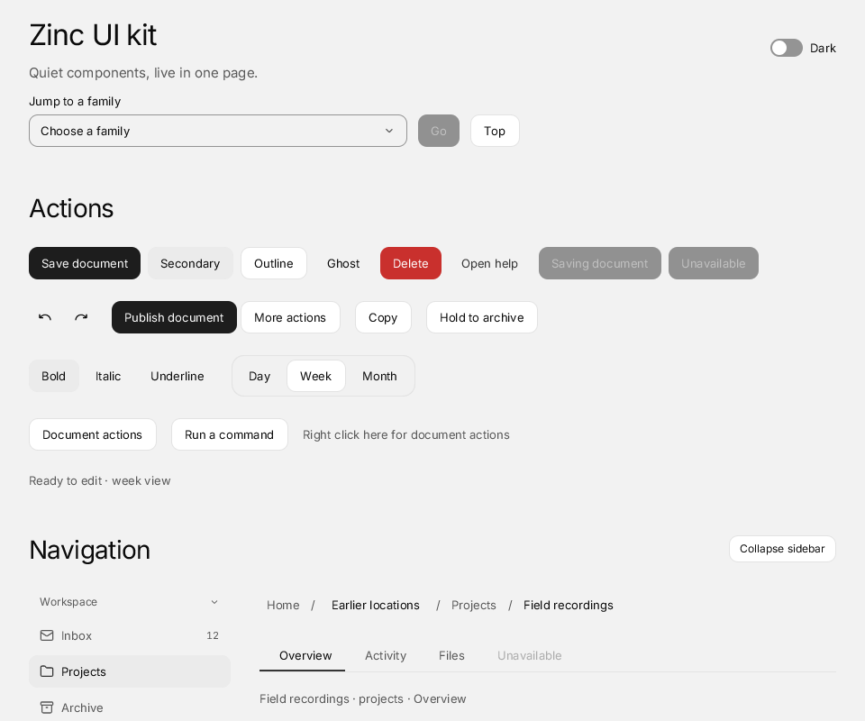

```sh
zinc run examples/ui/kit-gallery   # every component on one page, with a light / dark switch
```

**Adaptive by default.** On a phone or a Mac the kit takes the platform's look from `zinc:ui/platform`: iOS's 44 px buttons, 51 x 31 green
switches and type scale on iOS, Material 3's rounded buttons and outlined switches on Android, macOS's 24 px controls and the user's accent
colour on a Mac; Linux, the web and the boards keep the look described here (neutral). An app with a theme of its own keeps its colours on the
platform's shapes. `"ui": {"platformLook": "neutral"}` in `zinc.json` (or `"ios"`, `"android"`, `"macos"`) forces one look everywhere;
`ZINC_PLATFORM=ios zinc run examples/ui/kit-gallery` shows another platform's on the desktop ([docs/ui.md](ui.md), "Platform look").

## Using it

```tsx
import { createSignal, render } from 'zinc:ui/solid';
import { Card, CardHeader, CardContent, CardFooter, Button, Switch, heading, mutedText } from 'zinc:ui/kit';

const [wifi, setWifi] = createSignal<boolean>(true);

function App(): i32 {
  return <View className="flex-col gap-6 p-8 h-full bg-zinc-50">
    <Text className={heading(1)}>Settings</Text>
    <Card className="w-96">
      <CardHeader title="Network" description="Wireless and wired connections." />
      <CardContent>
        <Switch checked={wifi} onChange={setWifi} label="Wi-Fi" />
        <Text className={mutedText()}>{wifi() ? 'Connected to zinc-lab' : 'Offline'}</Text>
      </CardContent>
      <CardFooter><Button label="Save" onClick={() => {}} /></CardFooter>
    </Card>
  </View>;
}

render(App, 0xfafafa, null);
```

Conventions, identical in both UI models:

- **Components are functions returning nodes.** Solid calls them once; React / Inferno re-run them on each render and
  reconcile their nodes like any other component.
- **Text comes from props**: `label`, `title`, `description`, `hint`, `trailing`; the kit places and colours it.
- **Values that change are accessors**: `value={() => temp()}`, `checked={wifi}`, `selected={tab}`. Under Solid the
  component subscribes to them (only the affected node updates); under React write `value={() => temp}`, the
  accessor is read on every render. A plain prop that reads a signal (`title={page()}`) also follows it under Solid:
  the component is mounted again when the value changes (an accessor updates in place instead).
- **`children` adds custom content** (several children are passed as one fragment), and `className` adds layout
  classes to the component's outer node (`grow`, `w-80`, `w-full`).
- An explicit import wins over the host tag of the same name: `import { Button } from 'zinc:ui/kit'` makes
  `<Button>` the kit button in that file.

## Components

| Component | Props | Notes |
| --- | --- | --- |
| `Button` | `label?`, `variant?` (`default` `secondary` `outline` `ghost` `destructive`), `size?` (`sm` `default` `lg` `icon`), `onClick?`, `className?`, children | children follow the label (an icon glyph, a `Kbd`); `default` is filled with the theme's `primary` (near black on `LIGHT`, near white on `DARK`, as shadcn's), `outline` and `ghost` follow the page; the host `<Button>` without the kit draws nothing, so with no `bg-*` class it shows the page behind it |
| `Input` | `value?: () => string`, `onInput?`, `placeholder?`, `type?` (`password`), `name?`, `disabled?`, `className?` | shadcn's Input: `h-9`, `rounded-md`, a border in the theme's `input` colour, `px-3`, `text-sm`, no fill (it follows the page), a muted placeholder, a darker border while focused, half opacity when disabled |
| `Textarea` | the same, and `rows?` (3; `0` grows with the text) | shadcn's Textarea: Input's look with `py-2` and `min-h-16` |
| `Card` | `className?`, `selected?`, `muted?`, `disabled?`, `onClick?`, children | a hairline surface; Quiet cards have no shadow. An actionable card keeps keyboard activation and a visible focus ring. |
| `CardHeader` | `title?`, `description?`, children | |
| `CardTitle`, `CardDescription` | `text` | when composing a header by hand |
| `CardContent`, `CardFooter` | `className?`, children | column / row, padded like the header |
| `Badge` | `label`, `variant?` (`default` `secondary` `outline` `destructive` `success` `warning` `accent`), `className?` | |
| `Separator` | `vertical?`, `className?` | one-pixel hairline |
| `ResizeHandle` | `size: () => number`, `onResize`, `vertical?`, `after?`, `min?`, `max?`, `className?` | shadcn's ResizableHandle: a bar between two panes that resizes one when dragged (`vertical`: between columns; `after`: the pane follows the bar); the size is your signal, kept within `[min, max]` |
| `Stat`, `Metric` | `label`, `value: () => string`, `unit?`, `hint?`, `delta?`, `deltaLabel?`, `lowerIsBetter?`, `history?`, `className?`, children | compatible names for a metric; changes name their baseline, optional history draws a sparkline, and children sit on the label row. |
| `CallStats` | `sample: () => CallStatsSample`, `history: () => CallStatsSample[]`, `className?`, children | a call's health: a good / fair / poor badge with its MOS, loss, round trip, bit rates, jitter, and sparklines of the loss, round trip and outgoing bit rate; zinc:webrtc's `CallQuality` fills it (`sample={() => q.last} history={() => q.history}`); `labels?: Map<string,string>` replaces its words (title, measuring, good, fair, poor, loss, roundTrip, out, in, jitter); children go under the numbers |
| `Tabs` | `items: string[]`, `selected: () => i32`, `onSelect`, `className?` | segmented control; switch the panels yourself: `{tab() === 0 ? <A/> : <B/>}` |
| `Switch` | `checked: () => boolean`, `onChange`, `label?` | never flips itself: `onChange` decides |
| `Progress` | `value: () => number` (0–100), `accent?`, `className?` | |
| `ProgressRing` | `value: () => number` (0–100), `size`, `color: () => i32`, `track: () => i32`, `strokeWidth?` (2.5 of 24) | a ring filling clockwise from the top, for a row or a cell; an idle ring paints nothing |
| `Spinner` | `size: number`, `color: () => i32`, `active: () => boolean` | mount while active; engine-driven ring, still with reduced motion; list `loader-circle` in the project's icons |
| `Slider` | `value: () => number`, `onChange`, `min?`, `max?`, `step?`, `className?` | tap the rail or drag sideways to set the value (never at the press: a swipe over it scrolls); keeps horizontal drags inside scroll views (`grab="keep-x"`) |
| `Avatar` | `name`, `size?` (`sm` `default` `lg`) | initials of the first two words |
| `Alert` | `title`, `description?`, `variant?` (`default` `destructive` `success`), `icon?`, `className?` | |
| `List` | `className?`, children | bordered panel of rows |
| `ListItem` | `title`, `description?`, `trailing?`, `selected?: () => boolean`, `onClick?`, `disabled?`, `leading?: () => node`, children | actionable rows use Enter/Space; arrows and Home/End move between enabled rows. |
| `Kbd` | `label` | key or shortcut hint |

## Overlays

Built on the engine's layers, anchoring, focus scopes and dismiss stack ([ui.md](ui.md#layers-and-anchored-positioning)):
they paint above the page and outside any clipping, follow their button and flip when there is no room, and Escape or a
press outside closes the latest one.

```tsx
ui.bindKeys('mod-s', 'save'); ui.onAction(-1, 'save', save);
<Tooltip label="Save" action="save"><Button label="Save" onClick={save} /></Tooltip>          // hint: Save ⌘S
<DropdownMenu label="Edit" items={[{ label: 'Save', action: 'save' }, { label: 'Delete', onSelect: remove }]} />
<Popover label="Filters"><Switch checked={f} onChange={setF} label="Only mine" /></Popover>
<Dialog open={asking} onOpenChange={setAsking} title="Delete?" footer={() => <Button label="Delete" onClick={del} />} />
toast('Saved', 'All changes are on disk.');
```

| Component | Props | Notes |
| --- | --- | --- |
| `Tooltip` | `label`, `action?` (its shortcut is shown), `placement?` (`top` default), `delay?` (500 ms), `className?`, children | shows while the pointer rests on the children, and at once when Tab focuses them; a press hides it; `attachTooltip(node, label)` (`zinc:ui/kit`) does the same for a node made by code |
| `Popover` | `label` (the trigger button), `variant?`, `placement?` (`bottom-start`), `className?` (the panel), children | focus moves into the panel and comes back when it closes |
| `DropdownMenu` | `label`, `items: MenuItem[]` (`label`, `action?`, `onSelect?`, `disabled?`), `variant?`, `placement?`, `className?` | opens focused on its first item; arrows move (trapped), Enter picks; actions show their shortcut (`keyLabel`) |
| `Dialog` | `open: () => boolean`, `onOpenChange`, `title?`, `description?`, `className?`, children, `footer?` | modal, dims the page (the dim fades, the panel fades and grows from 96%, both ways), traps the focus, focuses its first control, gives the focus back |
| `toast(title, description?, ms?)` | | a stack in the bottom-right corner, 4 s by default; no component to mount |

Tooltip, Popover, DropdownMenu and HoverCard retain their local state across parent renders in both UI models.
Dialog and Sheet are controlled, like `Switch`.

## Keyboard (on-screen, touch devices)

```tsx
<Input value={name()} onInput={setName} />
<Input inputMode="numeric" value={pin()} onInput={setPin} />      {/* digit pad; also decimal, tel, email, url, search */}
<Keyboard layouts={['fr', 'en', 'de']} />                          {/* at the bottom of the screen's column */}
```

`Keyboard` slides in while a text field has the focus (`mode="always"` keeps it on screen) and types through the
real keyboard path (`ui.insertText` / `ui.sendKey`), so `onInput`, undo, selection and Enter behave as with a
physical keyboard; pressing a key never takes the focus (`keepFocus`). A bubble previews the pressed key, a long
press offers accents (slide onto one, release), backspace repeats while held, shift is one-shot and a double tap
locks capitals, the language key cycles `layouts`, ⌄ closes it.

| prop | |
| --- | --- |
| `layouts` | layout ids, cycled by the language key: `en fr de es it pt sv ru el` built in; `registerLayout(new KeyboardLayout(...))` adds yours (rows as strings, `{shift:1.5}`-style special keys, accents, localized Enter / search / done captions) |
| `mode` | `auto` (default) or `always` |
| `onKey` | every key: a character, `Backspace`, `Enter`, `Shift`, `Layout:<id>`, `Hide` (works without a focused field, e.g. a custom display) |
| `keyHeight`, `gap` | sizes (default 44 / 6 px) |
| `className`, `keyClass`, `specialKeyClass`, `accentClass` | restyle the panel, letter keys, special keys and the accent popup |
| `preview` | key bubble (default true) |

Engine hooks for your own keyboards: `ui.insertText(s)`, `ui.sendKey(key, mods)`, `ui.focusedField()`,
`ui.fieldMode(h)`, `ui.onFocusChange(f)`, and the `keepFocus` attribute. Example: `zinc run examples/ui/keyboard`.

Typography helpers return class strings for host `<Text>` nodes in the current theme:
`heading(1..4)`, `leadText()`, `bodyText()`, `smallText()`, `mutedText()`, `captionText()`, `overline()`.

```tsx
<Text className={heading(2)}>Devices</Text>
<Text className={mutedText()}>{count()} online</Text>
```

## Themes

`LIGHT` (default) and `DARK` name a Tailwind colour for each role of shadcn's CSS variables: `background`,
`foreground`, `card`, `muted`, `mutedForeground`, `border`, `primary`, `secondary`, `accent`, `destructive`,
`success`… `setTheme(DARK)` switches every mounted kit component (the theme is a signal); under React the new
theme applies on the next render. Your own nodes can use the same tokens:

```tsx
<View className={`h-full bg-${theme().background}`}>...</View>
```

A custom theme is a `Theme` object: copy `LIGHT`, change the colours (e.g. `accent: 'emerald-600'`), `setTheme` it.

### The Quiet theme

The look of every new app and template ([design.md](design.md)): neutral greys, one accent, hairline borders, no shadow on cards, a close shadow on menus and dialogs, controls of
30 / 36 / 44 px with 10 px corners, cards of 18 px, Inter at 13 px. Call it once before the first render:

```tsx
import { useQuietTheme, setThemeAccent, setTheme, DARK, ACCENTS } from 'zinc:ui/kit';
useQuietTheme();               // or useQuietTheme('blue')
setTheme(DARK);                // light and dark as before; ui.setScheme('auto') follows the system
setThemeAccent('green');       // one of ACCENTS: neutral violet blue green amber orange coral rose; mounted nodes follow at once
```

It is the kit's own mechanism: the roles of `theme()` take the Quiet colours in the `light` and `dark` schemes, and the
platform look `quiet` (`zinc:ui/platform`, also `ZINC_PLATFORM_LOOK=quiet`) gives the shapes, the same on every platform.
`themeColor('accent')` returns a role as `0xRRGGBB` for what draws with a colour value (an `Icon`, a `Canvas`).


Springs: a period and a bounce. `springTo(node, 'translateX', 0, 16, SPRING_STATE)` plays it on the
compositor; under reduced motion (`ui.prefersReducedMotion()`) the property takes its end at once.

| Spring | Period, bounce | For |
|---|---|---|
| `SPRING_STATE` | 180 ms, 0 | what reports a state: a switch thumb, progress |
| `SPRING_SMOOTH` | 400 ms, 0 | moves and opens |
| `SPRING_SNAPPY` | 260 ms, 0.12 | presses, small feedback |
| `SPRING_MORPH` | 420 ms, 0.16 | a shape turning into another |

## What a component costs

A program pays for the components it uses, not for the ones it could import. `import { Button } from 'zinc:ui/kit'`
loads every family of the kit, and the compilers keep only what the program reaches:

- the typed engines (interpreter and AOT) drop every function no reachable code calls, and every method nobody calls
  (rapid type analysis, before and after inlining);
- `zinc bundle` (QuickJS) tree-shakes with esbuild, which drops every unused export of a module that runs no code when
  it loads.

Measured on an M1 Pro, 2026-11-09 (`tests/t0/kit_size.sh` prints them):

| Program | AOT binary (`zinc build`) | QuickJS bundle (`zinc bundle --minify`) |
|---|---|---|
| one `Button`, imported from its own file | 5.49 MB | 227 KB |
| the same `Button` through `zinc:ui/kit` (26 families unused) | +66 KB | +0.4 KB |
| nine more components (Card, Input, Switch, Tabs, Slider...) | +49.6 KB each | +1.5 KB each |

The first `Button` carries the class-string styling of `zinc:ui` and the theme; each component after it costs little.
The index leaves a small amount of type metadata. AOT links native plugins only when reachable code calls them.
The typed engines add no atlas for unused families: embedded TrueType files rasterize library sizes on first use,
and library characters come from reachable literals. JavaScript keeps its conservative source scan.

The gate allows 4 KB per unused family in AOT and 256 bytes in the bundle, and an average 64 KB / 4 KB for each
further used component. These are byte budgets, not timing measurements; toolchains and targets can change absolute sizes.

Rules that keep it so, for whoever adds to the kit:

- **No code at the top level.** A kit module declares functions, types and constant data; it calls nothing, registers
  nothing and defines no scheme when it loads. State is made at its first use (the theme signal and the colour schemes
  are). An empty `Map` or `Set` is fine. `tests/t0/kit_size.sh` checks it.
- **One module per family**, exported by `index.ts`. No table that names every component, no registry filled at load.
- **Keep font sizes in component styles.** Embedded TrueType builds rasterize library sizes when used; bitmap-only
  builds still pre-bake the sizes written in library sources.
- **Icons by a written name** (`<Icon name="check" />`): only the names written in the sources are compiled in.
- **Themes are data**: roles, colours and shapes, never functions stored in a table.


## Quiet Selection

Selection state belongs to the application: pass an accessor and an `onChange` callback. All controls use the
Quiet theme in light and dark. Checks, radio dots, chip selections and rating changes cut directly to their final
state; they need no decorative motion and behave identically with reduced motion enabled.


| Component | Contract and useful options |
|---|---|
| `Checkbox` | `label`, `checked`, `onChange`; optional `description`, `indeterminate: () => boolean`, `disabled`, `className`. A mixed checkbox announces `mixed`; activating it selects it. The whole labelled row is clickable. |
| `Switch` | `checked`, `onChange`, optional `label`, `accessibilityLabel`, `disabled`, `className`. Use it for an immediate setting. The whole label toggles it; its name stays the same in both states. Existing adaptive platform shapes remain available. |
| `RadioGroup` | `label`, `items: {value,label,description?,icon?,badge?,disabled?}[]`, `value: () => string`, `onChange`; optional `orientation="horizontal"`, `variant="card"`, `disabled`, `className`. One choice per group. |
| `RadioCards` | The same controlled contract as `RadioGroup`, with bordered cards for choices that need descriptions, icons or badges. `columns` controls card widths. |
| `Slider` | `value`, `onChange`; optional `min`, `max`, `step`, `accessibilityLabel`, `format`, `showValue`, `markers: number[]`, `disabled`, `className`. Steps start at `min`, with the result clamped to the bounds. `vertical` puts the maximum at the top; `logarithmic` maps a positive range logarithmically. |
| `RangeSlider` | The Slider options, with `low`, `high` accessors and `onChange(low, high)`. Two named thumbs share a rail. A thumb stops at the other thumb; both stay reachable from Tab. |
| `Chip` | `label`, `selected: () => boolean`, `onChange`; optional `disabled`, `onRemove`. The remove action is a separate named button. |
| `Chips` | `label`, `items`, `value: () => string[]`, `onChange`, optional `disabled`. Choices toggle independently and return a new array. |
| `Rating` | `label`, `value`, `onChange`; optional `max` (5), `readOnly`, `disabled`. Clicking the selected star again clears the rating. Selected stars are filled in the selection accent; `Icon filled` also fills other closed Lucide shapes. |

Space and Enter activate checks, switches and chips. Tab enters a radio group at its selected item (the first
available item when none is selected); arrows select and focus the next available choice, wrapping at either end.
Home and End select the first and last choice. Disabled choices never take focus.
Slider arrows change one step, Shift plus an arrow and Page Up/Down change ten steps, and Home/End reach the
bounds. Sliders announce their name, current value, bounds, orientation and formatted value. Rating arrows change
one star, Home/Delete/Backspace clear it, and End selects the maximum. Each keyboard target keeps the engine's
visible focus ring.

```tsx
const [low, setLow] = createSignal(20);
const [high, setHigh] = createSignal(80);
<RangeSlider accessibilityLabel="Histogram" low={low} high={high}
  onChange={(lo: number, hi: number) => { setLow(lo); setHigh(hi); }} />
```

Reproduce the picture with `GALLERY=selection ZINC_HEADLESS=1 ZINC_SIZE=960x1000 ZINC_FRAMES=2
ZINC_SHOT=docs/img/kit-selection.png zinc run examples/ui/kit-gallery --engine quickjs`.
Add `GALLERY_DARK=1` to inspect dark mode. The Selection implementations are in `selection.tsx`, with the
existing switch and slider providers kept in their own modules; importing one family performs no registration.

## Quiet Navigation

The Navigation family uses the Quiet roles in light and dark. Selection markers move with a spring and take their
final position immediately with reduced motion. Panels and destinations stay under application control.


| Component | State and options | Keyboard |
|---|---|---|
| `Tabs` | Existing `items: string[]`, `selected`, `onSelect`; `variant="pill"` or `"underline"`, disabled indices, accessible label. Long labels scroll into view. | One tab stop; Left/Right skip disabled tabs, Home/End select the ends. |
| `NavigationTabs` | Named items `{ id, label, icon?, badge?, disabled? }`, selected id and `onSelect`; animated pill or underline. Icons and animation live here so plain Tabs stays small. | The same as Tabs. |
| `Sidebar` | Labelled groups of named items with icons, badges and disabled links; controlled `collapsed`, `closedGroups` and `onGroupToggle`. One highlight follows selection. | Arrows and Home/End move through enabled links and disclosures; Enter/Space act. Collapsed icons keep tooltips. |
| `Breadcrumb` | Labelled ancestors with `onSelect`; `maxItems` retains the root and recent ancestors and puts the rest in an accessible menu. The final entry marks the current page. | Tab or arrows reach links; Enter/Space open the overflow menu and choose an ancestor. |
| `Pagination` | Zero-based `page`, `pages`, `onChange`, optional `siblings`. First/last pages, gaps, Previous/Next and disabled boundaries. | Left/Right change page, Home/End reach the ends; Tab and Enter/Space activate page buttons. |
| `Stepper` | Label, description, optional `status="complete"` or `"error"`; controlled `current`, optional `onSelect`, `linear` and `vertical`. Without `onSelect`, it reports progress. | Arrows and Home/End move among available steps; Enter/Space select. Linear mode refuses later steps. |
| `TableOfContents` | A `scroll` handle accessor and `{ label, anchor: () => handle, level? }` entries. The rail follows the section in view; choosing one scrolls to it. Accessors work with both Solid and React refs. | Arrows and Home/End move among entries; Enter/Space scroll. |
| `Dock` | Named icon actions, running dots, notification counts, separators and disabled actions. `onSelect` receives the id. Icons remain the same size, following the Quiet rule against decorative hover growth. | Tab, arrows and Home/End move through actions; Enter/Space activate; tooltips name icons. |
| `TabBar` | Compact navigation from the same named items and controlled selected id as NavigationTabs; a moving pill, icons and optional badges. | One tab stop; Left/Right and Home/End select. |

```tsx
const [tab, setTab] = createSignal<i32>(0);
<Tabs items={['Overview', 'Files']} selected={tab} onSelect={setTab} />

const scroll = createNodeRef(), install = createNodeRef();
<View className="flex-row gap-6">
  <ScrollView ref={scroll} className="h-[240px] grow">
    <View ref={install}><Text>Install Zinc</Text></View>
  </ScrollView>
  <TableOfContents scroll={() => scroll.node}
    items={[{ label: 'Install', anchor: () => install.node }]} />
</View>
```

Register icon names constructed at run time in the project's `zinc.json` `icons` list. Reached typed library defaults are collected automatically. The family uses the existing icon
provider and loads no icons or handlers at import time. Document tabs and resizable panel docking remain the
[App chrome](#quiet-app-chrome) controls; the Dock here launches destinations.

Run `GALLERY=navigation zinc run examples/ui/kit-gallery`. Recreate either picture with `ZINC_HEADLESS=1
ZINC_SIZE=1100x1020 ZINC_FRAMES=3 ZINC_SHOT=<absolute-path> zinc run examples/ui/kit-gallery --engine quickjs`;
add `GALLERY=navigation` and, for dark, `GALLERY_DARK=1`.

## How it works

Each kit file starts with `/** @jsxHelpers zinc:ui/kit/host */`: the JSX compiler lowers that file against
`lib/std/kit/host.ts` instead of the Solid or React helpers. The host helpers ask whether the React engine is
rendering the program: under Solid, dynamic classes and texts become fine-grained effects; under React they are read
once per render and the nodes come from the reconciler. Nested components and logical Show/For owners keep their own hooks and keys. The canonical kit and Nuxt helper specifiers opt into this component identity contract; arbitrary custom helper modules keep their existing two-argument `_comp` interface. A React virtual list with unchanged count and row height preserves mounted row state and focused fields when its parent renders again; changing the count or height rebuilds its visible rows. `tests/conformance/kit_solid.tsx` and `kit_react.tsx` build
the same screen in both models and must print the same layout (on the sim and on every native target).

## Quiet Overlays

The family lives in `lib/std/kit/overlays.tsx`. Anchors flip and stay inside the viewport. Modal dialogs and sheets
block the page and trap focus; popovers, hover cards and confirmations allow Tab to leave. Closing a focused panel
restores its invoker.
Layer motion honors the operating system's reduced-motion setting.


| Component | Options and behavior |
| --- | --- |
| `Popover` | `label`, optional `trigger` slot, `placement`, `width` (288 px), `padding` (16 px), `gap` (4 px), `className`, children. Enter/Space toggles; Escape/outside closes. Custom triggers are keyboard buttons. |
| `Tooltip` | `label`, optional shortcut `action`, `placement`, `delay` (500 ms), children. Pointer dwell or keyboard focus reveals the hint. Nearby hints skip the second delay. Escape closes without moving trigger focus; its `aria-describedby` names the hint. Long press shows it for three seconds. |
| `Dialog` | `open`, `onOpenChange`, `title`, `description`, `width` (440 px), children, `footer`, `className`. The Close button, Escape and scrim close it unless `persistent`; its own footer can complete a persistent operation. |
| `Sheet` | Dialog's props plus `side` (`left`, `right`, `top`, `bottom`) and `size` (400 px). The body scrolls while its header/footer remain available. |
| `HoverCard` | `label`, `trigger` slot, children, `delay` (450 ms), `grace` (200 ms), `placement`, `width`, `className`. Hover or focus reveals rich content; the grace period lets the pointer cross into the card. Click/Enter opens it too. This is a popover region, not a tooltip. |
| `ConfirmPopover` | `label`, `title`, `description`, `confirmLabel`, `cancelLabel`, `destructive`, `onConfirm`, `placement`, `width`. Focus enters the confirmation; Enter accepts, Escape/outside cancels. |
| `toast` | `toast(title, description='', duration=4000, {tone?, action?, onAction?})`. A newest-first stack expands and pauses on hover/focus. Dismiss or drag sideways to close. Negative duration persists; use it for errors or information that must remain available. Toasts never take focus. `clearToasts()` cancels their timers and closes the stack's notices. |
| `GuidedTour` | Controlled `open`, `step`, `onStepChange`, `onOpenChange`, `steps`, `doneLabel`, `closeLabel`. Each step has `title`, `body`, optional `target: () => node`, `placement`, `width`, spotlight `padding`, `blockTarget`, `nextLabel`, `backLabel`. Targetless steps appear centrally. Left/Right, Enter and Escape navigate/close; Back/Next/Done and a count remain visible. Targets stay interactive unless `blockTarget` is true. |


Run `GALLERY=overlays zinc run examples/ui/kit-gallery`. Add `OVERLAY=dialog`, `sheet`, `tour`, `hint`, `popover`, `hover`, `confirm` or `toast` to open that
surface immediately; `GALLERY_DARK=1` starts dark. For a picture, add `ZINC_HEADLESS=1 ZINC_FRAMES=25
ZINC_SHOT=docs/img/kit-overlays.png`.

## Quiet Feedback

The family is implemented in `lib/std/kit/feedback.tsx`; existing imports from `alert`, `badge`, `avatar`, `progress`
and `spinner` still work. Quiet uses neutral surfaces and one accent, with colour reserved for status.
Default icons are selected automatically; only icon names built at run time need declarations in `zinc.json`.

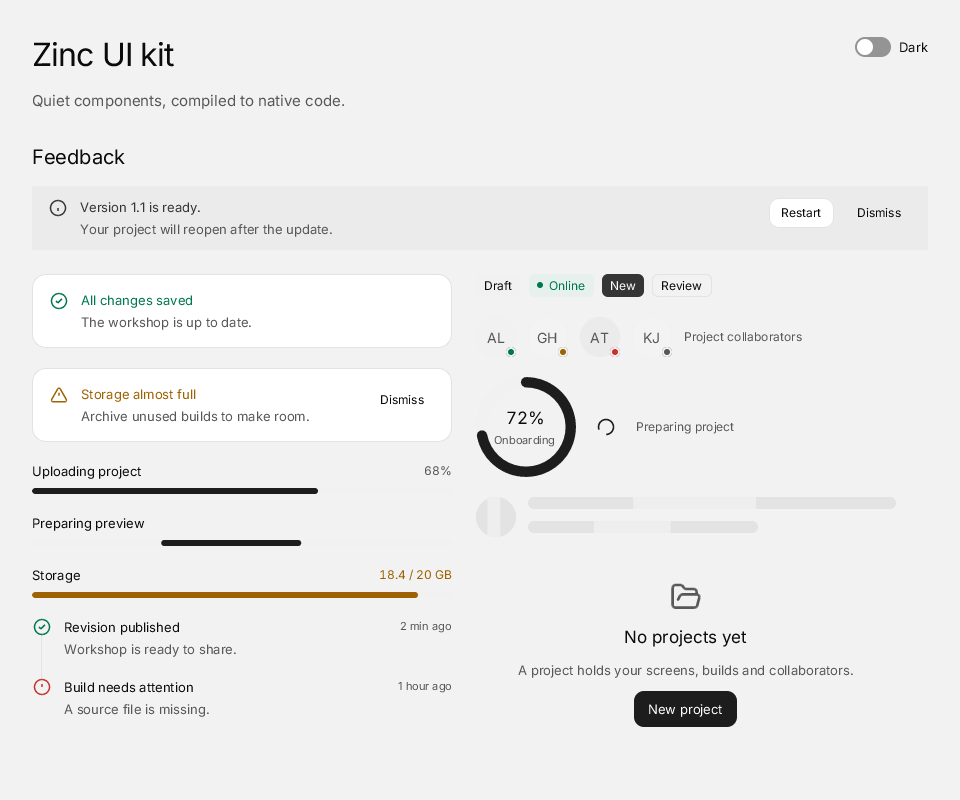
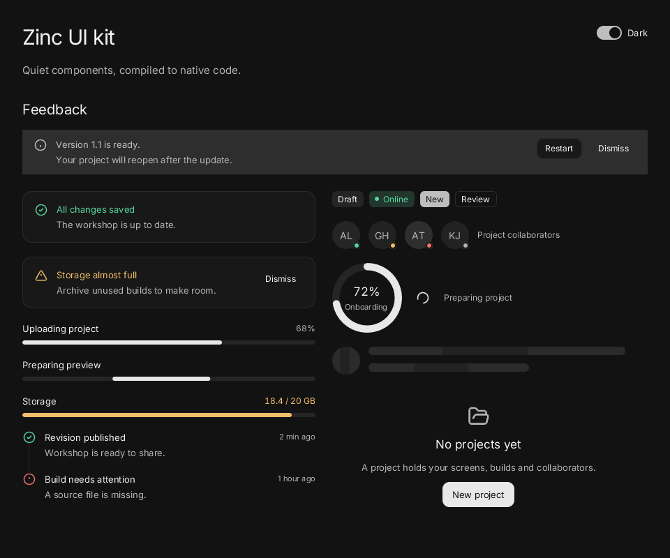

| Component | Options and behavior |
| --- | --- |
| `Alert` | `title`, `description`, `tone` (`neutral`, `info`, `success`, `warning`, `danger`), optional Lucide `iconName` (legacy `icon` glyph remains supported), `dismissible`, `dismissLabel`, `onDismiss`, `className`. Existing `variant` values remain supported. Dismiss is a normal keyboard button; dismissal survives parent rerenders. |
| `Banner` | Alert options plus `action`/`onAction`. It fills its container and collapses on dismissal, immediately under reduced motion. |
| `Progress` | `value: () => number` (0–100, clamped), `label`, `showValue`, `accent`, `indeterminate`, `className`. An indeterminate bar omits a numeric accessible value. Native progress controls remain supported. |
| `ProgressRing` | `value`, optional `size` (80 px), `label`, `showValue`, `strokeWidth`, `color` and `track` accessors. Large rings show the label inside; a label also enables the percentage unless `showValue` is false. Small rings keep the label accessible. Its one SVG document is replaced/disposed with the effect; idle rings do not repaint. |
| `Meter` | `label`, `value`, `max`, optional `min`, `unit`, `warning` (0.8), `danger` (0.95), `className`. Thresholds are fractions of the range; the fill clamps to its bounds. |
| `Spinner` | Optional `size` (20 px), `color`, `active` accessor, accessible `label`, `className`. Inactive indicators hide. |
| `Skeleton` | Optional `width` (fills its container), `height` (12 px), `circle`, `active` accessor, `shimmer`, `className`. Decorative placeholders are hidden from assistive technology. |
| `Badge` | `label`, optional `tone`, `dot`, `solid`, `className`; existing `variant` values remain supported. |
| `Avatar` | `name`, `size` (pixels or existing `sm`/`default`/`lg`), `src` or runtime `image`, `status` (`online`, `away`, `busy`, `offline`), `className`. Initials remain behind the image; neutral background shades are stable for each name. |
| `EmptyState` | `title`, optional `description`, `icon`, `action`/`onAction`, `className`. The action supports Tab, Enter and Space. |
| `Timeline` | `items`, optional accessible `label` and `className`. Each item has `title`, `time`, `description`, `icon` and status `tone`; the final connector is omitted. |

Loading motion uses the engine compositor and stops on unmount or when the OS enables reduced motion. No loading
indicator schedules work when inactive. Run `GALLERY=feedback zinc run examples/ui/kit-gallery`; add
`GALLERY_DARK=1` for dark mode. `ZINC_HEADLESS=1 ZINC_FRAMES=25 ZINC_SHOT=docs/img/kit-feedback.png` captures it.

## Limits

- No hover (touch screens and pads have none): pressed and focused states use `active:` and `focus:` fills, and every pressable also dims
  while it is held (zinc:ui's pressed feedback, docs/ui.md; `active:opacity-*` or `pressFeedback={0}` replaces it).
  Focusable kit nodes always set a `focus:` fill, which also replaces the yellow keyboard-focus ring of `zinc:ui`.
- Two weights are baked (Inter Regular and Bold): `font-medium` renders regular, `font-semibold` bold.
- The kit's text sizes are baked into every program that imports it (seven sizes, regular and bold).

## Quiet Actions

Call `useQuietTheme()` before rendering. The Actions family is in `lib/std/kit/actions.tsx`; existing `Button`,
`DropdownMenu` and `ContextMenu` remain compatible. Controls use the theme roles in light and dark, keyboard focus
rings and disabled opacity of 45%. Springs stop at the final state under reduced motion; hold confirmation still
requires the full hold time.


| Component | Props and behavior |
| --- | --- |
| `Button` | `variant="default"` (primary), `secondary`, `outline`, `ghost`, `destructive`, `link`; `size="sm"`, `default`, `lg`, `icon`; `disabled`, `loading` retains the label and blocks presses; `ariaLabel` names custom content. Children can hold leading/trailing content. |
| `IconButton` | `label`, Lucide `icon`, `onClick?`, `disabled?`, `variant?` (`ghost` default). The label names the button and its tooltip; list icons in `zinc.json`. |
| `ButtonGroup` | `label?`, children, `className?`. A named row of buttons; Tab and arrows move focus, Enter/Space activate. |
| `SplitButton` | `label`, `onClick`, `items: MenuItem[]`, `disabled?`. The main action and its alternative menu; Down opens the focused menu button. |
| `ToggleGroup` | `label`, `items: {value,label,disabled?}[]`, `value: () => string[]`, `onChange`, `multiple?`. Exclusive mode keeps one selected item; multiple mode toggles independently. Selection is exposed as `aria-pressed`. |
| `SegmentedControl` | `label`, `items`, `value: () => string`, `onChange`. Left/Right select the next enabled view; Home/End select the ends. |
| `CopyButton` | `text: () => string`, `label?`, `onError?: (message: string) => void`. Copies on activation and announces “Copied” in place; without an error callback clipboard errors propagate. |
| `HoldToConfirm` | `label`, `onConfirm`, `duration?` (1200 ms), `disabled?`. Hold pointer, Space or Enter until the fill completes. Fires once; release, pointer leave/cancel, Escape or focus loss resets it. |
| `DropdownMenu` | Existing `label`, `items`, `variant?`, `placement?`, `className?`; items additionally support `checked`, `separator`, `destructive`. Down opens, arrows navigate, Enter picks, Escape/outside dismisses and restores focus. |
| `ContextMenu` | `items: MenuEntry[]`, children, `onSelect?`. Right press, touch long press, ContextMenu key or Shift+F10 opens the menu; keyboard activation and dismissal follow the same focus scope. |
| `CommandPalette` | `open`, `onOpenChange`, `items: {label,keywords?,group?,shortcut?,disabled?,onSelect}[]`, `title?`. Fuzzy subsequence filtering ranks compact matches first. Down enters results; Up/Down navigate, Enter runs, Escape closes. The application owns its shortcut binding, so palettes do not compete for a global key. |


```tsx
const [view, setView] = createSignal('week');
<SegmentedControl label="Calendar view" value={view} onChange={setView}
  items={[{ value: 'day', label: 'Day' }, { value: 'week', label: 'Week' }]} />
<HoldToConfirm label="Hold to archive" onConfirm={archiveDocument} />
```

Recreate the pictures with `GALLERY=actions` or `GALLERY=palette`, `ZINC_HEADLESS=1`, `ZINC_FRAMES=40`,
`ZINC_SHOT=<path>` and `zinc run examples/ui/kit-gallery --engine quickjs`. `GALLERY_DARK=1` selects Quiet dark.
The gallery rests when nothing changes; its sample upload value is static.

## Quiet App chrome

The App chrome family composes the existing kit primitives and `zinc:ui/dnd`. Bars inherit their surface and draw
one inner hairline. Document and dock state belongs to the application; closing a dirty document asks the caller,
and loading an invalid saved layout leaves the current workspace intact.


| Component | Props and keyboard behavior |
| --- | --- |
| `MenuBar` | Existing `items: MenuEntry[]`, `native?`, `onSelect?`, `className?`; top-level entries accept `mnemonic?`. F10 enters the bar, Left/Right changes titles, Down/Enter opens, arrows navigate and Enter picks; Escape closes and restores focus. `Alt+mnemonic` opens a named menu. Hover switches open menus; accelerators remain global while the bar is mounted. Native mode still suppresses the drawn bar. |
| `Toolbar` | `label`, `items: {label,icon?,checked?,disabled?,separator?,onSelect?}[]`, `trailing?`, `className?`. Ghost actions and named icon tooltips; actions that do not fit move into “More actions”. All actions remain reachable by Tab, Enter/Space and the overflow menu. |
| `StatusBar` | Children and optional `trailing`, `className`. A 30 px row with a top hairline; the trailing slot aligns right. |
| `StatusItem` | `label`, `onClick?`, `progress?: () => number` (0–100). Text uses 12 px tabular figures; clickable items enter the Tab order. A progress value stays still when no work changes it. |
| `DocumentTabs` | `items: () => DocumentTab[]`, `selected`, `onSelect`, `onClose?`, `onMove?`, `className?`; tabs have stable `id`, `label`, `dirty?`, `closable?`. Click selects; the close button, middle press, Delete or Mod+W asks `onClose`. Left/Right and Home/End select, Shift+Left/Right and drag request reorder; Ctrl+Tab/Shift+Tab or Ctrl+PageDown/Up cycle. The caller decides whether to save a dirty document. |
| `DockLayout` | `layout: () => DockLayoutState`, `onChange`, `panels: {id,label,content}[]`, `className?`. A recursive tree of horizontal/vertical splits and tab groups. Drag a panel to an edge to split or to a group's centre to join it; “Panel actions” offers these moves by keyboard. Dividers resize by drag or 10 px arrow steps, Home/End use the bounds. Closed panels stop building; reopening retains their original group. |

`DockLayoutState` contains `root: DockNode` and `closed: string[]`. A node has a stable `id`, `axis` (`tabs`,
`horizontal`, `vertical`), `ratio`, `tabs`, `selected` and optional `first`/`second`. Split ratios stay within
0.05–0.95 and dividers reserve up to 120 px per side, sharing smaller spaces. Unknown panel IDs remain in the data,
so a temporarily absent plugin does not lose its position. Empty branches compact after a move.

```tsx
import * as storage from 'zinc:storage';
// Save when the person chooses; persistence is never performed at import time.
storage.set('workspace', saveDockLayout(layout()));
try { setLayout(parseDockLayout(storage.get('workspace'))); }
catch (error) { showStatus('Layout unchanged: ' + error.message); }
setLayout(setDockPanelOpen(layout(), 'output', true));
setLayout(moveDockPanel(layout(), 'output', 'editor', 'bottom'));
```

`parseDockLayout` throws on malformed data, duplicate node/panel identities, invalid selections or ratios, more
than 48 panels, 95 nodes, 16 levels or 64 KiB of source. It builds a validated copy before the caller applies it.
`saveDockLayout`, `moveDockPanel`, and `setDockPanelOpen` return data or new layouts; applications own storage and
surface any read/write error. Dock highlight and resize track direct manipulation; springs use the kit's reduced
motion path. No chrome control starts a decorative animation.

Recreate the picture with `GALLERY=chrome ZINC_HEADLESS=1 ZINC_FRAMES=40 ZINC_SHOT=docs/img/kit-app-chrome.png zinc run examples/ui/kit-gallery --engine quickjs`.

Escape cancels an active dock drag and clears its highlight; releasing afterwards cannot apply the cancelled drop.
The same shared operation is available as `cancelDrag()` from `zinc:ui/dnd`, returning whether it cancelled a drag.

## Inputs

The Inputs family shares the engine's selection, clipboard, undo and IME support. Values are caller-owned accessors;
`onInput` reports text and `onChange` reports numeric values, arrays or selections. Use `PasswordField` for reveal controls; the legacy `Input type="password"` remains masked. These controls use the Quiet
roles in both themes. They introduce no ongoing animation, so reduced motion keeps exactly the same feedback.


| Component | Options and behavior |
| --- | --- |
| `Input` | `value`, `onInput`, `onSubmit`, `type` (`password` masks), `label`, `placeholder`, `hint`, `error`, `icon?: () => i32` (a named Icon render slot), `prefix`, `suffix`, `clearable`, `readOnly`, `disabled`, `autofocus`, `size` (`sm`, default, `lg`), `name`, `className`. Clear uses the editing path, so Undo restores the value. Enter submits. |
| `PasswordField` | Text-field options; masks the value and supplies a named Show/Hide action. |
| `SearchField` | A search icon, search keyboard and Clear action; Enter calls `onSubmit`. |
| `Textarea` | Text-field values, labels, hints, errors, read-only and disabled states; `rows` (3, or 0 to grow), `height` (-1 fills). Enter adds a line; Ctrl/Cmd+Enter submits. |
| `NumberField` | Numeric `value` / `onChange`, `min`, `max`, `step`, `decimals`, `label`, `suffix`, `disabled`, `className`. Type or press minus/plus; arrows step, Shift steps tenfold, Home/End reach the bounds. |
| `MoneyField` | Numeric props plus `symbol`, `code`, `hint`; grouped at rest, plain while editing. `decimals` defaults to 2; -1 means whole units. |
| `ScrubField` | Numeric props; drag horizontally, Shift for tenfold finer changes, click to type, arrows to step. The bottom hairline shows the position in the range. |
| `TagInput` | String-array `value` / `onChange`, `label`, `placeholder`, `maxTags`, `disabled`; Enter/comma adds a unique tag, Backspace in the empty field removes the last, each tag has a named remove button. |
| `OneTimeCode` | String `value` / `onChange`, `length` (6), `label`, `disabled`, `onComplete`; accepts typing or paste, retaining only the requested number of digits. |
| `Select` | `SelectOption[]` (`value`, `label`, optional `icon`, `disabled`), `value` / `onChange`, `label`, `placeholder`, `disabled`, `className`. Arrows open/move, Home/End reach the ends, printable keys find an option, Enter/Space chooses, Escape closes and restores focus. |
| `Combobox` | Select props, with an editable filter. Arrows leave the filter for the matching options. |
| `MultiSelect` | String-array values, Select options, `searchable`, `maxChips` (3); named removable chips and an overflow count, Select all/Clear actions. Choosing an option keeps the list open. |
| `ShortcutRecorder` | String `value` / `onChange`, `label`, `disabled`; click or Enter/Space starts recording, a key combination saves, Backspace clears, Escape/Tab cancels. Recording consumes shortcuts before global keymaps; blur cancels, and recording can start again. |

Run the family alone with `GALLERY=inputs zinc run examples/ui/kit-gallery`. `GALLERY_DARK=1` selects dark.
The pictures above come from the gallery at 1120 × 900; all controls remain interactive in that same program.

## Pickers

Pickers use caller-owned values and the Quiet theme. Import them from `zinc:ui/kit`, or import the family from
`lib/std/kit/pickers`. The calendars use civil ISO dates (`YYYY-MM-DD`), independent of time zones and daylight
saving. Time values are whole minutes after midnight (0–1439), including in the 12-hour presentation.

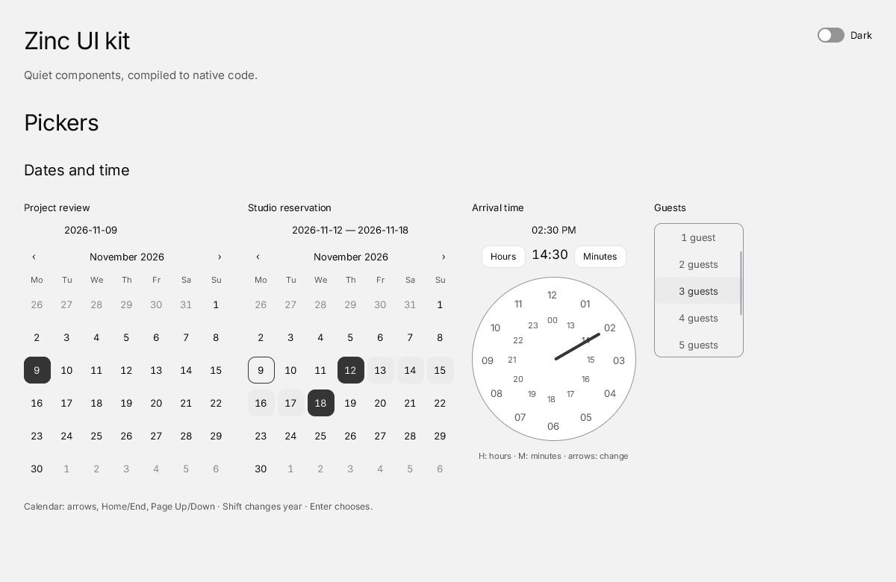
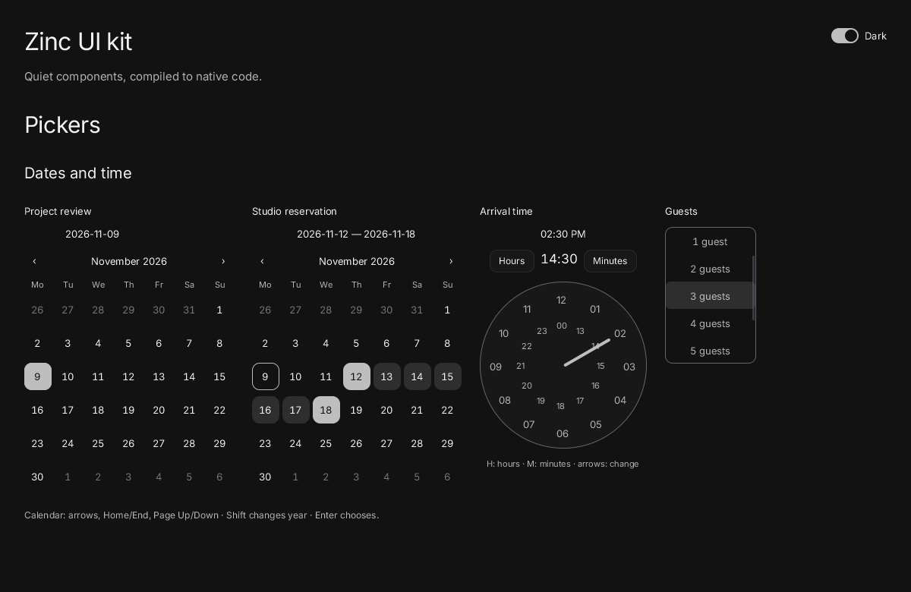
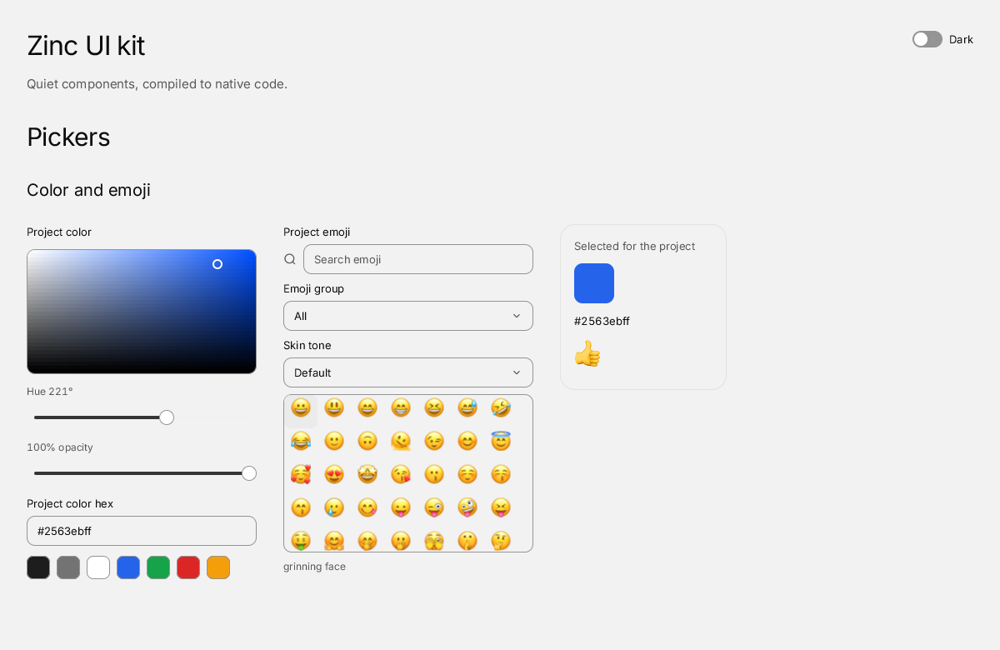
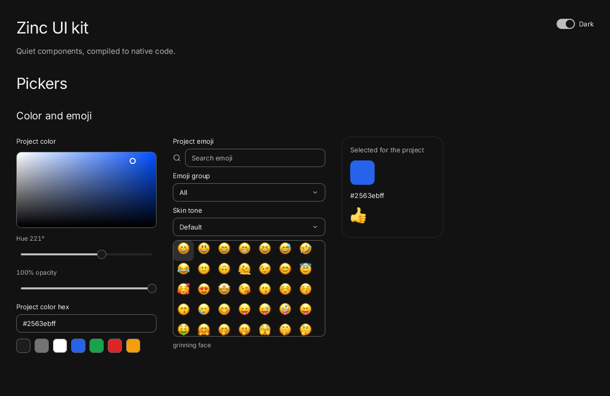
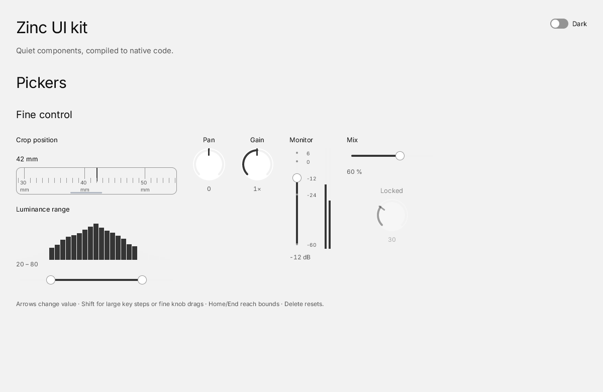
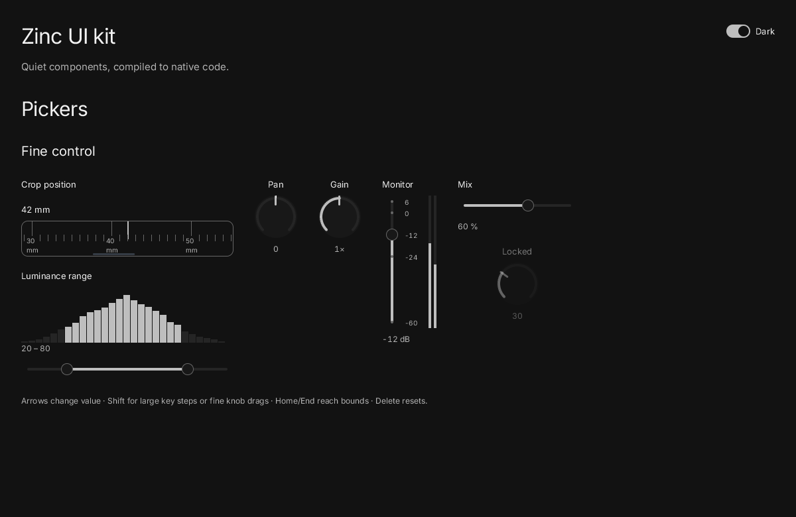

| Component | Values, options and keyboard behavior |
| --- | --- |
| `Calendar` | `value: () => string`, `onChange`, `label`, initial `month`, `today`, `min`, `max`, `disabledDate`, `weekStart` (Monday by default), `disabled`, `className`. One roving day per month; arrows move a day/week, Home/End reach the week ends, Page Up/Down change month, Shift changes year, Enter/Space chooses. Month changes clamp the day, so January 31 reaches February 28 or 29. Unavailable days cannot be selected. |
| `DatePicker` | Calendar options plus `placeholder`, trigger `width` (180). Opens a calendar in the existing Popover with outside-press/Escape dismissal and focus restoration. An empty value shows the placeholder. |
| `RangeCalendar` | Calendar options with `value` for the start, `end: () => string` and `onRangeChange(start, end)`; no unused single-date callback. `months` is 1 or 2. The first choice clears the end, the second orders the endpoints; hover previews the range. Escape cancels the pending endpoint. A disabled day inside a range prevents committing it. |
| `DateRangePicker` | Range-calendar options plus `placeholder`, `presets` (true). Today, Last 7 days and Last 30 days respect the same date restrictions. |
| `TimePicker` | `value: () => number`, `onChange`, `label`, `twelveHour`, `minuteStep` (1–60), `disabled`, `className`. Hour/minute and optional AM/PM wheels open at the current selection; the stored hour is always 0–23. |
| `WheelPicker` | `items: string[]`, numeric index `value` / `onChange`, `label`, odd visible `rows` (5), `width` (100), `loop`, `joinLeft` / `joinRight` (shared band/edges), `disabled`, `className`. Native inertial scroll snaps rows into the selection band. Arrows step, Page Up/Down move a visible page, Home/End reach the ends; `loop` wraps both scrolling and keyboard steps. |
| `TimeDial` | `value`, `onChange`, `label`, `minuteStep`, `disabled`, `className` and `size` (240). The outer ring selects 1–12, the inner ring 13–23 and midnight; releasing switches to minutes. Hours/Minutes buttons, H/M keys switch modes, arrows change the selected unit, Shift steps tenfold, Home/End reach midnight/23:59. |
| `ColorPicker` | Hex string `value` / `onChange` (`#rrggbb`, or `#rrggbbaa` with `alpha`), `label`, `swatches`, `disabled`, `className`. The saturation/brightness square works by pointer and arrows (Shift for 10%); Home gives white, End black. A hue slider, optional opacity slider and validated hex field expose every channel from the keyboard. |
| `EmojiPicker` | String `value` / `onChange`, optional `items: EmojiEntry[]`, app-owned `recent` / `onRecentChange`, `tone` / `onToneChange` (0–5), `label`, `placeholder`, `emptyText`, `width` (300), grid `height` (180), `size` (26), `noSearch`, `noPreview`, `noTone`, `disabled`, `className`. Includes Unicode 17.0’s 1,914 base emoji in nine groups and 330 exact tone sets, decoded lazily; supply `items` for a translated or app-specific catalog. Each entry has `emoji`, `name`, `group`, and optional `tone` for a single base emoji supporting skin tones, or five exact `tones` for compound sequences. Search matches word prefixes; Down enters the grid, Enter chooses the first match. The virtual grid keeps only visible rows mounted. Arrows and Home/End move the active cell; Enter/Space chooses. Recent values are supplied by the app; imports never read storage. |
| `RulerSlider` | Slider values, bounds, step, format, disabled and accessibility label, plus `majorEvery` (10), tick `spacing` (12 px), `unit`, `width` (300). The tape scrolls and snaps below a fixed marker. Arrows step, Shift/Page keys step tenfold, Home/End reach the bounds. At most 4096 ticks; increase `step` for larger ranges. |
| `HistogramSlider` | Range-slider `low`, `high`, `onChange(low, high)`, bounds, step and format, plus `bins: number[]` and `height` (72). Bars inside the selected range use the accent; both handles retain slider keyboard and pointer behavior. |
| `Knob` | Slider value/bounds/step/format, `label`, `unit`, `size` (64), `reset` (0), `bipolar`, `logarithmic` (positive ranges), `hideValue`, `disabled`, `className`. Drag vertically over 200 px for the full range; Shift makes the drag tenfold finer. Arrows step, Shift/Page keys step tenfold, Home/End reach bounds, Delete/Backspace or double-click resets. Wheel changes require focus. |
| `Fader` | `value`, `onChange`, bounds, step, format, logarithmic scale, markers, disabled, accessibility label and classes, plus `label`, `unit`, `length` (180), `horizontal` (false), `reset` (0), `ticks`, `meter: () => number[]` (levels 0–1) and `hideValue`. Reuses the slider gesture and bounds; labelled `ticks` follow the same linear/logarithmic scale. The wheel changes only the focused fader; Delete/Backspace or double-click resets. |

Wheel/ruler inertia and snap use the existing scroll engine. Reduced motion takes the same final selection without
the spring movement; pointer tracking and keyboard feedback remain immediate. Color swatches and emoji carry the
chosen content's colors, while surrounding controls follow Quiet's neutral surfaces and accent.

Run `GALLERY=pickers zinc run examples/ui/kit-gallery` for the whole family. The three focused views are
`GALLERY=pickers-dates`, `pickers-colors`, and `pickers-values`; add `GALLERY_DARK=1` for dark mode. The documentation
pictures use `ZINC_SIZE=1200x780 ZINC_HEADLESS=1 ZINC_FRAMES=4 ZINC_SHOT=...` with those focused views.

## Quiet Data

`GALLERY=data zinc run examples/ui/kit-gallery` shows the data family. Set `GALLERY_DATA=overview`, `grid`,
`tree` or `files` to show one part. Add `GALLERY_DARK=1` for the dark scheme. Existing `Card` sections,
`List`/`ListItem` and `Stat` callers keep their contracts; `Metric` adds a descriptive name for `Stat`.

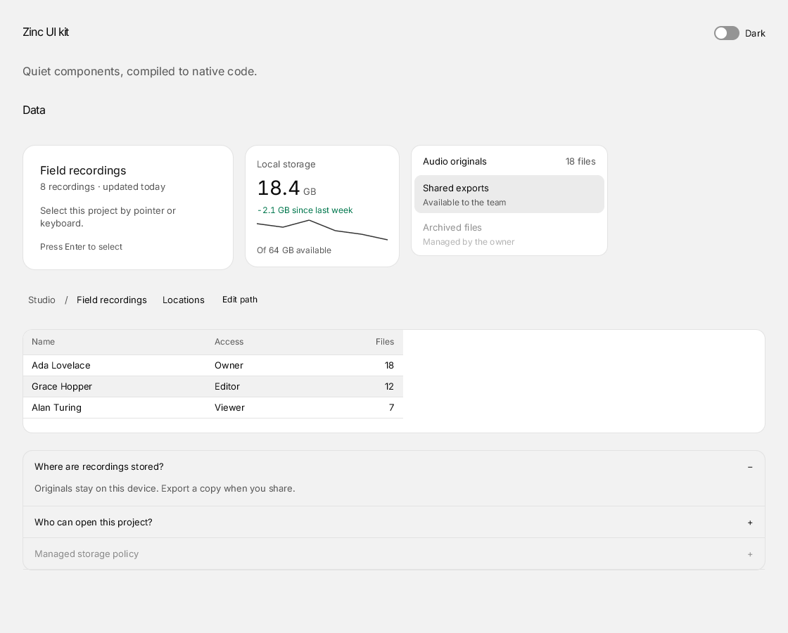
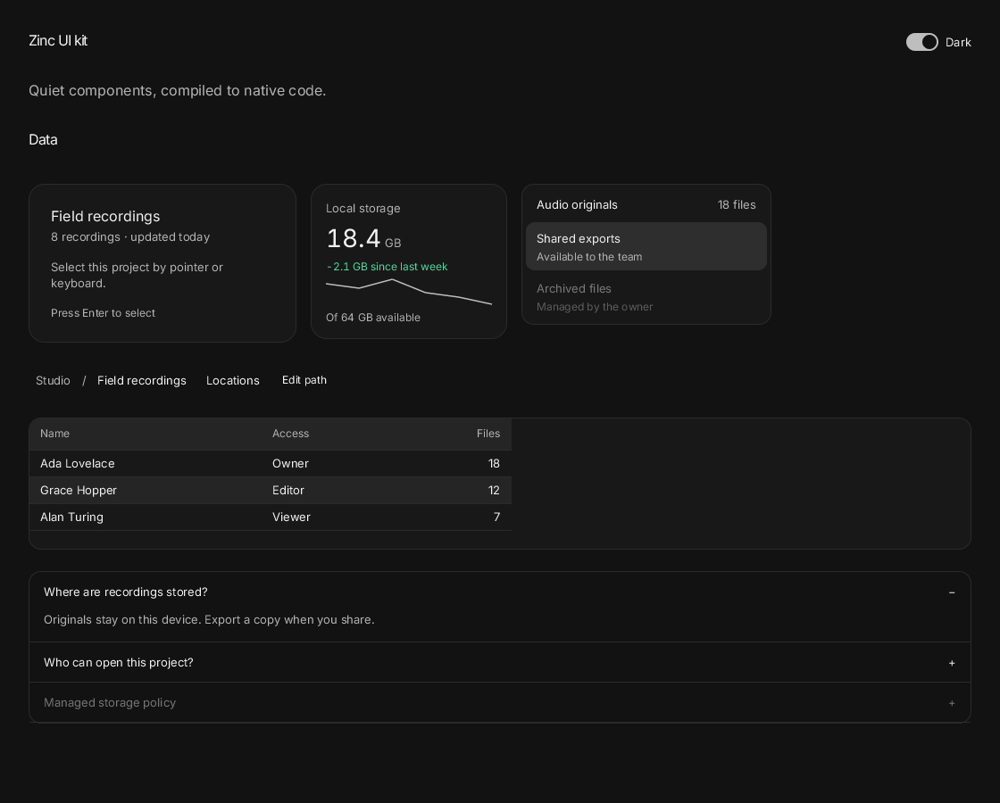

A row has a stable `id` and `cells: string[]`; each `DataColumn` has `id`, `label`, optional `width`, `minWidth`,
`align` (`left`, `center`, `right`), `sortable`, `hidden`, `fixed` (prevents resizing) and `cell(row)` for custom
content. Cell positions follow the original column array, including hidden columns. There is no automatic
priority hiding: an application sets `hidden` when its layout needs fewer columns.

| Component | Contract and useful options |
|---|---|
| `Table` | `label`, `columns`, `rows: () => DataRow[]`; optional controlled `sort`/`onSort`, `search`, `filter(row)`, `widths`, `compact`, `striped`, `fixedHeader`, `height`, `emptyLabel`, `className`. Sorting compares whole numeric cells numerically and preserves the order of ties. `fixedHeader` defaults to true; the body scrolls vertically and the complete table scrolls horizontally. |
| `DataGrid` | Table options plus controlled `selected: () => string[]`/`onSelect`, `rowHeight` (36), `height` (320), `onColumnResize(id,width)`, `onActivate(row)` and `onEdit(rowId,columnId,value)`. Only visible rows are mounted, including in the 2,000-row gallery. `widths` follows the original column array. |
| `TreeTable` | `label`, `columns`, `items: () => TreeItem[]`, controlled `expanded`/`onExpandedChange` and `selected`/`onSelect`; optional `widths`, `onColumnResize`, `height`, `onActivate`, `onLoadChildren(id): Promise<TreeItem[]>`, `className`. A tree item has `id`, `label`, optional extra `cells`, `children`, `hasChildren`, `disabled`. |
| `Tree` | The same tree contract with one label column. Duplicate/cyclic visible IDs are refused. Expanding a lazy `hasChildren` branch makes one request; loading suppresses duplicate requests, completed children are cached, and a failed request exposes Retry. Unmounting invalidates outstanding results. |
| `PathBar` | `path`, `segments: () => PathSegment[]`, `onNavigate(path)`; optional `editable`, `label`, `className`. A segment has `label`, `path`, and optional child locations. Breadcrumbs navigate ancestors; Locations opens child locations. Edit path or ⌘/Ctrl-L edits the complete path, Enter/Go submits, Escape/Cancel discards and returns focus to the path bar. |
| `Accordion` | `items: AccordionItem[]`, controlled `expanded: () => string[]`/`onChange`, optional `multiple`, `className`. Each item has stable `id`, `title`, `content()` and optional `description`/`disabled`. Heading buttons name their regions; Enter/Space toggles, arrows and Home/End move between enabled headings. Disclosures use the engine's spring layout animation; reduced motion cuts to the resulting state. |
| `FilterBar` | Controlled `search`/`onSearch`, `filters: () => DataFilter[]`, `onChange(id,value)`, `onRemove(id)`, `onClear`; optional `available: MenuItem[]`, `resultCount`, `className`. A filter has `id`, `label`, `value`, `options: SelectOption[]`; add actions, values and removal remain owned by the application. |
| `FileBrowser` | Controlled `path`/`onNavigate`, `selected`/`onSelect`; optional `multiple`, `foldersOnly`, `patterns: () => string[]`, `showHidden`, `places`, `height`, `lister`, `onActivate(entry)`, `className`. Back/Forward/Up/Reload, editable breadcrumbs, search, hidden files, sorting and Places share one cached directory listing. Patterns support `*`/`?`, case-insensitively, and always leave folders reachable. |
| `OpenFileDialog`, `SaveFileDialog` | `open`/`onOpenChange`, `initialFolder`, `onConfirm(paths)`; optional `initialName`, `title`, `multiple`, `foldersOnly`, `filters: {label,patterns}[]`, `places`, `lister`. Each opening starts fresh. Open validates selected existing files/folders. Save validates one name and its parent folder and asks before choosing an existing path. Both confirm paths only; the application performs any subsequent read/write. |

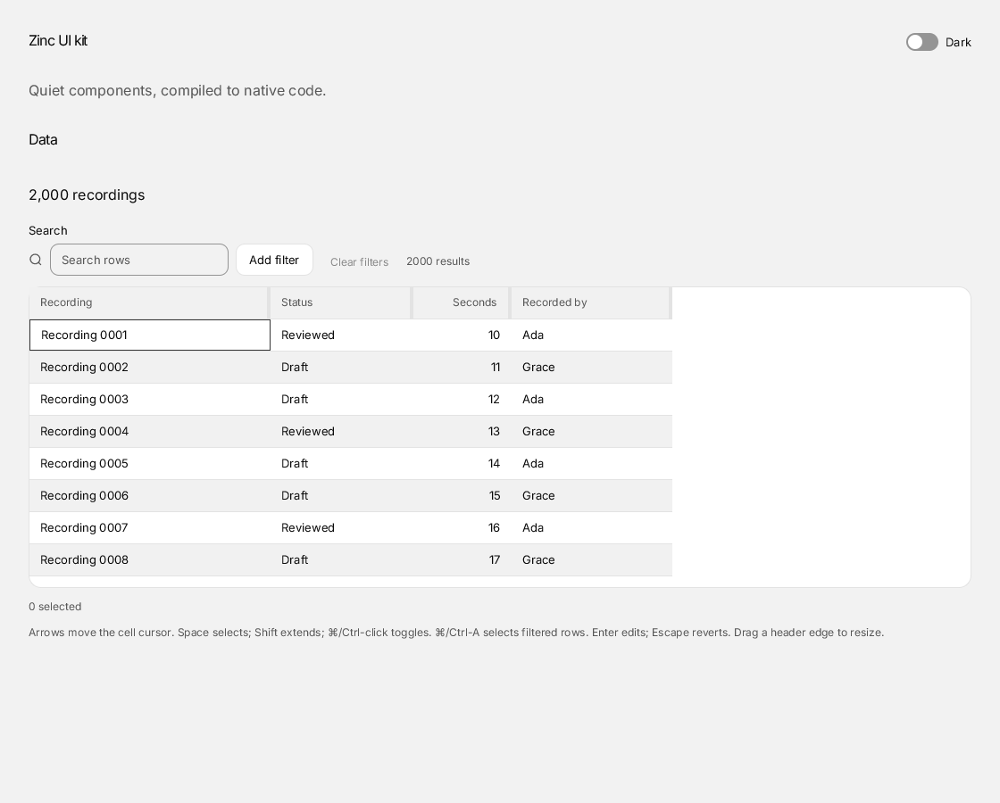
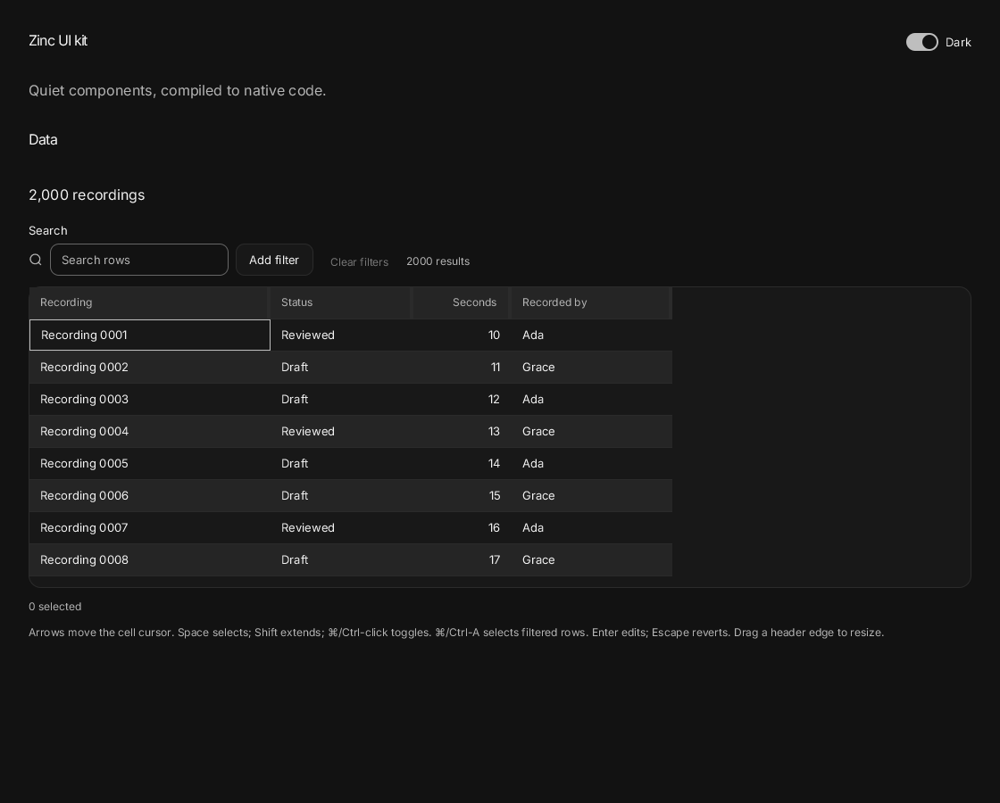
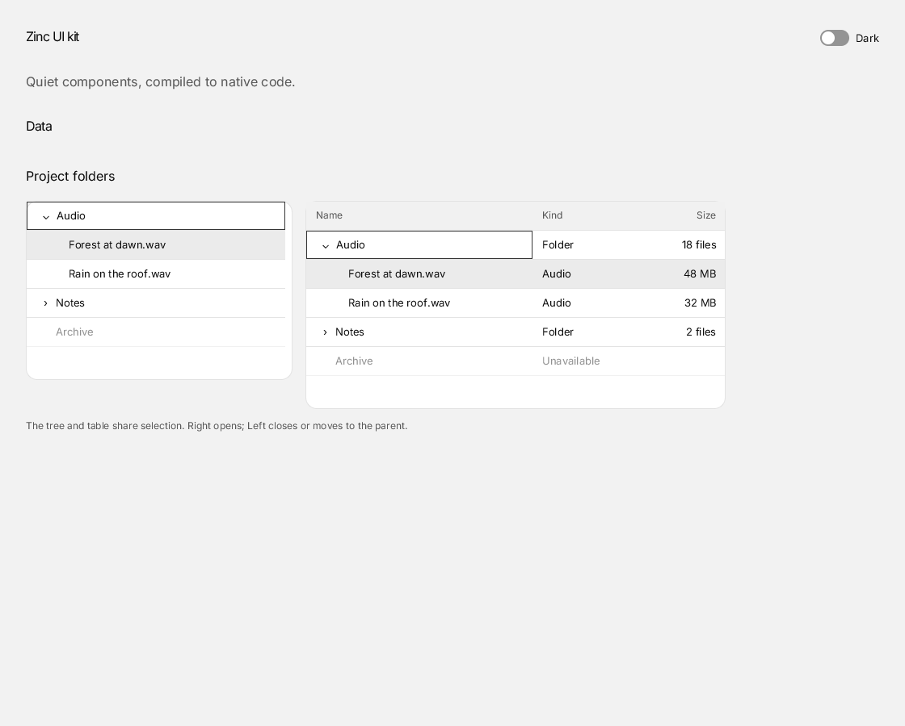

The grid's cell cursor and row selection are independent. Arrow keys move the cursor; Home/End move within a row,
⌘/Ctrl-Home/End reach the first/last row, and Page Up/Down move by a viewport. Space selects, Shift extends an
inclusive range in the current filtered/sorted order, ⌘/Ctrl-click toggles, and ⌘/Ctrl-A selects visible enabled
rows. Filtering and sorting preserve selected IDs. Alt-Up/Down sorts the current column; Alt-Left/Right resizes it
by 10 px. Enter/F2 or double-click edits a cell when `onEdit` is present; Enter or leaving the editor commits,
and Escape reverts. Without editing, Enter activates the row. Left/Right in a tree closes/opens a branch and
moves between a parent and its children. Virtual grids expose total row counts, row/column indices and a single
active descendant; moving the cursor scrolls its row and column into view.

`FileEntry` has `name`, `path`, `directory`, `size` (bytes) and `modified` (milliseconds). The default
`readFileEntries(folder)` uses `zinc:fs.readDir` and `stat`, preserving the application's filesystem scope.
A custom `FileLister` returns `Promise<FileEntry[]>`; synchronous throws and rejected promises both show a failure
with Retry. Navigation and reload invalidate earlier requests, so a late completion cannot replace a newer folder.
Search, selection, sorting and file-type filtering reuse the loaded entries. The controls never create directories,
write files or extend permissions. Custom providers still need paths that the application can validate when a dialog
confirms them.

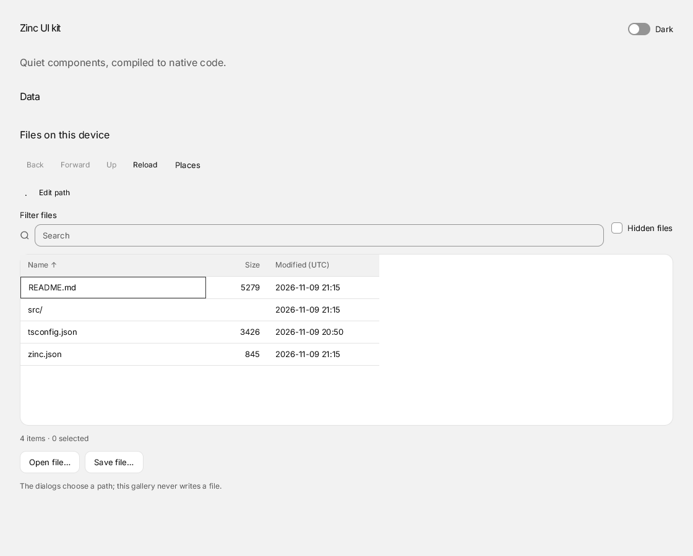
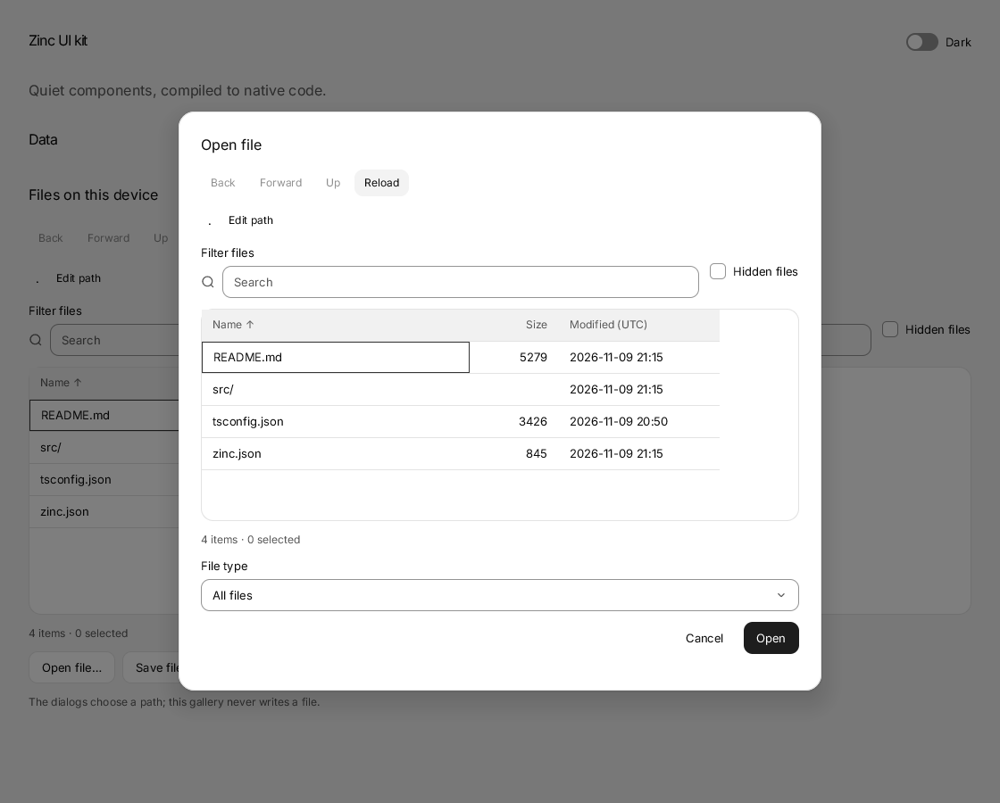
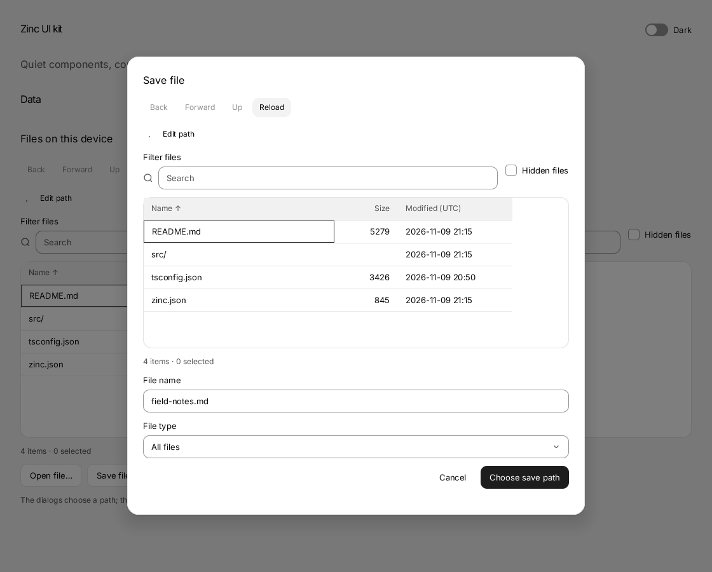

## Quiet Code

`GALLERY=code zinc run examples/ui/kit-gallery` shows all five controls. `CODE_VIEW=block`, `editor`, `diff`,
`markdown` or `json` isolates one; `GALLERY_DARK=1` selects the dark scheme.

| Component | Contract and useful options |
|---|---|
| `CodeBlock` | `code`, optional `language`, `title`, `lineNumbers`, 1-based `emphasizedLines`, `height`, `copy` (true), `className`. Text remains selectable; Copy code copies the original source. |
| `CodeEditor` | `label`, controlled `value: () => string` / `onChange(value)`; optional `language`, `title`, `height` (220), `readOnly`, `placeholder`, `lineNumbers` (true), `indent` (two spaces; one tab or up to eight spaces), `wrap`, `className`. Reuses `zinc:editor`'s document, cursor and undo history. Each instance owns its theme, assistant, edit callback and pending jump. |
| `DiffViewer` | `before`, `after`, optional `language`, `title`, `mode` (`split` or `inline`), `context` (3; negative shows all lines), `height` (240), `className`. Split pairs removed and added runs and falls back to inline below 560 px. Unchanged runs can be opened; Previous/Next change and F7/Shift-F7 navigate change groups. |
| `MarkdownView` | `source`, optional `compact`, `height`, `className`, `onLink(href)` and `onTask(nextSource, byteOffset, checked)`. Uses the existing md4c CommonMark/GitHub parser and the standard selectable Markdown view, including tables and fenced code. Raw HTML is disabled. Inline links retain their labels; callbacks decide navigation. Tasks return a new source string; the caller owns the source. |
| `JsonViewer` | `source`, optional `label`, `expandDepth` (2, capped at 64), `height` (220), `className`. Objects and arrays show counts; primitive roots and visible parse errors are supported. Each viewer owns its folds. Paths use escaped JSON Pointers, so `/`, `~` and empty member names stay distinct. |

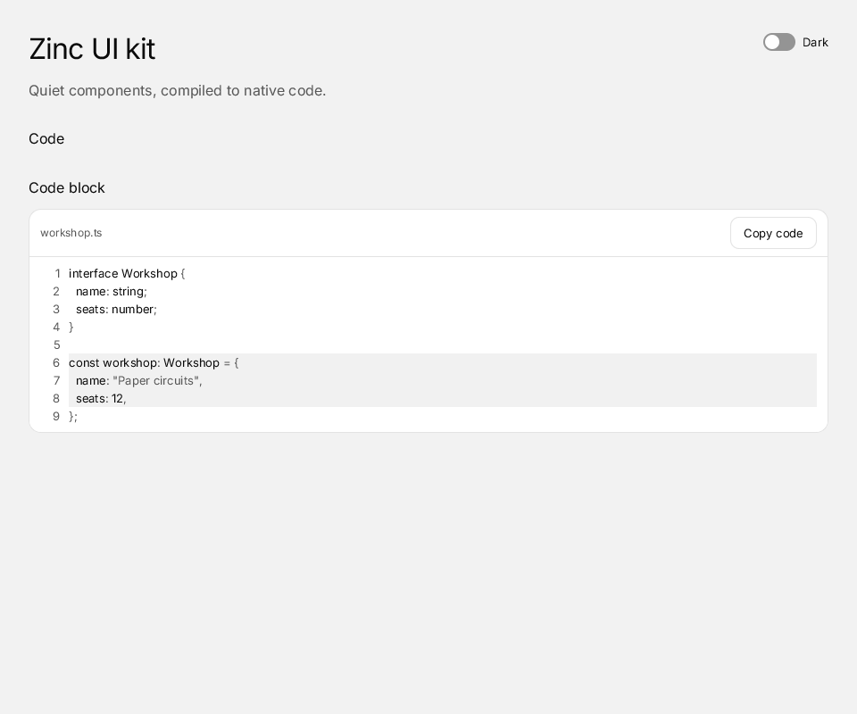
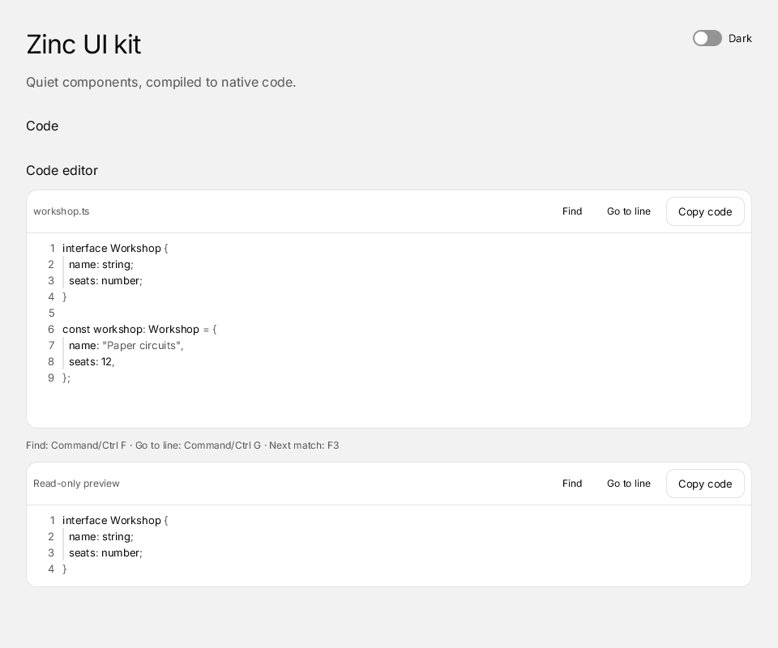
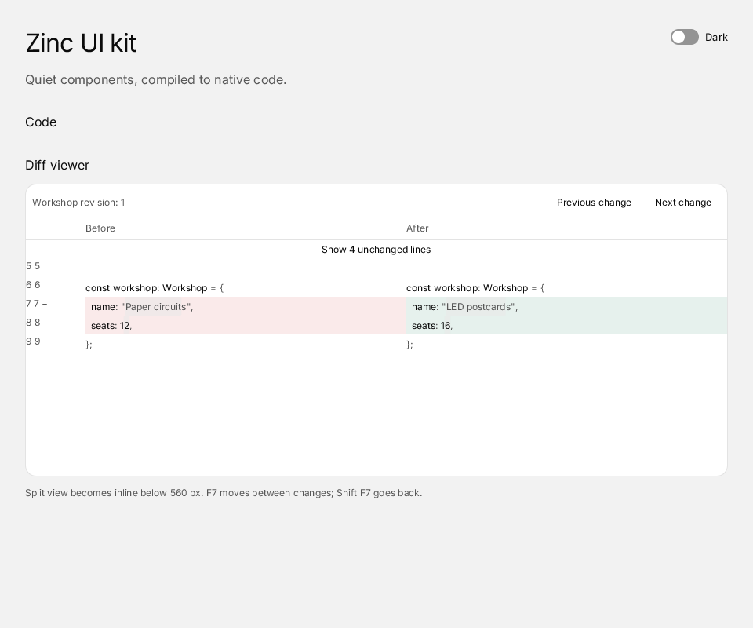
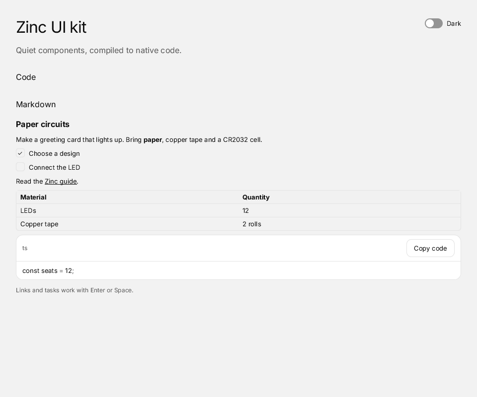
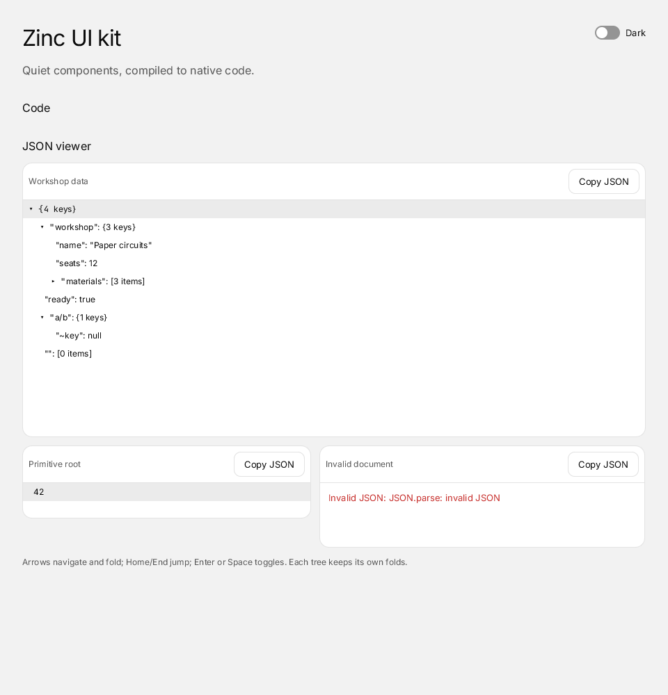
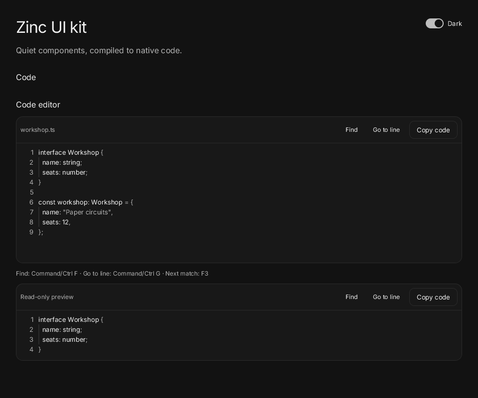
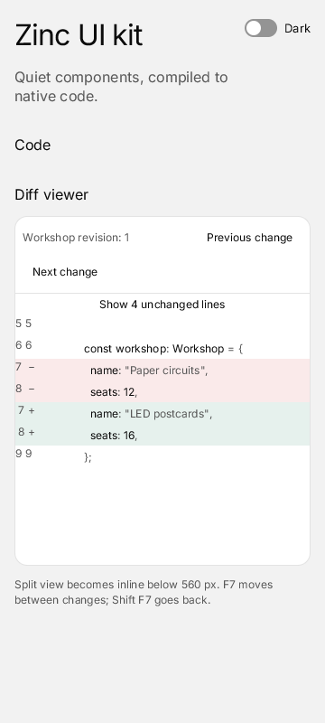
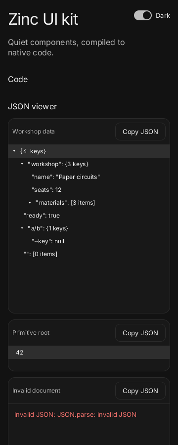

The editor supports Command/Ctrl-F, Command/Ctrl-G, F3/Shift-F3, indentation, multi-cursor editing, undo and redo.
Escape leaves editing so Tab can reach the surrounding controls. A linked paragraph takes Tab, arrows/Home/End choose its link, and Enter/Space activates the named destination. JSON trees use arrows, Home/End and Enter/Space;
only visible JSON and diff rows are mounted. These controls have no decorative animation; reduced motion keeps their
immediate feedback.

Diff inputs are cached until they change. Lines are interned with the standard string Map once per input change; anchor search checks at most 64 nearby
positions and spends at most 131,072 integer probes, then keeps a coarse replacement; there is no quadratic matrix. Changed ranges within paired
lines are bounded to 2,000 characters. Syntax comes from the existing editor registry (TS/JS/TSX, JSON, Markdown,
CSS); other language labels render as plain text.

## Quiet Charts

`LineChart`, `AreaChart`, `BarChart`, `DonutChart`, `Sparkline`, `Gauge`, `RadialGauge`, `Heatmap`, `Treemap`, `RadarChart`, `Funnel`, `Sankey`, `Waffle` and `ScatterChart`, plus `CandlestickChart`, share the Quiet theme and work in both UI models. Import from `zinc:ui/kit`, or directly from `zinc:ui/kit/charts`. The gallery has three focused views:

```sh
GALLERY=charts-overview zinc run examples/ui/kit-gallery
GALLERY=charts-distributions zinc run examples/ui/kit-gallery
GALLERY=charts-market zinc run examples/ui/kit-gallery
```

All charts take a required `label`, optional `width`, `height`, `className`, `format: (number) => string`, `noLegend` and `onSelect: (index, series) => void`. Data comes from accessors. Keep large arrays stable between changes and replace an array when editing its entries; appending candles also follows their new length. Geometry is cached by its inputs and the lazy Canvas has no idle frame callback. Colours are theme roles or ordinary Zinc colour names; the default uses one accent and neutral series. Give a series or item a `color` only when that distinction carries meaning.

| Component | Data and options |
| --- | --- |
| `LineChart`, `AreaChart` | `series: () => ChartSeries[]` (`name`, `values`, optional `color`), `labels`, `min`, `max`, `smooth`, `noGrid`; `area` also turns a line into an area. Only the first series fills, with a flat tint. Non-finite values create gaps. |
| `BarChart` | The same series and axes; `stacked` separates positive and negative totals around zero. |
| `DonutChart` | `items: () => ChartItem[]` (`label`, `value`, optional `color`), `innerRadius` (fraction). Non-positive amounts do not create slices. |
| `Sparkline` | `values: () => number[]`, optional `color`; compact line without axes or legend, with the same keyboard inspection. |
| `Gauge`, `RadialGauge` | `value: () => number`, `min`, `max`, `unit`, `size`; radial adds `sweep` (90–300°), `ticks` (`-1` hides them), `bands: {to, tone}[]`, `target`, `noNeedle`. Value changes use the existing Animated spring and stop immediately under reduced motion. |
| `Heatmap` | `values` in row-major order, `rows`, `columns`, `rowLabels`, `columnLabels`, `min`, `max`; one accent scale and a value range. Missing/non-finite cells stay empty. |
| `Treemap` | `items`; squarified rectangles, sized by positive values. Labels that cannot fit are omitted from the drawing while full values remain available to inspection. |
| `RadarChart` | `series`, `axes: string[]`, optional `max`; at least three axes. |
| `Funnel` | `items` in stage order; inspection names the share of the first stage and conversion from the preceding stage. |
| `Sankey` | `nodes: string[]`, `links: () => {from, to, value}[]`, optional `nodeWidth`; node indices belong to the caller. Layout follows the links, keeps a common flow scale, and terminates for cycles. |
| `Waffle` | `items`, optional `columns` and `rows` (10 each); largest-remainder allocation fills the exact number of cells. |
| `ScatterChart` | `series: () => ScatterSeries[]` (`name`, `points: {x,y,size?}[]`, optional `color`), `xLabel`, `yLabel`, `xFormat`; bubble area follows optional `size`. |
| `CandlestickChart` | `candles: () => Candle[]` (`open`, `high`, `low`, `close`, optional `volume`), `labels`, `overlays: () => ChartSeries[]`, `noVolume`, `ohlc`, `up`, `down`; visible-range price fitting, last-close marker and bounded OHLCV aggregation. |

Tab focuses the chart with a visible ring. Arrow keys inspect marks, Shift moves ten, Home/End select the ends, Enter/Space call `onSelect`, and Escape clears inspection. Pointer hit testing uses the same geometry that is painted. The accessible name and a status line report the inspected values; the gauge also names its current value and range. A focused price chart supports `+`/`-` zoom, `0` fit, pointer-centred wheel zoom, Shift-wheel/horizontal wheel pan and dragging. Its cursor retains the original candle index as the viewport changes. An appended candle follows the right edge only when that edge was already in view.

Input limits keep layout and hit testing bounded and reject oversized inputs with a `RangeError`: 16 series with 4,096 values or points each; 128×128 heatmap cells; 128 donut/funnel/waffle items (512 for treemap); 32 radar axes; 256 Sankey nodes and 2,048 links. Waffle dimensions clamp to 1–50 cells per side. Candles read the visible range and aggregate to at most 880 view-box columns; the focused model regression includes 100,000 candles. These are correctness bounds, not a measured throughput or memory claim.

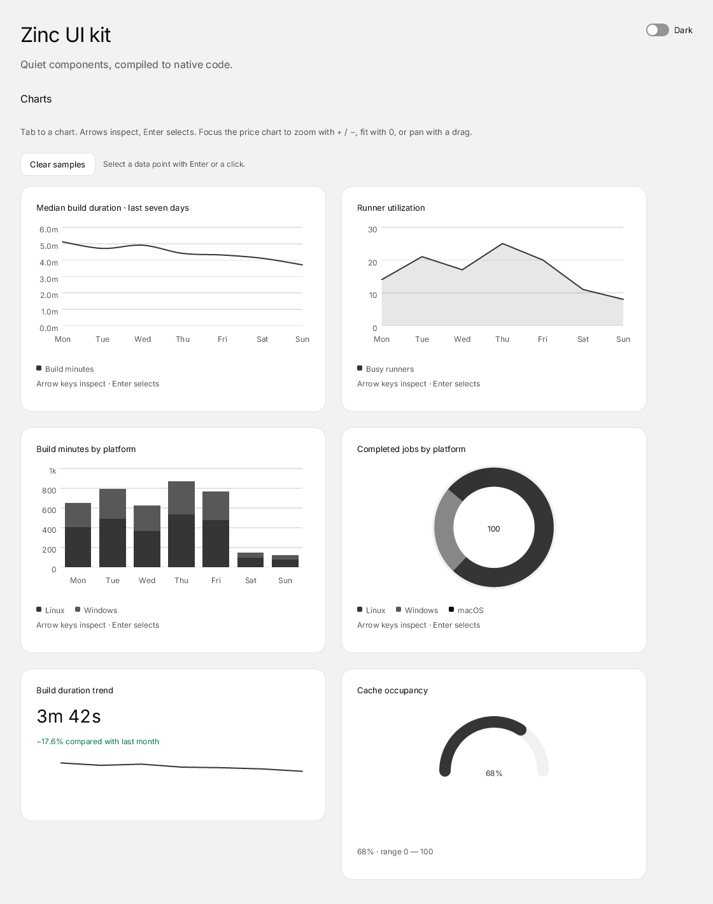

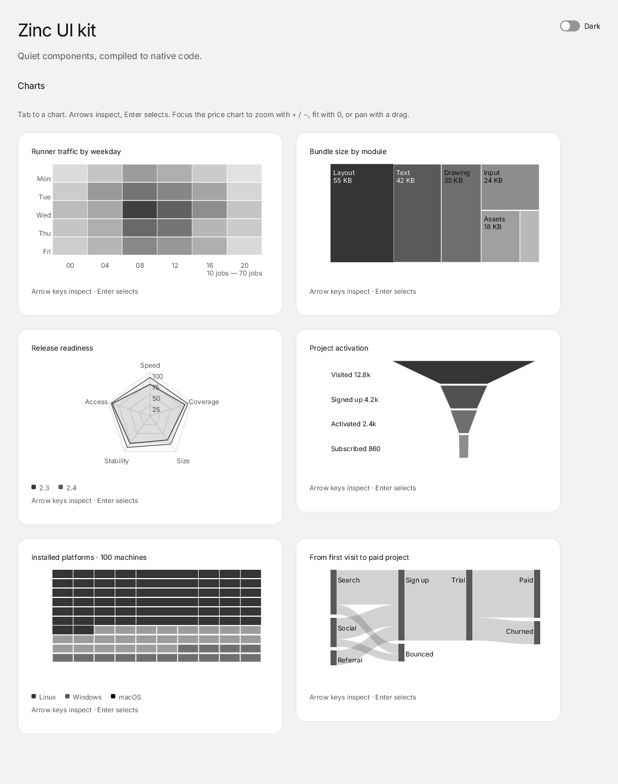

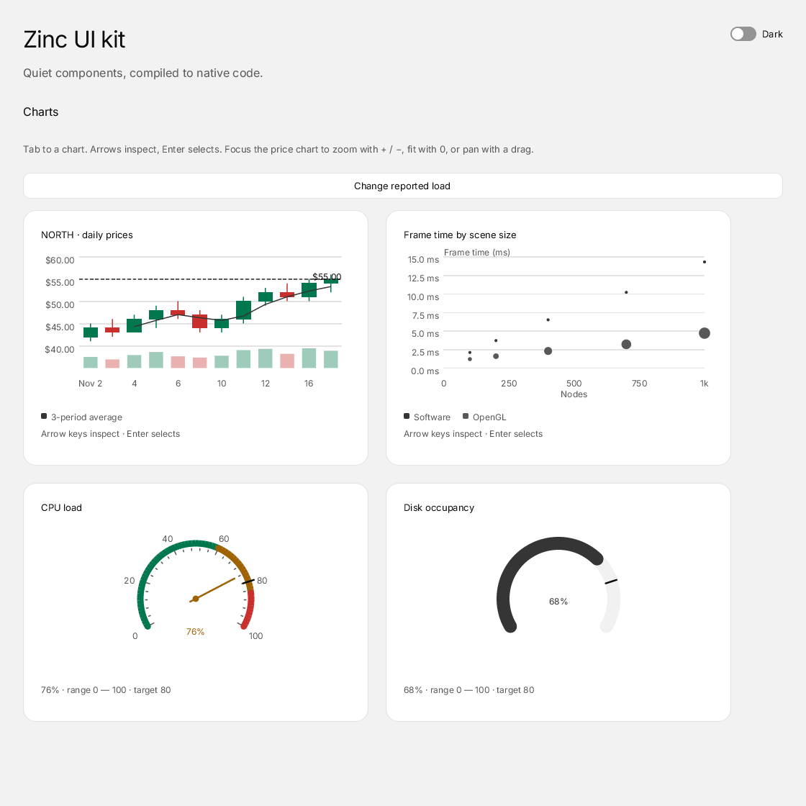

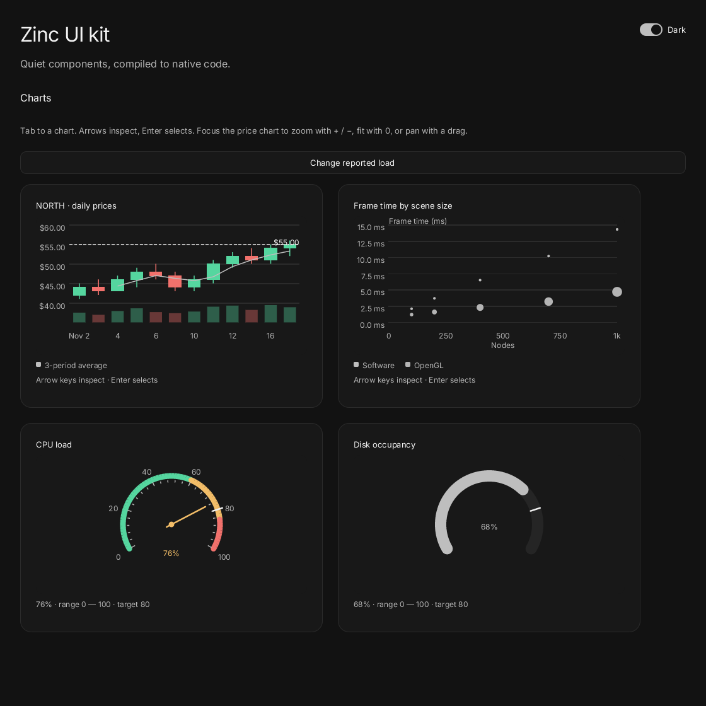

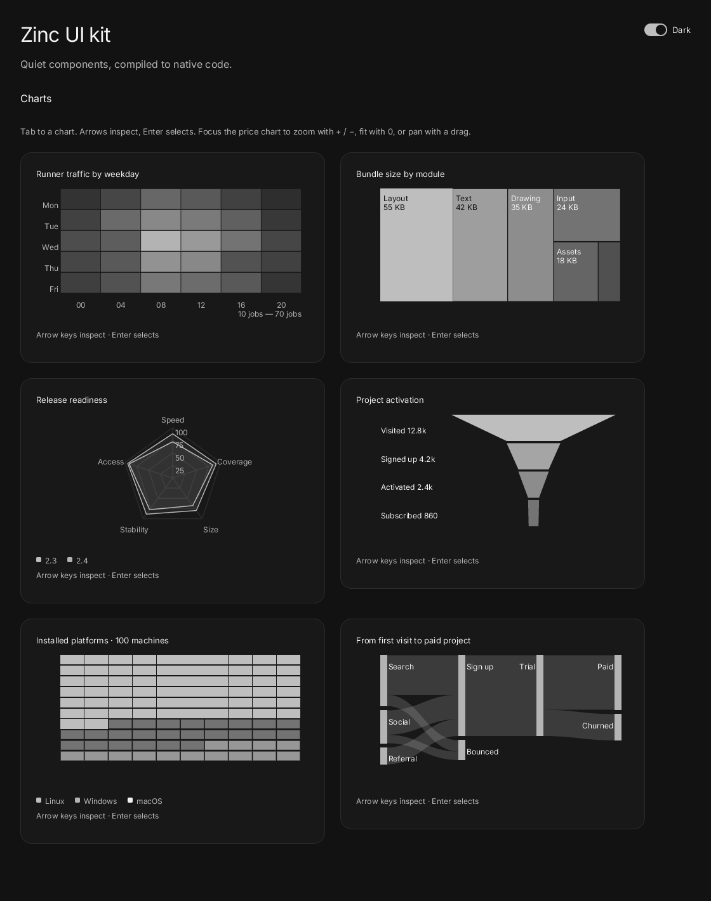

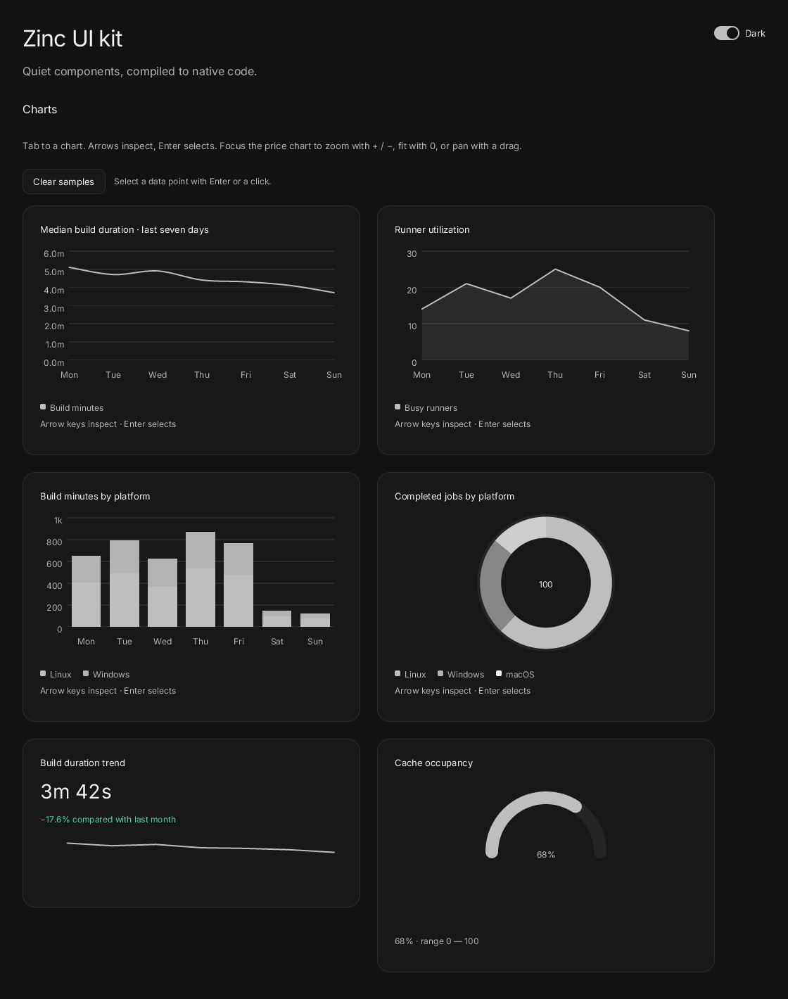

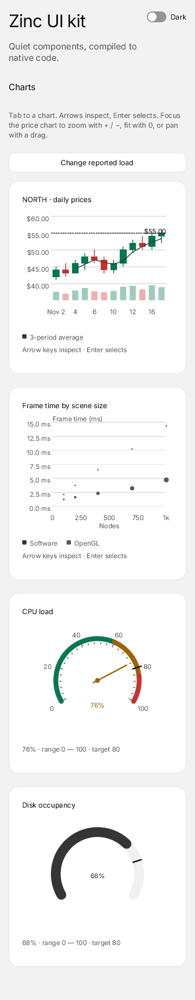

## Tool panels

Import this family from `zinc:ui/kit` or `zinc:ui/kit/panels`. Values belong to the caller; the panels create no
process, profiler, audio device, or playback loop. `GALLERY=tools GALLERY_TOOLS=inspector|streams|graph|animation|binary`
selects a page of the [interactive gallery](../examples/ui/kit-gallery).

| Component | Values and behaviour |
|---|---|
| `PropertyInspector` | `properties: InspectorProperty[]`, optional `label`/`className`. A property has `id`, `label`, `type` (`text`, `float`, `integer`, `boolean`, `enum`, `color`, `vector`, `vector2`, `vector3`, `vector4`), string `value()`/`onChange`, optional `group`, `tooltip`, `disabled`, numeric `min`/`max`/`step`, or enum `options`. Vectors use two, three or four comma-separated numbers. Groups collapse lazily; labels start at 38%, resize with pointer or separator arrows, and stack below 380 px. Numeric scrubbing and exact text entry share the field bounds; omitted bounds permit negative values. |
| `LogConsole` | `buffer: LogBuffer`, `revision()`, optional `label`, `height` (220), `className`. `append(text,level,source,time)` returns a monotonic record ID; `clear()` retains ID monotonicity. Defaults bound 2,000 records and 262,144 characters including metadata. Search and level filters cache by buffer revision; the virtual DataGrid supplies keyboard selection and copying. Follow scrolls new records into view. After appending, notify the accessor supplied as `revision`. |
| `Terminal` | `buffer: TerminalBuffer`, `revision()`, `onCommand`, optional `onInterrupt`, `prompt`, `label`, `height` (200), `size` (13), `noInput`, `disabled`, `className`. `write(chunk)` accepts incremental SGR 16/256/RGB colours, bold/dim/underline/inverse/reset, carriage return, line feed, tab, backspace, erase-line and clear-screen; OSC payloads are discarded. Output wraps at the current width; output and history are bounded. Up/Down recall commands, Enter submits, Ctrl+C copies a selection or calls the interrupt callback; Ctrl+L clears output. The output region supports arrows, Shift-selection, Cmd/Ctrl+A/C, copying and follow. This is output plus a prompt; attach your own pipe or remote service. |
| `NodeEditor` | Caller `nodes()`/`links()`, `onNodesChange`/`onLinksChange`; optional pin `validate`, `label`, `height` (320), `minimap`, `disabled`, `className`. Nodes have stable `id`, `label`, `x`/`y`, optional `width` and real UI `children`, and typed input/output `pins`. Connections replace a single input link and reject mismatched types. Select output then input by pointer or Tab/Enter; titles move selected groups, empty space selects a marquee, middle-button/Space-drag pans, Ctrl/Cmd-wheel zooms, arrows move selection, Alt-arrows pan, +/- zoom, F frames all, Delete removes a selected connection or nodes. The minimap centres a clicked point and supports keyboard pan/fit. |
| `FlameGraph` | `spans(): FlameSpan[]` (`id`, `label`, `start`, `duration`, `depth`), optional `label`, `height` (220), `start`/`end`, `className`. This is a time-ordered chart. An index by depth/start bounds visible work, and subpixel spans are omitted. Hover/selection reports duration and share; drag pans, Ctrl/Cmd-wheel or +/- zooms, vertical wheel/arrows navigate depths, [ and ] select visible spans, Home restores the view. |
| `HexViewer` | `bytes(): number[]`, optional immutable-length `onChange`, `label`, address `base`, highlighted `ranges: HexRange[]` (`offset`, `length`, `label`), `columns` (16; adapts to 4/8/16/32), `height` (220), `className`. Virtual rows show addresses, hex and ASCII. Click or arrows select bytes, Shift extends, Home/End and Page Up/Down navigate. Hex digits replace high then low nibbles; focus loss resets the nibble phase. Go-to accepts hexadecimal. Home/End address the current row; Cmd/Ctrl reaches the file ends. Cmd/Ctrl+C copies hex, Shift copies ASCII, bounded to 4 MiB of selected bytes; selections clamp to the buffer. |
| `CurveEditor` | Caller `keys()`/`onChange`, optional `label`, time/value bounds (0–1), `snap`, `height` (180), `disabled`, `className`. `CurveKey` carries `id`, `time`, `value`, `mode` (`linear`, `step`, `smooth`, `free`) and optional in/out handle time/value. Double click or Insert adds, [ and ] select, arrows move, Delete retains at least two keys; exact fields expose interpolation and free handles. Smooth interpolation preserves monotonic segments; free handle x coordinates stay inside their segment. `evaluateCurve(orderedKeys,time)` is the same evaluator used by the timeline. |
| `GradientEditor` | Caller `stops()`/`onChange`, optional `label`, `disabled`, `className`. Stops have `id`, `position` (0–1), `color` (`#rrggbb`/`#rrggbbaa`). Sorted stop handles drag or use arrows/Home/End; add samples the current ramp, delete retains two stops. Position and alpha-aware ColorPicker fields expose exact edits. Checkerboard previews alpha; `sampleGradient(stops,position)` interpolates sRGB channels and alpha. |
| `TimelineEditor` | Caller `tracks()`/`onChange`, `playhead()`/`onPlayheadChange`, `duration`; optional `onPlayRequest`, `playing()`, `label`, `snap`, `height` (220), `disabled`, `className`. Virtual tracks share `CurveKey` and the curve evaluator. Visible keys drag/snap; clips move and trim within neighbouring clips with media offsets preserved. Exact fields expose key time/value and clip in/out. A ruler changes the playhead; arrows step selection, Delete removes, +/- zoom, Space requests play. The caller advances playback. Locked tracks reject edits. |
| `LevelMeter` | `peaks(): number[]` linear amplitudes (up to eight channels); optional `label`, `minDb` (-60), `maxDb` (+6), `holdMs` (1,500), `decayDb` (20 dB/s), `length` (160), `channelWidth` (6), `horizontal`, `segmented`, `scale` (true), `sampleId()`, `className`. Changed values, or a new stream sample ID for repeated equal peaks, are converted to dBFS. A peak holds then decays, and clipping stays latched until reset. It schedules only while a displayed peak remains above the floor; silence stops the schedule. Blur suspends it, unmount cancels it, and scheduled callbacks carry a generation. |

All panels use Quiet roles in light/dark, visible keyboard focus, and instance-owned state. Static visualisations use lazy
canvases, and motion is limited to the existing disclosure component with its reduced-motion path. Geometry and drawing
read current theme colours. No panel imports app singletons or creates a permanent frame callback.

Behaviour was compared with [CUI's tool panels](https://github.com/yappologistic/CUI/tree/f70a1d3d095cafd67814b23bdd82c2dfba28efe0/src)
(MIT, pinned `f70a1d3d095cafd67814b23bdd82c2dfba28efe0`), [xterm control sequences](https://invisible-island.net/xterm/ctlseqs/ctlseqs.html),
and [Godot GraphEdit](https://docs.godotengine.org/en/stable/classes/class_graphedit.html). The Zinc implementation is original;
no CUI code or third-party parser was copied.


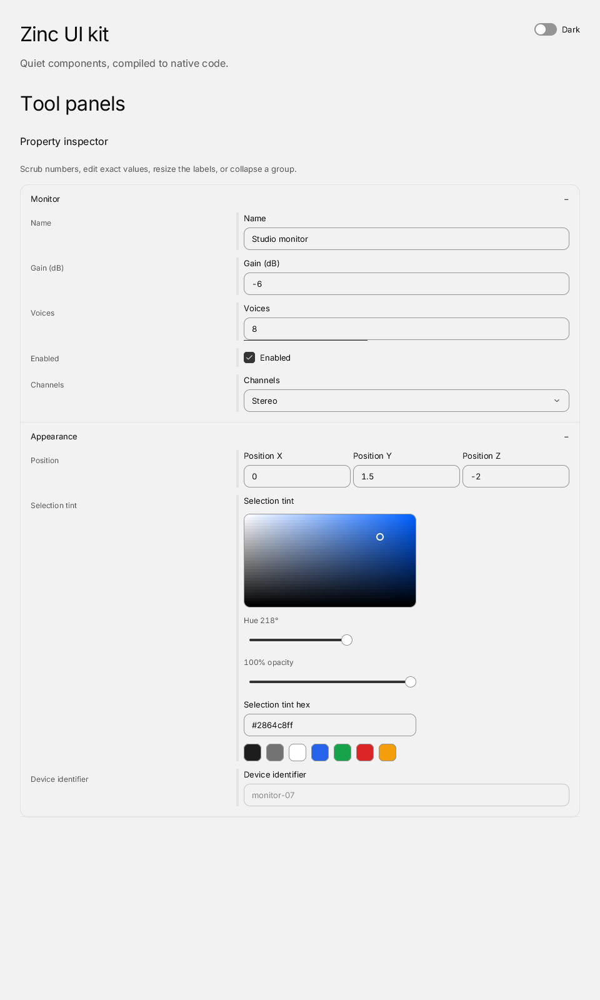
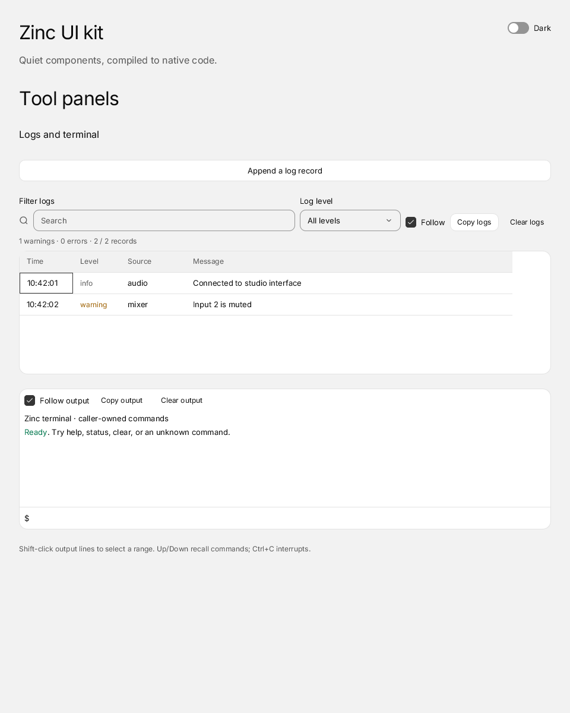
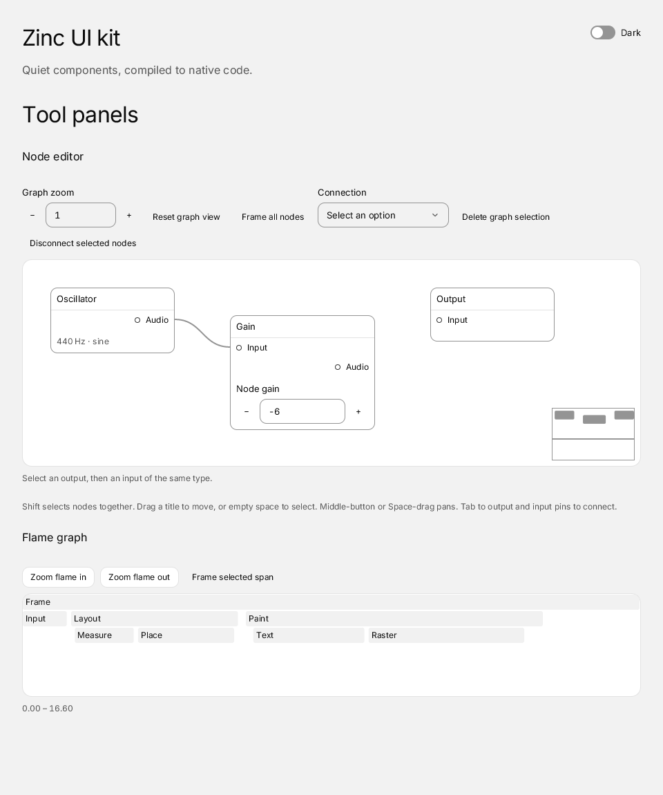
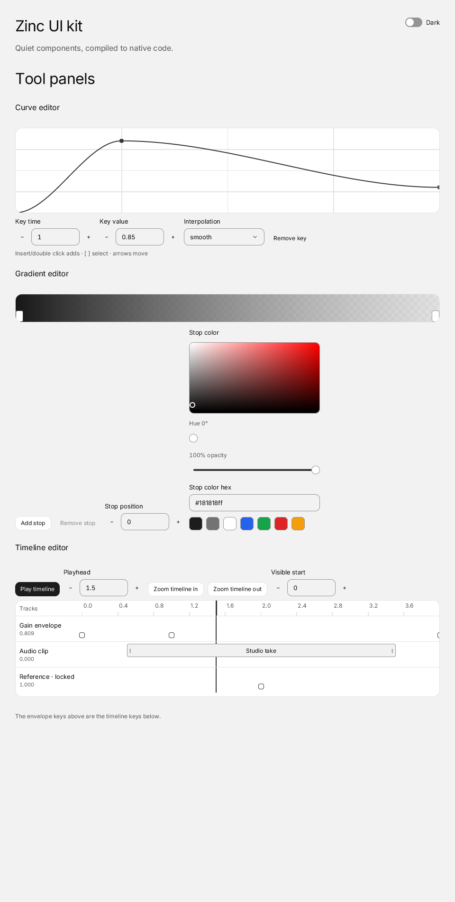
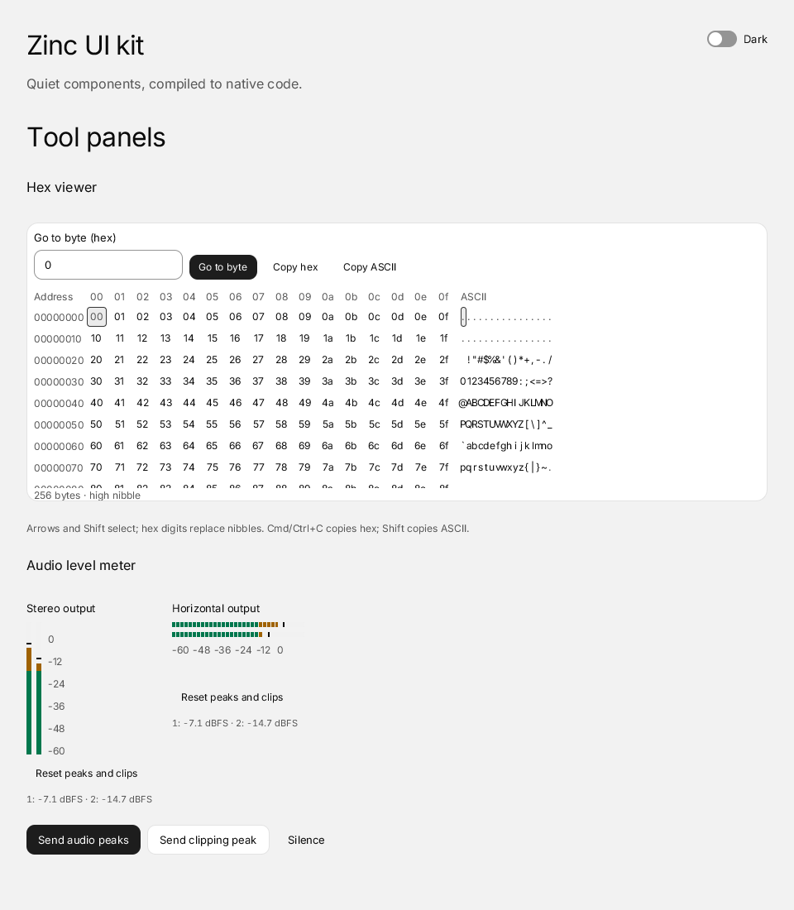
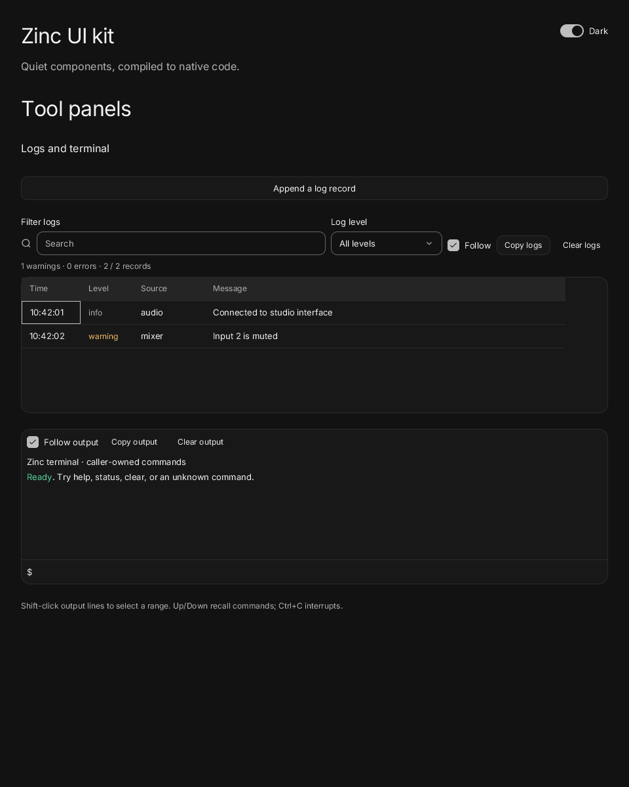
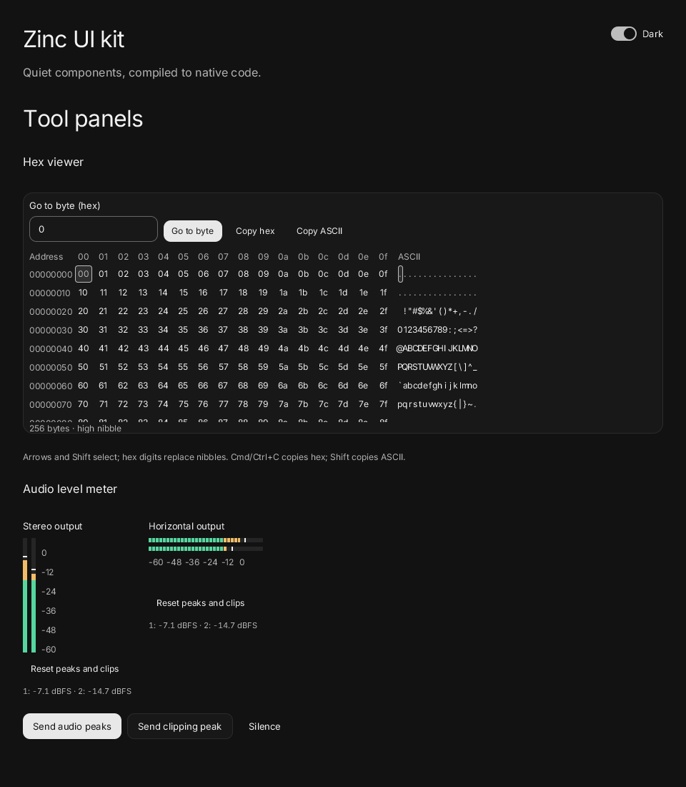
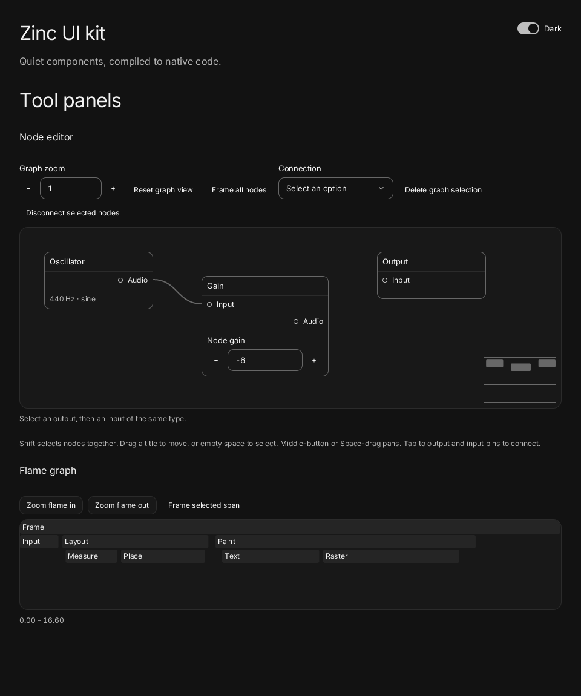
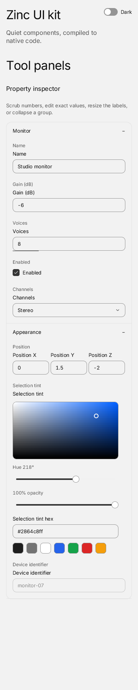
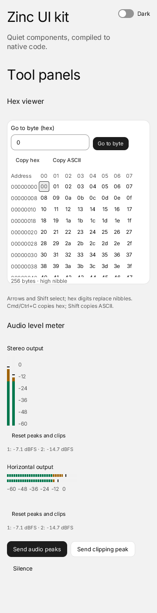
