# zinc:ui/kit — Quiet components

`zinc:ui/kit` is a small component kit written in Zinc (`lib/std/kit`). Call `useQuietTheme()` before rendering for
neutral surfaces, one accent, Inter, hairline borders and shadows on floating layers. Light and dark share the same
roles and the keyboard keeps a visible focus ring. The kit compiles to native code with the application; the
original shadcn and adaptive platform looks remain available. See [the design principles](design.md).


```sh
zinc run examples/ui/kit-gallery   # every component on one page, with a light / dark switch
```

**Adaptive by default.** On a phone or a Mac the kit takes the platform's look from `zinc:ui/platform`: iOS's 44 px buttons, 51 x 31 green
switches and type scale on iOS, Material 3's rounded buttons and outlined switches on Android, macOS's 24 px controls and the user's accent
colour on a Mac; Linux, the web and the boards keep the look described here (neutral). An app with a theme of its own keeps its colours on the
platform's shapes. `"ui": {"platformLook": "neutral"}` in `zinc.json` (or `"ios"`, `"android"`, `"macos"`) forces one look everywhere;
`ZINC_PLATFORM=ios zinc run examples/ui/kit-gallery` shows another platform's on the desktop ([docs/ui.md](ui.md), "Platform look").

## Using it

```tsx
import { createSignal, render } from 'zinc:ui/solid';
import { Card, CardHeader, CardContent, CardFooter, Button, Switch, heading, mutedText } from 'zinc:ui/kit';

const [wifi, setWifi] = createSignal<boolean>(true);

function App(): i32 {
  return <View className="flex-col gap-6 p-8 h-full bg-zinc-50">
    <Text className={heading(1)}>Settings</Text>
    <Card className="w-96">
      <CardHeader title="Network" description="Wireless and wired connections." />
      <CardContent>
        <Switch checked={wifi} onChange={setWifi} label="Wi-Fi" />
        <Text className={mutedText()}>{wifi() ? 'Connected to zinc-lab' : 'Offline'}</Text>
      </CardContent>
      <CardFooter><Button label="Save" onClick={() => {}} /></CardFooter>
    </Card>
  </View>;
}

render(App, 0xfafafa, null);
```

Conventions, identical in both UI models:

- **Components are functions returning nodes.** Solid calls them once; React / Inferno re-run them on each render and
  reconcile their nodes like any other component.
- **Text comes from props**: `label`, `title`, `description`, `hint`, `trailing`; the kit places and colours it.
- **Values that change are accessors**: `value={() => temp()}`, `checked={wifi}`, `selected={tab}`. Under Solid the
  component subscribes to them (only the affected node updates); under React write `value={() => temp}`, the
  accessor is read on every render. A plain prop that reads a signal (`title={page()}`) also follows it under Solid:
  the component is mounted again when the value changes (an accessor updates in place instead).
- **`children` adds custom content** (several children are passed as one fragment), and `className` adds layout
  classes to the component's outer node (`grow`, `w-80`, `w-full`).
- An explicit import wins over the host tag of the same name: `import { Button } from 'zinc:ui/kit'` makes
  `<Button>` the kit button in that file.

## Components

| Component | Props | Notes |
| --- | --- | --- |
| `Button` | `label?`, `variant?` (`default` `secondary` `outline` `ghost` `destructive`), `size?` (`sm` `default` `lg` `icon`), `onClick?`, `className?`, children | children follow the label (an icon glyph, a `Kbd`); `default` is filled with the theme's `primary` (near black on `LIGHT`, near white on `DARK`, as shadcn's), `outline` and `ghost` follow the page; the host `<Button>` without the kit draws nothing, so with no `bg-*` class it shows the page behind it |
| `Input` | `value?: () => string`, `onInput?`, `placeholder?`, `type?` (`password`), `name?`, `disabled?`, `className?` | shadcn's Input: `h-9`, `rounded-md`, a border in the theme's `input` colour, `px-3`, `text-sm`, no fill (it follows the page), a muted placeholder, a darker border while focused, half opacity when disabled |
| `Textarea` | the same, and `rows?` (3; `0` grows with the text) | shadcn's Textarea: Input's look with `py-2` and `min-h-16` |
| `Card` | `className?`, children | rounded-xl surface with a border and `shadow-sm`; spaces its sections |
| `CardHeader` | `title?`, `description?`, children | |
| `CardTitle`, `CardDescription` | `text` | when composing a header by hand |
| `CardContent`, `CardFooter` | `className?`, children | column / row, padded like the header |
| `Badge` | `label`, `variant?` (`default` `secondary` `outline` `destructive` `success` `warning` `accent`), `className?` | |
| `Separator` | `vertical?`, `className?` | one-pixel hairline |
| `ResizeHandle` | `size: () => number`, `onResize`, `vertical?`, `after?`, `min?`, `max?`, `className?` | shadcn's ResizableHandle: a bar between two panes that resizes one when dragged (`vertical`: between columns; `after`: the pane follows the bar); the size is your signal, kept within `[min, max]` |
| `Stat` | `label`, `value: () => string`, `unit?`, `hint?`, `className?`, children | metric tile; children sit on the label row (a `Badge`) |
| `CallStats` | `sample: () => CallStatsSample`, `history: () => CallStatsSample[]`, `className?`, children | a call's health: a good / fair / poor badge with its MOS, loss, round trip, bit rates, jitter, and sparklines of the loss, round trip and outgoing bit rate; zinc:webrtc's `CallQuality` fills it (`sample={() => q.last} history={() => q.history}`); `labels?: Map<string,string>` replaces its words (title, measuring, good, fair, poor, loss, roundTrip, out, in, jitter); children go under the numbers |
| `Tabs` | `items: string[]`, `selected: () => i32`, `onSelect`, `className?` | segmented control; switch the panels yourself: `{tab() === 0 ? <A/> : <B/>}` |
| `Switch` | `checked: () => boolean`, `onChange`, `label?` | never flips itself: `onChange` decides |
| `Progress` | `value: () => number` (0–100), `accent?`, `className?` | |
| `ProgressRing` | `value: () => number` (0–100), `size`, `color: () => i32`, `track: () => i32`, `strokeWidth?` (2.5 of 24) | a ring filling clockwise from the top, for a row or a cell; an idle ring paints nothing |
| `Spinner` | `size: number`, `color: () => i32`, `active: () => boolean` | mount while active; engine-driven ring, still with reduced motion; list `loader-circle` in the project's icons |
| `Slider` | `value: () => number`, `onChange`, `min?`, `max?`, `step?`, `className?` | tap the rail or drag sideways to set the value (never at the press: a swipe over it scrolls); keeps horizontal drags inside scroll views (`grab="keep-x"`) |
| `Avatar` | `name`, `size?` (`sm` `default` `lg`) | initials of the first two words |
| `Alert` | `title`, `description?`, `variant?` (`default` `destructive` `success`), `icon?`, `className?` | |
| `List` | `className?`, children | bordered panel of rows |
| `ListItem` | `title`, `description?`, `trailing?`, `selected?: () => boolean`, `onClick?`, `leading?: () => node`, children | rows with `onClick` are focusable and highlight when pressed |
| `Kbd` | `label` | key or shortcut hint |

## Overlays

Built on the engine's layers, anchoring, focus scopes and dismiss stack ([ui.md](ui.md#layers-and-anchored-positioning)):
they paint above the page and outside any clipping, follow their button and flip when there is no room, and Escape or a
press outside closes the latest one.

```tsx
ui.bindKeys('mod-s', 'save'); ui.onAction(-1, 'save', save);
<Tooltip label="Save" action="save"><Button label="Save" onClick={save} /></Tooltip>          // hint: Save ⌘S
<DropdownMenu label="Edit" items={[{ label: 'Save', action: 'save' }, { label: 'Delete', onSelect: remove }]} />
<Popover label="Filters"><Switch checked={f} onChange={setF} label="Only mine" /></Popover>
<Dialog open={asking} onOpenChange={setAsking} title="Delete?" footer={() => <Button label="Delete" onClick={del} />} />
toast('Saved', 'All changes are on disk.');
```

| Component | Props | Notes |
| --- | --- | --- |
| `Tooltip` | `label`, `action?` (its shortcut is shown), `placement?` (`top` default), `delay?` (500 ms), `className?`, children | shows while the pointer rests on the children, and at once when Tab focuses them; a press hides it; `attachTooltip(node, label)` (`zinc:ui/kit`) does the same for a node made by code |
| `Popover` | `label` (the trigger button), `variant?`, `placement?` (`bottom-start`), `className?` (the panel), children | focus moves into the panel and comes back when it closes |
| `DropdownMenu` | `label`, `items: MenuItem[]` (`label`, `action?`, `onSelect?`, `disabled?`), `variant?`, `placement?`, `className?` | opens focused on its first item; arrows move (trapped), Enter picks; actions show their shortcut (`keyLabel`) |
| `Dialog` | `open: () => boolean`, `onOpenChange`, `title?`, `description?`, `className?`, children, `footer?` | modal, dims the page (the dim fades, the panel fades and grows from 96%, both ways), traps the focus, focuses its first control, gives the focus back |
| `toast(title, description?, ms?)` | | a stack in the bottom-right corner, 4 s by default; no component to mount |

Tooltip, Popover, DropdownMenu and HoverCard retain their local state across parent renders in both UI models.
Dialog and Sheet are controlled, like `Switch`.

## Keyboard (on-screen, touch devices)

```tsx
<Input value={name()} onInput={setName} />
<Input inputMode="numeric" value={pin()} onInput={setPin} />      {/* digit pad; also decimal, tel, email, url, search */}
<Keyboard layouts={['fr', 'en', 'de']} />                          {/* at the bottom of the screen's column */}
```

`Keyboard` slides in while a text field has the focus (`mode="always"` keeps it on screen) and types through the
real keyboard path (`ui.insertText` / `ui.sendKey`), so `onInput`, undo, selection and Enter behave as with a
physical keyboard; pressing a key never takes the focus (`keepFocus`). A bubble previews the pressed key, a long
press offers accents (slide onto one, release), backspace repeats while held, shift is one-shot and a double tap
locks capitals, the language key cycles `layouts`, ⌄ closes it.

| prop | |
| --- | --- |
| `layouts` | layout ids, cycled by the language key: `en fr de es it pt sv ru el` built in; `registerLayout(new KeyboardLayout(...))` adds yours (rows as strings, `{shift:1.5}`-style special keys, accents, localized Enter / search / done captions) |
| `mode` | `auto` (default) or `always` |
| `onKey` | every key: a character, `Backspace`, `Enter`, `Shift`, `Layout:<id>`, `Hide` (works without a focused field, e.g. a custom display) |
| `keyHeight`, `gap` | sizes (default 44 / 6 px) |
| `className`, `keyClass`, `specialKeyClass`, `accentClass` | restyle the panel, letter keys, special keys and the accent popup |
| `preview` | key bubble (default true) |

Engine hooks for your own keyboards: `ui.insertText(s)`, `ui.sendKey(key, mods)`, `ui.focusedField()`,
`ui.fieldMode(h)`, `ui.onFocusChange(f)`, and the `keepFocus` attribute. Example: `zinc run examples/ui/keyboard`.

Typography helpers return class strings for host `<Text>` nodes in the current theme:
`heading(1..4)`, `leadText()`, `bodyText()`, `smallText()`, `mutedText()`, `captionText()`, `overline()`.

```tsx
<Text className={heading(2)}>Devices</Text>
<Text className={mutedText()}>{count()} online</Text>
```

## Themes

`LIGHT` (default) and `DARK` name a Tailwind colour for each role of shadcn's CSS variables: `background`,
`foreground`, `card`, `muted`, `mutedForeground`, `border`, `primary`, `secondary`, `accent`, `destructive`,
`success`… `setTheme(DARK)` switches every mounted kit component (the theme is a signal); under React the new
theme applies on the next render. Your own nodes can use the same tokens:

```tsx
<View className={`h-full bg-${theme().background}`}>...</View>
```

A custom theme is a `Theme` object: copy `LIGHT`, change the colours (e.g. `accent: 'emerald-600'`), `setTheme` it.

### The Quiet theme

The look of every new app and template ([design.md](design.md)): neutral greys, one accent, hairline borders, no shadow on cards, a close shadow on menus and dialogs, controls of
30 / 36 / 44 px with 10 px corners, cards of 18 px, Inter at 13 px. Call it once before the first render:

```tsx
import { useQuietTheme, setThemeAccent, setTheme, DARK, ACCENTS } from 'zinc:ui/kit';
useQuietTheme();               // or useQuietTheme('blue')
setTheme(DARK);                // light and dark as before; ui.setScheme('auto') follows the system
setThemeAccent('green');       // one of ACCENTS: neutral violet blue green amber orange coral rose; mounted nodes follow at once
```

It is the kit's own mechanism: the roles of `theme()` take the Quiet colours in the `light` and `dark` schemes, and the
platform look `quiet` (`zinc:ui/platform`, also `ZINC_PLATFORM_LOOK=quiet`) gives the shapes, the same on every platform.
`themeColor('accent')` returns a role as `0xRRGGBB` for what draws with a colour value (an `Icon`, a `Canvas`).

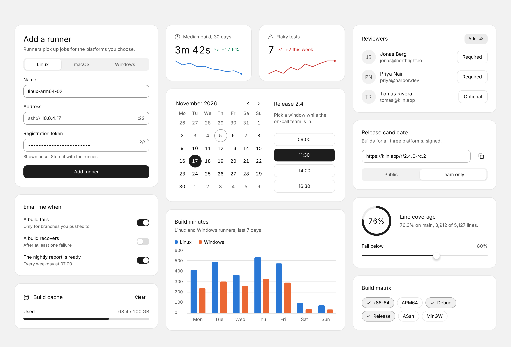

Springs: a period and a bounce. `springTo(node, 'translateX', 0, 16, SPRING_STATE)` plays it on the
compositor; under reduced motion (`ui.prefersReducedMotion()`) the property takes its end at once.

| Spring | Period, bounce | For |
|---|---|---|
| `SPRING_STATE` | 180 ms, 0 | what reports a state: a switch thumb, progress |
| `SPRING_SMOOTH` | 400 ms, 0 | moves and opens |
| `SPRING_SNAPPY` | 260 ms, 0.12 | presses, small feedback |
| `SPRING_MORPH` | 420 ms, 0.16 | a shape turning into another |

## What a component costs

A program pays for the components it uses, not for the ones it could import. `import { Button } from 'zinc:ui/kit'`
loads every family of the kit, and the compilers keep only what the program reaches:

- the typed engines (interpreter and AOT) drop every function no reachable code calls, and every method nobody calls
  (rapid type analysis, before and after inlining);
- `zinc bundle` (QuickJS) tree-shakes with esbuild, which drops every unused export of a module that runs no code when
  it loads.

Measured on an M1 Pro, 2026-11-09 (`tests/t0/kit_size.sh` prints them):

| Program | AOT binary (`zinc build`) | QuickJS bundle (`zinc bundle --minify`) |
|---|---|---|
| one `Button`, imported from its own file | 5.49 MB | 227 KB |
| the same `Button` through `zinc:ui/kit` (26 families unused) | +66 KB | +0.4 KB |
| nine more components (Card, Input, Switch, Tabs, Slider...) | +49.6 KB each | +1.5 KB each |

The first `Button` carries the class-string styling of `zinc:ui` and the theme; each component after it costs little.
The index leaves a small amount of type metadata. AOT links native plugins only when reachable code calls them.
The typed engines add no atlas for unused families: embedded TrueType files rasterize library sizes on first use,
and library characters come from reachable literals. JavaScript keeps its conservative source scan.

The gate allows 4 KB per unused family in AOT and 256 bytes in the bundle, and an average 64 KB / 4 KB for each
further used component. These are byte budgets, not timing measurements; toolchains and targets can change absolute sizes.

Rules that keep it so, for whoever adds to the kit:

- **No code at the top level.** A kit module declares functions, types and constant data; it calls nothing, registers
  nothing and defines no scheme when it loads. State is made at its first use (the theme signal and the colour schemes
  are). An empty `Map` or `Set` is fine. `tests/t0/kit_size.sh` checks it.
- **One module per family**, exported by `index.ts`. No table that names every component, no registry filled at load.
- **Keep font sizes in component styles.** Embedded TrueType builds rasterize library sizes when used; bitmap-only
  builds still pre-bake the sizes written in library sources.
- **Icons by a written name** (`<Icon name="check" />`): only the names written in the sources are compiled in.
- **Themes are data**: roles, colours and shapes, never functions stored in a table.


## Quiet Selection

Selection state belongs to the application: pass an accessor and an `onChange` callback. All controls use the
Quiet theme in light and dark. Checks, radio dots, chip selections and rating changes cut directly to their final
state; they need no decorative motion and behave identically with reduced motion enabled.

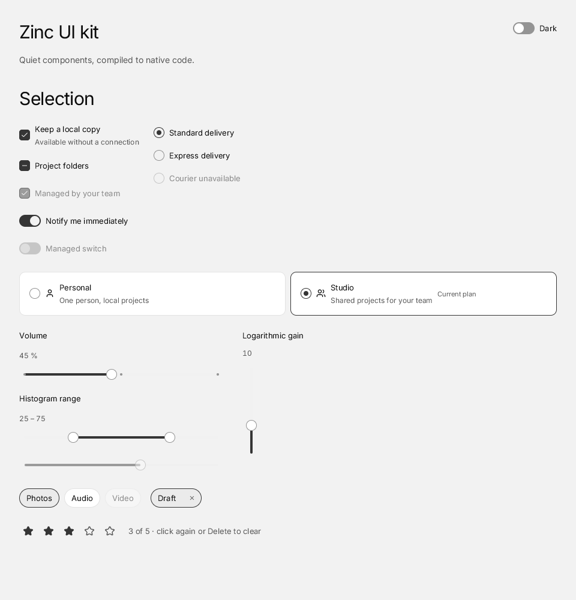

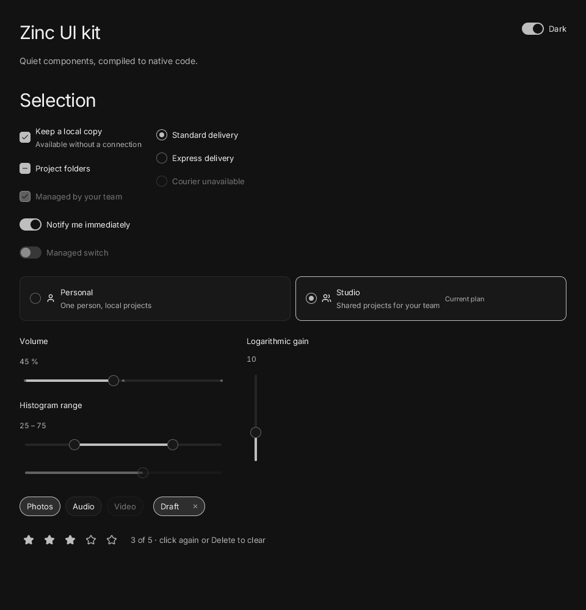

| Component | Contract and useful options |
|---|---|
| `Checkbox` | `label`, `checked`, `onChange`; optional `description`, `indeterminate: () => boolean`, `disabled`, `className`. A mixed checkbox announces `mixed`; activating it selects it. The whole labelled row is clickable. |
| `Switch` | `checked`, `onChange`, optional `label`, `accessibilityLabel`, `disabled`, `className`. Use it for an immediate setting. The whole label toggles it; its name stays the same in both states. Existing adaptive platform shapes remain available. |
| `RadioGroup` | `label`, `items: {value,label,description?,icon?,badge?,disabled?}[]`, `value: () => string`, `onChange`; optional `orientation="horizontal"`, `variant="card"`, `disabled`, `className`. One choice per group. |
| `RadioCards` | The same controlled contract as `RadioGroup`, with bordered cards for choices that need descriptions, icons or badges. `columns` controls card widths. |
| `Slider` | `value`, `onChange`; optional `min`, `max`, `step`, `accessibilityLabel`, `format`, `showValue`, `markers: number[]`, `disabled`, `className`. Steps start at `min`, with the result clamped to the bounds. `vertical` puts the maximum at the top; `logarithmic` maps a positive range logarithmically. |
| `RangeSlider` | The Slider options, with `low`, `high` accessors and `onChange(low, high)`. Two named thumbs share a rail. A thumb stops at the other thumb; both stay reachable from Tab. |
| `Chip` | `label`, `selected: () => boolean`, `onChange`; optional `disabled`, `onRemove`. The remove action is a separate named button. |
| `Chips` | `label`, `items`, `value: () => string[]`, `onChange`, optional `disabled`. Choices toggle independently and return a new array. |
| `Rating` | `label`, `value`, `onChange`; optional `max` (5), `readOnly`, `disabled`. Clicking the selected star again clears the rating. Selected stars are filled in the selection accent; `Icon filled` also fills other closed Lucide shapes. |

Space and Enter activate checks, switches and chips. Tab enters a radio group at its selected item (the first
available item when none is selected); arrows select and focus the next available choice, wrapping at either end.
Home and End select the first and last choice. Disabled choices never take focus.
Slider arrows change one step, Shift plus an arrow and Page Up/Down change ten steps, and Home/End reach the
bounds. Sliders announce their name, current value, bounds, orientation and formatted value. Rating arrows change
one star, Home/Delete/Backspace clear it, and End selects the maximum. Each keyboard target keeps the engine's
visible focus ring.

```tsx
const [low, setLow] = createSignal(20);
const [high, setHigh] = createSignal(80);
<RangeSlider accessibilityLabel="Histogram" low={low} high={high}
  onChange={(lo: number, hi: number) => { setLow(lo); setHigh(hi); }} />
```

Reproduce the picture with `GALLERY=selection ZINC_HEADLESS=1 ZINC_SIZE=960x1000 ZINC_FRAMES=2
ZINC_SHOT=docs/img/kit-selection.png zinc run examples/ui/kit-gallery --engine quickjs`.
Add `GALLERY_DARK=1` to inspect dark mode. The Selection implementations are in `selection.tsx`, with the
existing switch and slider providers kept in their own modules; importing one family performs no registration.

## Quiet Navigation

The Navigation family uses the Quiet roles in light and dark. Selection markers move with a spring and take their
final position immediately with reduced motion. Panels and destinations stay under application control.

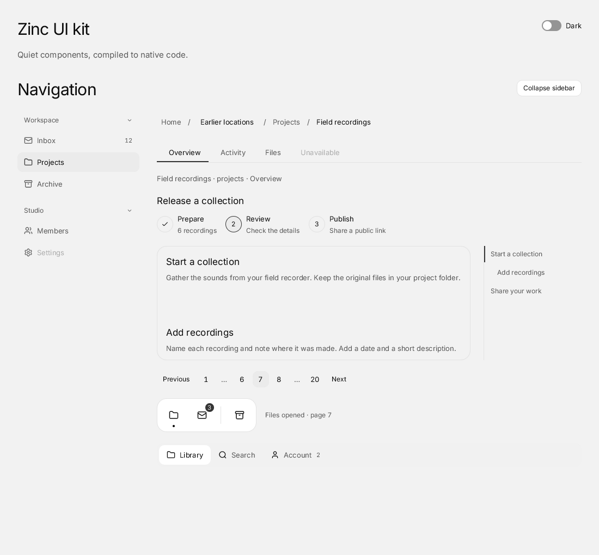

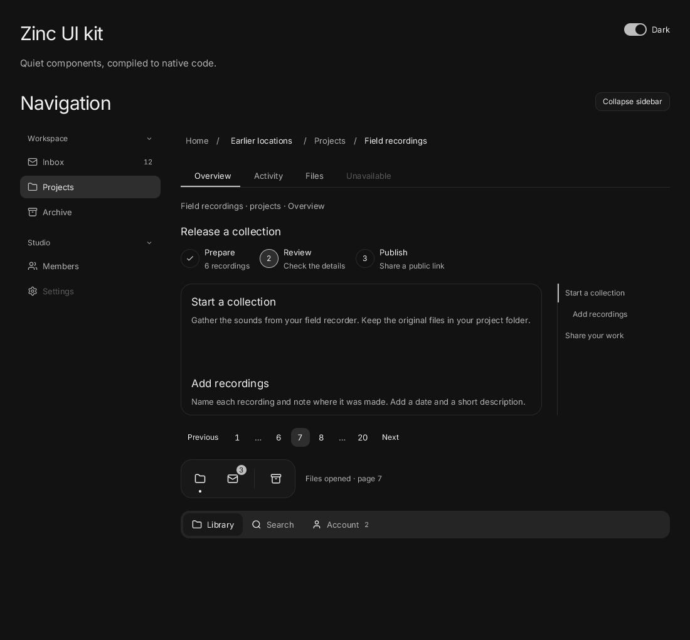

| Component | State and options | Keyboard |
|---|---|---|
| `Tabs` | Existing `items: string[]`, `selected`, `onSelect`; `variant="pill"` or `"underline"`, disabled indices, accessible label. Long labels scroll into view. | One tab stop; Left/Right skip disabled tabs, Home/End select the ends. |
| `NavigationTabs` | Named items `{ id, label, icon?, badge?, disabled? }`, selected id and `onSelect`; animated pill or underline. Icons and animation live here so plain Tabs stays small. | The same as Tabs. |
| `Sidebar` | Labelled groups of named items with icons, badges and disabled links; controlled `collapsed`, `closedGroups` and `onGroupToggle`. One highlight follows selection. | Arrows and Home/End move through enabled links and disclosures; Enter/Space act. Collapsed icons keep tooltips. |
| `Breadcrumb` | Labelled ancestors with `onSelect`; `maxItems` retains the root and recent ancestors and puts the rest in an accessible menu. The final entry marks the current page. | Tab or arrows reach links; Enter/Space open the overflow menu and choose an ancestor. |
| `Pagination` | Zero-based `page`, `pages`, `onChange`, optional `siblings`. First/last pages, gaps, Previous/Next and disabled boundaries. | Left/Right change page, Home/End reach the ends; Tab and Enter/Space activate page buttons. |
| `Stepper` | Label, description, optional `status="complete"` or `"error"`; controlled `current`, optional `onSelect`, `linear` and `vertical`. Without `onSelect`, it reports progress. | Arrows and Home/End move among available steps; Enter/Space select. Linear mode refuses later steps. |
| `TableOfContents` | A `scroll` handle accessor and `{ label, anchor: () => handle, level? }` entries. The rail follows the section in view; choosing one scrolls to it. Accessors work with both Solid and React refs. | Arrows and Home/End move among entries; Enter/Space scroll. |
| `Dock` | Named icon actions, running dots, notification counts, separators and disabled actions. `onSelect` receives the id. Icons remain the same size, following the Quiet rule against decorative hover growth. | Tab, arrows and Home/End move through actions; Enter/Space activate; tooltips name icons. |
| `TabBar` | Compact navigation from the same named items and controlled selected id as NavigationTabs; a moving pill, icons and optional badges. | One tab stop; Left/Right and Home/End select. |

```tsx
const [tab, setTab] = createSignal<i32>(0);
<Tabs items={['Overview', 'Files']} selected={tab} onSelect={setTab} />

const scroll = createNodeRef(), install = createNodeRef();
<View className="flex-row gap-6">
  <ScrollView ref={scroll} className="h-[240px] grow">
    <View ref={install}><Text>Install Zinc</Text></View>
  </ScrollView>
  <TableOfContents scroll={() => scroll.node}
    items={[{ label: 'Install', anchor: () => install.node }]} />
</View>
```

Register the icon names you choose in the project's `zinc.json` `icons` list. The family uses the existing icon
provider and loads no icons or handlers at import time. Document tabs and resizable panel docking remain the
[App chrome](#quiet-app-chrome) controls; the Dock here launches destinations.

Run `GALLERY=navigation zinc run examples/ui/kit-gallery`. Recreate either picture with `ZINC_HEADLESS=1
ZINC_SIZE=1100x1020 ZINC_FRAMES=3 ZINC_SHOT=<absolute-path> zinc run examples/ui/kit-gallery --engine quickjs`;
add `GALLERY=navigation` and, for dark, `GALLERY_DARK=1`.

## How it works

Each kit file starts with `/** @jsxHelpers ./host */`: the JSX compiler lowers that file against
`lib/std/kit/host.ts` instead of the Solid or React helpers. The host helpers ask whether the React engine is
rendering the program: under Solid, dynamic classes and texts become fine-grained effects; under React they are read
once per render and the nodes come from the reconciler. `tests/conformance/kit_solid.tsx` and `kit_react.tsx` build
the same screen in both models and must print the same layout (on the sim and on every native target).

## Quiet Overlays

The family lives in `lib/std/kit/overlays.tsx`. Anchors flip and stay inside the viewport. Modal dialogs and sheets
block the page and trap focus; popovers, hover cards and confirmations allow Tab to leave. Closing a focused panel
restores its invoker.
Layer motion honors the operating system's reduced-motion setting.

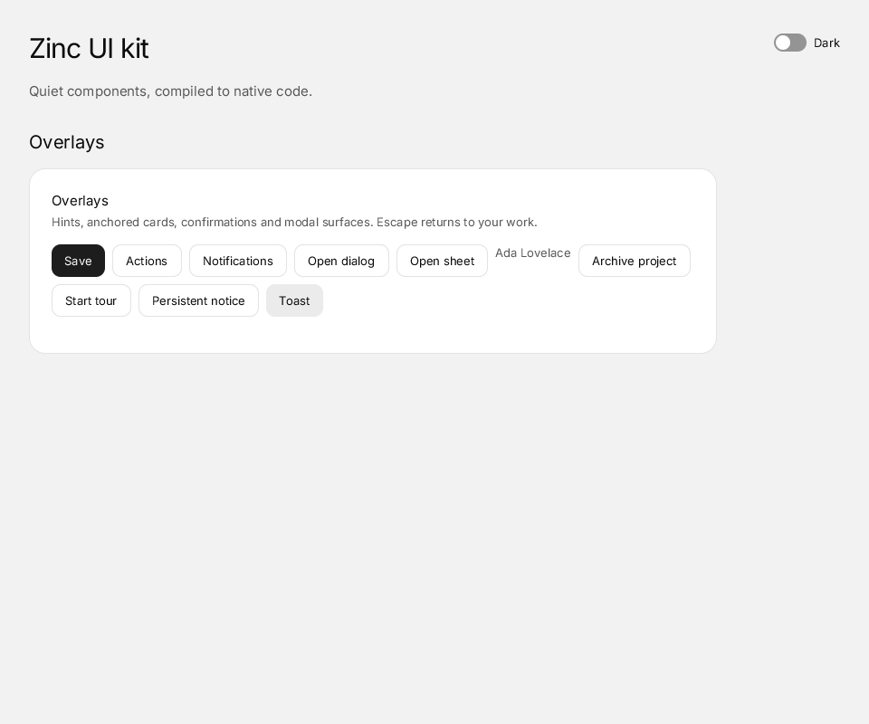

| Component | Options and behavior |
| --- | --- |
| `Popover` | `label`, optional `trigger` slot, `placement`, `width` (288 px), `padding` (16 px), `gap` (4 px), `className`, children. Enter/Space toggles; Escape/outside closes. Custom triggers are keyboard buttons. |
| `Tooltip` | `label`, optional shortcut `action`, `placement`, `delay` (500 ms), children. Pointer dwell or keyboard focus reveals the hint. Nearby hints skip the second delay. Escape closes without moving trigger focus; its `aria-describedby` names the hint. Long press shows it for three seconds. |
| `Dialog` | `open`, `onOpenChange`, `title`, `description`, `width` (440 px), children, `footer`, `className`. The Close button, Escape and scrim close it unless `persistent`; its own footer can complete a persistent operation. |
| `Sheet` | Dialog's props plus `side` (`left`, `right`, `top`, `bottom`) and `size` (400 px). The body scrolls while its header/footer remain available. |
| `HoverCard` | `label`, `trigger` slot, children, `delay` (450 ms), `grace` (200 ms), `placement`, `width`, `className`. Hover or focus reveals rich content; the grace period lets the pointer cross into the card. Click/Enter opens it too. This is a popover region, not a tooltip. |
| `ConfirmPopover` | `label`, `title`, `description`, `confirmLabel`, `cancelLabel`, `destructive`, `onConfirm`, `placement`, `width`. Focus enters the confirmation; Enter accepts, Escape/outside cancels. |
| `toast` | `toast(title, description='', duration=4000, {tone?, action?, onAction?})`. A newest-first stack expands and pauses on hover/focus. Dismiss or drag sideways to close. Negative duration persists; use it for errors or information that must remain available. Toasts never take focus. `clearToasts()` cancels their timers and closes the stack's notices. |
| `GuidedTour` | Controlled `open`, `step`, `onStepChange`, `onOpenChange`, `steps`, `doneLabel`, `closeLabel`. Each step has `title`, `body`, optional `target: () => node`, `placement`, `width`, spotlight `padding`, `blockTarget`, `nextLabel`, `backLabel`. Targetless steps appear centrally. Left/Right, Enter and Escape navigate/close; Back/Next/Done and a count remain visible. Targets stay interactive unless `blockTarget` is true. |

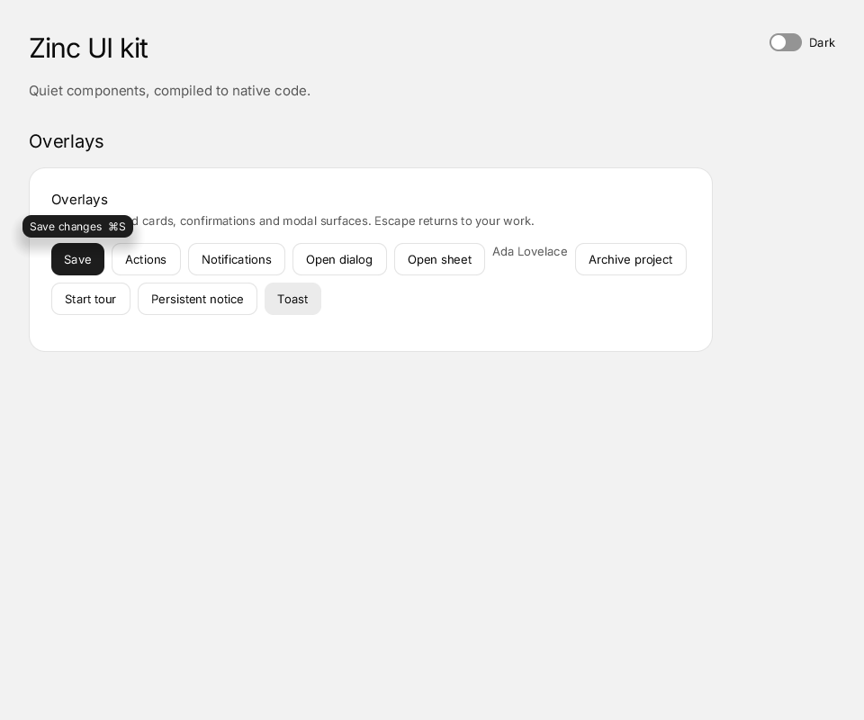
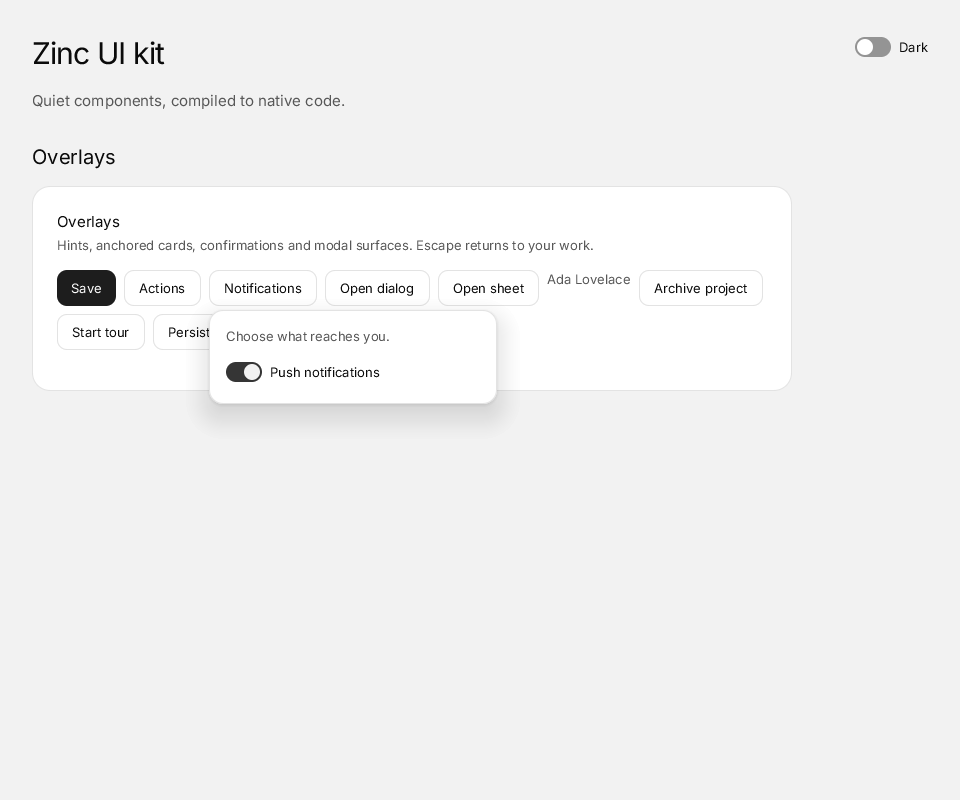
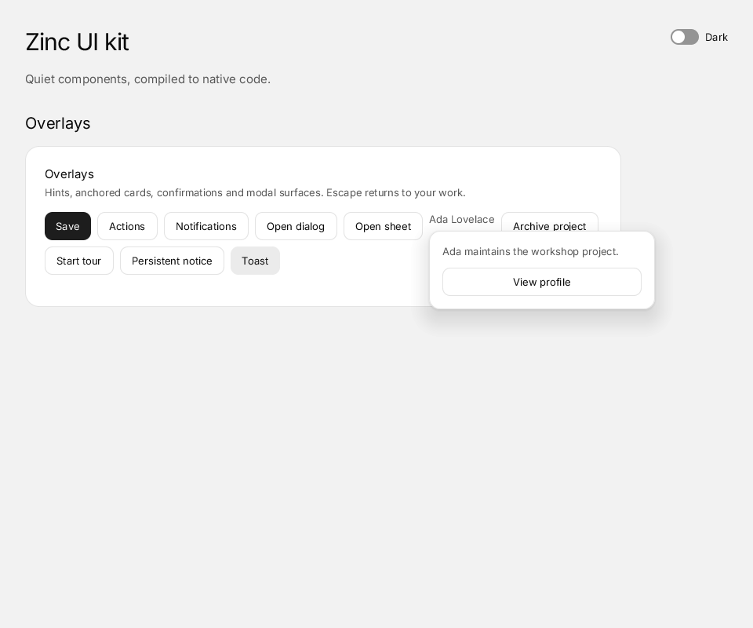
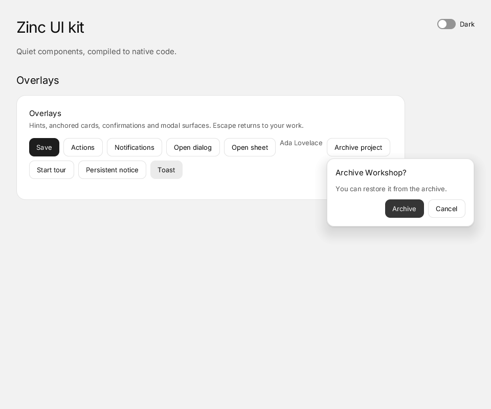
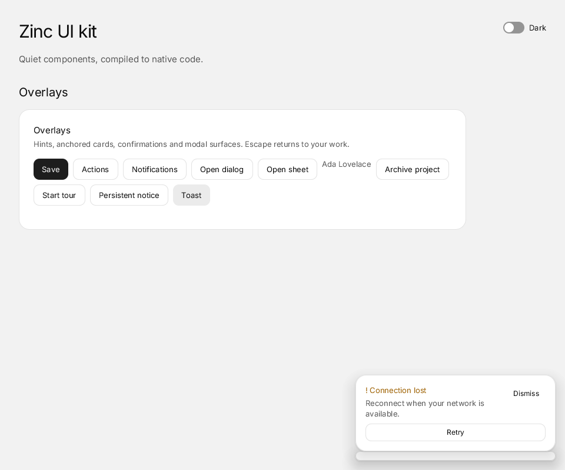
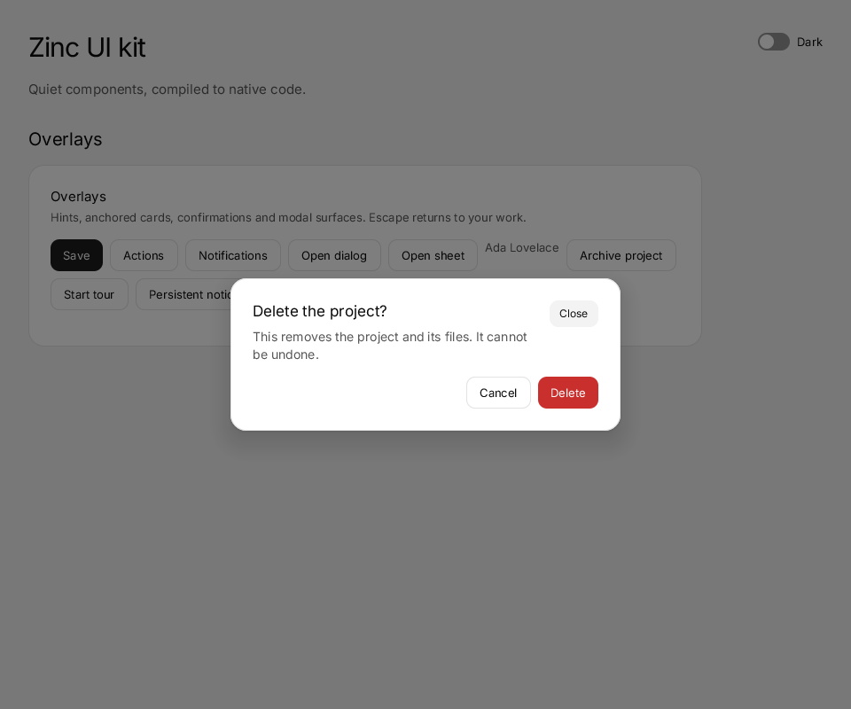
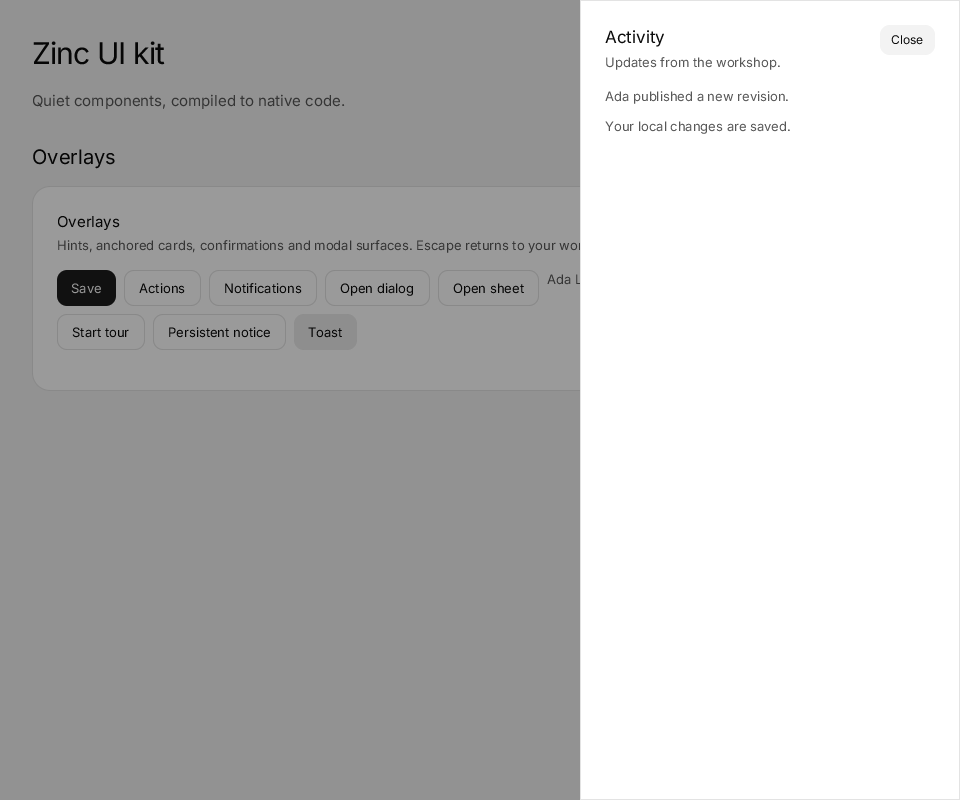
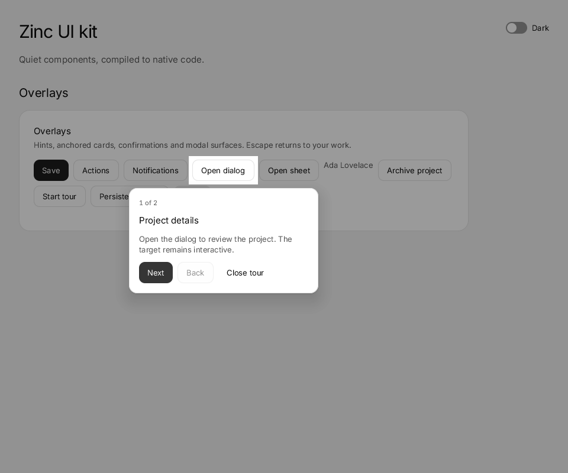
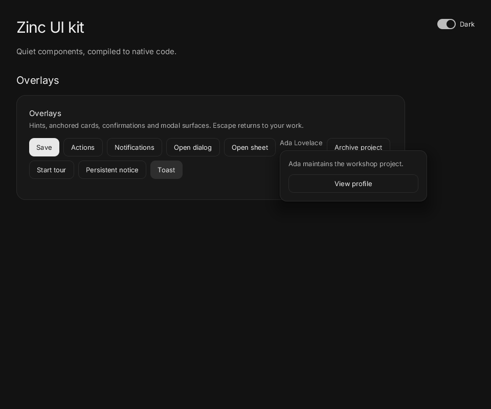
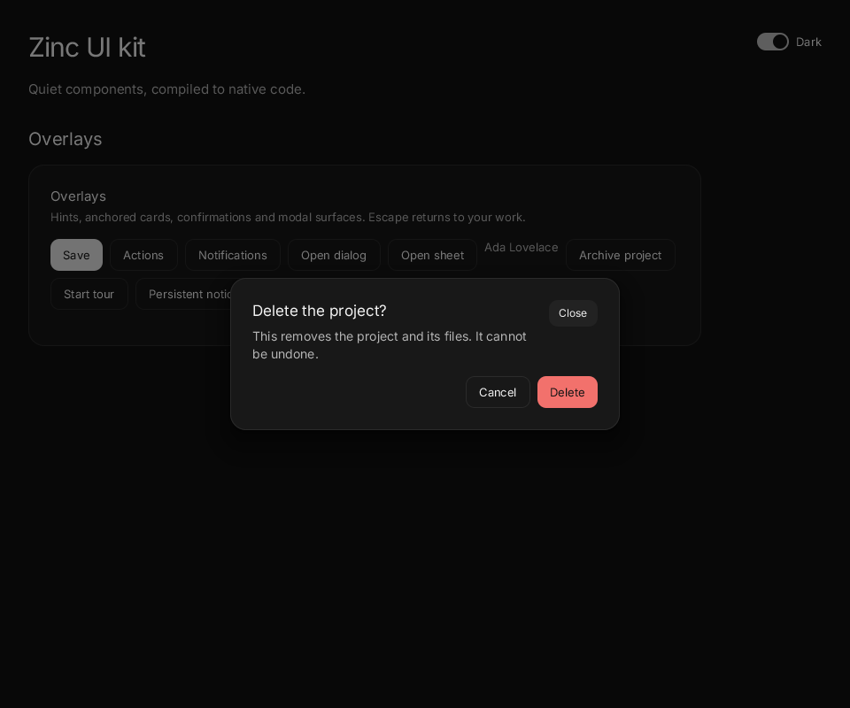

Run `GALLERY=overlays zinc run examples/ui/kit-gallery`. Add `OVERLAY=dialog`, `sheet`, `tour`, `hint`, `popover`, `hover`, `confirm` or `toast` to open that
surface immediately; `GALLERY_DARK=1` starts dark. For a picture, add `ZINC_HEADLESS=1 ZINC_FRAMES=25
ZINC_SHOT=docs/img/kit-overlays.png`.

## Limits

- No hover (touch screens and pads have none): pressed and focused states use `active:` and `focus:` fills, and every pressable also dims
  while it is held (zinc:ui's pressed feedback, docs/ui.md; `active:opacity-*` or `pressFeedback={0}` replaces it).
  Focusable kit nodes always set a `focus:` fill, which also replaces the yellow keyboard-focus ring of `zinc:ui`.
- Two weights are baked (Inter Regular and Bold): `font-medium` renders regular, `font-semibold` bold.
- The kit's text sizes are baked into every program that imports it (seven sizes, regular and bold).

## Quiet Actions

Call `useQuietTheme()` before rendering. The Actions family is in `lib/std/kit/actions.tsx`; existing `Button`,
`DropdownMenu` and `ContextMenu` remain compatible. Controls use the theme roles in light and dark, keyboard focus
rings and disabled opacity of 45%. Springs stop at the final state under reduced motion; hold confirmation still
requires the full hold time.

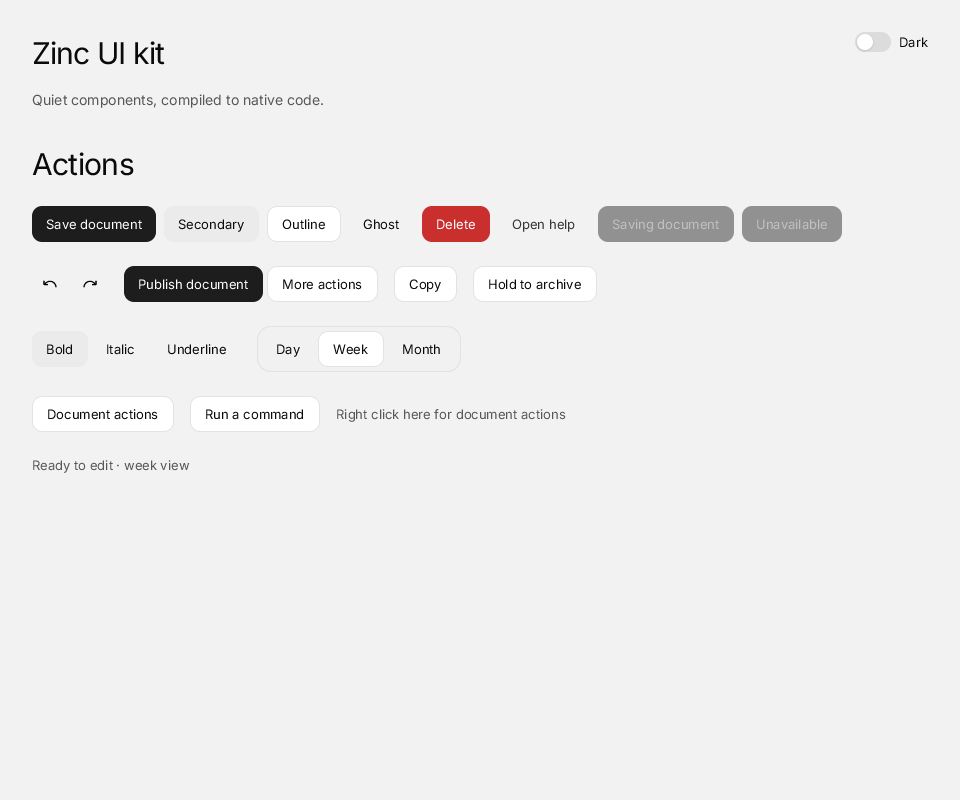

| Component | Props and behavior |
| --- | --- |
| `Button` | `variant="default"` (primary), `secondary`, `outline`, `ghost`, `destructive`, `link`; `size="sm"`, `default`, `lg`, `icon`; `disabled`, `loading` retains the label and blocks presses; `ariaLabel` names custom content. Children can hold leading/trailing content. |
| `IconButton` | `label`, Lucide `icon`, `onClick?`, `disabled?`, `variant?` (`ghost` default). The label names the button and its tooltip; list icons in `zinc.json`. |
| `ButtonGroup` | `label?`, children, `className?`. A named row of buttons; Tab and arrows move focus, Enter/Space activate. |
| `SplitButton` | `label`, `onClick`, `items: MenuItem[]`, `disabled?`. The main action and its alternative menu; Down opens the focused menu button. |
| `ToggleGroup` | `label`, `items: {value,label,disabled?}[]`, `value: () => string[]`, `onChange`, `multiple?`. Exclusive mode keeps one selected item; multiple mode toggles independently. Selection is exposed as `aria-pressed`. |
| `SegmentedControl` | `label`, `items`, `value: () => string`, `onChange`. Left/Right select the next enabled view; Home/End select the ends. |
| `CopyButton` | `text: () => string`, `label?`, `onError?: (message: string) => void`. Copies on activation and announces “Copied” in place; without an error callback clipboard errors propagate. |
| `HoldToConfirm` | `label`, `onConfirm`, `duration?` (1200 ms), `disabled?`. Hold pointer, Space or Enter until the fill completes. Fires once; release, pointer leave/cancel, Escape or focus loss resets it. |
| `DropdownMenu` | Existing `label`, `items`, `variant?`, `placement?`, `className?`; items additionally support `checked`, `separator`, `destructive`. Down opens, arrows navigate, Enter picks, Escape/outside dismisses and restores focus. |
| `ContextMenu` | `items: MenuEntry[]`, children, `onSelect?`. Right press, touch long press, ContextMenu key or Shift+F10 opens the menu; keyboard activation and dismissal follow the same focus scope. |
| `CommandPalette` | `open`, `onOpenChange`, `items: {label,keywords?,group?,shortcut?,disabled?,onSelect}[]`, `title?`. Fuzzy subsequence filtering ranks compact matches first. Down enters results; Up/Down navigate, Enter runs, Escape closes. The application owns its shortcut binding, so palettes do not compete for a global key. |

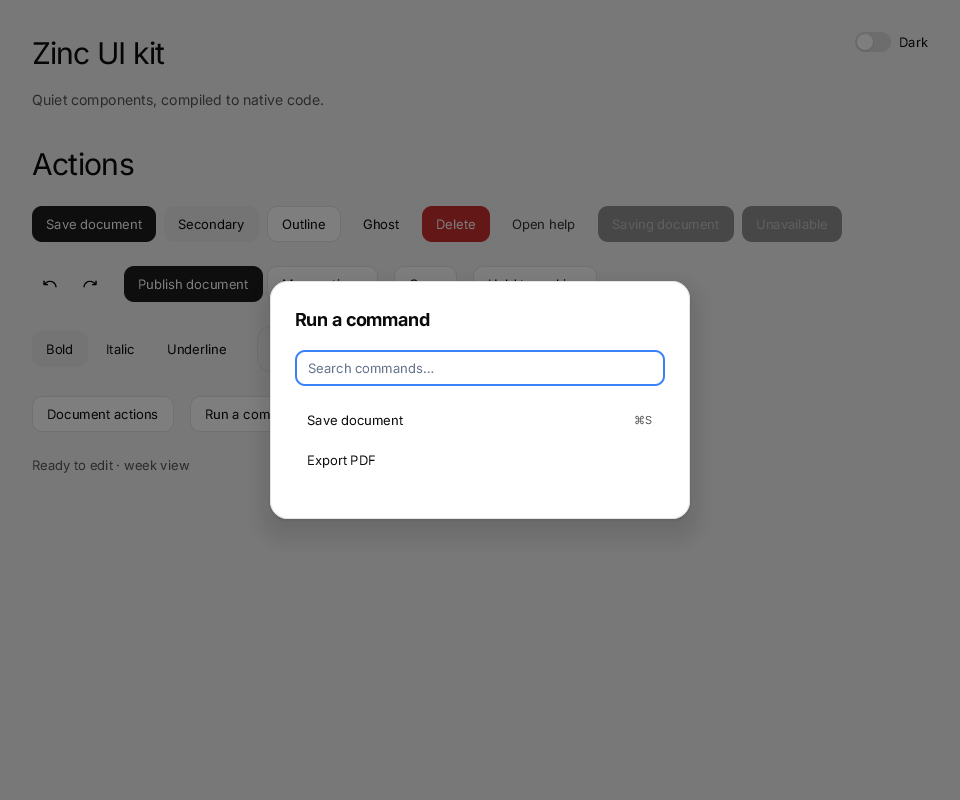

```tsx
const [view, setView] = createSignal('week');
<SegmentedControl label="Calendar view" value={view} onChange={setView}
  items={[{ value: 'day', label: 'Day' }, { value: 'week', label: 'Week' }]} />
<HoldToConfirm label="Hold to archive" onConfirm={archiveDocument} />
```

Recreate the pictures with `GALLERY=actions` or `GALLERY=palette`, `ZINC_HEADLESS=1`, `ZINC_FRAMES=40`,
`ZINC_SHOT=<path>` and `zinc run examples/ui/kit-gallery --engine quickjs`. `GALLERY_DARK=1` selects Quiet dark.
The gallery rests when nothing changes; its sample upload value is static.

## Quiet App chrome

The App chrome family composes the existing kit primitives and `zinc:ui/dnd`. Bars inherit their surface and draw
one inner hairline. Document and dock state belongs to the application; closing a dirty document asks the caller,
and loading an invalid saved layout leaves the current workspace intact.

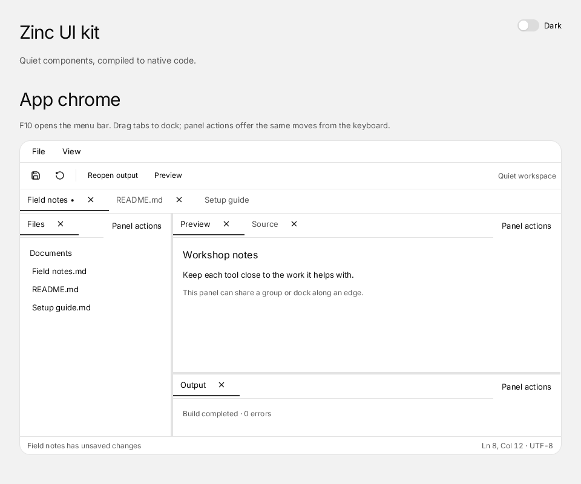

| Component | Props and keyboard behavior |
| --- | --- |
| `MenuBar` | Existing `items: MenuEntry[]`, `native?`, `onSelect?`, `className?`; top-level entries accept `mnemonic?`. F10 enters the bar, Left/Right changes titles, Down/Enter opens, arrows navigate and Enter picks; Escape closes and restores focus. `Alt+mnemonic` opens a named menu. Hover switches open menus; accelerators remain global while the bar is mounted. Native mode still suppresses the drawn bar. |
| `Toolbar` | `label`, `items: {label,icon?,checked?,disabled?,separator?,onSelect?}[]`, `trailing?`, `className?`. Ghost actions and named icon tooltips; actions that do not fit move into “More actions”. All actions remain reachable by Tab, Enter/Space and the overflow menu. |
| `StatusBar` | Children and optional `trailing`, `className`. A 30 px row with a top hairline; the trailing slot aligns right. |
| `StatusItem` | `label`, `onClick?`, `progress?: () => number` (0–100). Text uses 12 px tabular figures; clickable items enter the Tab order. A progress value stays still when no work changes it. |
| `DocumentTabs` | `items: () => DocumentTab[]`, `selected`, `onSelect`, `onClose?`, `onMove?`, `className?`; tabs have stable `id`, `label`, `dirty?`, `closable?`. Click selects; the close button, middle press, Delete or Mod+W asks `onClose`. Left/Right and Home/End select, Shift+Left/Right and drag request reorder; Ctrl+Tab/Shift+Tab or Ctrl+PageDown/Up cycle. The caller decides whether to save a dirty document. |
| `DockLayout` | `layout: () => DockLayoutState`, `onChange`, `panels: {id,label,content}[]`, `className?`. A recursive tree of horizontal/vertical splits and tab groups. Drag a panel to an edge to split or to a group's centre to join it; “Panel actions” offers these moves by keyboard. Dividers resize by drag or 10 px arrow steps, Home/End use the bounds. Closed panels stop building; reopening retains their original group. |

`DockLayoutState` contains `root: DockNode` and `closed: string[]`. A node has a stable `id`, `axis` (`tabs`,
`horizontal`, `vertical`), `ratio`, `tabs`, `selected` and optional `first`/`second`. Split ratios stay within
0.05–0.95 and dividers reserve up to 120 px per side, sharing smaller spaces. Unknown panel IDs remain in the data,
so a temporarily absent plugin does not lose its position. Empty branches compact after a move.

```tsx
import * as storage from 'zinc:storage';
// Save when the person chooses; persistence is never performed at import time.
storage.set('workspace', saveDockLayout(layout()));
try { setLayout(parseDockLayout(storage.get('workspace'))); }
catch (error) { showStatus('Layout unchanged: ' + error.message); }
setLayout(setDockPanelOpen(layout(), 'output', true));
setLayout(moveDockPanel(layout(), 'output', 'editor', 'bottom'));
```

`parseDockLayout` throws on malformed data, duplicate node/panel identities, invalid selections or ratios, more
than 48 panels, 95 nodes, 16 levels or 64 KiB of source. It builds a validated copy before the caller applies it.
`saveDockLayout`, `moveDockPanel`, and `setDockPanelOpen` return data or new layouts; applications own storage and
surface any read/write error. Dock highlight and resize track direct manipulation; springs use the kit's reduced
motion path. No chrome control starts a decorative animation.

Recreate the picture with `GALLERY=chrome ZINC_HEADLESS=1 ZINC_FRAMES=40 ZINC_SHOT=docs/img/kit-app-chrome.png zinc run examples/ui/kit-gallery --engine quickjs`.

Escape cancels an active dock drag and clears its highlight; releasing afterwards cannot apply the cancelled drop.
The same shared operation is available as `cancelDrag()` from `zinc:ui/dnd`, returning whether it cancelled a drag.

## Inputs

The Inputs family shares the engine's selection, clipboard, undo and IME support. Values are caller-owned accessors;
`onInput` reports text and `onChange` reports numeric values, arrays or selections. Use `PasswordField` for reveal controls; the legacy `Input type="password"` remains masked. These controls use the Quiet
roles in both themes. They introduce no ongoing animation, so reduced motion keeps exactly the same feedback.

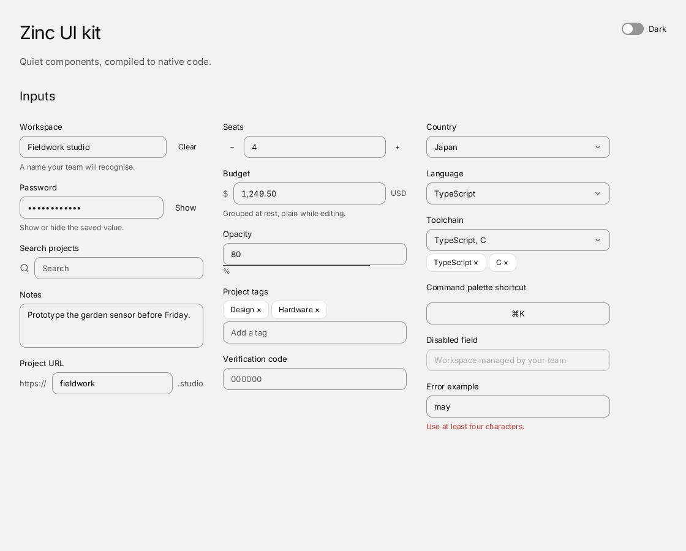
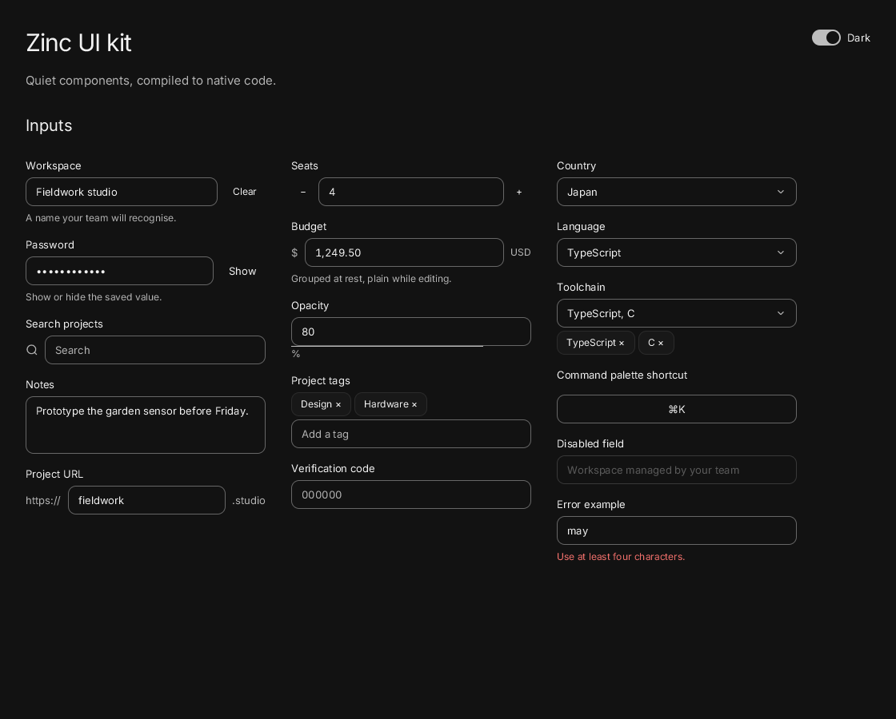

| Component | Options and behavior |
| --- | --- |
| `Input` | `value`, `onInput`, `onSubmit`, `type` (`password` masks), `label`, `placeholder`, `hint`, `error`, `icon?: () => i32` (a named Icon render slot), `prefix`, `suffix`, `clearable`, `readOnly`, `disabled`, `autofocus`, `size` (`sm`, default, `lg`), `name`, `className`. Clear uses the editing path, so Undo restores the value. Enter submits. |
| `PasswordField` | Text-field options; masks the value and supplies a named Show/Hide action. |
| `SearchField` | A search icon, search keyboard and Clear action; Enter calls `onSubmit`. |
| `Textarea` | Text-field values, labels, hints, errors, read-only and disabled states; `rows` (3, or 0 to grow), `height` (-1 fills). Enter adds a line; Ctrl/Cmd+Enter submits. |
| `NumberField` | Numeric `value` / `onChange`, `min`, `max`, `step`, `decimals`, `label`, `suffix`, `disabled`, `className`. Type or press minus/plus; arrows step, Shift steps tenfold, Home/End reach the bounds. |
| `MoneyField` | Numeric props plus `symbol`, `code`, `hint`; grouped at rest, plain while editing. `decimals` defaults to 2; -1 means whole units. |
| `ScrubField` | Numeric props; drag horizontally, Shift for tenfold finer changes, click to type, arrows to step. The bottom hairline shows the position in the range. |
| `TagInput` | String-array `value` / `onChange`, `label`, `placeholder`, `maxTags`, `disabled`; Enter/comma adds a unique tag, Backspace in the empty field removes the last, each tag has a named remove button. |
| `OneTimeCode` | String `value` / `onChange`, `length` (6), `label`, `disabled`, `onComplete`; accepts typing or paste, retaining only the requested number of digits. |
| `Select` | `SelectOption[]` (`value`, `label`, optional `icon`, `disabled`), `value` / `onChange`, `label`, `placeholder`, `disabled`, `className`. Arrows open/move, Home/End reach the ends, printable keys find an option, Enter/Space chooses, Escape closes and restores focus. |
| `Combobox` | Select props, with an editable filter. Arrows leave the filter for the matching options. |
| `MultiSelect` | String-array values, Select options, `searchable`, `maxChips` (3); named removable chips and an overflow count, Select all/Clear actions. Choosing an option keeps the list open. |
| `ShortcutRecorder` | String `value` / `onChange`, `label`, `disabled`; click or Enter/Space starts recording, a key combination saves, Backspace clears, Escape/Tab cancels. Recording consumes shortcuts before global keymaps; blur cancels, and recording can start again. |

Run the family alone with `GALLERY=inputs zinc run examples/ui/kit-gallery`. `GALLERY_DARK=1` selects dark.
The pictures above come from the gallery at 1120 × 900; all controls remain interactive in that same program.
