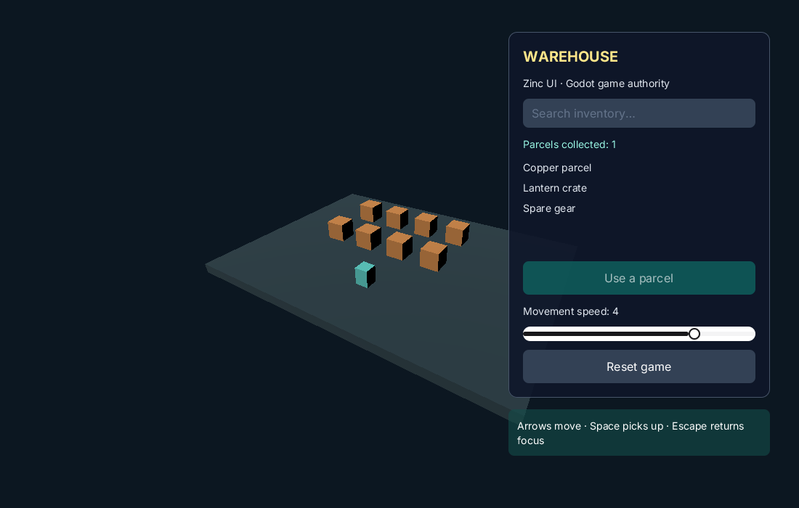

# Godot Warehouse with real Zinc UI



Godot owns the 3D warehouse, movement, pickups and inventory. One native
`ZincControl` GDExtension hosts the AOT-compiled Zinc TSX search/inventory,
settings slider and transparent HUD. No browser, second UI window, screenshots
or IPC polling sit between the two runtimes.

On the development Apple Silicon Mac, from the repository root:

```sh
cmake -S . -B build -DCMAKE_BUILD_TYPE=Release
tools/build zn_app zinc
GODOT=$(tools/godot/fetch)
examples/godot-zinc-ui/build.sh
GODOT="$GODOT" tests/run --only godot_zinc_ui
examples/godot-zinc-ui/package.sh
open examples/godot-zinc-ui/build/Warehouse.app
```

Alternatively open `godot/project.godot` with Godot 4.6-stable after building.
Move with arrows; Space collects a nearby parcel. Click Zinc's search field to
filter the catalogue, use a collected parcel, drag the speed slider, or reset.
Escape releases Zinc focus to gameplay. The world animates behind the translucent
panel. Godot's polled keys are explicitly disabled while Zinc has focus; event
acceptance alone would not do this.

`src/main.tsx` is the actual Zinc interface. The project-local `warehouse` native
module carries bounded counts, speeds and validated action codes. Godot validates
and applies actions, and publishes inventory snapshots. The native control
translates pointer/buttons/wheel, keys/repeats/committed Unicode text and focus
loss to the shared `zn/embed.h` ABI. Godot provides Control mouse capture; Zinc
receives local coordinates even when a held pointer leaves its bounds. The host
owns focus policy. Native IME composition, clipboard, screen keyboard,
accessibility semantics and gamepad navigation are **not implemented** here.

`zn_embed_tick` runs on the Godot main thread. Pixels are persistent top-left
premultiplied `0xAARRGGBB`; little-endian BGRA is converted to RGBA and drawn with
Godot's `blend_premul_alpha`. The existing software command lists reconstruct
alpha over black/white backdrops. No chroma key is used. The same `ImageTexture`
is updated only when the presentation serial changes, with replacement on resize.
This is a CPU upload baseline, not GPU sharing or partial texture uploads.

The build pins godot-cpp 4.5-stable commit
`e83fd0904c13356ed1d4c3d09f8bb9132bdc6b77`, compatible with the pinned 4.6 host,
and verifies its archive. The small class profile avoids compiling unused
bindings. SDL C symbols stay private to the extension; the two Objective-C rumble
classes are prefixed in a copied build archive to avoid colliding with Godot's
SDL. No vendored source or shared runtime is modified.

The local `.app` includes the official Godot runtime, native extension and project,
and starts outside the source tree without a separately installed Zinc CLI.
Its runtime is signed locally ad hoc after changing bundle identity; distribution
signing/notarization is not supplied. Only macOS arm64 is built. The README's
`open` command is for people; automated graphical checks must use a disposable
project override `display/window/size/no_focus=true` and clean up the process.

Executed evidence: headless real Godot GDExtension startup, native pixels and
partial premultiplied alpha, no idle upload, inventory and UI action exchange,
search text, slider, focus plus polled key isolation, 2× resize, idempotent teardown,
and packaged run from `/tmp`. The graphical proof also passes on the real OpenGL
viewport: viewport-routed clicks reach Zinc and the game, focus blocks polled
movement, the slider changes game speed, and actual GPU pixels over red/blue
backdrops match premultiplied composition. The reviewed image above captures the
ordinary 3D scene after those probes are removed.

Run this finite graphical proof alone; it copies the project to a disposable
directory, prevents window activation and exits after saving the viewport:

```sh
GODOT="$GODOT" ZINC_CAPTURE="$PWD/examples/godot-zinc-ui/preview.png" \
  tests/run --tier demo --only godot_zinc_ui_visual
```

No GPU completion latency or memory/performance claim has been measured.
