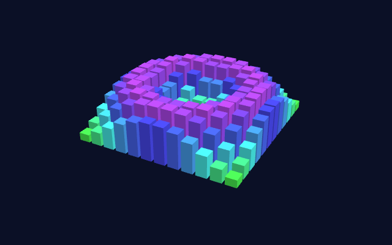
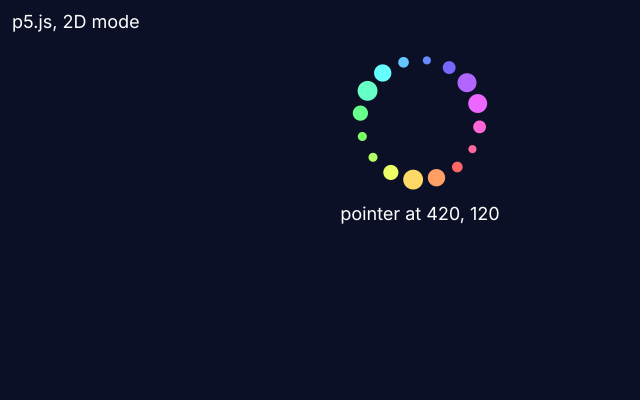

# js-p5

A wave of boxes, a [p5.js](https://p5js.org) sketch (1.11.13, unmodified) in WEBGL mode, written in global mode as the p5 editor writes it: `setup`, `draw`, lights, and the pointer that turns and tilts the wave.



```sh
tools/test-lib p5-1.11.13          # once: downloads p5.js
build/zinc run examples/js-p5
```

Move the pointer left and right to turn the wave, up and down to tilt it. The sketch fills the window, which opens at the size `zinc.json` gives (800 by 500).

p5.js is under the LGPL, so this repository does not carry it. `tools/test-lib p5-1.11.13` takes `p5.min.js` from p5's own npm release, checks it against a pinned sha256 and keeps it in Zinc's cache (`~/.zinc/cache/test-libs/`), where `main.js` looks for it.

How it fits together:

- `main.js` is JavaScript, so `zinc run` takes the QuickJS engine by itself. `zinc.json` has `"web": true`: the program gets a `window`, a `document` and WebGL, as a page in a browser does.
- `main.js` is the page: it loads p5.js, then `sketch.js`, as two `<script>` tags would.
- `sketch.js` is the sketch, thirty lines. It runs as it is in the p5 editor; nothing in it is special to Zinc.

A second sketch, `sketch2d.js`, is in p5's default 2D mode (a plain `createCanvas(w, h)`, `circle()`, `text()`), which draws with Canvas 2D. A ring of dots turns around the pointer, opens wider while the button is down, and a line of text says where the pointer is:



```sh
P5_SKETCH=sketch2d.js build/zinc run examples/js-p5
```

(`main.js` loads the file named by `P5_SKETCH`, or `sketch.js`.) Text uses the bundled Inter or a font of the project. Not there yet: patterns, filters and blend modes beyond the common eleven (ZN-572); no sound (waits for ZN-573).

Test: `tests/run --only example_js_p5` (a scripted pointer, then frame 30 of each sketch against `screenshot.png` and `screenshot2d.png`).
