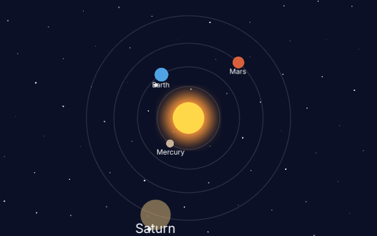

# js-pixi

A small solar system made with [PixiJS](https://pixijs.com) (8.22.0, unmodified) in plain JavaScript: sprites in a tree of containers (a planet turns around the sun, its moon around the planet), a blur filter for the glow of the sun, and planets that hear the pointer.



```sh
cd next
build/zinc run ../examples/js-pixi --engine quickjs
```

Point at a planet: it grows. Click it: it stops, fades and its name grows (Saturn in the picture); click again and it goes on. The system follows the size of the window (`ZINC_SIZE=800x500` before the command opens a larger one).

How it fits together:

- `zinc.json` has `"web": true`: the program gets a `window`, a `document` and WebGL, as a page in a browser does.
- `importmap.json` says where `import 'pixi.js'` comes from (the copy in `next/third_party/pixi`), as an import map does in a page.
- `main.js` is the whole program. It is PixiJS as its guide writes it; nothing in it is special to Zinc. It has no asset: one white disc is drawn into a texture, and every star, planet and moon is a sprite of it.

Each planet has its name, a PixiJS `Text` that follows it (drawn with Canvas 2D); the name of the clicked planet is larger. Still missing: no sound (waits for ZN-573).

Test: `next/tests/run --only example_js_pixi` (a scripted click on the large planet, then frame 60 against `screenshot.png`).
