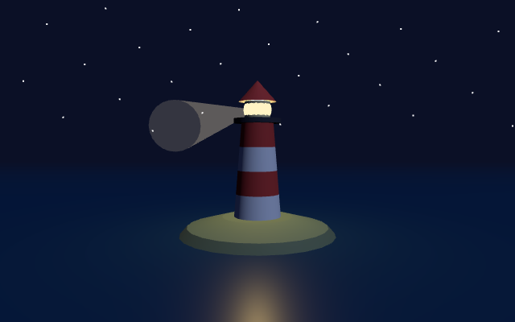

# js-three

A lighthouse at night, made with [three.js](https://threejs.org) (r186, unmodified) in plain JavaScript: a model loaded from a file with `GLTFLoader`, three lights (the moon, the sky, the lamp), a sea, stars, a beam that goes round, and `OrbitControls` on the pointer.



```sh
cd next
build/zinc run ../examples/js-three
```

Drag to turn around the lighthouse, use the wheel to come closer. The window opens at the size `zinc.json` gives (800 by 500) and can be resized.

How it fits together:

- `main.js` is JavaScript, so `zinc run` takes the QuickJS engine by itself. `zinc.json` has `"web": true`: the program gets a `window`, a `document` and WebGL, as a page in a browser does.
- `importmap.json` says where `import 'three'` comes from (the copy in `next/third_party/three`), as an import map does in a page.
- `main.js` is the whole program. It is three.js as its own guide writes it; nothing in it is special to Zinc.
- `assets/lighthouse.glb` is the model: a profile turned around an axis, written by `assets/make-lighthouse.mjs` (`node assets/make-lighthouse.mjs` makes it again; change the profile and the colours there). Model and script were written for this example and are public domain (CC0).

Not there yet: an import map cannot map a whole folder (`"three/addons/"`), so each addon has its line.

Test: `next/tests/run --only example_js_three` (a scripted drag, then frame 10 against `screenshot.png`).
