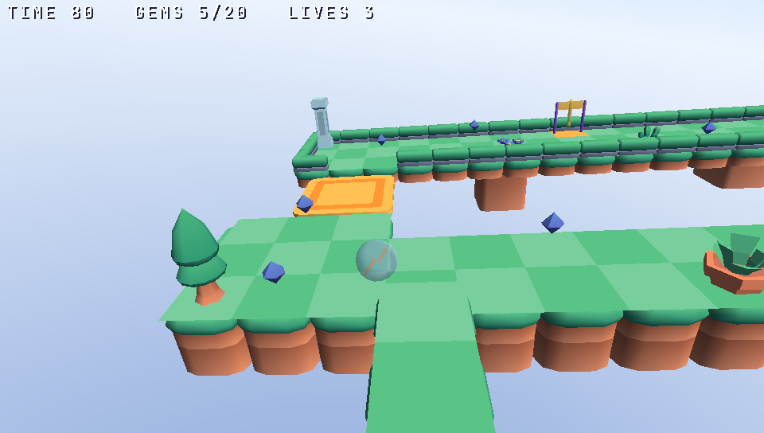

# Marble Terraces (marble)

A small 3D marble game written once for the desktop and the consoles: PSP (480x272), PS Vita (960x544), PS2 (640x448) and
Nintendo 3DS (400x240). Tilt the board, roll the marble down four terraces, cross the gap on a moving shuttle and roll
into the gold ring before the 90 seconds run out. Twenty gems along the way score; three falls and the game is over.



```sh
zinc run examples/marble                         # desktop window, 960x544 (the GPU renderer)
ZINC_SIZE=480x272 zinc run examples/marble       # the PSP's screen (also 400x240, 640x448, 960x544)
ZINC_3D=software zinc run examples/marble        # the CPU renderer, the consoles' worst case
zinc run examples/marble -- --autopilot          # the game plays itself and prints the d-pad it holds
zinc run examples/marble -- --stats              # triangles, draw calls and ms per frame, every second
zinc test examples/marble --profile ps2          # the rules with the consoles' f32 numbers
```

## Controls

| | Pad | Keyboard |
|---|---|---|
| tilt the board (up to 12 degrees) | left stick or d-pad | arrows (or W A S D) |
| start | Start or Cross | Enter or Space |

## How it is made

| File | Role |
|---|---|
| `src/course.ts` | the rules without drawing: the height grid and entities of the LDtk level, the ball against boxes (floor columns, rails, solid props, shuttles) at 120 steps a second, gems, ring, clock, lives |
| `src/scene.ts` | zinc:3d: 3 x 3 chunks of 8 x 8 cells, one mesh each; the board tilting around the ball; the camera behind it; the chunks out of view hidden; the HUD |
| `src/pieces.ts` | reads the course art's `.zmesh` pieces and merges them, moved and turned, into the chunks' meshes |
| `src/input.ts`, `src/sound.ts`, `src/autopilot.ts` | the tilt eased towards what is held; the sounds; the demo player that made `tests/data/marble/win.input` |
| `tests/course.test.ts` | the demo player reaches the ring, holding up and left falls three times (also with `--profile ps2`) |
| `tools/make_assets.py` | writes the level (`assets/level.ldtk`) and the rolling loop; `--from` copies Kenney's sounds |

- **Level**: `assets/level.ldtk`, an IntGrid "Heights" of 24 x 24 cells (0: no floor, 1 to 4: heights 0 to 3, half a cell
  each) and entities: Start, 20 Gem, Goal, 2 Platform (where they go, their period), 14 Prop (a piece of the art, solid or
  not). A step down is a drop; a step up is a wall.
- **Art**: `assets/models` (Kenney's Marble, Platformer and Nature kits adapted in Blender by `assets/blender`, CC0, licences in
  `assets/models/licences`): the low pieces on screens of up to 448 lines, the high ones above. Floors, sides, rails, props
  and the goal gate are merged per chunk; the marble, gems, ring, shuttles, sky and backdrop are nodes. Without
  `assets/models` the game builds plain meshes of its own (coloured tops, sides, a checker texture, a striped sphere).
- **Measured** (`--stats`, the scripted session): at most 2,297 triangles drawn by the software renderer in 35 draws with
  the low pieces (400x240 to 640x448), 8,668 with the high ones at 960x544 (18,708 submitted to the GPU); no texture (the
  palette is in the vertex colours). Budgets of `docs/reports/games/console-2d-3d-frameworks.md`: 5,000 triangles and 60
  draws; the PSP takes 8k, the Vita 30k.
- **Sound**: the rolling loop (`assets/roll.wav`, made by `tools/make_assets.py`) follows the ball's speed in pitch and
  level; gem, fall and the two jingles are Kenney's [Digital Audio](https://kenney.nl/assets/digital-audio) and
  [Music Jingles](https://kenney.nl/assets/music-jingles) (CC0, `assets/kenney/<pack>/License.txt`).

## On the consoles

The game runs unchanged where a console back end with zinc:3d exists (ZN-753's chain, ZN-476/477 for the PSP's and the
Vita's 3D). Until then the desktop proves it at the consoles' sizes and with their f32 numbers (`tests/t1/marble.sh`).
