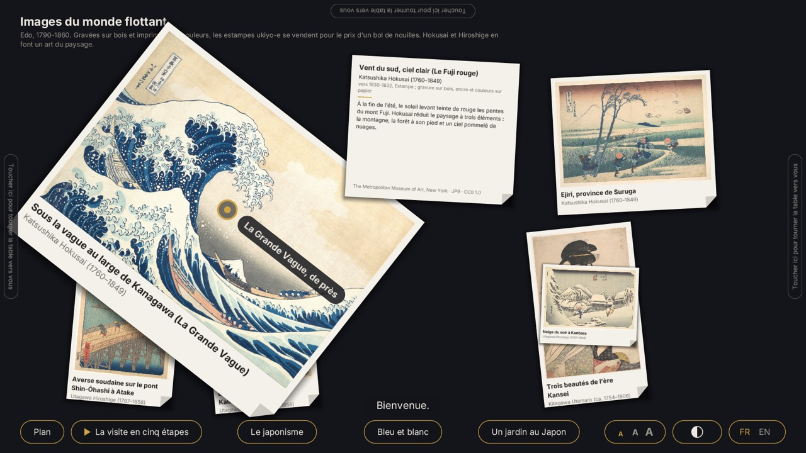
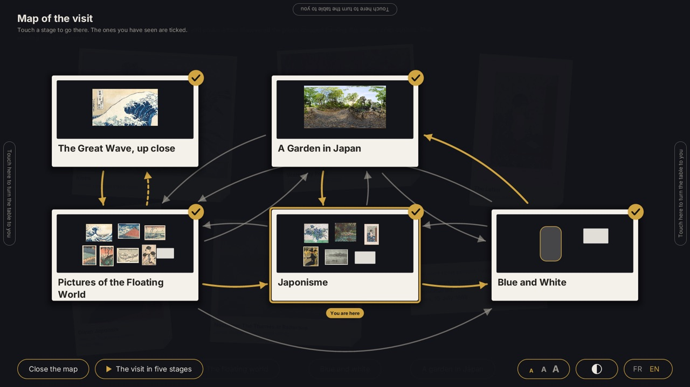
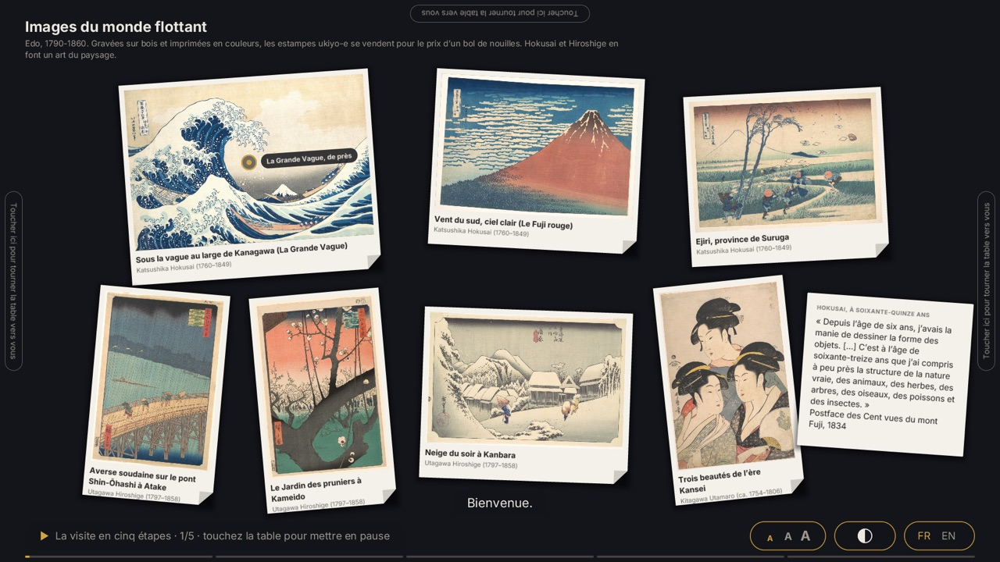
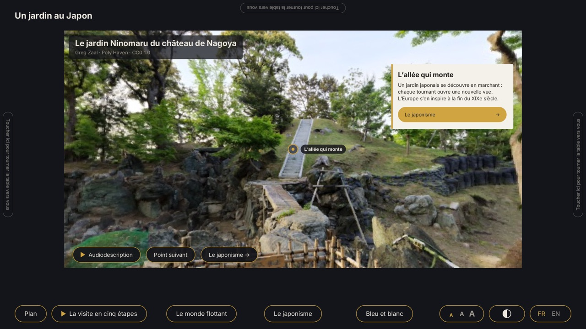
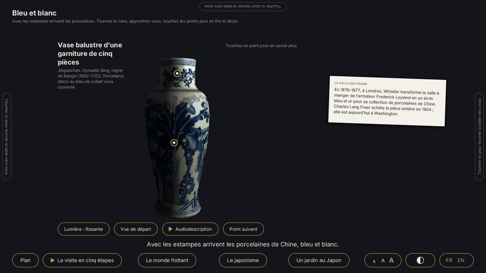
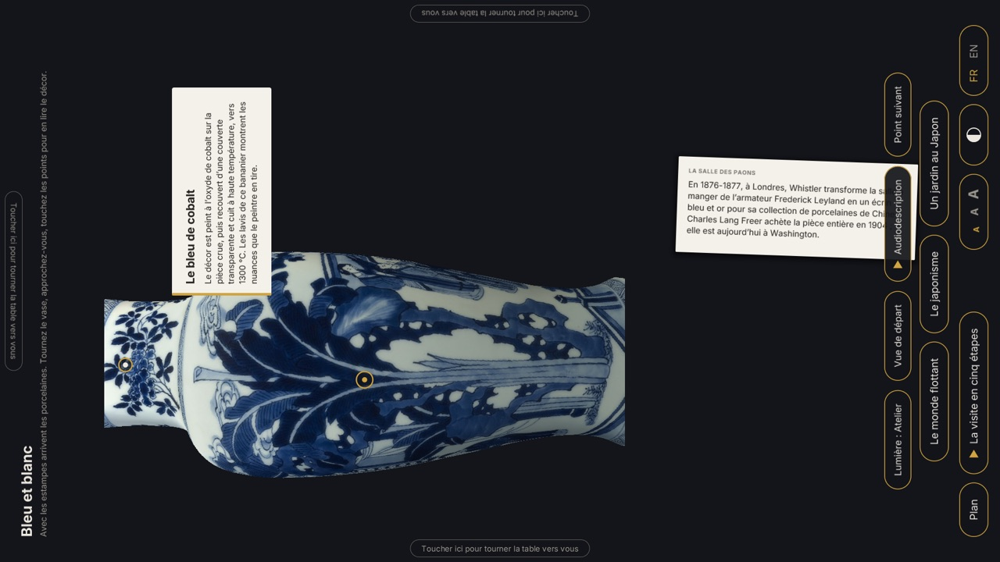
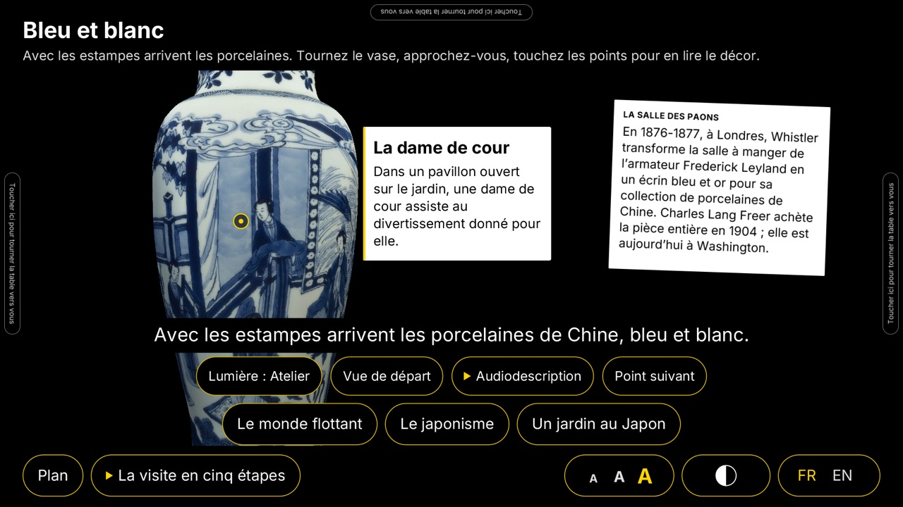

# museum-table

An app a museum puts on a multi-touch table: a collection told as linked sequences, in the manner of Klynt. Visitors handle photographs like
prints on a light table, turn an object in 3D and touch its points of interest, look around a panorama, follow links from one sequence to the
next, find their way on the storyboard, or let a guided visit play with its narration and subtitles, in French or English. The app is a
player: everything it shows comes from one project file, [`assets/project.json`](assets/project.json)
([reference](../../docs/museum-table-format.md)), which the storyboard editor in [`editor/`](editor) writes.

The sample is *The Floating World, from Edo to Paris*: twelve works from The Met and the Art Institute of Chicago, a Kangxi vase scanned by the
Smithsonian, a panorama of a Japanese garden, all CC0, and a narration by two open synthetic voices ([LICENSES.md](LICENSES.md)).








## Run it

```sh
zinc run examples/museum-table                          # a window; on a touch screen every finger counts
zinc run examples/museum-table -- --sequence porcelain  # start on another sequence (ukiyo-e, wave, japonisme, porcelain, garden)
zinc run examples/museum-table -- --lang en
zinc run examples/museum-table -- --story               # print what happens to the story: sequences, links, narration clips, subtitles
zinc run examples/museum-table/src/pano.ts              # the panorama alone, full screen
zinc run examples/museum-table/src/check.ts -- examples/museum-table/assets/project.json   # validate a project file
```

| on the table | touch | mouse |
| --- | --- | --- |
| a card | one finger drags; two turn and zoom; let go and it glides | drag; wheel or trackpad pinch zooms; Shift + wheel turns |
| | a touch brings it to the front; the folded corner turns it over to its notice; a double tap opens the full view | click, double click |
| a ring on a card, with its label | a hotspot: it opens another sequence, here over the current one, which waits underneath | click |
| a film | it plays in its card by itself, with its subtitles in the visitor's language; a touch pauses it and starts it again; it stops when its sequence is left | click |
| the 3D object | one finger turns it; two bring it closer and move it | drag; wheel zooms |
| | a touch on a ring opens the point's panel and shows it; `Lumière` changes the lighting, `Vue de départ` goes back, `Point suivant` opens the points in turn | click |
| the panorama | one finger looks around; two change the field of view; a ring opens its panel, whose button leads to a sequence | drag; wheel zooms |
| buttons at the visitor's edge | the links of the sequence; `Plan`: the storyboard, where a touch on a node goes there; the guided visit | click |
| | `A A A`: the text size; the half disc: high contrast; `FR EN`: the language. Kept for the visit | click |
| `Audiodescription` | under an object, in a panorama, beside `Refermer` when a print is seen in full: the voice describes it, with subtitles | click |
| a guided visit | a touch pauses it; then `Reprendre la visite` or `Quitter la visite` | click |

Several hands work at the same time: a finger belongs to what it landed on until it lifts. A sequence with a `next` gives way by itself at
its end; a card or a link comes and goes at the time the project gives it.

## On a table



One or two visitors stand around the table and share one story. The texts, the buttons, the panels, the full view and the 3D object turn to
one side at a time: a tap or a press near an edge turns them to that edge (each other edge has a mark that says so), a drag never does, and
the cards stay free. At a short side the texts are laid out again for a table deeper than wide. After 60 seconds without a touch the attract
loop plays, silently, with an invitation at the four edges; a touch finds the visit as it was, until after 120 seconds it is forgotten and a
touch starts a new one (both times are in the project file). As a kiosk:

```sh
ZINC_KIOSK=1 zinc run examples/museum-table      # fullscreen, on top, no cursor, quit shortcuts ignored
```

Escape does nothing, no gesture leads out, and a fault is written on the error output, never on the table.

## For every visitor



Three buttons stay at the visitor's edge. `A A A` steps through the text sizes of the project (1, 1.3 and 1.6 times the designed size in the
sample): every text grows, the buttons with their labels, the caption of a card inside the card, the panels; what no longer fits in one row
comes to the edge in rows. The half disc puts on the high-contrast colours of the project, in which nothing is drawn faintly. Both are
forgotten with the visit. Every button lies within `table.reach` of the edge the visitor stands at (26 cm on a 43-inch table), and what lies
farther on an object or in a panorama has a twin there: `Point suivant` opens the points of interest in turn, and the button of an open
point is repeated beside it. Every narration has subtitles; each picture, object and panorama has an audio description, said on request by
the synthesised voice with its own subtitles (`tools/narration.sh` makes the clips; a museum replaces them with a recorded voice).

```sh
next/tools/contrast-check --museum examples/museum-table/assets/project.json   # the contrast of the theme and of the high-contrast colours
```

## Statistics

```sh
zinc run examples/museum-table -- --statistics /var/museum/statistics   # one file a day: 2026-10-11.csv
```

The project asks for statistics (`kiosk.statistics`) and the directory says where: the table then counts the visits (from a first touch
to the reset), their length, the hour they began in, their language, each sequence opened and for how long, each picture seen in full,
each audio description, each point of interest, each guided visit started and played to its end. A day is a CSV file of sums that a
spreadsheet opens (`docs/museum-table-format.md`, "The statistics of a table"): nothing identifies a visitor, no time is finer than the
hour, and no touch is kept. Two fingers held three seconds in two opposite corners show the staff the counts of the day; the next touch
closes them. Without `--statistics` nothing is counted and nothing is written.

## The storyboard editor

[`editor/`](editor) is the authoring tool, an app of its own for a desk, a mouse and a keyboard: a museum makes its installation there
without opening the project file. Its interface is in English or French, as the system is.

```sh
zinc run examples/museum-table/editor -- examples/museum-table/assets/project.json   # the sample; without a file, a new project
```

| view | what is done there |
| --- | --- |
| the storyboard | sequences as nodes, links drawn from the handle under a node; name, move, duplicate, delete, choose where the visit starts |
| the table of a sequence (double click a node) | the media library of the project folder; media dragged on the table, moved, sized, turned by the round handle above the selected one, timed on the timeline; buttons and hotspots; texts in every language side by side |
| a 3D model or a panorama (double click it on the table) | points of interest: turn the object, click it to place a point, drag a point to move it; its name and text in every language, the view it opens with ("Use this view"), the sequence its card leads to |
| the preview | "Play from here" (P) plays the project as it is, saved or not, with the table's own player, until Escape; "In a window" (W) keeps a preview beside the editor that follows the sequence being edited |
| the settings (click the project's name, or Ctrl or Cmd + comma) | the name and the languages of the project (a language more is a column more in every panel), the six colours of the theme, the table and the kiosk (reach, attract loop and reset delays, statistics, update address), text sizes and high contrast, guided visits (a named path of sequences ordered by dragging); a live sample of a sequence beside the forms follows every change |

Undo and redo cover every step; the advanced mode (Ctrl or Cmd + E) adds exact numbers, the keys and the selection as the file has it.
The document is `editor/doc.ts` (one operation per command, checked without a window by `editor/selftest.ts`). Test:
`next/tests/run --tier t1 --only museum_editor` (scripted mouse and keyboard sessions, file and frame goldens).

## What to look at

| file | role |
| --- | --- |
| `src/project.ts` | the project format: types, `parseProject` (validates, names the field at fault), `serializeProject` (canonical form), `copyProject` |
| `src/player.ts` | the player, a class given a project and each frame the rectangle of the window it has: the story (links, overlays, transitions, `next`, presentations, the narration), the fingers, the controls at the edge |
| `src/main.ts` | the table's app: the window and the command line around one player |
| `src/files.ts` | where the files of a project are read: the assets of the app, or the project's folder in the editor's preview |
| `src/stage.ts` | one sequence on the table: its clock, its cards, its object or panorama, its links |
| `src/storyboard.ts` | the map of the story for the visitor, with the visited trail |
| `src/narration.ts` | a narration: the clip through `zinc:audio`, the subtitles from WebVTT or from the transcript |
| `src/touch.ts` | fingers (touch points or the mouse) and `manipulate`: what one or two fingers do to what they hold |
| `src/table.ts` | the light table: cards drawn with `zinc:gfx` under a matrix, glide, soft edges, turning over, hotspots, timed cards |
| `src/viewer.ts`, `src/orbit.ts`, `src/panel.ts` | the 3D object viewer on `zinc:3d` (OBJ, glTF, GLB), the turning it shares with the panorama, the panel of a point |
| `src/lookout.ts`, `src/panorama.ts`, `src/pano.ts` | 360-degree panoramas: on the table, the view itself, and alone |
| `src/frame.ts` | the table as the visitor at one of its sides sees it: where texts and buttons are laid out, and the matrix that turns them |
| `src/button.ts` | a button, and buttons set in rows at the visitor's edge |
| `src/type.ts`, `src/words.ts` | fonts at the text size the visitor reads at, and word wrapping; the player's own few words |
| `src/check.ts`, `src/assets.ts` | command-line checks of a project file and of its media |
| `tools/` | rebuild the media from their sources (`fetch-collection.sh`, `decimate.cpp`); synthesise the narration and its subtitles from the transcripts of the project with Piper and two open voices (`narration.sh`) |

Tests: `next/tests/run --tier t1 --only museum_visit` (also `museum_mode`, `museum_access`, `museum_video`, `museum_stats`, `museum_format`, `museum_assets`, `museum_table`,
`museum_viewer`, `museum_panorama`). The sessions are scripted touches (`ZINC_INPUT`, `touch ID X Y` and `touchup ID`): `next/tests/data/museum_visit/visit.py`
is a whole visit, `next/tests/data/museum_table/hands.py` two hands on two cards. A headless run plays no sound: the story log says which clip
is asked for and when.

## Not there yet

A film has no sound (zinc:video decodes its pictures), and needs FFmpeg's libraries on the machine: without them its card keeps the
poster, with the subtitles and the timeline. A presentation that is paused starts its step again when it resumes, because `zinc:audio`
cannot pause a clip. The panorama does not turn with the visitor (its texts do). At the two larger text sizes the buttons take two or
three rows at the visitor's edge and lie over the foot of the lowest cards, which the visitor moves; the notice on the back of a card
shows what fits, as at the designed size (the full view has all of it). The narration and the audio descriptions were checked by their
durations and their decoding, not by ear, and the table mode by scripted touches, not on a touch table.
