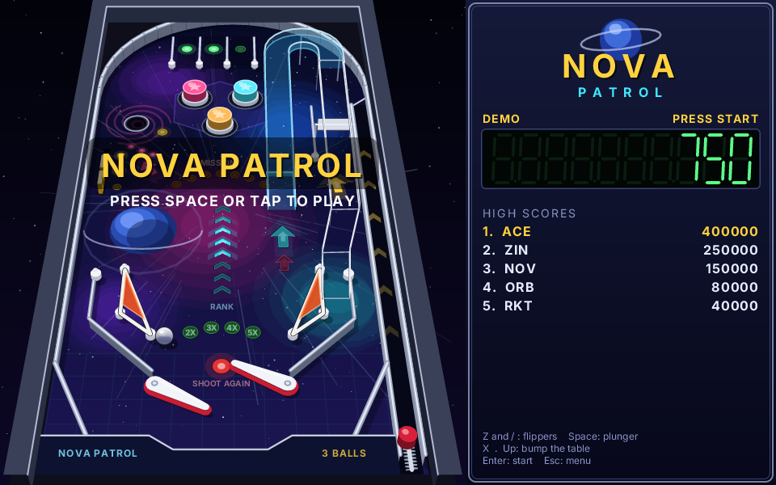
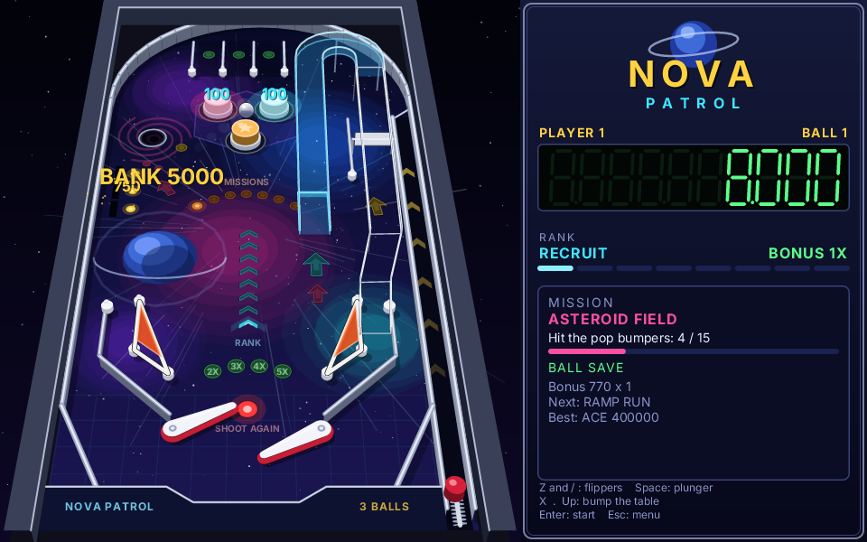
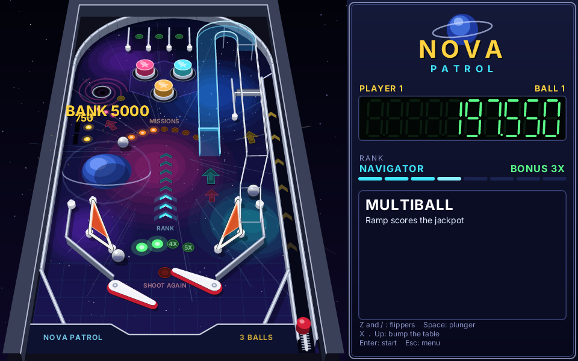
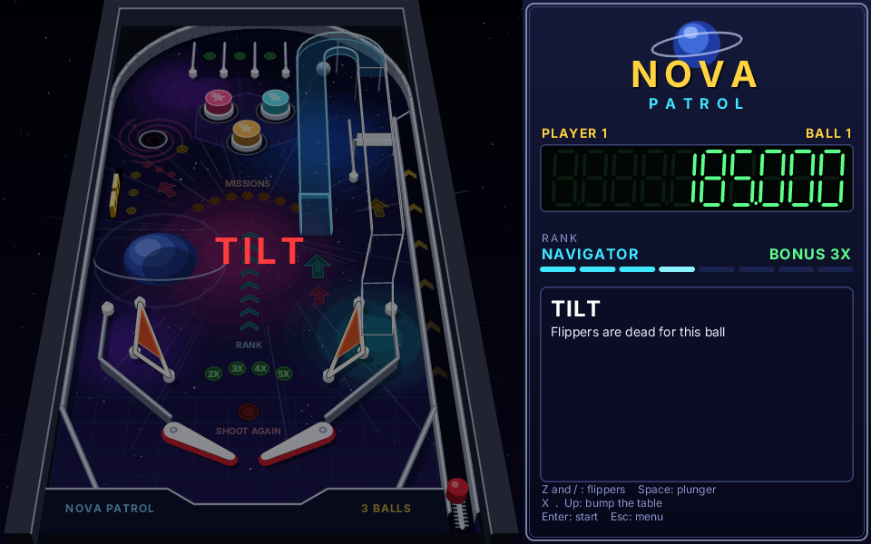
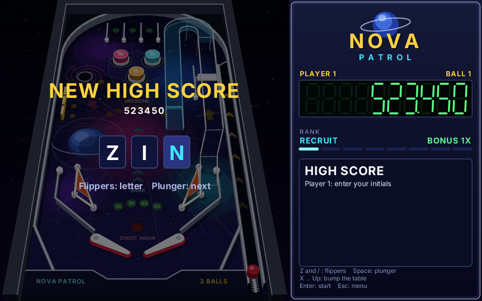

# pinball: Nova Patrol

A space pinball in the spirit of the 90s desktop pinball tables: a tilted table in pseudo-3D on the left, the score
panel on the right. Written in Zinc on `zinc:gfx` and **Box2D 3.1.1** (`zinc:physics2d`). The shared engine is
[`examples/pinball-kit`](../pinball-kit/README.md), also used by Nova Patrol DS; its Jolt adapter powers the 3D pinball.
The layout, names and rules are original. The ball and spark sprites are Kenney Puzzle Pack 1.1 assets (CC0),
credited in `assets/kenney/SOURCE.txt`; the remaining art is drawn in code.



| | |
| --- | --- |
|  |  |
|  |  |

## Run it

```sh
zinc run examples/pinball                        # macOS window, 960x600 (letterboxed when resized)
zinc run examples/pinball --profile rpi1         # the Pi build's layout and effect budget, on the host
ZINC_DEMO=multiball zinc run examples/pinball    # a scripted state (below)
```

## Controls

| action | keyboard | gamepad (zinc:gfx buttons) | touch / mouse |
| --- | --- | --- | --- |
| left flipper | Z, Left, A | L, D-pad left | left half of the table |
| right flipper | / (slash), Right, D | R, D-pad right | right half of the table |
| plunger (hold, release) | Space, Down | A, D-pad down | the side panel |
| bump the table | X (from the left), . (from the right), Up | B, Y, D-pad up | – |
| start / add a player | Enter (Space and the plunger also start) | Start | tap |
| menu | Esc or P (Enter during play) | Start | – |

The menu holds resume, sound on / off, tilt sensitivity (low, normal, high), controls and rules, new game and quit.
Settings and the high score table persist through `zinc:storage`. Left and right Shift cannot stand in for the
flippers: the HAL reports Shift as a modifier without its side, so Z and / are the keyboard flippers.

## Rules

- **Missions**: one at a time, shown on the panel and on the mission lights (the arc under the bumpers). Asteroid
  Field (pop bumpers), Ramp Run, Target Practice (clear the drop target bank), Orbit Spin (spinner), Star Lanes
  (complete the top lanes), Wormhole (kicker hole), Slingshot. Finishing one pays its award times your rank.
- **Rank**: every mission promotes you: Recruit, Cadet, Pilot, Navigator, Commander, Captain, Commodore, Admiral
  (the chevron ladder in the middle of the table). The extra ball lights at Navigator and Commodore. Collect it at
  the wormhole.
- **Multiball**: every third wormhole shot launches two more balls (three in play) with a 12 s ball saver. During
  multiball the ramp scores the jackpot, which grows by 10,000 each time.
- **Top lanes**: light all three for +1 bonus multiplier (up to 5x). The flipper buttons move the lit lanes
  (lane change).
- **Bonus**: most shots add to the ball's bonus, counted times the multiplier when the ball drains.
- **Ball saver**: for 10 s after the launch, a drained ball comes back (the Shoot Again lamp blinks).
- **Tilt**: each bump adds to a tilt meter that drains over time. Past the warning the panel says DANGER. One more
  bump tilts: flippers and kickers die and the ball's bonus is lost.
- 3 balls per player, 1 to 4 players. Press Start again before the first launch to add a player. A score that
  makes the top 5 asks for initials: the flippers change the letter, the plunger moves on.

## How it is built

| path | role |
| --- | --- |
| `src/main.ts` | the frame: controls, rules and physics, table, panel, overlays |
| `src/input.ts` | keyboard, gfx buttons and touch, read once per frame into `Controls` |
| `../pinball-kit/physics/` | the shared Box2D adapter, table parts, coils and gameplay switches |
| `../pinball-kit/clock.ts`, `tuning.ts` | fixed simulation clock, interpolation and shared calibration |
| `src/table/layout.ts` | the table: every wall, post, bumper, target, lane, sensor and ramp, in inches |
| `src/game/game.ts` | rules: phases, scoring, missions, ranks, multiball, ball saver, tilt, players, autopilot |
| `src/game/missions.ts`, `store.ts` | missions and ranks; high scores and settings in `zinc:storage` |
| `src/render/camera.ts` | the pseudo-3D pinhole camera (table inches to screen pixels) |
| `src/render/art.ts` | the static table, painted once into an image at the screen's pixel density |
| `src/render/scene.ts` | per frame: lit inserts, mechanisms, flippers, balls, bumper caps, ramps, apron |
| `src/render/fx.ts`, `inserts.ts`, `draw.ts` | popups, rings, sparks, shake; lamp inserts; projection helpers |
| `src/render/quality.ts`, `quality.rpi1.ts` | effect budget; the Pi build takes the `.rpi1` file |
| `src/ui/panel.ts`, `menu.ts` | the side panel (seven-segment score); pause menu, title, initials entry |
| `src/audio/sound.ts` | sound hooks (below) |
| `src/demo.ts` | `ZINC_DEMO` states and the benchmark |
| `tools/feel.ts`, `tools/soak.ts` | physics numbers used for tuning; a 10-minute autopilot run that reports stuck balls |

### Physics

Box2D owns continuous collision detection, restitution, friction, spin and ball-to-ball contacts. The adapter
supplies kinematic flippers and a spring plunger, ramp layers and gameplay events. Distances are inches;
`tuning.ts` shares gravity and speed units with the 3D table's centimetres.

The frame delta feeds a fixed 960 Hz clock. Rendering interpolates the previous and current ball positions;
30, 60 and 120 Hz rendering produces the same simulation. After a stall, catch-up is limited to 100 ms.
Additional collision steps limit relative travel to half a ball radius. A held flipper stops completely and
supports cradling; its last moving step still transfers energy. Active kicks are limited at contact.

The target bank sits against the wall, leaving no narrow pocket behind it, and the ramp's low lip slopes so a
slow ball rolls away. Ramp portals switch collision layers without stepping a ball twice in the same interval.

`tests/run --only pinball_core` checks fast walls, multiball, bounded kicks, the plunger, held flippers and
frame-rate independence. `tools/feel.ts` measures shots and `tools/soak.ts` runs ten simulated minutes.
The frozen language conformance fixture is preserved separately in `tests/data/pinball-frozen`.

### Rendering

`render/art.ts` paints the static table (about a thousand commands: backdrop, cabinet, playfield wash and nebulas, planet,
streaks, stars, grid, unlit inserts, shadows, shaded rails, posts, bumper bases, the wormhole, slingshots) into one
image with `beginImage` / `endImage`. The image is baked at `gfx.pixelScale()` (2x on Retina) and drawn at its own
physical size, which makes it a row copy. Per frame, the scene adds only what moves or lights up. It uses about 200
commands, drawn back to front:
- lit lamps and chases, rings and sparks;
- targets, the spinner, the plunger and the flippers;
- balls and bumper caps sorted by depth (a cap hides a ball behind it);
- the translucent ramp and the wire, then balls on ramps;
- the apron and the popups.

zinc:gfx diffs each frame's command list against the previous one and rasterizes only the damaged rectangles.
Around a moving ball, that is a row copy of the image and a few shapes.

The camera is a pinhole behind the table's lower end, pitched 45°, 64 in away. Heights project naturally: a ball on
the ramp rises and shrinks, and its shadow stays on the playfield below. The ball is a chrome sphere (rim, a vertical
light-to-dark gradient, the playfield's reflection, two highlights) with a motion trail above 70 in/s.

On the Pi, `quality.rpi1.ts` replaces `quality.ts`: no trail, no glow halos, 12 sparks instead of 48. The table
art is the same.

### Sound

Zinc has no audio module yet: `targets/capabilities.json` knows an `audio` capability, but nothing implements it.
`src/audio/sound.ts` is the hook. The rules call `play(SFX_…)` for flippers, bumpers, slingshots, targets,
rollovers, the spinner, the ramp, the wormhole, the launch, drains, tilt, missions, rank-ups, multiball, bumps and
extra balls. Each cue carries a recipe for a sound to synthesize at startup (square-wave sweeps and noise bursts
with a linear decay). When an audio back end exists, set `output` to a function that renders the recipe to PCM and
queues it. The menu's sound switch already gates `play()`.

## Demo states and screenshots

`ZINC_DEMO=<state>` (or `-- --demo=<state>`) scripts a state. The autopilot plays, so a run is the same every
time: `attract` (the default), `playing`, `multiball`, `tilt`, `highscore`, `pause`, `bench`. Demo runs never write
to storage.

```sh
ZINC_DEMO=multiball zinc capture examples/pinball --frames 300 --out shots/
```

## Performance and targets

The static board is baked once. Per-frame rendering updates the ball, mechanisms, lamps and effects.
`quality.rpi1.ts` reduces trails and halos. Historical timing estimates for the former handwritten solver no
longer describe this Box2D version; desktop and device performance must be measured on the current build.

Console cores generated by `tools/build-console-core` include Box2D alongside their other native modules.
The revised core is verified on the development Mac; physical consoles and other targets remain part of the
cross-platform pass.

## Limits

- No sound until Zinc gets an audio output (hooks and recipes are in place).
- The flipper is kinematic: a hard hit does not slow it down.
- Walls do not occlude the ball. Only the bumper caps, the ramp and the apron are drawn over it.
- Shift cannot be a flipper key (the HAL gives no left / right Shift).
