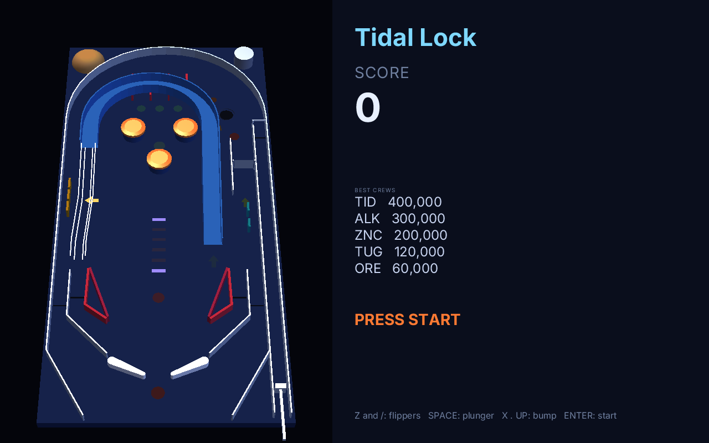
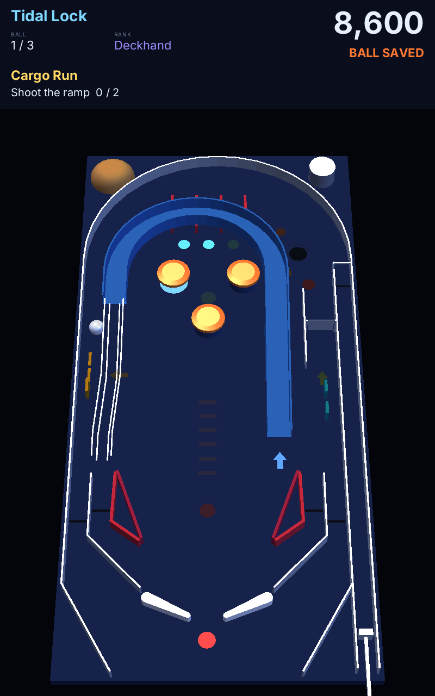

# pinball3d

A pinball in real 3D, in the spirit of the desktop tables of the 90s: the table upright at the left and the score panel
at the right, or the whole table on a vertical screen. The ball is a real sphere on a tilted board (`zinc:physics3d`,
Jolt): it climbs the ramp, rides a wire rail above the playfield, drops into a lane, and the dock throws it in the air.
The scene is drawn by `zinc:3d` on the GPU. **Nothing about the table is in the code**: walls, lanes, flippers, bumpers,
ramps, lights, looks, rules, missions, the camera and the panel all come from one file,
[`assets/tables/tidal-lock/table.json`](assets/tables/tidal-lock/table.json), whose format is described field by field in
[docs/pinball-table-format.md](../../docs/pinball-table-format.md). Another table is another file.


| | |
| --- | --- |
|  |  |

## Run it

```sh
zinc run examples/pinball3d                                   # 1280 x 800; a window taller than wide takes the portrait layout
zinc run examples/pinball3d -- --layout=portrait              # force a layout (landscape, portrait)
zinc run examples/pinball3d -- --table=my-table               # a table folder, its table.json, or a package (.zpinball)
zinc run examples/pinball3d -- --demo --stats                 # a blind player plays; the time of the physics and of the drawing every 5 s
```

## Controls

| action | keyboard | pad buttons (`zinc:gfx`) | touch |
| --- | --- | --- | --- |
| left flipper | Z, Left | L, Left | the left half of the table |
| right flipper | /, Right | R, Right | the right half of the table |
| plunger (hold, let go) | Space, Down | Down | the bottom right corner of the table |
| bump the table from the left, the right, the front | X, . (period), Up | X, Y, Up | |
| start | Enter, 1 | Start | |

The plunger also starts a game. Every action is remapped by a settings file, `settings.json` beside `zinc.json` or
`--settings=<file>`; an action it does not name keeps its inputs:

```json
{ "controls": { "left": ["key:a", "pad:L"], "right": ["key:l", "pad:R"], "plunger": ["key:enter"], "start": ["key:5"] } }
```

An input is `key:<name>` (a key, or the key a cabinet's button encoder sends), `pad:<button>` or `touch:left`,
`touch:right`, `touch:plunger`. The engine has no gamepad input yet; when it has, its inputs join this table
(`src/input.ts`) and nothing else changes.

## Tidal Lock

A tug crew works the docks of a mining station held in tidal lock above a gas giant. What follows is all in the table file.

- **Missions**, one at a time: Cargo Run (the ramp, twice), Asteroid Sweep (the bumpers), Night Berth (the three lanes, then
  the dock), Solar Flare (the drop targets), Slingshot Burn, Spin Up. The light of the step to do blinks. A mission pays its
  award times the rank and promotes: Deckhand, Rigger, Tug Pilot, Dock Master, Station Chief, Orbit Marshal, Tide Warden.
- **The ramp** climbs 5.5 cm, turns over the top lanes and hands the ball to a wire rail that drops it in the left inlane.
  Five laps save the ball for 15 s.
- **The dock** catches a slow ball, holds it a second and throws it over the lane guides. Each catch is a lock; the third
  starts **multiball**: three balls, scores doubled, the ramp pays a jackpot that grows.
- **Lanes**: light the three for one more bonus multiplier (up to 5); the flippers move the lit lanes.
- **Ball save** for 8 s after a launch; **extra ball** lit at the dock at ranks 3 and 6; **tilt** after two warnings: the
  flippers die and the ball's bonus is lost. The five best scores are kept between runs.

## How it is built

The game is a library that a window, a test or an editor drives; `src/main.ts` is only the window.

| path | role |
| --- | --- |
| `src/format/` | the table format: `schema.ts` (a small schema engine), `table-schema.ts` (every field), `table.ts` (the typed table, load, check, save), `source.ts` (a folder, the game's assets, a package) |
| `src/geometry.ts` | shapes from data: a path with arcs to a polyline, walls, tracks with a height profile, wires, lathes, floors, the flipper's outline. Used by the scene and by the physics |
| `src/scene.ts` | the table as a `zinc:3d` scene, and what the game moves or lights in it |
| `src/physics.ts` | `TablePhysics`, what the game asks of a physics engine, and `JoltPhysics`, its answer with `zinc:physics3d` |
| `src/rules.ts` | the rules engine: events in; score, lights, missions, ranks, locks, jackpot out. It has no rule of its own |
| `src/game.ts` | a table played: controls in, one step of the physics, what each ball did told to the rules; `show(scene)` |
| `src/input.ts`, `src/panel.ts`, `src/view.ts` | the table of controls; the score panel; a layout placed in a window |
| `tools/table.ts` | `check`, `format`, `print`, `pack` a table; `doc` prints the format's reference |
| `tools/probe.ts` | one shot without a window: put the ball somewhere with a speed, read the events and where it went |

The physics runs at the table's rate (960 steps a second) whatever the frame rate, with the board flat and gravity
leaning by the table's slope. Flippers and the plunger are kinematic bodies the game moves; the ball is swept through
each step (continuous collision); bumpers and slingshots add their kick when touched; rollovers, spinners, gates and the
ends of ramps are lines the game tests against each ball's move, so a fast ball never slips past a switch.

```sh
zinc run examples/pinball3d/tools/table.ts -- check assets/tables/tidal-lock          # every fault, with the path of the value
zinc run examples/pinball3d/tools/probe.ts -- assets/tables/tidal-lock 36 70 1.37 0 -330 0 4   # a shot up the ramp at 3.3 m/s
```

Tests: `next/tests/t1/pinball3d_format.sh` (the format), `pinball3d.sh` (a scripted game's event log, six pixel goldens,
single shots), `pinball3d_aot.sh` (the compiled game prints the same log).

## Limits

- No sound yet: the format names a sound per event and the rules can play one; nothing plays them.
- A look's `texture` is read and not drawn yet (the generated meshes have no texture coordinates).
- A high score enters as `YOU`: there is no entry of initials.
- Tidal Lock has no upper playfield; the format has them (`floors`, and every element's `z`).
- Text of a table is drawn with the characters and sizes baked into the program: ASCII, 18 sizes from 10 to 96.
