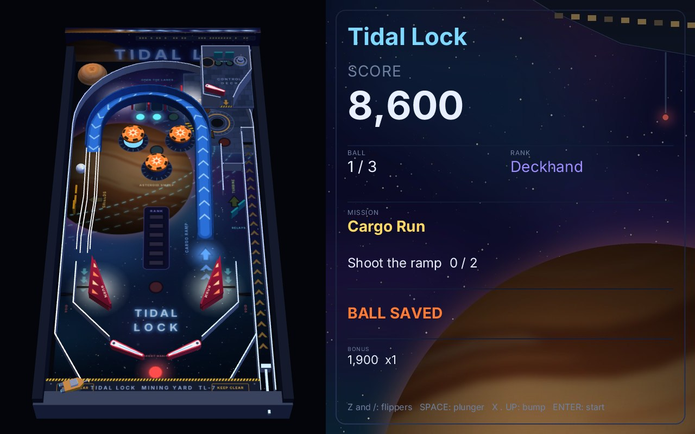
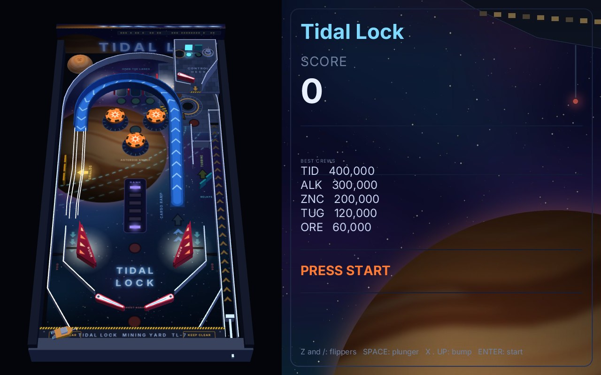
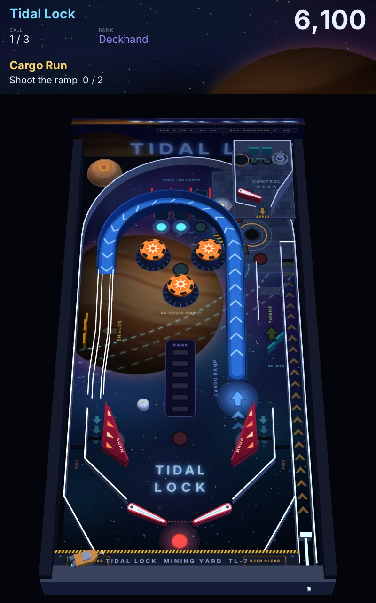
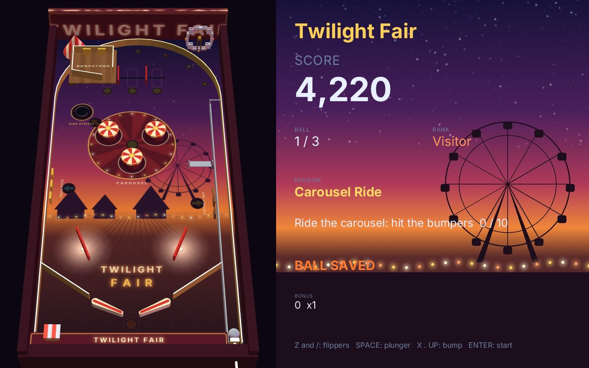

# pinball3d

A pinball in real 3D, in the spirit of the desktop tables of the 90s: the table upright at the left and the score panel
at the right, or the whole table on a vertical screen. The ball is a real sphere on a tilted board (`zinc:physics3d`,
Jolt): it climbs the ramp, rides a wire rail above the playfield, drops into a lane, and the dock lifts it to an upper
playfield with a flipper of its own. The scene is drawn by `zinc:3d` on the GPU and heard through `zinc:audio`. **Nothing about the table is in the code**: walls,
lanes, flippers, bumpers, ramps, lights, looks, sounds, music, rules, missions, the camera and the panel all come from one file,
[`assets/tables/tidal-lock/table.json`](assets/tables/tidal-lock/table.json), whose format is described field by field in
[docs/pinball-table-format.md](../../docs/pinball-table-format.md). Another table is another file.



| | |
| --- | --- |
|  |  |

## Run it

```sh
zinc run examples/pinball3d                                   # 1280 x 800; a window taller than wide takes the portrait layout
zinc run examples/pinball3d -- --layout=portrait              # force a layout (landscape, portrait)
zinc run examples/pinball3d -- --table=my-table               # a table folder, its table.json, or a package (.zpinball)
zinc run examples/pinball3d -- --demo --stats                 # a blind player plays; the time of the physics and of the drawing every 5 s
zinc run examples/pinball3d -- --volume=0.3                   # the volume of everything (0: silence); --sounds prints each sound as it plays
zinc run examples/pinball3d -- --scores=scores.txt            # keep the high scores in a file (default: the application's storage)
```

## Controls

| action | keyboard | pad buttons (`zinc:gfx`) | touch |
| --- | --- | --- | --- |
| left flipper | Z, Left | L, Left | the left half of the table |
| right flipper | /, Right | R, Right | the right half of the table |
| plunger (hold, let go) | Space, Down | Down | the bottom right corner of the table |
| bump the table from the left, the right, the front | X, . (period), Up | X, Y, Up | |
| start | Enter, 1 | Start | |

The plunger also starts a game. A score that enters the table of the best is signed with three letters: the flippers go
down and up the alphabet, the plunger (or start) takes the letter; after 30 seconds the letter in hand fills what is left.
Every action is remapped by a settings file, `settings.json` beside `zinc.json` or
`--settings=<file>`; an action it does not name keeps its inputs:

```json
{ "controls": { "left": ["key:a", "pad:L"], "right": ["key:l", "pad:R"], "plunger": ["key:enter"], "start": ["key:5"] } }
```

An input is `key:<name>` (a key, or the key a cabinet's button encoder sends), `pad:<button>` or `touch:left`,
`touch:right`, `touch:plunger`. The engine has no gamepad input yet; when it has, its inputs join this table
(`src/input.ts`) and nothing else changes.

## Tidal Lock

A tug crew works the docks of a mining station held in tidal lock above a gas giant. What follows is all in the table file.

- **Missions**, one at a time: Cargo Run (the ramp, twice), Asteroid Sweep (the bumpers), Night Berth (the three lanes, then
  the dock), Solar Flare (the drop targets), Slingshot Burn, Spin Up. The light of the step to do blinks. A mission pays its
  award times the rank and promotes: Deckhand, Rigger, Tug Pilot, Dock Master, Station Chief, Orbit Marshal, Tide Warden.
- **The ramp** climbs 5.5 cm, turns over the top lanes and hands the ball to a wire rail that drops it in the left inlane.
  Five laps save the ball for 15 s.
- **The dock** catches a slow ball, holds it a second and lifts it to the **control deck**, an upper playfield 5.5 cm above
  the board with its own flipper (on the left button), two beacons to light for a bonus multiplier, and the station's
  tower to bounce off. A ball that leaves the deck falls back on the playfield and is turned by the relays into the right
  inlane. Each catch is a lock; the third starts **multiball**: three balls, scores doubled, the ramp pays a jackpot that grows.
- **Lanes**: light the three for one more bonus multiplier (up to 5); the flippers move the lit lanes.
- **Ball save** for 8 s after a launch; **extra ball** lit at the dock at ranks 3 and 6; **tilt** after two warnings: the
  flippers die and the ball's bonus is lost. The five best scores are signed and kept between runs.

## Twilight Fair, a second table

A funfair at dusk: ring the bell of the high striker (a kicker that throws the ball onto the bandstand, an upper
playfield with two bells), clear the coconut shy (three drop targets), ride the carousel (the bumpers), hook the ducks;
a string of bulbs under the arch flashes with every bumper. Warm colours, bells, ratchets and a steam organ's waltz
where Tidal Lock is cold, synthetic and blue.



```sh
zinc run examples/pinball3d -- --table=assets/tables/twilight-fair
```

It is the proof that a table is data: **no line of the game changed for it**. Its `table.json` was made in the table
editor by five sessions kept in [`tools/twilight_fair/sessions`](tools/twilight_fair/sessions) (a test replays them and
gets the file byte for byte); its 11 images and 2 models are drawn by [`tools/twilight_fair_art.py`](tools/twilight_fair_art.py)
and its 34 sounds synthesised by [`tools/twilight_fair_sounds.py`](tools/twilight_fair_sounds.py) (715 KB in all).
[docs/pinball-make-a-table.md](../../docs/pinball-make-a-table.md) walks through the making, and lists what the editor
could not do. The game starts on the first table of its assets (Tidal Lock); any other is named with `--table`.

## The look

Everything the eye sees is named in the table file too, and made by code: nothing is fetched or copied from a game.

- **A painted playfield.** A look's `texture` is an image of the table folder laid flat over the element as the top view
  shows it: the playfield's painting (space, the gas giant, the hull of the station, the lanes and their legends), the
  upper playfield's, the ramp's chevrons, the bumper caps, the flippers, the ball.
- **Lights that light.** A light of the table is an insert that the rules turn on, and with a `glow` it throws a pool of
  light around it, on the playfield or on the upper playfield it is in: its colour is added to what is under it (real
  additive blending), strongest at the light and gone at the rim, cut where its level ends, and two pools that meet add
  up. `lighting.general` names the lights that are the general illumination (on Tidal Lock, lamps under the plates of the
  slingshots whose light spills around them):
  while they are off (a tilt, a game that is over) the lamps of the scene fall to `dimmed`. A bumper, a slingshot or a
  target shows its look's glow when it is hit, and while the light the table gives it is lit.
- **Modelled pieces.** A `model` is a mesh file (OBJ) or a simple solid, decorative or with a collision box or hull: the
  station's tower on the deck (the ball bounces off it, and a rule scores it), the tug on the apron, the plates over the
  slingshots; the cabinet, the apron and the backboard are boxes with an image.
- **A backglass.** Each layout's panel has an `image` behind the score.
- **Two renderers.** A window draws on the GPU with 4 samples a pixel and mipmaps; a headless or deterministic run draws
  with the software renderer, whose frames are the goldens of the tests. They are the same picture (0.06 % of the pixels
  apart with multisampling and filtering off, structural similarity 0.96 as a window shows it).

[`tools/tidal_lock_art.py`](tools/tidal_lock_art.py) draws the 13 images and builds the 4 models of Tidal Lock (470 KB) from
the table file itself: the pads under the lights, the rings of the bumpers and the docking ring are
painted where table.json puts those elements (`python3 tools/tidal_lock_art.py`; it needs Pillow).

## Sound

Every event of every element plays the sound that the element names in the table file: `"sounds": { "hit": "bumper" }` on a
bumper, `up` and `down` on a flipper, `pull` and `release` on the plunger, `capture` and `eject` on the dock, and so on for
walls, gates, targets, rollovers, the spinner, ramps and the ball itself (`roll`, `hit`, `land`, `knock`). A rule plays one
with `{ "do": "sound", "target": "..." }`, which is how the events of the game are heard (a new game, a drained ball, a
mission done, a jackpot, a bump of the table, the tilt, each letter of the initials that sign a high score). `music` names a piece per state: waiting, playing, multiball, game over. A sound is a
file of the table folder or a generated tone, with its volume, its pitch, and how much both vary from one play to the next;
a hit is louder when the ball arrives faster, it comes from the side of the table it happens on, and the rolling sound gets
louder and higher with the speed of the ball. Change a name in the file and another sound plays: the code names none.

Tidal Lock has 44 sounds in 42 MP3 files, 600 KB in all:

- **recorded mechanics** under CC0 (flippers, bumpers, slingshots, plunger, drain, the ball rolling, landing and knocking), cut
  out of recordings of a 1977 pinball machine and of a marble on a table; each source, its author and its licence are in
  [LICENSES.md](LICENSES.md) and in the table file (`credits`);
- **synthesised effects and music**: everything else is computed by [`tools/tidal_lock_sounds.py`](tools/tidal_lock_sounds.py),
  which makes all the files again (`python3 tools/tidal_lock_sounds.py`; it needs ffmpeg).

`tools/soundcheck.ts` plays every sound of a table on the mixer without a loudspeaker and names the ones that are missing or
silent. A headless or deterministic run is silent.

## How it is built

The game is a library that a window, a test or an editor drives; `src/main.ts` is only the window.

| path | role |
| --- | --- |
| `src/format/` | the table format: `schema.ts` (a small schema engine), `table-schema.ts` (every field), `table.ts` (the typed table, load, check, save), `source.ts` (a folder, the game's assets, a package) |
| `src/geometry.ts` | shapes from data: a path with arcs to a polyline, walls, tracks with a height profile, wires, lathes, floors, the flipper's outline. Used by the scene and by the physics |
| `src/scene.ts` | the table as a `zinc:3d` scene, and what the game moves or lights in it |
| `src/physics.ts` | `TablePhysics`, what the game asks of a physics engine, and `JoltPhysics`, its answer with `zinc:physics3d` |
| `src/rules.ts` | the rules engine: events in; score, lights, missions, ranks, locks, jackpot out. It has no rule of its own |
| `src/game.ts` | a table played: controls in, one step of the physics, what each ball did told to the rules; `show(scene)`; the sounds it asks for (`cues`) |
| `src/audio.ts` | the sounds of a table, played: what the game asked for, the rolling sound, the music of each state |
| `src/input.ts`, `src/panel.ts`, `src/view.ts` | the table of controls; the score panel; a layout placed in a window |
| `tools/table.ts` | `check`, `format`, `print`, `pack` a table; `doc` prints the format's reference |
| `tools/probe.ts` | one shot without a window: put the ball somewhere with a speed, read the events (and the sounds) and where it went |
| `tools/soundcheck.ts` | every sound of a table played without a loudspeaker: its length, its peak, the size of the files |
| `tools/tidal_lock_sounds.py` | makes the sounds of Tidal Lock again: cuts the CC0 recordings, synthesises the rest |
| `tools/tidal_lock_art.py` | makes the images and the models of Tidal Lock again, laid out from its table file |

The physics runs at the table's rate (960 steps a second) whatever the frame rate, with the board flat and gravity
leaning by the table's slope. The bodies of the playfield are made first, then the balls, then what stands on an upper
level, because the engine's answers depend on that order: a table that gains an upper playfield plays the same, to the
bit, below it. Flippers and the plunger are kinematic bodies the game moves; the ball is swept through
each step (continuous collision); bumpers and slingshots add their kick when touched; rollovers, spinners, gates and the
ends of ramps are lines the game tests against each ball's move, so a fast ball never slips past a switch.

```sh
zinc run examples/pinball3d/tools/table.ts -- check assets/tables/tidal-lock          # every fault, with the path of the value
zinc run examples/pinball3d/tools/probe.ts -- assets/tables/tidal-lock 36 70 1.37 0 -330 0 4   # a shot up the ramp at 3.3 m/s
```

Tests: `next/tests/t1/pinball3d_format.sh` (the format), `pinball3d.sh` (a scripted game's event log, six pixel goldens,
single shots), `pinball3d_second_table.sh` (Twilight Fair: its sessions replayed in the editor give its file, the same
scripted game played on it), `pinball3d_sound.sh` (the scripted game's sound log, every sound decoded, a sound renamed in the file),
`pinball3d_aot.sh` (the compiled game prints the same logs).

## Limits

- Sounds come from two speakers by a balance, not from a place in space; the music of a state starts at its beginning each time.
- A pool of light lights the floor it lies on, not the pieces that stand in it: the renderer has no light of its own on a piece
  (a bumper or a target shows its look's `glow` instead).
- An image is laid flat, as the top view shows the element: a wall or the face of a target cannot carry one.
- Text of a table is drawn with the characters and sizes baked into the program: ASCII, 18 sizes from 10 to 96.
