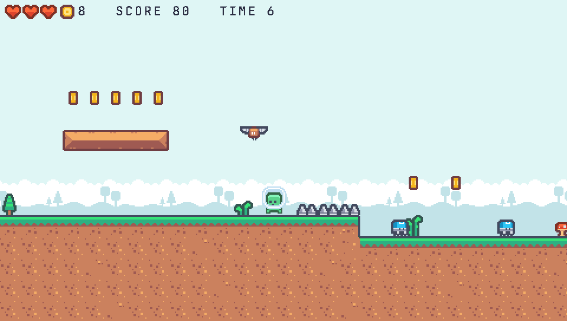

# Meadow Run (platformer)

A small side-scrolling platformer written once for the desktop and the consoles: PSP (480x272), PS Vita (960x544), PS2
(640x448) and Nintendo 3DS (400x240). Run right through one level, jump the pits and the spikes, stomp the critters,
collect the coins and reach the flag. Three hits or falls and the game is over.



```sh
zinc run examples/platformer                          # desktop window, 960x544
ZINC_SIZE=480x272 zinc run examples/platformer        # the PSP's screen (also 400x240, 640x448, 960x544)
zinc run examples/platformer -- --stats               # tiles, sprites, draw commands and ms per frame, every second
zinc test examples/platformer --profile ps2           # the rules with the consoles' f32 numbers
```

## Controls

| | Pad (PlayStation names) | Keyboard |
|---|---|---|
| move | d-pad or left stick | arrows, A / D |
| jump (hold for higher) | Cross | Space, Z |
| run | Square | C |
| start, pause | Start | Enter |

## How it is made

| File | Role |
|---|---|
| `src/main.ts` | the frame loop: fixed steps of 1/60 s (two at 30 fps), the title screen drifting over the level, `--log` and `--stats` |
| `src/world.ts` | the rules without drawing: the hero against the LDtk IntGrid (solid, one-way clouds, spikes), coyote time and jump buffering, walkers and flyers, coins, lives, the flag |
| `src/render.ts` | the far layer at half speed, the front layer, the sprites, the HUD; one logical pixel is one screen pixel up to 448 lines, two above (Vita, desktop) |
| `src/input.ts`, `src/sound.ts` | the controls of one frame; the sounds played on the world's events |
| `tests/world.test.ts` | a scripted run reaches the flag, one that never jumps loses (also with `--profile ps2`) |
| `tools/make_assets.py` | writes the level (`assets/level.ldtk`), the two sprite sheets and the music loop; `--from` copies Kenney's files |

- **Level**: `assets/level.ldtk`, 120 x 28 cells of 18 px in LDtk's JSON, imported by the asset build (`zinc:tilemap`):
  layers `Front` (tiles), `Back` (24 px backgrounds, drawn at half speed), `Collisions` (IntGrid) and `Entities`.
- **Atlas**: the tiles the level uses and the frames of `characters.json` and `items.json` are packed into one atlas,
  `game`: a single 256x128 page (`--stats` prints it).
- **Measured** (`--stats`, CPU renderer on one thread, the scripted session): at most 346 tiles, 16 sprites and 362 draw
  commands a frame at 640x448 (the PS2's view: 36 x 25 cells), 270 tiles at 480x272; the PSP budget of
  `docs/reports/games/console-2d-3d-frameworks.md` is 2,300 tiles and 60 sprites.

## Assets and licences

The art and the sound effects are Kenney's, CC0 1.0 (public domain), copied unchanged into `assets/kenney/<pack>/` with
each pack's `License.txt` and a `SOURCE.txt` naming the pack and its page:

- [Pixel Platformer](https://kenney.nl/assets/pixel-platformer): the tiles, backgrounds, characters, coins and flag;
- [Digital Audio](https://kenney.nl/assets/digital-audio): jump, coin, hurt;
  [Impact Sounds](https://kenney.nl/assets/impact-sounds): stomp;
  [Music Jingles](https://kenney.nl/assets/music-jingles): the goal and game-over jingles.

The level layout, the sprite sheets' frame lists and the music loop (`assets/music.wav`, synthesised by
`tools/make_assets.py`: Kenney publishes jingles, not loops) are this example's own.

## On the consoles

The game runs unchanged where a console back end exists (ZN-753's chain: pspdev, VitaSDK, ps2dev; PPSSPP, Vita3K, Play!).
Until then the desktop proves it at the consoles' sizes and with their f32 numbers (`tests/t1/platformer.sh`).
