# rn-showcase

A kitchen-sink app written the React Native way, in the spirit of Expo's
[native-component-list](https://github.com/expo/expo/tree/main/apps/native-component-list): what a React Native style app can do on Zinc,
with no browser and no bridge. Function components and hooks (`zinc:ui/react`), React Native's components and APIs (`zinc:react-native`),
`StyleSheet.create` and style objects only, Yoga layout (`"ui": { "preset": "react-native" }`). Every screen is small and is also documentation:
open the file named in the table and read it.

```sh
zinc run examples/rn-showcase                                   # a window (native code, cached after the first build)
zinc run --interp examples/rn-showcase                          # the interpreter: starts at once
SHOWCASE_SCREEN=more/motion SHOWCASE_SCHEME=dark zinc run examples/rn-showcase   # open a route in a scheme
SHOWCASE_LANG=fr zinc run examples/rn-showcase                  # French
SHOWCASE_NET=mock zinc run examples/rn-showcase                 # the in-app mock server instead of the network
```

| Home | Components | Forms | Signed up | Posts | Live feed |
|---|---|---|---|---|---|
| 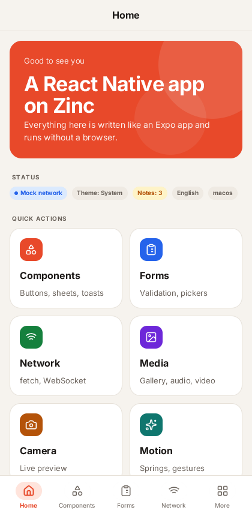 | 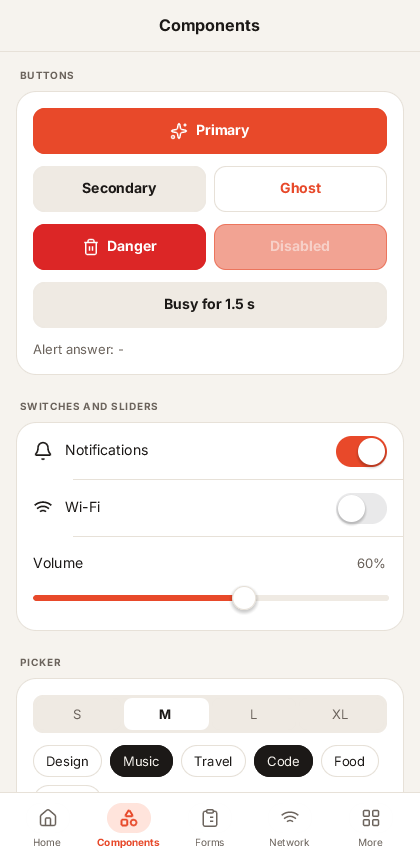 | 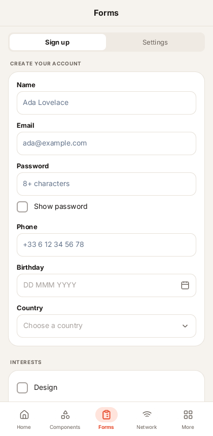 | 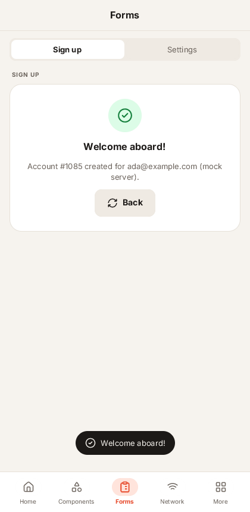 | 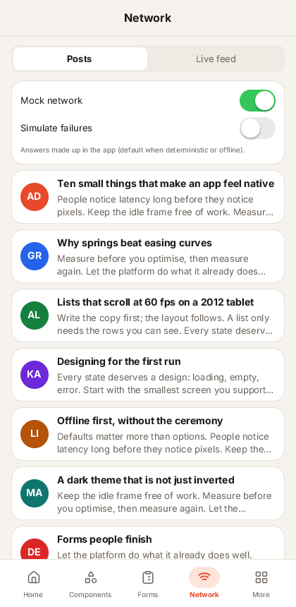 | 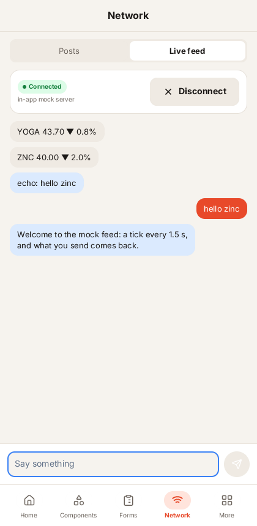 |
| **Gallery** | **Camera** | **Motion** | **Notes** | **Home, dark** | **More, dark** |
| 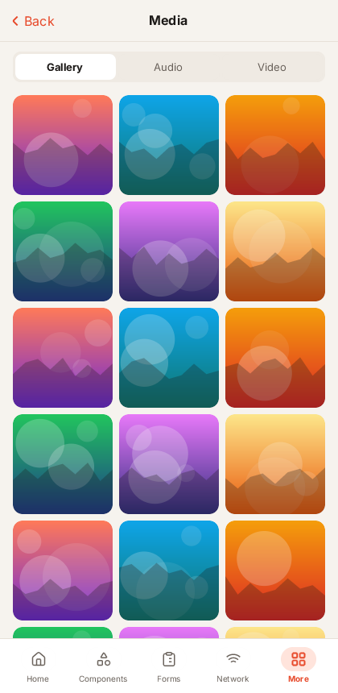 | 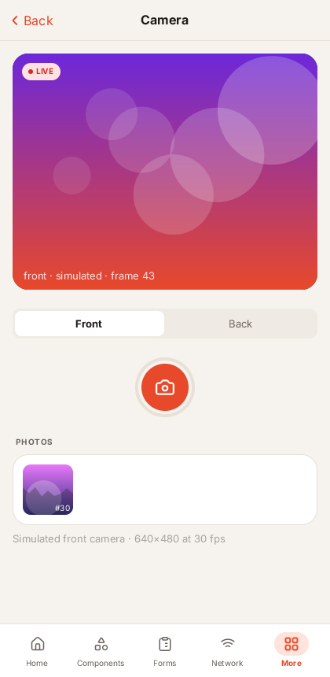 | 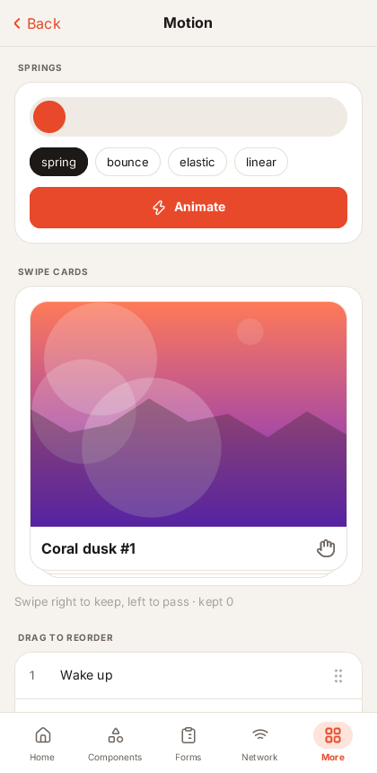 | 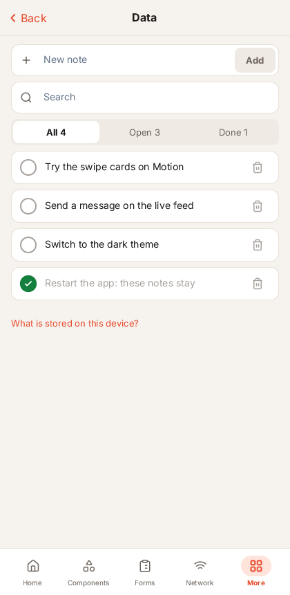 | 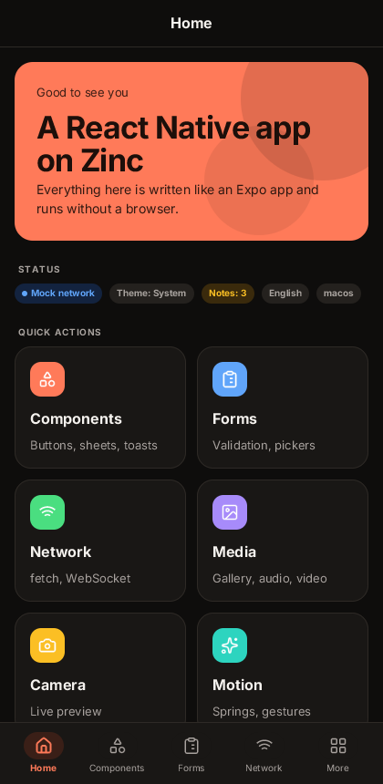 | 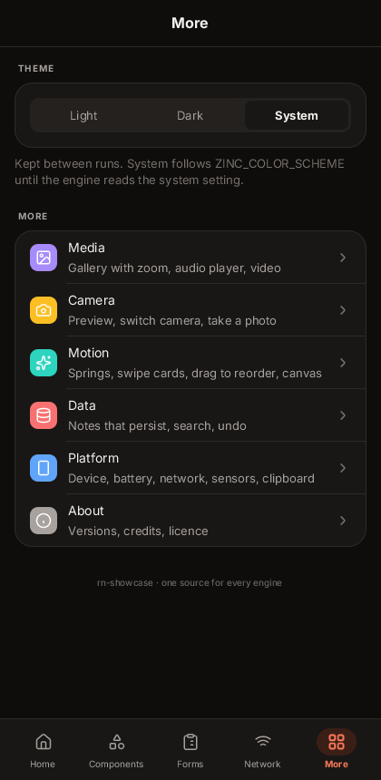 |

## The app

A bottom tab bar (Home, Components, Forms, Network, More) and a stack above it: More and Home's quick actions push Media, Camera, Motion,
Data, Platform and About with a back button. Only the top of the stack is mounted; a screen that starts timers, sockets or a camera stops
them when it is left (`onLeave` in `src/nav.ts`: zinc:ui/react has no effect cleanup yet).

| Screen | File | What it shows |
|---|---|---|
| Home | `screens/Home.tsx` | a hero card, live status chips (network mode, theme, open notes, language, platform), quick actions to every screen |
| Components | `screens/Components.tsx` | buttons (primary, secondary, ghost, danger, disabled, busy), switches, a slider, a segmented picker and chips, badges, an avatar stack, a card, progress bars, activity indicators, skeletons, a bottom sheet (Modal), Alert.alert, a toast |
| Forms | `screens/Forms.tsx`, `controls.tsx` | a sign-up form: text fields with keyboard types, secure entry with show/hide, a date picker, a select, checkboxes, radios, a stepper, a textarea with a counter; errors after the first submit, a submit that goes to the network and ends in a success or an error state; a settings form saved on the device and sent to the server |
| Network | `screens/Network.tsx`, `api.ts`, `feed*.ts` | posts from a public JSON API: skeletons while loading, an error with Retry and "Use mock data", an empty state, pull to refresh, pages loaded at the end of a virtualised FlatList, a detail screen; a live feed over a WebSocket with connect, disconnect and a composer |
| Media | `screens/Media.tsx`, `art.ts`, `media*.ts` | a virtualised gallery of generated pictures, a viewer with pinch, double tap and buttons to zoom and a share sheet stand-in (copy link, save to notes); an audio player (play, pause, seek, progress) on a track synthesised in the app; a video with its poster when there is no decoder |
| Camera | `screens/Camera.tsx`, `camera.ts` | permission, the list of cameras, a live preview, front and back, taking photos (a flash, thumbnails) |
| Motion | `screens/Motion.tsx` | Animated springs and timing with easing and colour interpolation, swipe cards (PanResponder, a fling throws the card out), drag to reorder with LayoutAnimation, a Lottie animation, a finger-paint canvas |
| Data | `screens/Data.tsx`, `store.ts` | notes that persist: add, tick, delete with undo, search and filter in a FlatList; what is stored on the device, key by key |
| Platform | `screens/Platform.tsx` | device and screen, battery, network type, orientation, the accelerometer, vibration, clipboard, opening a link, lifecycle and keyboard events, a keyboard-avoiding field, safe areas, a language switch, a platform-specific file |
| More, About | `screens/More.tsx`, `screens/About.tsx` | the theme (light, dark, system; kept between runs); versions, links and the licences of what the app ships |

Shared pieces: `theme.ts` (the palette of both schemes, a 4 px spacing grid, radii, a type scale), `parts.tsx` (screen frame, sections, rows,
buttons, chips, badges, avatars, progress, skeletons, empty and error states, the toast host), `controls.tsx` (the form controls React Native
leaves to libraries), `i18n.ts` (English is the key, a French table; `tr('Home')`), `nav.ts` (tabs, the stack, `onLeave`).

## Design choices

- **Friendly when something is missing.** Every feature has a state for the device that lacks it: no network (the mock server, a banner),
  a failing server ("Simulate failures" on the Network tab shows the error states), no audio device (it plays silently and says so), no video
  decoder (the poster), no camera (an empty state; the simulated camera until `zinc:camera` is in the tree), no sensor, no vibration motor,
  links that cannot open. Nothing ends in an error screen.
- **The network goes through one file.** `api.ts` is a small typed client: JSONPlaceholder over HTTPS (`fetch`) in live mode, the same answers
  made up in the app in mock mode. Mock is the default under `ZINC_DETERMINISTIC` (tests and screenshots are stable) and with
  `SHOWCASE_NET=mock`, and the app falls back to it when the device is offline.
- **Platform-specific files**, React Native's `.ios.tsx` way: `feed.macos.ts` replaces `feed.ts` on macOS (the import still says `./feed`).
  The desktop gets the real WebSocket (`zinc:socket`, a local echo-and-ticker server, or `SHOWCASE_WS=ws://host:port`), audio and video
  (`media.macos.ts`, `media.linux.ts`) and links (`links.*.ts`); the browser build, phones and boards get the stand-ins and still compile.
  `greeting.ts` / `greeting.macos.ts` shows the mechanism on the Platform screen.
- **The camera** goes through `camera.ts`, which has the API of `zinc:camera` (`devices`, `requestPermission`, `Camera.open`, `image`,
  `onFrame`, `snapshot`) over a simulated camera. When the plugin lands, `camera.macos.ts` and `camera.linux.ts` (one line each:
  `export { devices, requestPermission, Camera, CameraDevice } from 'zinc:camera';`) switch to the real cameras; the screen does not change.
- **Modest machines first.** A screen at rest draws nothing and allocates nothing per frame: icons, pictures and the stopped spinner are lazy
  canvases, animations run only while something moves, the progress of the audio player ticks only while it plays. Long lists are
  virtualised (FlatList with `getItemLayout`); pictures are drawn at their size, there are no image files to decode. Audio samples are made
  on the first play, not when the screen opens.
- **Accessible and translatable.** Pressables carry `accessibilityLabel`, switches, checkboxes and radios their role and state; strings go
  through `tr()` (en, fr).

## Measured (Intel Mac, 6 cores, under the load of other builds)

| | Interpreter | Native (AOT) |
|---|---|---|
| A tab switch, the frame that builds the new screen (headless, real time) | 1.9 to 7.8 ms | 0.5 to 1.9 ms |
| The same tab a second time (Components) | 4.6 ms (first 4.5) | 1.1 ms (first 1.5) |
| An idle frame | 0.004 ms (kept: no paint) | 0.001 ms |
| Allocations over 300 idle frames (Home, Components, Forms, More, Motion) | 3 (the probe's own) | |
| Peak memory, eight tab switches headless | 60 MB | 51 MB |
| Peak memory, a window for 8 s | | 97 MB, 0.7 s of CPU (start included) |

The native build of the app takes 14 s the first time (8.6 MB), and starts at once after that.

## Engines

The interpreter and the native build run the same source to the same pixels (the test compares one frame hash). The QuickJS engine runs
plain JavaScript only: it refuses `.tsx` modules ("JSX needs the typed engine"), so this app does not run on it.
`zinc lint --all-targets examples/rn-showcase` is clean on macos, linux, sim, wasm and rpi1; android and ios warn about the vector icon
plugin (`zinc:svg` is not built for them yet); `zinc.json` `requires` (`display`, `pointer|touch`, `heap>=32M`) refuses esp32, ps1 and ps2.

## Tests

`next/tests/t1/rn_showcase.sh`: no class string and no kit, the react-native preset; the key screens (tabs and stack screens, light and dark)
render to their frame hashes in `next/tests/golden/rn-showcase/hashes.txt`; the native build draws the interpreter's frame; idle screens
allocate nothing; and scripted sessions (`ZINC_INPUT`, `SHOWCASE_LOG=1`, lines in `session.out`): the sign-up form refuses a missing field
and then submits to the mock server, the mock WebSocket feed connects, ticks and echoes a message, a note added on Data is there after a
restart with the same `ZINC_STORAGE`, and the Camera screen shows the simulated preview and takes a photo. `ZN_UPDATE_GOLDEN=1` records
the goldens again.
