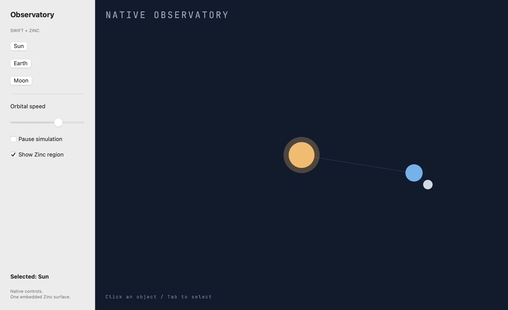

# Native Observatory



A runnable macOS SwiftUI application with a **live Zinc view in the same window**.
Swift owns the sidebar, speed slider, pause and visibility controls, and selection
inspector. Zinc owns the orbit display tree and object hit testing. Click the Sun,
Earth or Moon in Zinc to update native details; select an object in the sidebar to
highlight it in Zinc. Focus the scene and press Tab to cycle objects.

## Build and run

Requires macOS, Xcode command-line tools (Swift/AppKit/SwiftUI), CMake and the Zinc
checkout. No Xcode project or downloaded Swift package is required: `build.sh` is
the complete build definition. From the repository root:

```sh
cmake -S . -B build -DCMAKE_BUILD_TYPE=Release
tools/build zn_app zinc
examples/swift-observatory/build.sh
ZINC_BACKGROUND=1 'examples/swift-observatory/build/Native Observatory.app/Contents/MacOS/Observatory'
```

Omit `ZINC_BACKGROUND=1` for an interactive foreground launch. Close the window to
exit. The output `.app` contains the AOT Zinc program, runtime and native shell;
it runs without an installed Zinc CLI. Development builds are unsigned; signing
and notarization are not provided.

## Tests and capture

No-window native integration test, safe while other agents build:

```sh
ZINC=build/zinc tests/run --only swift_observatory
ZINC=build/zinc tests/run --only embed
```

After other builds/window tests finish, run the native UI proof alone. It creates
one background window, exercises native controls, Zinc hit testing, keyboard
focus, native resizing, explicit 2x pixels and hide/show, saves the actual native
view, then terminates itself:

```sh
mkdir -p examples/swift-observatory/captures
ZINC_BACKGROUND=1 'examples/swift-observatory/build/Native Observatory.app/Contents/MacOS/Observatory' \
  --smoke --capture "$PWD/examples/swift-observatory/captures/observatory.png"
```

The process prints a success line only after its assertions pass. Review the PNG
before treating visual acceptance as complete. Native window/capture proof is
separate from the no-window test; compiling Swift does not prove AppKit behavior.

The bounded native regression is also available through the demo runner:

```sh
ZINC_CAPTURE="$PWD/examples/swift-observatory/preview.png" tests/run --tier demo --only swift_observatory_native
```

Executed on macOS: the actual background native-window proof passed, including
one-window ownership, native controls, pointer selection, keyboard focus,
Retina/resize, hide/show and clean shutdown. The reviewed image above comes from
that run. The sidebar paints its native background explicitly so captures retain
the same readable contrast as the window.

## Source and ownership

- `src/main.ts`: stage assembly and host command input.
- `src/state.ts`: bounded speed, pause and selection state.
- `src/Scene.ts`: persistent `zinc:stage` scene, drawing and hit zones.
- `native/Main.swift`: SwiftUI chrome, native child NSView, event adaptation and
  deterministic interaction/capture script.
- `native/Observatory.cpp`: scalar command snapshots and selection callback.
- `native/Observatory.h`: C bridge imported by Swift.
- `native/Smoke.cpp`: real AOT integration regression.

The host sends a bounded snapshot via three process environment values plus a
queued private `s` key event; Zinc reads them only on a command, never by polling
strings every frame. A namespaced `observatory:selected:<0..2>` console event
returns selection through the existing runtime console callback. This is a small
single-program demo bridge, not a general messaging protocol. Nothing evaluates
host-supplied code. The scene's animation pause differs from hiding the surface:
paused scenes still accept input; hiding suspends runtime ticks until shown.

The renderer copies premultiplied BGRA pixels into an owned CGImage only when the
presentation serial changes. It does not share Metal textures or claim partial
GPU uploads. Resize follows logical AppKit points and integer display scale.
One instance starts for the application lifetime; closing terminates the app.
The smoke checks shutdown twice to verify idempotence, not in-process restart.

Committed text/IME, clipboard and accessibility semantics inside Zinc, gamepad
navigation, iOS packaging and non-macOS builds are not implemented by this demo.
Native SwiftUI controls keep their own accessibility. No performance or memory
claim is made while parallel work is running.
