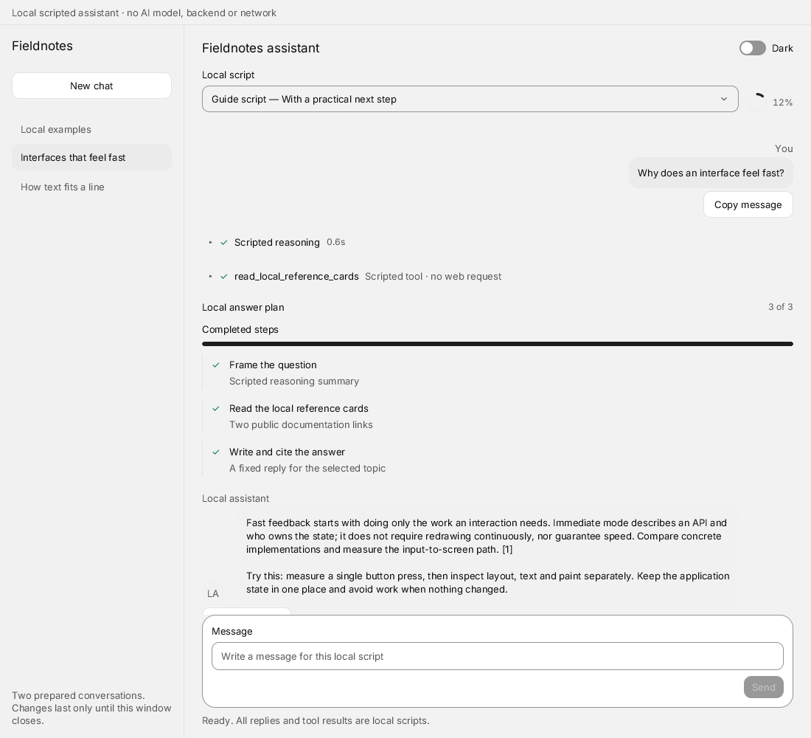
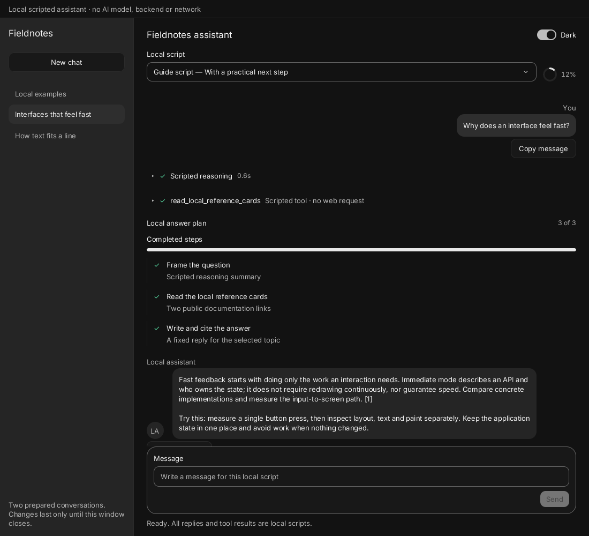

# Fieldnotes assistant

A local, scripted chat demo in the Quiet theme. It shows reasoning, a tool result,
a three-step plan, messages, citations, source cards, a script picker, local text
size and a multiline composer. **There is no AI model, backend, API key or network
request.** Any question plays the fixed answer for the selected topic.





[Light at 360 px](images/light360.png) · [Dark at 360 px](images/dark360.png)

```sh
build/zinc run examples/ui/assistant --engine quickjs
build/zinc run examples/ui/assistant --interp
build/zinc run examples/ui/assistant --native
ASSISTANT_DARK=1 build/zinc run examples/ui/assistant --engine quickjs
```

Choose a prepared conversation, or New chat and a prompt suggestion. Suggestions
fill the draft. Enter sends; Shift Enter adds a line. A reply takes 2.2 seconds:
reasoning, local reference cards, then a complete answer. Stop cancels it; Retry
replays the question with the selected script. Brief and Guide produce different
answer lengths. The model control is disabled during playback. The composer can
hold the next draft while a reply runs.

At phone widths, Chats replaces the conversation with the local chat list; Back
to chat returns without losing the draft. Opening another prepared conversation
or New chat clears the current draft and exchange. The demo keeps one current
exchange, in memory. All edits disappear on exit. Source actions reveal the real
public URL and its summary; Copy source URL copies it for opening elsewhere.

The sidebar occupies 250 px at desktop widths. Below 768 px, Chats opens the
local list and leaves room for the conversation and composer.

## Code and reuse

- `src/main.tsx` mounts Solid and the Quiet theme; `App.tsx` composes navigation,
  script choice, appearance and conversation.
- `ChatSidebar.tsx` uses the kit Sidebar and buttons. `Conversation.tsx` composes
  `ChatBubble` (the kit's message component), `Reasoning`, `ToolCall`, `AgentPlan`,
  `Citation`, `Sources`, `PromptSuggestions` and `ChatComposer`.
- `state.ts` owns one phase enum and checked transition function. A generation
  invalidates stale callbacks; Stop, navigation, New chat and unmount clear the
  bounded timers. There is no idle polling or custom animation loop. Kit motion
  uses its existing reduced-motion paths.
- `data.ts` holds our own questions and scripted answers, two local script
  choices and the public reference cards. No provider or shared component was
  copied or added.

Desktop, Linux, web and simulator presets describe layout intentions. Only the
development Mac's headless interpreter, AOT and QuickJS entries were smoke-run.
The unchanged app was checked at 1100 × 1000 and 360 × 800, in both themes.
Actual pointer/keyboard handlers exercised suggestions, multiline and duplicate
Enter, Send/Stop/Retry, New chat, script choice, tool details, source selection
and theme switching. Model and citation layers snap on their first visible paint
with reduced motion; citation dismissal restores its trigger focus. Cancellation
and root destruction were checked after the pending reply deadline. These are
short deterministic proofs; hardware input, browser export, touch and
screen-reader use remain unvalidated.

## Reference

Layout and the short scripted-answer idea were inspired by
[CUI's Assistant](https://github.com/yappologistic/CUI/blob/f70a1d3d095cafd67814b23bdd82c2dfba28efe0/examples/assistant.c)
(MIT). Zinc owns this implementation and its content; no CUI code or fictitious
source URLs were copied.

The reference cards link to
[Dear ImGui's explanation of the IMGUI paradigm](https://github.com/ocornut/imgui/wiki/About-the-IMGUI-paradigm)
and [FreeType's glyph metrics](https://freetype.org/freetype2/docs/glyphs/glyphs-3.html).
They support the distinction between API state ownership and rendering, and
between glyph bounds and advances. The advice to measure an interaction is our
practical suggestion, not a quoted performance result.

## Proposed tests

- `ZINC_BACKGROUND=1 timeout 120 build/zinc run examples/ui/assistant --engine quickjs`:
  physical keyboard, pointer and scroll walkthrough at 1100 px and 360 px, both
  themes, including source cards and chat-list focus; about 2 minutes, estimated
  under 250 MB, unmeasured.
- At a UI milestone, a bounded scripted interaction session on interpreter,
  AOT and QuickJS: send/duplicate Enter, Shift Enter, model choice, stop/retry,
  New chat during playback, stale callback rejection and unmount; about 30
  seconds plus AOT compilation, estimated under 400 MB runtime, unmeasured.
- `ZINC_BACKGROUND=1 timeout 120 build/zinc run examples/ui/assistant --native`:
  OS reduced-motion and VoiceOver walkthrough, including
  citation overlays and focus restoration; about 2 minutes, memory unmeasured.
