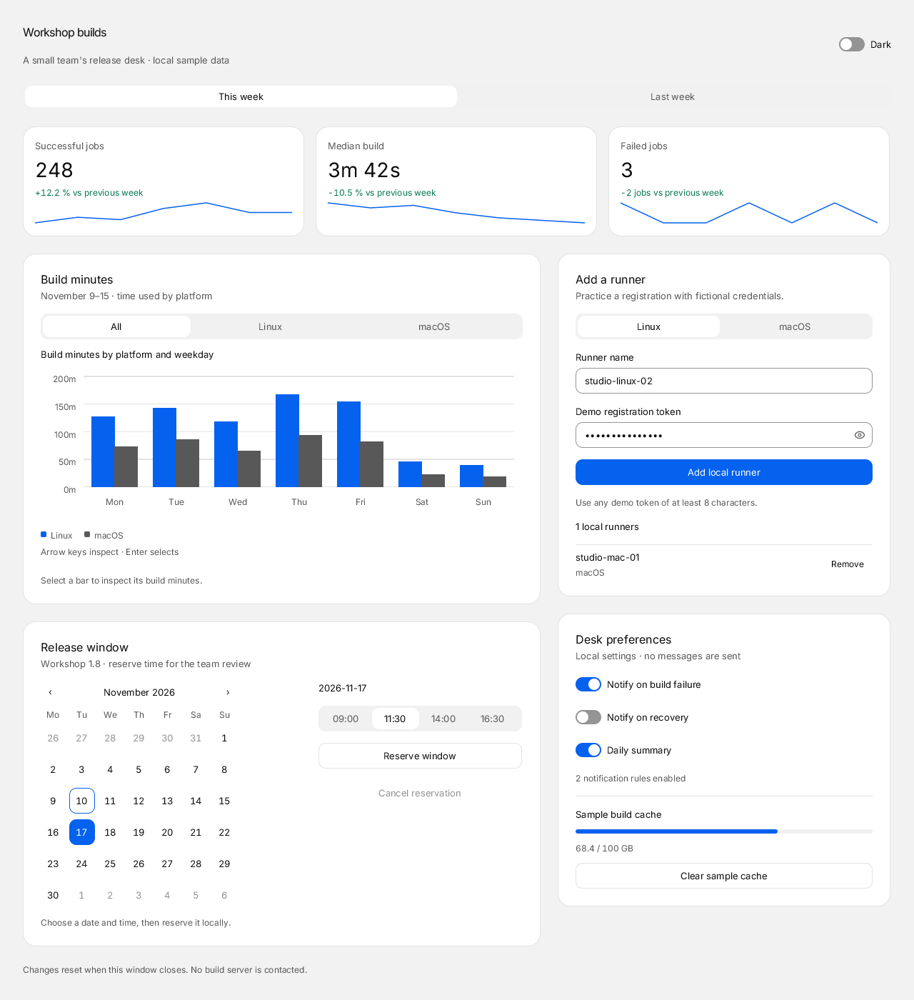
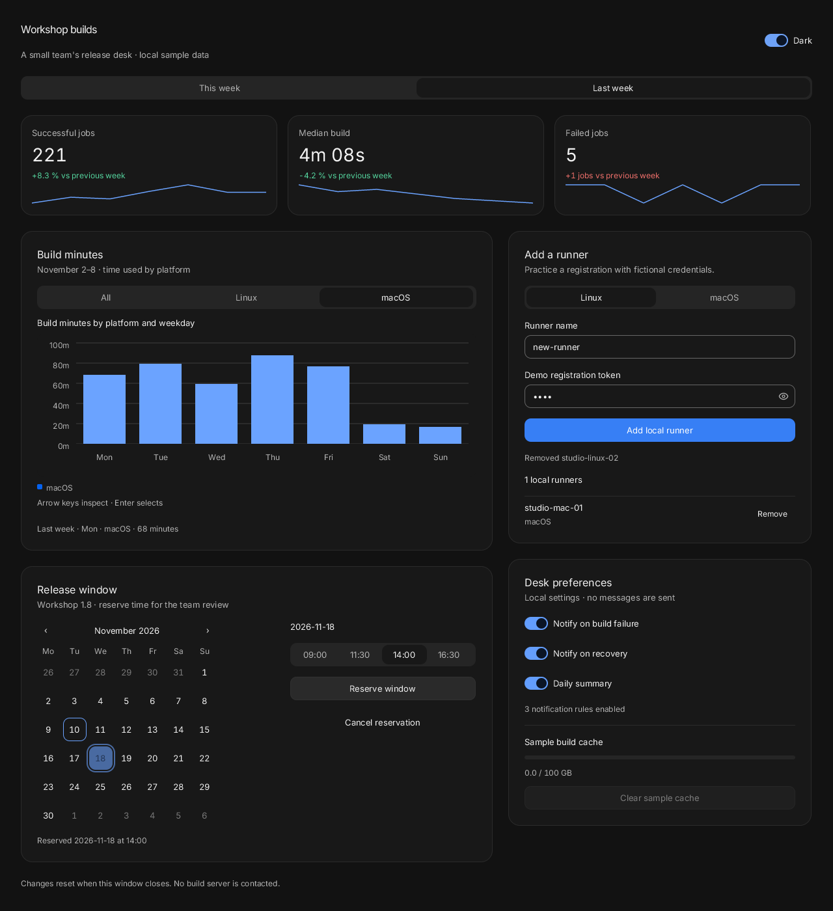
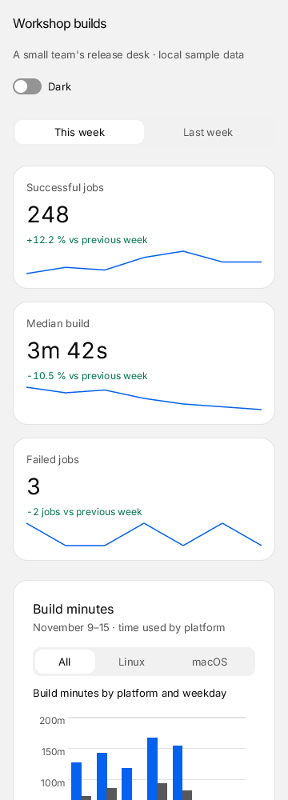

# Workshop Dashboard

A release desk for a fictional workshop: build metrics, a platform chart, a release calendar, local runner registration and desk preferences. All data lives in the window; it resets on close. No server, account, network access or real credential is needed.



```sh
build/zinc run examples/ui/dashboard --interp
build/zinc run examples/ui/dashboard --native
build/zinc run examples/ui/dashboard --engine quickjs
DASHBOARD_DARK=1 build/zinc run examples/ui/dashboard
```

Change the reporting week to update all three metrics and chart data. Filter Linux/macOS and inspect a bar with the pointer or arrow keys and Enter. Choose a release date and time, reserve it, then cancel it. Registration validates names, duplicate names and the sample token's minimum length; adding a runner clears its token and the new entry can be removed. The eye reveals or hides the token without changing its value. Notification switches update the enabled-rule count; clearing the sample cache sets its usage to zero and disables the empty action.

Tab and Shift-Tab move between controls; Enter or Space activates. Arrow keys navigate tabs and the calendar; Page Up/Down changes calendar month. Keyboard focus is visible. The kit supplies reduced-motion behavior. The page wraps into one scrollable column at narrow widths; controls keep their normal sizes and secondary content remains reachable. This `zinc:ui` demo targets desktops and recent phones; old-device display-tree performance and physical touch/assistive technology have not been validated.





## Source layout and reuse

- `src/main.tsx` sets the Quiet theme and mounts the app.
- `src/App.tsx` owns reporting period and theme, and composes the responsive screen.
- `src/data.ts` holds fictional chart samples and the runner record type.
- `src/components/` contains the chart, release calendar, runner form and preferences, each owning its local state and actions.

The kit supplies Metric, BarChart, Calendar, Tabs, Input, PasswordField, Switch, Progress, Button and Card. There is no private widget provider, timer or polling loop. No network, storage or OS notification service is used; the registration, reservation, cache and notification values are explicitly local examples.

[CUI's dashboard](https://github.com/yappologistic/CUI/blob/f70a1d3d095cafd67814b23bdd82c2dfba28efe0/examples/dashboard.c) and [component reference](https://github.com/yappologistic/CUI/blob/f70a1d3d095cafd67814b23bdd82c2dfba28efe0/docs/components.md) inspired metric hierarchy, range filtering and responsive stacking. The existing Zinc design picture in `docs/img/design/src` supplied the runner/calendar/preferences composition; this demo uses current kit providers and its own code and sample data. No CUI C implementation is copied.

## Proposed tests

Future milestone checks, for the owner to choose:

- Replay period/platform selection, chart callback, token reveal/hide, valid/invalid/duplicate registration, runner removal, date/time reservation/cancellation, switches and cache clear through real inputs on all three engines; about 10 seconds plus a cold native build, under 500 MB expected.
- Resize 1280→768→360→1280, scroll the entire page, inspect calendar/form focus and light/dark/reduced motion with keyboard and physical touch; about 30 seconds, under 500 MB expected.
- Repeat add/remove/reserve/cancel and leave the dashboard idle; inspect retained memory and paint count, about 30 seconds, under 500 MB expected. Idle energy and long-run memory have not been measured.
