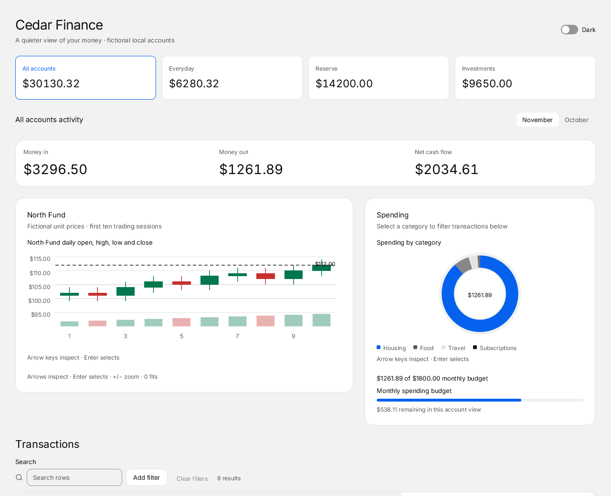
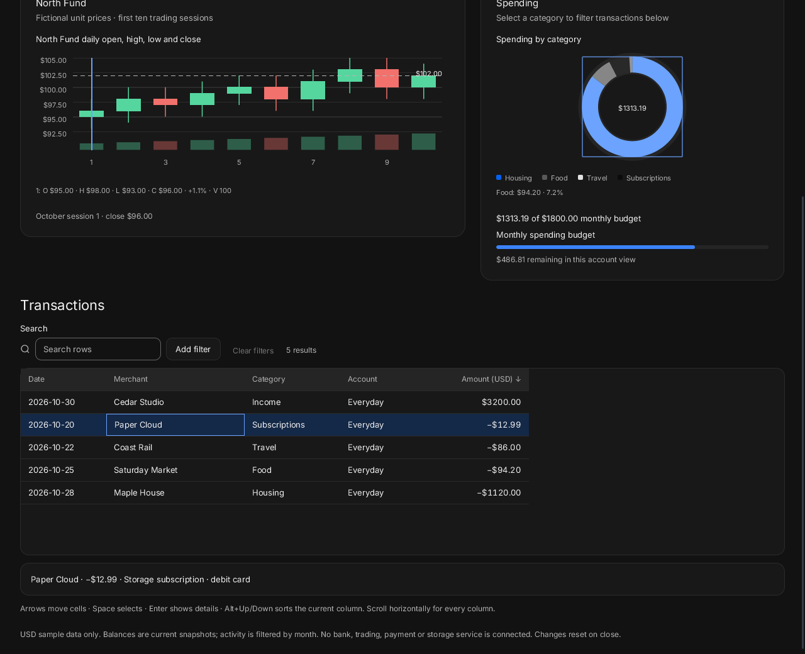
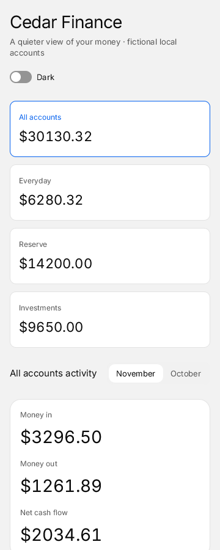
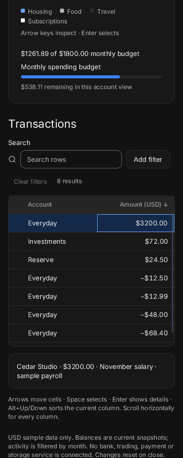

# Cedar Finance

A local finance desk with fictional USD accounts, month-filtered cash flow, a candlestick chart, spending categories, a budget and a real transaction DataGrid. No bank, trading, payment, network or storage service is connected. All changes reset when the window closes.



```sh
build/zinc run examples/ui/finance --interp
build/zinc run examples/ui/finance --native
build/zinc run examples/ui/finance --engine quickjs
FINANCE_DARK=1 build/zinc run examples/ui/finance
```

Choose an account card to filter income, spending, cash flow and transactions. November/October changes those records and the fictional North Fund's first ten trading sessions. Account balances are current snapshots; the fund chart shows the same market sample for every account. The $1800 spending budget applies to the displayed account view, so the all-accounts view includes each account once.

Inspect either chart with the pointer or arrow keys. Enter selects a candle and reports its session/closing price, or selects a spending category and filters the transactions. `+`/`−` zoom the candlestick chart and `0` fits its data. An account without outgoings shows an empty spending chart.

Search transactions by merchant, date, category, account or displayed amount. Add/remove a category with the filter bar; Clear filters resets search and category. The grid sorts dates, text and numeric amounts. Select a row for its local detail; multiple selection shows a net total. Arrow keys move between grid cells, Space selects, Enter opens the current row detail, Alt+Up/Down sorts the current column. Tab/Shift-Tab move between controls with a visible ring. The grid scrolls horizontally on narrow screens; the page scrolls vertically to every section. The kit supplies reduced-motion behavior.







## Source and reuse

- `src/main.tsx` selects the Quiet theme and mounts the screen.
- `src/App.tsx` owns account/month/category/theme state and composes the responsive page.
- `src/data.ts` holds fictional records, formatting, cash activity and chart samples.
- `src/components/` contains Accounts, Market, Spending and Transactions, one component per file.

The existing kit supplies Button, Tabs, Switch, Card, CandlestickChart, DonutChart, Progress, FilterBar and DataGrid. No private chart, table, provider, dependency, timer or polling loop is added. The [pinned CUI finance example](https://github.com/yappologistic/CUI/blob/f70a1d3d095cafd67814b23bdd82c2dfba28efe0/examples/finance.c) (MIT) inspired the account hierarchy, period selector, spending/budget composition and responsive stacking. This demo uses its own code and data, without the reference's decorative payment card or disconnected service actions.

This `zinc:ui` demo targets desktops and recent phones. Physical touch, assistive technology, old-device display-tree performance, long-run memory and idle energy have not been validated.

## Proposed tests

Future milestone checks, for the owner to choose:

- `ZINC_INPUT=<chosen session> build/zinc run examples/ui/finance --interp` (also `--native` and `--engine quickjs`): replay account/month, chart callbacks, category/search empty/clear, numeric sorting and multi-row keyboard details; about 10 seconds per engine plus a cold native build, under 500 MB expected.
- `ZINC_SIZE=360x900 build/zinc run examples/ui/finance`: resize 1280→768→360→1280, scroll through charts and all grid columns, exercise keyboard and physical touch in light/dark/reduced motion; about 30 seconds, under 500 MB expected.
- `ZINC_REALTIME=1 ZINC_FRAMES=1800 build/zinc run examples/ui/finance --interp`: repeat filters, select/clear and theme changes, then inspect idle paints and retained memory; about 30 seconds, under 500 MB expected. These are estimates, not measurements.
