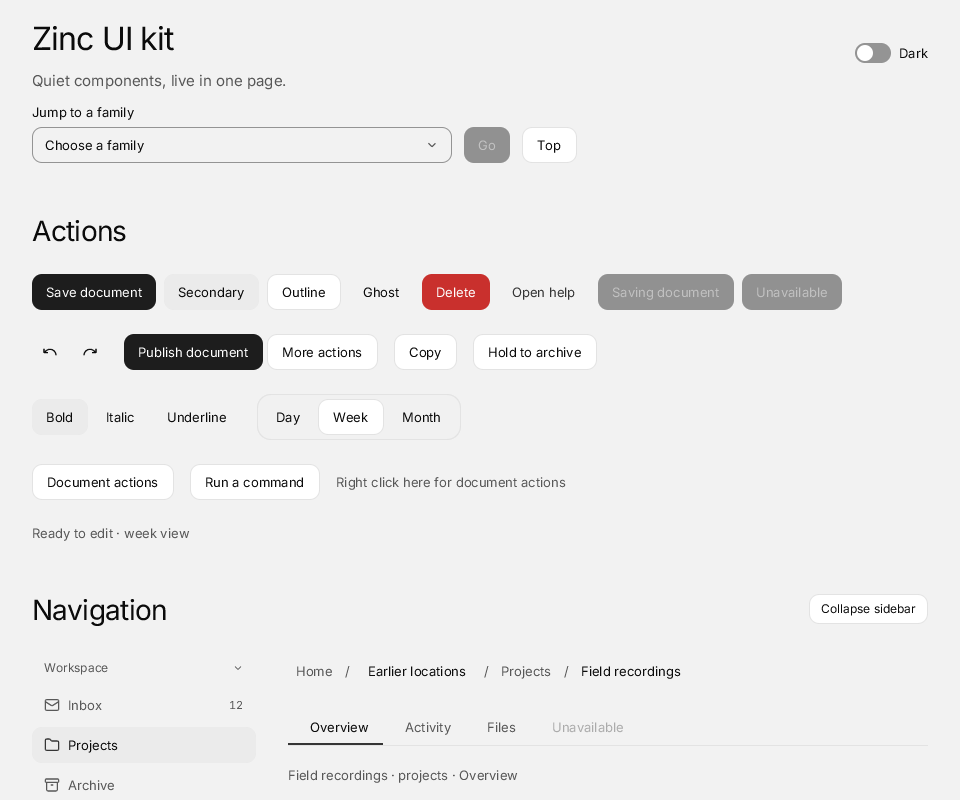
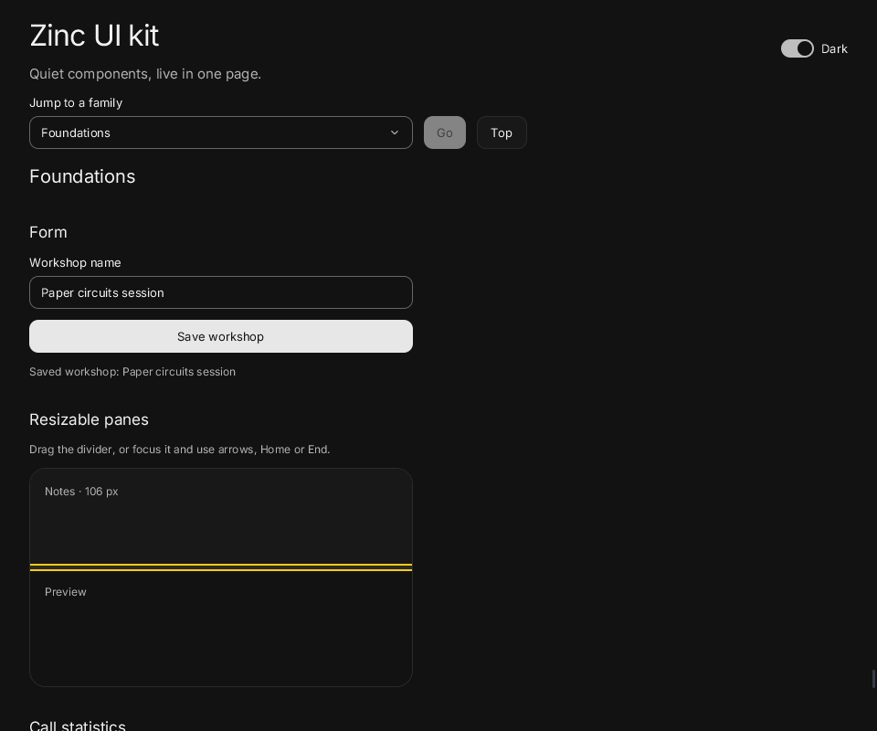
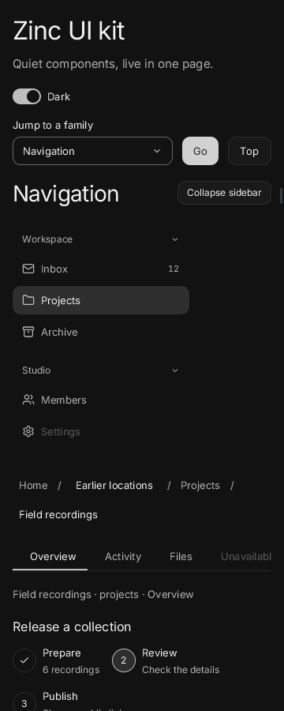

# Kit gallery

The public controls of `zinc:ui/kit` on one scrollable page in the Quiet light and dark themes.
The fixed header keeps **Dark** and **Jump to a family** available while scrolling. Choose a family,
then press **Go**: its first enabled control receives focus, so Tab continues inside that family.
**Top** returns to the beginning. The wheel, trackpad or touch scrolls the same page; families are
not replaced when you jump. Motion respects the system's reduced-motion preference.



## Run it

```sh
zinc run examples/ui/kit-gallery --interp
zinc run examples/ui/kit-gallery --native          # AOT; compiles on the first run
zinc run examples/ui/kit-gallery --engine quickjs
GALLERY_DARK=1 zinc run examples/ui/kit-gallery --interp
```

The short proofs for this change use the development Mac, headless software rendering. The retained
Linux, Raspberry Pi, web and sim profiles have not been validated here. The exhaustive page enables
the existing `growDrawCommands` target option so the fixed small-scene pool does not discard later sections.

Controls: click or tap; arrow keys / Tab move the focus, Space or Enter presses; the wheel or a drag scrolls.

## What to look at

| File | Role |
| --- | --- |
| `src/main.tsx` | the complete scroll page, section references and focus transfer |
| `src/Header.tsx` | persistent theme and family navigation controls |
| `src/sections/foundations.tsx`, `src/foundations/` | a real form, resize divider, disconnected call state, on-screen keyboard and zoomable content |
| `src/state.ts` | the signals the controls read and write, the theme toggle, the static sample upload value |
| `src/sections/buttons.tsx` | `Button` variants and sizes, a `Kbd` inside a button, a live click counter |
| `src/sections/settings.tsx` | `Tabs` switching two panels with an inline `{cond ? <A/> : <B/>}`, `Switch`, `Slider`, `Progress` |
| `src/sections/overlays.tsx` | `Tooltip` with a shortcut hint, `DropdownMenu` bound to actions (`ui.bindKeys`), `Popover`, `Dialog`, `toast()` |
| `src/sections/inputs.tsx` | text, numeric, token, selection and shortcut fields with caller-owned state |
| `src/sections/display.tsx` | `Stat` tiles, `Badge`, `Avatar`, `Alert`, `List` / `ListItem` |

Live values are passed as accessors (`value={upload}`, `checked={notifications}`): the kit component subscribes to
the signal, so only the affected node updates when it changes.



The Actions family uses the Quiet theme. `GALLERY=actions` shows only Actions; `GALLERY=palette` opens its command
palette for documentation, and `GALLERY_DARK=1` starts dark. The copy action reports success in place, holding
Space/Enter or the pointer archives once, and Left/Right changes the segmented calendar view. `src/sections/actions.tsx`
contains the family composition. Nothing animates at rest.

`GALLERY=chrome` focuses the App chrome workspace (`src/sections/chrome.tsx`). F10 and Alt+F/V enter its menus;
document tabs select/close/reorder from the keyboard. Drag panel tabs into groups or to edges, or use “Panel actions”
to dock by keyboard; Escape cancels a drag. Dividers take pointer drags and arrow keys. Save/Restore layout use a
single gallery storage key only on request, report errors in the status bar and preserve the current layout on failure.

`GALLERY=selection` shows mixed and disabled checkboxes, whole-label switches, radio lists and cards, sliders
(horizontal, vertical, logarithmic, marked and range), filter chips, a removable chip and a clearable star rating.
The radio group skips disabled choices with arrows; slider arrows step (Shift steps ten), Home/End reach bounds,
and Delete clears the focused rating. `src/sections/selection.tsx` owns this page's local state.
`GALLERY=overlays` focuses the overlay family: hints, popovers, hover cards, confirmation, dialogs, edge sheets,
toasts and a guided tour. `OVERLAY=dialog`, `sheet`, `tour`, `hint`, `popover`, `hover`, `confirm` or `toast` opens a surface for a closer look. Hover crosses into
the rich card; Tab/Enter provides the same path. Toast hover/focus expands and pauses the stack; drag dismisses.


`GALLERY=inputs` shows the text, numeric, token, selection and shortcut fields. Their values belong to the gallery; every example is editable from the keyboard. `GALLERY_DARK=1` selects Quiet dark.

`GALLERY=navigation` shows all eight Navigation controls: a grouped sidebar, overflow breadcrumbs, scrollable tabs,
pagination, a release stepper, a document with a following contents rail, a named dock and a compact tab bar.
Collapse the sidebar, open its groups, switch pages, or choose a contents entry; Tab/Shift-Tab, arrows, Home/End and
Enter/Space reach the same actions. `GALLERY_DARK=1` starts in Quiet dark.
`GALLERY=feedback` shows the Feedback family: dismissible alerts and a banner, determinate and indeterminate progress,
a ring, storage meter, spinner and skeletons, badges, avatar statuses, empty-state action and timeline. Dismiss and
action controls support Tab/Enter/Space; the empty-state action ends the sample loading state. Nothing moves after
loading is stopped, and reduced motion freezes the loading indicators.

The Pickers family is available with `GALLERY=pickers`, or the focused views `pickers-dates`, `pickers-colors` and `pickers-values`. Add `GALLERY_DARK=1` for Quiet dark. Values are interactive; calendar keys, wheel snapping, color channels and fine numeric controls share the public kit components.

`GALLERY=data` shows cards, metrics, lists and tables, a 2,000-row recording grid, shared tree selection,
disclosures, editable paths, filters and filesystem navigation. `GALLERY_DATA=overview`, `grid`, `tree` or `files`
selects one part. The grid supports keyboard range/toggle selection, sorting, column resizing and cell editing.
`GALLERY_DIALOG=open` or `save` opens the corresponding path dialog in the files view. These examples read the
repository's gallery folder and return chosen paths; they never write a file. `GALLERY_DARK=1` starts in Quiet dark.

`GALLERY=tools` shows the Tool panels. `GALLERY_TOOLS=inspector`, `streams`, `graph`, `animation` or `binary`
focuses a page; `GALLERY_DARK=1` selects Quiet dark. `src/tools/` owns the sample data and callbacks. Edit properties,
append/filter logs, issue terminal commands, connect and move nodes, inspect time spans, edit bytes, share curve keys
with the timeline, change gradient stops or send meter peaks. The terminal supports `help`, `status`, `clear` and an
explicit unknown-command reply; it starts no process. Play requests are displayed; the editor owns no playback loop.
These examples use only public kit controls and create no background service.


`GALLERY=ai` shows assistant presentation; `GALLERY_AI=research`, `composer` or `messages` selects one page.
Finish/restart the local research, inspect tool payloads, choose a plan step/source, add context, choose a suggestion
or model, attach/remove sample notes, send/stop/finish a sample reply, and activate Markdown links/tasks or Retry.
All state is local; model names are fictitious and no network request or file chooser runs. Enter sends, Shift Enter
starts a line, and composition Enter remains with the IME. `GALLERY_DARK=1` starts in Quiet dark. The controls are
composed in `src/sections/ai.tsx`; `src/ai/` owns each example's state and callbacks.

`GALLERY=extended-capture`, `GALLERY=extended-social`, `GALLERY=extended-motion` or `GALLERY=extended-audio` isolates an Extended page.
Capture uses the declared `dialog` permission and the existing scoped system picker. Text/card effects start only
when requested; audio controls update a caller model. No sound service is started by the gallery.

## Coverage and focused views

All rows below are mounted in the default page. The selectors only isolate an existing section for
inspection; they do not implement another gallery. Clear the selectors to return to the whole page.

| Family | Controls and sample pages | Focused command prefix |
| --- | --- | --- |
| Actions | button variants/sizes, icon/group/split/toggle/copy/hold/segmented actions, menus, palette | `GALLERY=actions` or `palette` |
| App chrome | menus, toolbar, status, document tabs, dock layout | `GALLERY=chrome` |
| Inputs | text, password reveal, search, multiline, numeric/money/scrub, tags, code, select/combo/multi-select, shortcut | `GALLERY=inputs` |
| Pickers | dates/ranges/time/dial/wheel, colors/emoji, ruler/histogram/knob/fader | `GALLERY=pickers` or `pickers-dates`, `pickers-colors`, `pickers-values` |
| Selection | checkboxes, switches, radios/cards, slider/range, chips, rating | `GALLERY=selection` |
| Navigation | sidebar, breadcrumbs, navigation tabs, pagination, stepper, contents, dock, tab bar | `GALLERY=navigation` |
| Overlays | tooltip, dropdown, popover, hover card, confirmation, dialog, sheet, toast, tour | `GALLERY=overlays OVERLAY=<surface>` |
| Feedback | alerts/banner, progress/ring/meter, spinner/skeleton, badges/avatars, empty state, timeline | `GALLERY=feedback` |
| Data | cards/metrics/lists/table, editable grid, tree/table/path, accordion, filters, files/dialogs | `GALLERY=data GALLERY_DATA=overview\|grid\|tree\|files` |
| Code | block, editor, diff, Markdown, JSON | `GALLERY=code CODE_VIEW=block\|editor\|diff\|markdown\|json` |
| Charts | overview, distributions and market; all fifteen public charts | `GALLERY=charts-overview`, `charts-distributions`, `charts-market` |
| Tool panels | inspector, logs/terminal, node/flame graphs, curves/gradient/timeline, hex/levels | `GALLERY=tools GALLERY_TOOLS=inspector\|streams\|graph\|animation\|binary` |
| Media | viewer, cropper, comparison, carousel | `GALLERY=media-viewer`, `media-crop`, `media-compare`, `media-carousel` |
| Planning | board, week, month, Gantt | `GALLERY=planning PLANNING_VIEW=board\|week\|month\|gantt` |
| AI | reasoning/tools/plans/sources/citations/context/suggestions/models/composer/bubbles | `GALLERY=ai GALLERY_AI=research\|composer\|messages` |
| Extended | file drop/avatar/signature, comments/presence, counters/ticker/cards/text effects/loaders, waveform/now playing | `GALLERY=extended` or `extended-capture`, `extended-social`, `extended-motion`, `extended-audio` |
| Foundations | form, on-screen keyboard, resize divider, disconnected call statistics, zoom view, cards/typography | `GALLERY=foundations` |

The forms save only local sample state; the touch keyboard types through the engine's real input path.
Call statistics are explicitly unavailable until a call exists; this gallery opens no call, profiler or
benchmark. Family examples retain their own documented callbacks and resource cleanup. This app uses
existing kit providers throughout, with no duplicated widgets.

Layout and behavior are inspired by the MIT [CUI gallery at the pinned reference](https://github.com/yappologistic/CUI/tree/f70a1d3d095cafd67814b23bdd82c2dfba28efe0/examples).
Its shared gallery state and focused pages informed the reusable sections; this demo uses Zinc code,
its own sample data and the repository's existing UI model.



## Proposed tests

- Bounded default-page session on interpreter/AOT/QuickJS: jump to every family, edit a field and toggle dark; about 1–2 min per engine plus AOT compile, peak memory unmeasured.
- Window resize from 960 to 360 px, scroll to the final family, use Tab/Shift-Tab, arrows, Enter and Space; about 1 min, memory unmeasured. Confirm no inaccessible horizontal overflow.
- Physical touch keyboard, pinch/pan, drag divider, file drop/native chooser and accessibility reading order on each device; about 2 min per target, memory unmeasured.
- Long idle/theme/navigation churn on a quiet machine: verify offscreen activity and cleanup; about 5 min, memory unmeasured. This has not been run as a milestone.
