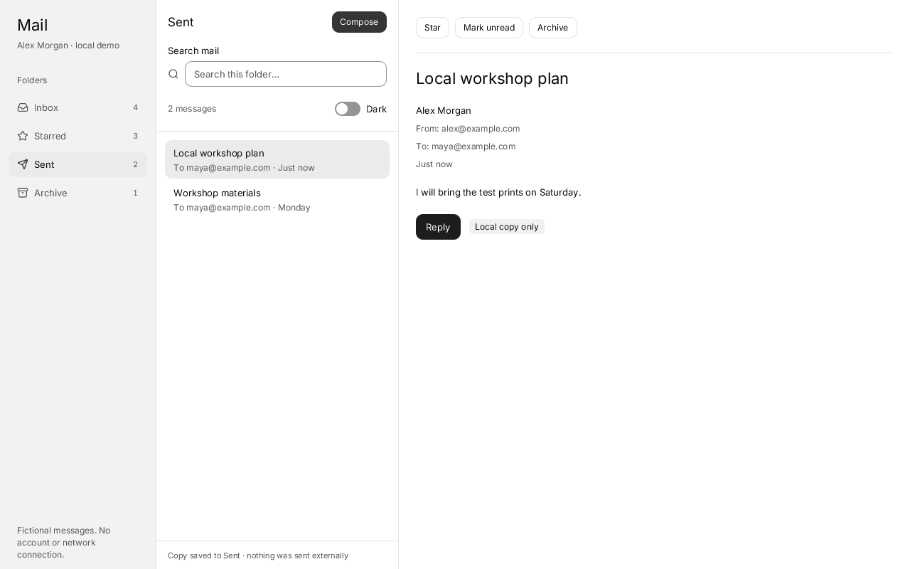
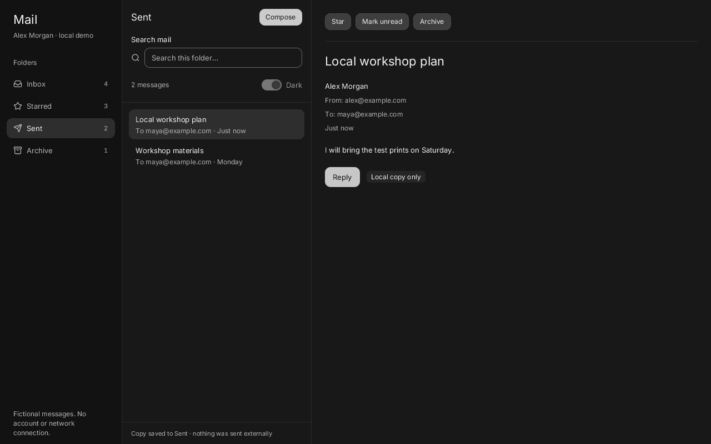
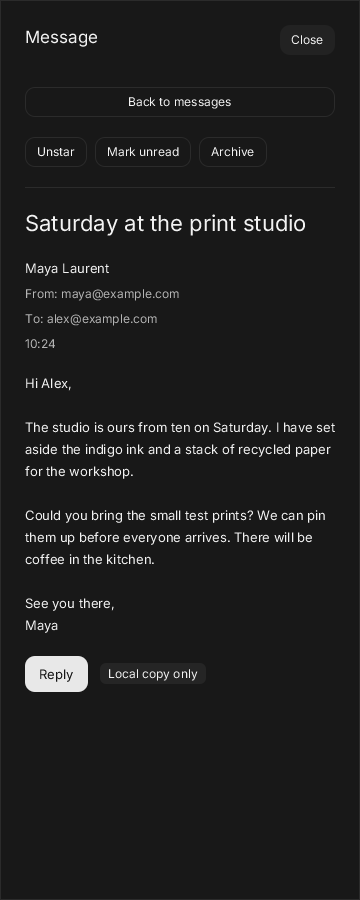

# Quiet Mail

A three-panel mail demo with fictional messages and memory-only changes. No account, backend, SMTP or network access. **Save to Sent** creates a local copy; it never delivers email. Closing the window resets everything.



```sh
build/zinc run examples/ui/mail --interp
build/zinc run examples/ui/mail --native
build/zinc run examples/ui/mail --engine quickjs
MAIL_DARK=1 build/zinc run examples/ui/mail
```

Choose Inbox, Starred, Sent or Archive. Search the current folder by sender, recipient, subject or message text; clear a search from its field or empty state. Open a message to mark it read, star or unstar it, toggle read status, archive it or move an archived message back to Inbox. Starred includes starred messages from every folder. Folder counts follow local changes.

Compose starts a fresh message. Reply fills the recipient and subject; add your own message. Saving requires one address, a subject and a message, then creates and selects a copy in Sent. The action is explicitly local. Discard, Close and Escape abandon the editor; reopening starts a fresh draft. There are no attachments, remote delivery, account controls or persistence.

Tab and Shift-Tab move focus, Enter or Space activates buttons, and arrows move through folders and message rows. Escape closes the current sheet or dialog and restores focus. The composer also accepts the platform's primary modifier plus Enter. Every action uses a named kit control and visible keyboard focus. Kit overlays supply opening and closing motion. Their reduced-motion behavior awaits a shared engine fix; the app adds no custom animation.

From 1000 px folders, messages and reading sit side by side. Between 700 and 999 px folders open in a drawer. Below 700 px the list fills the screen and reading opens a full-width sheet with **Back to messages**. Lists and reading content scroll independently. This uses modern `zinc:ui`; old-device display-tree performance is outside the demo's scope.





## Source and reuse

- `src/main.tsx` mounts the Quiet theme and app.
- `src/App.tsx` assembles panels, tracks the viewport and owns one explicit overlay lifecycle.
- `src/data.ts` contains fictional messages and domain types.
- `src/state.ts` owns the document's messages, filtering and editing actions.
- `src/components/` contains folders, message list, reader and composer, one component per file.

The demo reuses Sidebar, List/ListItem, Badge, SearchField, Input, Textarea, Button, Switch, EmptyState, Separator, Sheet and Dialog from `zinc:ui/kit`. No private widget framework or new dependency. [CUI's Mail example](https://github.com/yappologistic/CUI/blob/f70a1d3d095cafd67814b23bdd82c2dfba28efe0/examples/mail.c) inspired the folder/search/reader/composer arrangement and the three-to-two-to-one-panel response; code and sample data are our own.

## Proposed tests

- `build/zinc run examples/ui/mail --interp` (repeat with `--native` and `--engine quickjs`): replay folders, search/no results/clear, select/read/unread, star/unstar, archive/restore and compose/reply validation; inspect Sent and counts, about 15 seconds plus a cold native build, under 500 MB expected.
- `MAIL_DARK=1 ZINC_SIZE=360x900 build/zinc run examples/ui/mail --interp`: resize 1280→800→360→1280; open/close folders, reader and composer by keyboard and pointer; inspect light/dark, scrolling, restored focus and reduced motion, about 30 seconds, under 500 MB expected.
- `ZINC_DURATION=30000 build/zinc run examples/ui/mail --interp`: repeat editing/open/close, then leave idle and inspect memory and paint counts, about 30 seconds, under 500 MB expected. These estimates are not device performance measurements.
