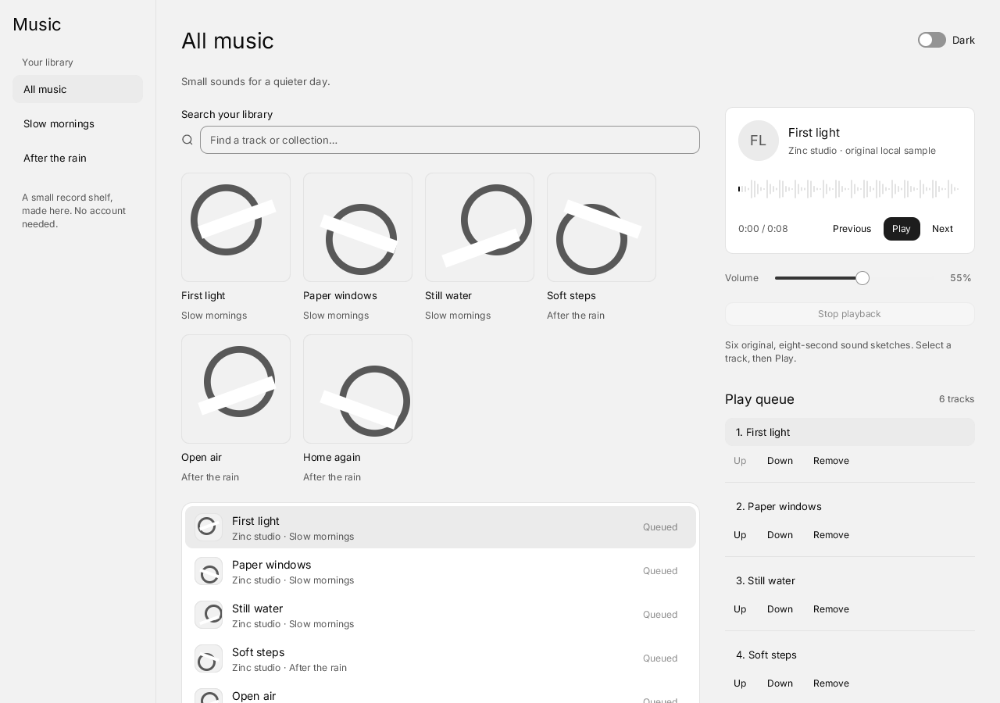

# Quiet Music

A local record shelf with six original eight-second sound sketches. Search by
track or collection, select a track, play or pause it, seek in its waveform and
change the volume. The queue supports selection, moving tracks up or down and
removal; an empty queue can be filled again from the library.



[Dark theme](pictures/dark-quickjs.png) · [Player and queue at 360 px](pictures/narrow-player-queue.png)

```sh
build/zinc run examples/ui/music --interp
build/zinc run examples/ui/music --native
build/zinc run examples/ui/music --engine quickjs
```

The library, search and queue are kept in memory for this window. This demo has no
login, streaming service, file importer or network traffic. Nothing starts playing
until Play is pressed. `MUSIC_DARK=1` starts in the dark theme; the Dark switch
changes it in place. The library navigation becomes a sheet on narrow windows;
the player and queue stack below the library and stay reachable by scrolling.

Tab and Shift-Tab reach every control, Enter or Space activate buttons, and arrows
navigate the track list. Focus the waveform to seek with arrows, Home and End;
focus the volume slider to adjust with arrows or Page Up/Down. The queue's named
Up, Down and Remove buttons also work from the keyboard.

## Implementation and assets

`src/main.tsx` assembles the app. `src/App.tsx` lays out the responsive regions;
`src/state.ts` owns the library, bounded unique queue and playback lifecycle.
`src/data.ts` contains track metadata and peaks measured from the generated PCM.
The components in `src/components/` compose the existing Quiet kit: List,
ListItem, SearchField, Button, Switch, Sheet, Slider and NowPlaying, which embeds
Waveform. The small cover component draws neutral geometry using theme roles.

Playback uses the existing `zinc:audio` asset-streaming Music provider. Only one
handle is open; selecting another track, Stop, an error or unmount closes it.
A generation guards delayed callbacks. The position is read from the audio
provider every 100 ms while playing; pause and stop cancel the timer. There is no
simulated progress. Without an output device, the provider uses a silent null
backend, whose clock moves only when the audio mix is driven; headless captures
therefore stay still unless a proof explicitly mixes samples.

All six WAV assets are original generated melodic sketches, eight seconds of
mono 8 kHz 16-bit PCM each (768,264 bytes together), rather than full songs.
Their waveform peaks come from those exact samples. The icon and covers are
original geometry. Asset provenance and CC0 dedication: [assets/LICENSE.txt](assets/LICENSE.txt).
The engine's existing audio plugin uses vendored miniaudio; no dependency was added.

The layout was inspired by CUI's [Music example](https://github.com/yappologistic/CUI/blob/f70a1d3d095cafd67814b23bdd82c2dfba28efe0/examples/music.c)
(MIT), with our own code, names and audio. Its UI-state transport is replaced here
by the existing local audio provider. Provider ownership and playback follow the
[miniaudio manual](https://miniaud.io/docs/manual/index.html).

Short headless runs and light/dark captures were checked on the interpreter, AOT
and QuickJS on macOS. The muted/null-mixer proofs cover the original app
controls, real playback position and seeking, queue completion and failure/retry,
root destruction, released stream slots and stale callbacks. The 360 px library
sheet and keyboard access to the player and queue were checked too. These checks
do not validate physical audio, touch devices or browser output.

## Proposed tests

- `tools/compat/timeout 30 env ZINC_AUDIO=null ZINC_HEADLESS=1 ZINC_FRAMES=60 ZINC_SIZE=360x900 build/zinc run examples/ui/music --interp`: narrow navigation, search, queue edits and waveform/volume keyboard session; approximately 15 seconds and 150 MB. Needs scripted input chosen by the owner.
- `tools/compat/timeout 60 env ZINC_BACKGROUND=1 build/zinc run examples/ui/music --native`: physical keyboard, trackpad, touch accessibility and audible start/pause/seek/queue completion; bound to 60 seconds, estimated 200 MB. Run on a quiet machine with permission to hear the sketches.
- Repeat the short feature session with `--engine quickjs`, then play/pause/unmount repeatedly: confirm audio handles, timers and stale callbacks are released; approximately 30 seconds, estimated 200 MB.
- A 60-second paused/playing/paused run on macOS, Linux and web: inspect idle redraws and output-device behavior. Device audio and physical accessibility remain separate checks; estimates above are planning values, not measurements.
