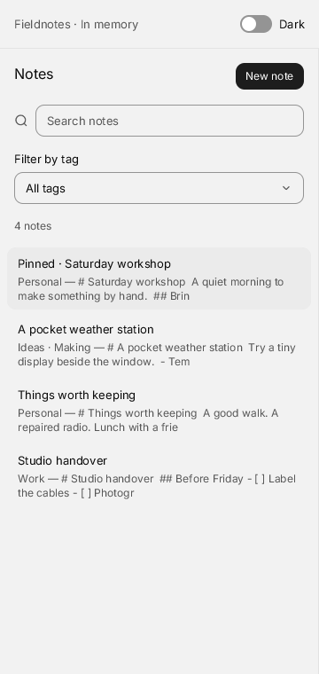

# Fieldnotes

A small notes workspace in the Quiet theme. Search titles, Markdown bodies and tags; filter by a tag, pin a note, or write a new one. Preview renders Markdown and its task checkboxes update the source. Title and tag changes apply immediately.



```sh
build/zinc run examples/ui/notes
build/zinc run examples/ui/notes --interp
build/zinc run examples/ui/notes --engine quickjs
NOTES_DARK=1 build/zinc run examples/ui/notes
```

On a narrow window the list and detail take turns. Open a note, then choose **All notes** to return; desktop windows show both. Tab and Shift-Tab reach controls, Enter activates them, arrow keys switch Preview/Edit and choose tags, and Escape cancels deletion. Inside the body editor, Tab indents and Escape returns to its group. Delete asks for confirmation and initially focuses Cancel. Add a tag with Enter or a comma; its named remove button removes it.

These are fictional notes held **only in memory**. Closing the window resets the sample data. There are no files, accounts, network calls, sync or version history. Markdown HTML is disabled; links are displayed as text. Linux and web targets are declared but have not been exercised for this demo.

`src/main.tsx` composes the screen, theme and focus handoff. `state.ts` owns the notes and actions; `NoteList.tsx` and `NoteEditor.tsx` compose the two panes. There is no private widget or Markdown implementation: the demo uses the kit's ListItem, SearchField, Select, Input, TagInput, Tabs, CodeEditor, MarkdownView, EmptyState, Button, Switch and Dialog. CodeEditor owns its editor lifetime; MarkdownView uses the existing md4c provider. The app starts no timer or frame callback.

The split view and note actions are inspired by [CUI Notes](https://github.com/yappologistic/CUI/blob/f70a1d3d095cafd67814b23bdd82c2dfba28efe0/examples/notes.c) (MIT). Zinc code and sample content were written independently. Confirmation follows the [W3C APG guidance](https://www.w3.org/WAI/ARIA/apg/patterns/alertdialog/examples/alertdialog/) to focus the safe action first.

## Proposed tests

These are proposals, not a committed test session.

- `ZINC_HEADLESS=1 ZINC_SIZE=360x760 ZINC_FRAMES=90 ZINC_INPUT=<chosen-tape> build/zinc run examples/ui/notes --interp`: open/create/edit a note, tags, body/tag search, Preview/Edit, task checkbox, pin/unpin, cancel/confirm delete, delete all and create from empty; about 5 s, estimated under 300 MB RSS.
- Repeat the chosen tape with `--native` and `--engine quickjs`, in light and `NOTES_DARK=1`, at 360×760 and 1080×760: input/focus parity and readable responsive layouts; about 30 s with a warm AOT cache, estimated under 500 MB RSS.
- `ZINC_HEADLESS=1 ZINC_FRAMES=300 build/zinc run <chosen-idle-probe> --interp`: import the real entry, count paints with `ui.setAfterPaint`, then reopen to confirm data reset; about 5 s, estimated under 300 MB RSS.
- Replay delete/open/Escape while sending `reducemotion 1`: confirm final state, focus and reduced-motion dialog behavior; about 5 s, estimated under 300 MB RSS. The shared layer motion issue found during this batch is recorded in the task notes.
