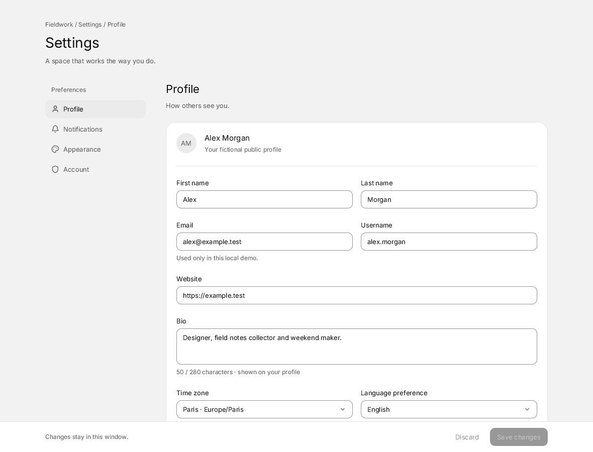
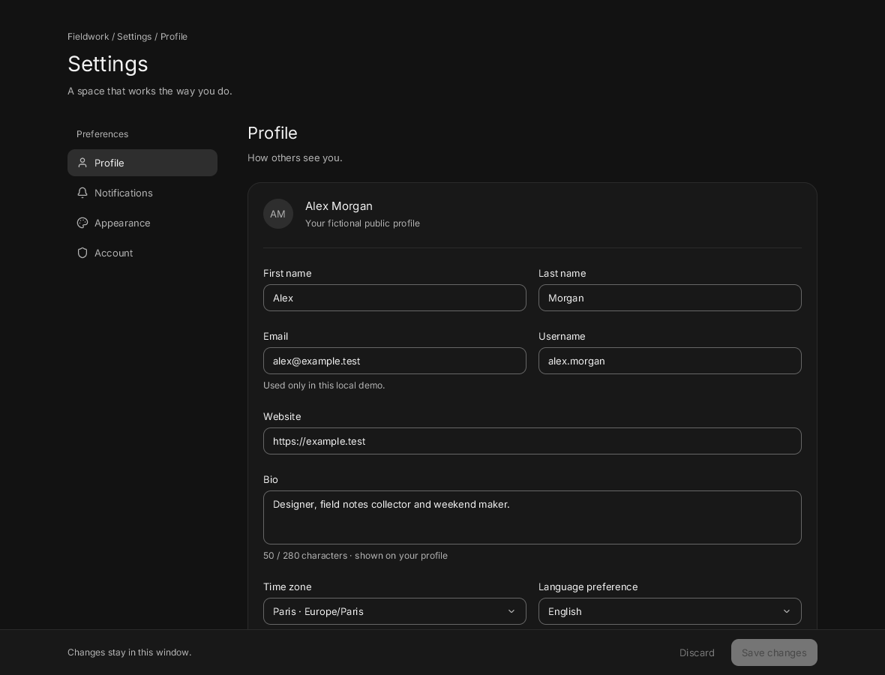
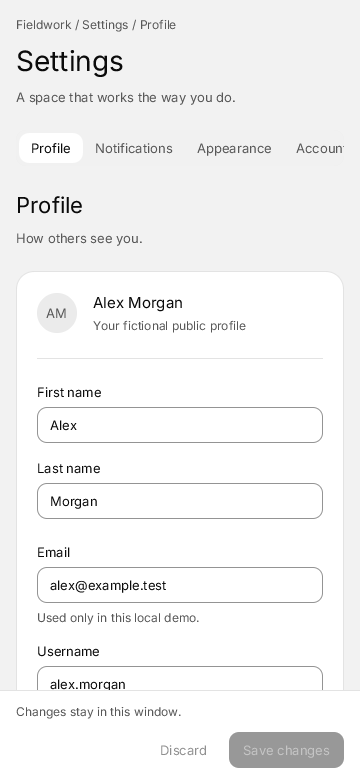

# Fieldwork Settings

A local settings app for a fictional workspace. Profile, notifications, appearance and account pages compose the existing Quiet kit. No backend, files, real account or authentication is involved.



```sh
build/zinc run examples/ui/settings --interp
build/zinc run examples/ui/settings --native
build/zinc run examples/ui/settings --engine quickjs
SETTINGS_DARK=1 build/zinc run examples/ui/settings
```

Edit the profile, notification preferences, theme, accent or reduced motion. **Save changes** validates the profile and replaces this window's saved snapshot. **Discard** restores that snapshot, including the appearance preview. Both buttons reflect actual changes, including edits made on another page. Enter in a profile field also saves. Names, email, username, optional HTTPS website and bio have inline validation; invalid settings cannot replace the saved snapshot.

Everything resets when the window closes. Time zone and language are stored sample preferences; the interface stays in English. Notification preferences send nothing and request no OS permission. The account page's session action only changes its fictional list and explicitly reports the simulation; it is independent of the preferences snapshot.



Tab and Shift-Tab move between controls, with visible keyboard focus. Sidebar arrows move focus and Enter opens a page. Below 760 px the sidebar becomes horizontally scrollable tabs: arrows select a page and reveal its tab. Fields stack below 960 px; the page scrolls while Save and Discard stay reachable. Selects use arrows and Enter; Escape dismisses the menu. Space changes a checkbox or switch, and arrows change radio and theme groups. The kit's motion follows the shared reduced-motion preference, initialized from the system.



This is a `zinc:ui` demo for desktop and recent mobile hardware. Touch behavior, physical accessibility tools and old-device performance have not been validated.

## Source layout

- `src/main.tsx` selects Quiet and mounts the app.
- `src/App.tsx` owns the responsive layout and composes the pages.
- `src/state.ts` owns one window's draft, saved snapshot, validation and appearance preview.
- `src/pages/` holds one component per page; each composes kit controls.

The [CUI settings example](https://github.com/yappologistic/CUI/blob/f70a1d3d095cafd67814b23bdd82c2dfba28efe0/examples/settings.c) (MIT) inspired the section navigation, form grouping, responsive tabs and Save/Discard footer. Zinc code and fictional data are original. The snapshot restoration is functional rather than merely clearing a dirty flag.

## Proposed tests

Future milestone checks for the owner to choose; no demo suite is added:

- Replay profile validation, Enter save, edit/discard, cross-page notification edits and appearance save/restore through real controls on all three engines; about 10 seconds plus a cold native build, under 500 MB expected.
- Resize 1180→760→360→1180, use Tab/Shift-Tab, navigation arrows, select menus and scrolling, inspect light/dark and reduced motion with physical keyboard, touch and VoiceOver; about 60 seconds, under 500 MB expected.
- Repeat page navigation and edits, then leave the app idle and inspect paint counts and memory; about 30 seconds, under 500 MB expected. No idle-energy or memory claim is made here.
