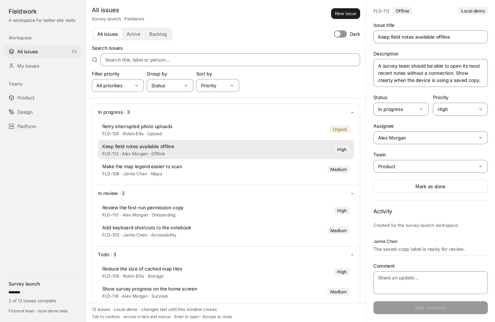
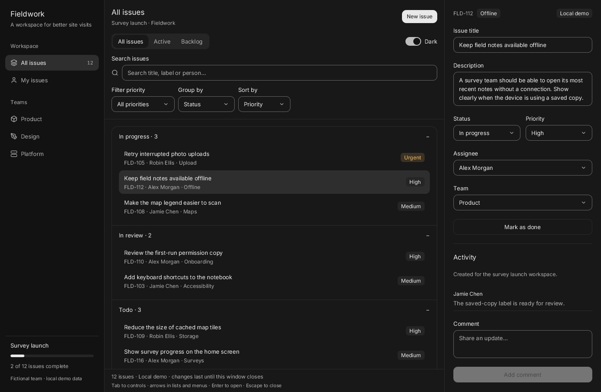
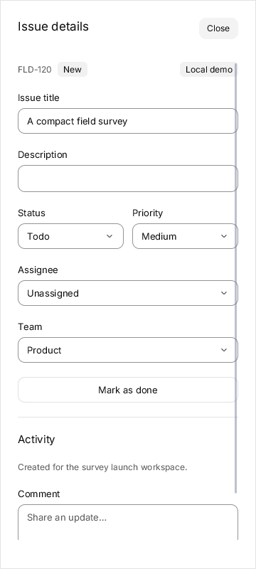

# Fieldwork Tracker

A local issue tracker for a fictional survey team. The Quiet theme keeps the sidebar, grouped issue list and editable detail panel readable in light and dark. No server, account or repository access is needed. All changes live in memory and reset when the window closes.



```sh
build/zinc run examples/ui/tracker --interp
build/zinc run examples/ui/tracker --native
build/zinc run examples/ui/tracker --engine quickjs
TRACKER_DARK=1 build/zinc run examples/ui/tracker
```

Search titles, descriptions, labels or people. Choose a team or **My issues**, switch between all/active/backlog views, filter priority, group by status or assignee, and sort by priority or title. Group headings collapse. Select an issue to edit its title, description, status, priority, assignee or team; mark it done or reopen it, and add a comment. **New issue** creates and selects a fresh local ticket. Progress reflects the actual completed count.

Tab and Shift-Tab move between controls. Arrows navigate sidebar links, issue rows, tabs, group headings and select options; Enter or Space activates. Escape dismisses the current menu, drawer, detail sheet or create dialog. Focus is visible for keyboard use. The kit handles reduced motion.

From 1200 px the detail sits alongside the list. Smaller windows open it in a scrollable sheet; below 760 px the sidebar moves into a drawer. On phones the list keeps its title and person while hiding the secondary priority badges. The toolbar wraps, and the list and detail scroll independently. This is a modern `zinc:ui` demo for desktop and recent mobile hardware; old-device display-tree performance is outside its scope.





## Source layout

- `src/main.tsx` selects the Quiet theme and mounts the app.
- `src/App.tsx` composes the layout and owns its overlay lifecycle and viewport subscription.
- `src/data.ts` defines the fictional sample issues and domain types.
- `src/state.ts` creates one document's data, filters, ordering and editing actions.
- `src/components/` holds the sidebar, grouped list, issue detail and create dialog, one component per file.

The demo reuses the kit's Sidebar, Accordion, List/ListItem, Input, Textarea, SearchField, Select, Tabs, Switch, Badge, Progress, EmptyState, Dialog and Sheet. It has no private widget framework or import-time file/network service. The [CUI tracker](https://github.com/yappologistic/CUI/blob/f70a1d3d095cafd67814b23bdd82c2dfba28efe0/examples/tracker.c) inspired the layout and narrow-screen behavior; code and sample data are our own.

## Proposed tests

These are future milestone checks, not a new demo test suite:

- Replay search, no results, team/my-issue filters, grouping, sorting, edits, status/reopen, comment and creation through real inputs on all three engines; prove rendered values and focus, about 10 seconds plus a cold native build, under 500 MB expected.
- Resize 1380→800→360→1380, open/close the drawer, detail sheet and dialog by pointer/keyboard, scroll their content, inspect light/dark and reduced motion; about 30 seconds, under 500 MB expected.
- Leave the screen idle, then repeat open/edit/close cycles and inspect memory and paint counts; about 30 seconds, under 500 MB expected. No idle or memory claim has been measured here.
