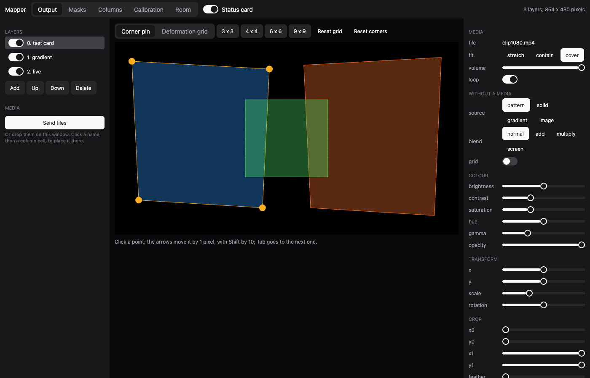
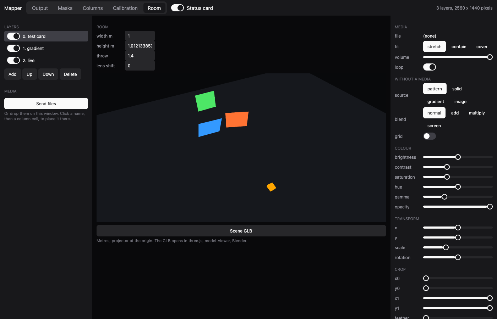

# Mapper

**Anything with an HDMI port becomes a video-mapping player.** Plug a cheap box into a projector, send it your media from a
browser, and pin the picture onto the wall, the stage or the building in front of you. No media server, no laptop left behind:
the show lives on the device and starts again by itself.

Mapper is a demo of Zinc and a real tool. It runs today on a €50 Android 4.4 pico projector (Rockchip RK3128, Mali-400) at its
panel's full 59 images per second, with a 1080p video on a warped, masked layer.



## Start

```sh
zinc run examples/video/mapper                  # on this computer
```

It prints the address of its editor, and shows it as a QR code on the output:

```text
mapper: editor at http://192.168.2.172:8080/?token=a121af90afbe48eb
```

Open it in any browser on the same network. The editor is itself a Zinc app, so the same program also runs natively:

```sh
zinc run examples/video/mapper/editor -- --app http://192.168.2.172:8080/?token=a121af90afbe48eb
```

The editor is built once, into the mapper's assets. The mapper explains this if you forget:

```sh
zinc export examples/video/mapper/editor --target web -o examples/video/mapper/assets/editor
```

On the device: the left and right arrows of the remote change column, Select shows or hides the status card. On a computer: Tab
is the status card, F fullscreen, Esc quits. Options: `--media <folder>`, `--port <osc port>`, `--web <port>` or `--web off`.

## How you work

1. **Pin the surfaces.** In *Output*, drag a layer's corners onto the real object while watching the wall. Click a point: the
   arrows move it by one pixel of the output, with Shift by ten, and Tab goes to the next point. Curved or uneven surface? Open
   *Deformation grid*, pick 3 x 3 up to 9 x 9, and move any point of the grid, as in Resolume.
2. **Cut the shapes.** In *Masks*, add a polygon mask and click around the shape; set its feather, or invert it. Crop and edge
   blend are in the same view, for two projectors that overlap.
3. **Measure, then make the media.** In *Calibration*, each layer tells how many pixels it really covers on the output, and the
   size to give a media so that it is neither stretched nor wasted. Download a template (see below), compose over it in your tool,
   and export at that size.
4. **Send the media.** Drop files on the window or use *Send files*. They are copied to the device, with progress, and a broken
   transfer leaves nothing behind.
5. **Build the show.** In *Columns*, one row is a layer, one column a moment of the show. Click a media name, click a cell, and
   click a column's title to play it. The remote steps through the columns; the last one played comes back after a restart.

### A 1920x1080 media in a smaller zone

Nothing to prepare: a layer takes any media and draws it in its zone. `fit` says how: **stretch** fills the zone and deforms,
**contain** shows the whole picture with bars, **cover** fills the zone and cuts what exceeds. The device's GPU does the scaling,
so a big file costs decoding, not drawing. A file at the size *Calibration* gives looks sharper and decodes more easily, which is
what counts on small hardware.

### What you take to Premiere, Cavalry or After Effects

| From *Calibration* | What it is |
| --- | --- |
| **Template SVG** of a layer | the flat media as it must be drawn, with the deformation grid; import it on top of your composition |
| **Stage SVG** | the whole output as the projector draws it: every surface where it is, for a piece that crosses several |
| **calibration.json** | the snapshot of the setting: sizes in pixels, corners, grids, for a script or another tool |

### The room in 3D

Enter a surface's real size and the projector's throw ratio in *Room*: the editor works out where each surface stands in the room
from its corners, and shows the scene with three.js, in the browser and in the native client. Drag to turn around it, use the wheel
to move closer. **Scene GLB** saves it (in metres, the projector at the origin) for a web page with three.js or `model-viewer`, or
for Blender.



The size you type is what fixes the scale: the corners alone give the shape, not the metres.

### Sound

On Android a layer plays the sound of its media, with its own volume in the layer's settings. On a computer the layers show the
picture only for now.

## What runs where

| Device | State |
| --- | --- |
| macOS | runs; video through `zinc:video`, no sound on layers |
| Android 4.4, RK3128, Mali-400 (Toumei C800) | runs at 56-57 images per second shown on a 59 Hz panel, hardware decoding, sound |
| Android 5 and later (Xiaomi box, Chromecast) | the same APK should run; not tried yet |
| Raspberry Pi 3 and later | builds; not run on hardware |

Android 4.4 is below Zinc's export floor, so its APK takes a patch after the export:

```sh
zinc export examples/video/mapper --target android
sh docs/reports/hardware/toumei-c800-api19.sh apply examples/video/mapper/dist/mapper-android
```

## Control it from anything

The editor speaks one small HTTP API, and every setting is also an OSC command on UDP 9000: a lighting desk, TouchOSC or a script
can drive a show. The address space is in [docs/plugins/mapping.md](../../../docs/plugins/mapping.md); `/column <n>` plays a column
and `/hud <0|1>` shows the status card.

Anyone who has the token controls the mapper, and OSC has no token at all: keep the device on a network you trust.

## Where it goes

- **A fleet, in sync.** Every device keeps its own media and plays from one shared clock, the way Sonos and AirPlay 2 groups do.
  This is studied, not built: the design and its limits (one refresh at worst without genlock) are in
  [docs/reports/mapper-fleet-sync.md](../../../docs/reports/mapper-fleet-sync.md).
- **Live from a master.** Devices joined by Ethernet, following one operator's edits and sources. Later.
- **An iOS companion** that scans the room and gives the 3D model. Later, if the typed sizes turn out not to be enough.

## The code

| Path | Role |
| --- | --- |
| `src/main.ts` | composes everything, the frame loop, the remote's keys |
| `src/layers.ts`, `src/live.ts`, `src/hud.ts` | the demo layers, a live image, the status card and its QR code |
| `src/services/` | one file per outside thing: `web` (the editor's server), `mediaStore`, `show` (columns), `control` (commands), `layerMedia` (video on a computer) |
| `editor/src/model/` | the maths, with no interface: warp, the surface's pose from its corners, the GLB, the SVG templates |
| `editor/src/components/`, `editor/src/services/` | the editor's views, its link to the mapper, its file dialogs |
| `tests/` | `model_check.ts` (the maths), `editor-check.mjs` (the HTTP API) |
